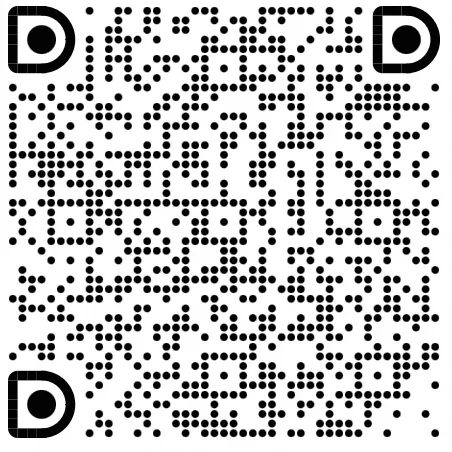

<div align="center">

<picture>
  <source
    media="(prefers-color-scheme: dark)"
    srcset="docs/images/brand/anolisa-lockup-dark.svg"
  >
  <source
    media="(prefers-color-scheme: light)"
    srcset="docs/images/brand/anolisa-lockup-light.svg"
  >
  
</picture>

<sub>**A**gentic **N**exus **O**perating **L**ayer & **I**nterface **S**ystem **A**rchitecture</sub>

**A system software stack for AI Agents.**

[中文版](README_zh.md) · [Website](https://agentic-os.sh/) ·
[Get Started](#get-started) · [User Guide](https://agentic-os.sh/docs/user-guide/) ·
[Contribute](CONTRIBUTING.md)

[](LICENSE)
[](https://agentic-os.sh/docs/user-guide/getting-started/installation/)
[](https://aarm.dev/builders/agentseccore-anolisa)
[](docs/user-guide/en/agent-sec-core/owasp-agentic-top10.md)

</div>

**ANOLISA is a multi-component system software stack for AI Agent workloads.**
Built on existing operating system kernels and infrastructure, it provides
context management, Skills delivery, workspace recovery, security, and
observability for Agent applications, frameworks and platforms.
**Users** can carry out tasks in a native terminal that preserves a familiar
Shell experience, and enable system-level optimizations for their Agents'
runtime environments. **Developers** can extend the stack through
[AW's open architecture](https://agentic-os.sh/docs/developer-guide/aw/providers/)
by integrating their own system software optimized for Agent workloads into ANOLISA.

> **ANOLISA vs. Agentic OS:** Agentic OS describes a class of operating systems
> designed for AI Agent workloads. Our community takes a neutral and open
> approach to exploring this direction; ANOLISA is the core system software
> stack in the Agentic OS architecture we design.

<a id="get-started"></a>

## 1. Get started

ANOLISA offers three ways to get started: use a **preinstalled image** to
experience the full capabilities of an Agentic OS; install the system software
stack on an existing OS to **extend it into an Agentic OS**; or connect an
existing Agent application, framework, or harness to
**enable configurable system-level optimizations**.

<a id="preinstalled-images-and-agentic-computers"></a>

### 1.1 Start from an image

In a ready-to-use preinstalled system environment, you can use familiar Shell
workflows in cosh and call system tools and Skills through natural language.
After installing and configuring the relevant components, you can also use
Agent Semantic Layer capabilities such as context compression, workspace
snapshots and recovery, security, and observability. Container base images
provide a starting point for building your own Agent runtime environment.

The [Images and cloud services](docs/user-guide/en/getting-started/images.md)
catalog lists available images, their preinstalled software, download or pull
addresses, and cloud service entry points. Vendors and community contributors
can add image or cloud service entries and usage instructions to the catalog.

<a id="integrate-anolisa-into-an-agent-platform-image"></a>

Developers of Agent platforms and Agent runtime infrastructure can preinstall
ANOLISA packages in Agent, sandbox, or business images. See the
[base image catalog](docs/user-guide/en/getting-started/images.md#container-base-images)
and [package installation guide](https://agentic-os.sh/docs/user-guide/getting-started/installation/).

<a id="convert-an-existing-os-into-an-agentic-os"></a>

### 1.2 Convert an existing OS into an Agentic OS

If you already run a supported Linux system, you can install ANOLISA's system
software stack to add runtime capabilities for Agent workloads. You can install
cosh, OS Skills, and the Agent Semantic Layer components you need, use cosh as
the terminal entry point, and configure model access and the relevant services.

First read the [installation guide](https://agentic-os.sh/docs/user-guide/getting-started/installation/)
to check platform requirements, then install the packages and configure the
services. Follow the [cosh first-use guide](https://agentic-os.sh/docs/user-guide/cosh-ng/)
to begin using the terminal.

<a id="plugin-packages-for-an-existing-agent-framework"></a>

<a id="12-enable-anolisa-for-an-existing-agent"></a>

### 1.3 Enable ANOLISA for an existing Agent

If you want to keep using an existing Agent application, framework, or harness,
you can enable ANOLISA's headless system capabilities in its runtime environment
through adapters and plugins. You can continue using the Agent's interface,
model account, and workflow.

For the currently available workflow, see [installation and adapter integration](https://agentic-os.sh/docs/user-guide/getting-started/installation/).

<a id="why-anolisa"></a>

## 2. Why ANOLISA?

**ANOLISA is a system software stack that enhances Agent applications,
frameworks, and harnesses without replacing them.**

When Agents plan tasks and call tools, they also need their runtime environments
to provide context management, Skill discovery, action constraints, and execution
records. ANOLISA improves an Agent's working environment in the following ways:

- **Keep context for useful information.** Tool output compression shortens
  lengthy results. Persistent memory lets Agents retrieve and reuse information
  across sessions, reducing repeated reads.
- **Find system Skills for the task.** Agents can consult OS instructions and
  discover and read the Skills they need for a task.
- **Constrain actions and recover workspace changes.** Security policies and
  underlying isolation mechanisms constrain Agent actions. Workspace snapshots
  let users inspect file changes and roll them back when needed.
- **Understand how a task ran.** You can inspect an Agent's model and tool calls,
  trajectories, and Token usage to investigate task failures and analyze runtime
  costs.

We welcome **OS vendors and distribution communities** to adopt and help develop
ANOLISA, integrating it into existing distributions or incorporating it into
their Agentic OS architecture from the outset.

**Enterprise Agent governance platform developers** and **sandbox service providers**
can also preinstall ANOLISA in their runtime environments to provide context
management, security, and observability for the Agent workloads they host.

<a id="examples"></a>

<a id="5-examples"></a>

## 3. Examples

<table width="100%">
  <tr>
    <td width="33%" align="center" valign="top">
      <video
        controls
        muted
        preload="metadata"
        width="240"
        src="https://github.com/user-attachments/assets/ed6952c6-19da-44c7-ae35-85d753bdccf9"
      ></video>
      <br>
      <sub><strong>Observability: Observe an Agent run</strong><br>Inspect model and tool calls, execution trajectories, and Token usage.<br><a href="https://agentic-os.sh/docs/user-guide/agentsight/">Reproduction guide</a></sub>
    </td>
    <td width="33%" align="center" valign="top">
      <video
        controls
        muted
        preload="metadata"
        width="240"
        src="https://github.com/user-attachments/assets/b372ae72-44fa-492f-9feb-e6cd137b631a"
      ></video>
      <br>
      <sub><strong>Context compression: See tool output compression</strong><br>Try Tokenless and inspect tool output compression and changes in Token usage.<br><a href="https://agentic-os.sh/docs/user-guide/tokenless/measuring-savings/">Reproduction guide</a></sub>
    </td>
    <td width="33%" align="center" valign="top">
      <video
        controls
        muted
        preload="metadata"
        width="240"
        src="https://github.com/user-attachments/assets/aad6e296-7c5a-4a81-be2e-ea4f49e43637"
      ></video>
      <br>
      <sub><strong>Security: Detect Skill file changes</strong><br>Use Qoder to check Skill file changes and inspect rescan results.<br><a href="https://agentic-os.sh/docs/user-guide/agent-sec-core/qoder-skill-ledger-demo/">Reproduction guide</a></sub>
    </td>
  </tr>
</table>

<a id="components"></a>

<a id="3-components"></a>

## 4. Components

ANOLISA's components are organized into the User Entrypoint Layer, AW Unified
Stack Layer, and Agent Semantic Layer. See the [glossary](#glossary) for each
layer's role.

<a id="31-user-entrypoint-layer"></a>

### 4.1 User Entrypoint Layer

| Component | What it adds |
|---|---|
| [cosh (cosh-ng)](https://agentic-os.sh/docs/user-guide/cosh-ng/) | An AI-native terminal that preserves a familiar Shell experience, letting users call tools and Skills through natural language to complete tasks. |
| [OS Skills](https://agentic-os.sh/docs/user-guide/os-skills/) | An OS handbook for AI Agents, covering system administration, monitoring, security, DevOps automation, and more. |

<a id="32-unified-integration-layer"></a>

<a id="42-unified-integration-layer"></a>

### 4.2 AW Unified Stack Layer

| Component | What it adds |
|---|---|
| [AW](https://agentic-os.sh/docs/user-guide/aw/) | A unified architecture connecting Agent frameworks with extensible AI-native system software. |

<a id="33-agent-semantic-layer"></a>

### 4.3 Agent Semantic Layer

| Component | What it adds |
|---|---|
| [Tokenless](https://agentic-os.sh/docs/user-guide/tokenless/) | Reduce AI Agent Token usage through tool output compression, tool schema simplification, command rewriting, and other techniques. |
| [Agent Memory](https://agentic-os.sh/docs/user-guide/agent-memory/) | Store persistent memories that Agents can retrieve and reuse in later sessions. |
| [SkillFS](https://agentic-os.sh/docs/user-guide/skillfs/) | Organize Skills into stable filesystem views for Agents to discover and read on demand. |
| [Workspace Checkpoint (ws-ckpt)](https://agentic-os.sh/docs/user-guide/ws-ckpt/) | Create Agent workspace snapshots so users can compare file differences and roll back changes when needed. |
| [Agent Security Core](https://agentic-os.sh/docs/user-guide/agent-sec-core/) | OS-level security kernel for AI Agents. |
| [AgentSight](https://agentic-os.sh/docs/user-guide/agentsight/) | Observe Agent execution through trajectories, LLM calls, and Token usage. |

[ANOLISA CLI](distribution/anolisa/README.md) manages component installation and
lifecycle. [ktuner](https://agentic-os.sh/docs/user-guide/ktuner/) inspects Linux
kernel parameters, provides tuning recommendations, and can apply or roll back
kernel parameter changes. See [Installation](https://agentic-os.sh/docs/user-guide/getting-started/installation/)
for each component's supported platforms.

<a id="open-architecture"></a>

<a id="4-open-architecture"></a>

## 5. Open architecture

Within ANOLISA's AW Unified Stack Layer, AW connects Agents to the system
software that supports them. Developers can build adapters for Agents that AW
does not yet support, or create system software optimized for Agent workloads
and expose its capabilities to ANOLISA through the Provider protocol. The
existing Agent application or framework continues to manage its models,
interface, and permissions.

AW currently integrates command safety checks and tool-content optimization,
and can correlate AgentSight execution records through optional configuration.
The existing operating system, kernel, and sandbox provide the underlying
resources and isolation mechanisms. ANOLISA is designed for environments
including AI PCs and cloud desktops, Agent applications and frameworks, Agent
platforms, and Agent runtime infrastructure.

<a id="configuration-and-execution-example"></a>

<a id="41-configuration-and-execution-example"></a>

### 5.1 Configuration and execution example

This example enables safety checks and context optimization in one configuration.
Before running it, follow [AW installation](https://agentic-os.sh/docs/user-guide/aw/installation/)
to install the Linux Preview version of `aw-all-in-one` and set `AW_PREFIX` and
`PATH`. Then start sec-core using the [security backend setup](https://agentic-os.sh/docs/user-guide/aw/security/).
CI packages require a Linux x86_64 system with glibc 2.39 or later. You also need
Qoder CLI 1.1.64 or later, installed and signed in.

Run the following commands as the user who normally runs Qoder to create a new
`anolisa.yaml` and start the Agent. The socket path below connects to the local
trial backend in the security guide. If you are connecting to another existing
security backend, set `AW_SEC_SOCKET` to that service's actual socket path.

```bash
export AW_HOME="$HOME/aw"
export AW_SEC_SOCKET=/run/aw-preview-sec/daemon.sock
install -d -m 700 "$AW_HOME" "$AW_HOME/workspace"
aw config init --prefix "$AW_PREFIX" \
  --config "$AW_HOME/anolisa.yaml" --state-dir "$AW_HOME/anolisa-state" \
  --qoder "$(command -v qodercli)" \
  --provider sec-core+tokenless --socket "$AW_SEC_SOCKET"
aw validate --config "$AW_HOME/anolisa.yaml"
cd "$AW_HOME/workspace"
aw run --config "$AW_HOME/anolisa.yaml" --agent qoder
```

For tool calls covered by the configuration, sec-core performs safety checks
before the tool executes. After a tool succeeds, Tokenless attempts to compress
supported text results. Once the Agent has called a tool, open another terminal,
set the same `PATH` and `AW_HOME` as the terminal used to start the Agent, and run
the following commands to inspect execution records:

```bash
aw status --config "$AW_HOME/anolisa.yaml"
aw inspect --config "$AW_HOME/anolisa.yaml" --json
```

After exiting the Agent, run `aw stop --config "$AW_HOME/anolisa.yaml"` to stop
the local AW service. Then stop the security backend with the command appropriate
to how you started it. See the [AW user guide](https://agentic-os.sh/docs/user-guide/aw/)
for other Agent integrations, rule configuration, and observability integration.

<a id="develop-and-extend"></a>

<a id="42-develop-and-extend"></a>

### 5.2 Develop and extend

Choose a guide for the integration you want to build:

- [Agent and framework integration](https://agentic-os.sh/docs/developer-guide/aw/) — learn how to connect AW to an Agent application's or framework's native execution flow.
- [Provider development and protocol](https://agentic-os.sh/docs/developer-guide/aw/providers/) — learn how to expose your system software to ANOLISA through the Provider protocol.
- [SDK guide](https://agentic-os.sh/docs/developer-guide/sdk/) — learn how to call component capabilities from application code.

<a id="documentation-and-development"></a>

## 6. Documentation and development

| Goal | Start here |
|---|---|
| Install, configure, and use components | [User Guide](https://agentic-os.sh/docs/user-guide/) · [Installation](https://agentic-os.sh/docs/user-guide/getting-started/installation/) · [Troubleshooting](https://agentic-os.sh/docs/user-guide/getting-started/troubleshooting/) |
| Embed a component capability in an application | [SDK guide](https://agentic-os.sh/docs/developer-guide/sdk/) |
| Connect an Agent or framework to AW | [AW integration](https://agentic-os.sh/docs/developer-guide/aw/) |
| Develop and distribute an AW Provider | [Provider development and protocol](https://agentic-os.sh/docs/developer-guide/aw/providers/) · [Provider implementations](providers/README.md) |
| Contribute to ANOLISA | [Contribution guide](CONTRIBUTING.md) · [Component chapters](https://agentic-os.sh/docs/contribute/) |

<a id="repository-layout"></a>

## 7. Repository layout

The repository contains runtime components, distribution tooling, evaluation
tools, and retained legacy implementations. When a component's source moves to
another directory, its commands, package names, and release tags stay the same.

| Directory | Contents |
|---|---|
| [`src/`](src/) | Runtime components, including AW, cosh-ng, and components providing observability, security, memory, and sandbox capabilities. Each component keeps its own build and test entry points. |
| [`providers/`](providers/README.md) | AW Provider collaboration space. Each Provider implementation has its own workspace, examples, and contract tests. |
| [`distribution/`](distribution/) | Distribution tooling and images. `anolisa/` owns the installation CLI, component manifests, and packaging resources; `docker/` defines the integrated ANOLISA image. |
| [`benchmark/`](benchmark/) | Cross-component evaluation runners: ClawEval, SWE, and Terminal Bench. Component-specific benchmarks stay with their components. |
| [`deprecated/`](deprecated/) | Retained legacy implementations and their archived documentation. |
| [`scripts/`](scripts/) | Repository-wide build, packaging, and validation scripts. |
| [`tests/`](tests/) | Repository-wide regression checks and test orchestration. Component tests remain local to each component. |
| [`contribute/`](contribute/) | Component contribution guides, linked from the contribution guide at the repository root. |
| [`docs/`](docs/) | User and developer guides, source-build instructions, and shared documentation assets. |
| [`specs/`](specs/) | Contribution standards, component onboarding, and documentation rules. |
| [`website/`](website/) | Public website source and generators. Generated output is not a second documentation source. |
| [`.github/`](.github/) | CI, release workflows, component routing metadata, and ownership. |

Before changing files, read [AGENTS.md](AGENTS.md) for repository rules, component
locations, and build/test commands, then read the component's scoped `AGENTS.md`
when present. See [CONTRIBUTING.md](CONTRIBUTING.md) for the contribution workflow.
When moving source code, update `.github/components.json` and the paths used by
build, release, ownership configuration, and documentation entry points. Keep
the component's commands, package names, and release tags unchanged.

<a id="community"></a>

## 8. Community

<div align="center">



Scan with DingTalk to join the ANOLISA community.

</div>

- [Open an issue](https://github.com/agentic-os-org/ANOLISA/issues) if you encounter
  a problem or want the project to support a new Agent use case.
- Read [CONTRIBUTING.md](CONTRIBUTING.md) before submitting a pull request.
- Report vulnerabilities through the [Security Policy](SECURITY.md).

<a id="license"></a>

## 9. License

ANOLISA is released under the [Apache License 2.0](LICENSE).

<a id="more-resources"></a>

## 10. More resources

[User Guide](https://agentic-os.sh/docs/user-guide/) ·
[Troubleshooting](https://agentic-os.sh/docs/user-guide/getting-started/troubleshooting/) ·
[Build from Source](https://agentic-os.sh/docs/user-guide/getting-started/building/) ·
[Changelog](https://agentic-os.sh/changelog/) ·
[For Agents](https://agentic-os.sh/agents/)

Security references for Agent Security Core:
[AARM registry entry (Aligned)](https://aarm.dev/builders/agentseccore-anolisa) ·
[OWASP Agentic Top 10 control mapping](docs/user-guide/en/agent-sec-core/owasp-agentic-top10.md).

Blaze has moved to its standalone repository,
[blaze-rs](https://github.com/agentic-os-org/blaze-rs).

<a id="glossary"></a>

## 11. Glossary

| Term | Meaning |
|---|---|
| ANOLISA | A multi-component system software stack for AI Agent workloads. |
| Agentic OS | A form of operating system designed for AI Agent workloads. |
| User Entrypoint Layer | cosh provides terminal interaction for users; OS Skills provides OS instructions for Agents. |
| AW Unified Stack Layer | AW connects Agent applications and frameworks above this layer with extensible system software below it. |
| Agent Semantic Layer | Components providing context management, memory, Skills delivery, workspace recovery, security, and observability. |
