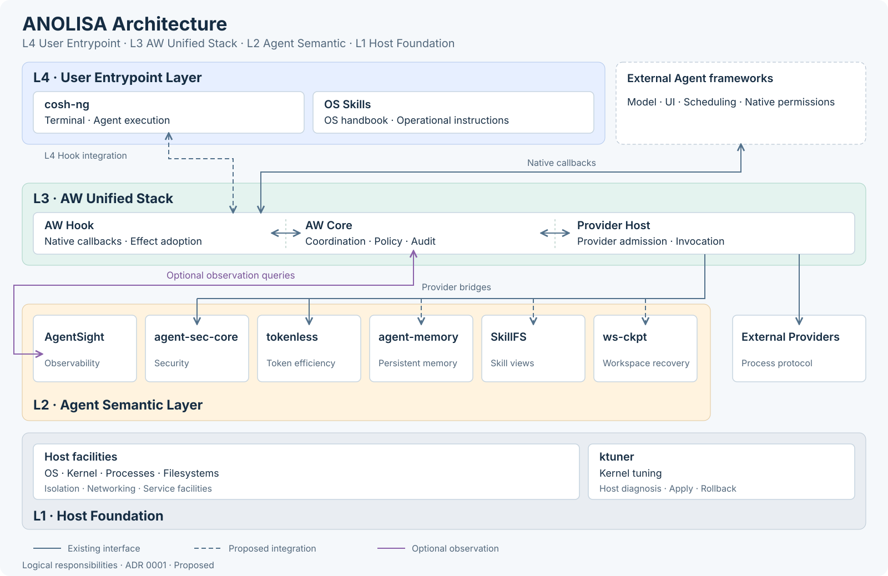

# ADR 0001：ANOLISA 架构与组件边界

[English](0001-anolisa-architecture.md)

> 本 ADR 的架构决策以英文原文为准。包括本译文在内的所有其他语言译文仅供参考。

- **状态：** Proposed（提议中）
- **日期：** 2026-10-23
- **范围：** ANOLISA 系统架构与组件位置。
- **实现基线：** `5351c892f2e89d6be799ebdbeea948c173d3d7c2`。

## 背景

ANOLISA 包含 Agent 入口、框架集成、Agent 能力和主机工具。统一的架构定义它们的
职责与源码位置，同时保留各组件独立使用的能力。

## 决策

### 分层

采用四层架构，从主机层向上编号。

| 层级 | 职责 |
| --- | --- |
| L4 — 用户入口层 | 为用户和 Agent 提供终端交互与操作知识。 |
| L3 — AW 统一栈 | 通过 AW Hook、AW Core 协调逻辑及 Provider Host，将 Agent 框架连接到能力 Providers。 |
| L2 — Agent 语义层 | 为 Agent 工作负载提供观测、安全、上下文、Skill 和工作区能力。 |
| L1 — 主机基础层 | 主机设施及其管理工具。 |

L1 中的主机设施与 ktuner 并列。ktuner 的[决策](../../src/ktuner/src/profile/mod.rs)
依据主机状态与通用工作负载类型，因此归入此层。L2 的六个组件在同一行平铺并列。
架构分层与手册导航分组相互独立。

### AW 集成

L3 从左到右为 **AW Hook → AW Core → Provider Host**。Hook 适配原生回调，并向
Agent 入口返回 effects。Provider Host 调用连接能力后端的 Providers，也支持外部实现。
这里的 AW Core 表示逻辑上的协调职责；当前 Hook 运行时使用 `aw-service`，
`aw-core` crate 则提供独立的 plan API。

sec-core 和 Tokenless 的桥接实现已经存在。Memory、SkillFS、checkpoint 及 cosh-ng
Hook 集成属于提议内容，以虚线表示。AgentSight 通过独立、可选、只读的观测连接
接入 AW 协调逻辑。External Providers 作为扩展能力与 L2 并列，使用已有的进程协议。
每条连接均落在对应的能力或 Provider 卡片上。

### 组件位置

| 组件 | 层级 | 职责 | 源码 |
| --- | --- | --- | --- |
| cosh-ng | L4 | 终端与 Agent 执行 | [`src/cosh-ng/`](../../src/cosh-ng/) |
| os-skills | L4 | OS 与 DevOps 操作指南 | [`src/os-skills/`](../../src/os-skills/) |
| AW | L3 | Agent 集成与策略协调 | [`src/aw/`](../../src/aw/) |
| AW Providers | L3 扩展接口 | 连接 L2 后端或外部能力 | [`providers/`](../../providers/) |
| AgentSight | L2 | 执行与 Token 可观测性 | [`src/agentsight/`](../../src/agentsight/) |
| agent-sec-core | L2 | 安全检查与沙箱执行 | [`src/agent-sec-core/`](../../src/agent-sec-core/) |
| tokenless | L2 | 工具 schema 与输出压缩 | [`src/tokenless/`](../../src/tokenless/) |
| agent-memory | L2 | 持久上下文与检索 | [`src/agent-memory/`](../../src/agent-memory/) |
| SkillFS | L2 | Skill 发现与文件系统视图 | [`src/skillfs/`](../../src/skillfs/) |
| ws-ckpt | L2 | 工作区文件系统检查点与回滚 | [`src/ws-ckpt/`](../../src/ws-ckpt/) |
| ktuner | L1 | 主机诊断与内核调优 | [`src/ktuner/`](../../src/ktuner/) |
| anolisa CLI | 跨层 | 分发与运维 | [`distribution/anolisa/`](../../distribution/anolisa/) |
| copilot-shell | 历史组件 | 已弃用的终端实现 | [`deprecated/copilot-shell/`](../../deprecated/copilot-shell/) |

主机 OS、内核、进程、文件系统、隔离机制、网络及服务设施构成 L1 的其余部分。
Linux 是完整能力的基线；macOS 支持情况因组件而异。

### 边界

- 各组件保持独立可用，分层不要求所有调用都经过 AW。
- 原生 Agent 保留调度与权限决定权。安全组件和主机机制分别执行各自的策略。
- AW 框架代码放在 `src/aw/`；具体 Providers 放在 `providers/<provider>/` 或独立仓库。
  框架 crate 不依赖具体 Providers。参见 [AW 架构](../../src/aw/docs/design/zh/architecture.md)。
- 源码目录仍按组件组织。层级名称不改变包名、安装后的命令、发布标签或构建与测试入口。
- 所有 ADR（包括单组件决策）统一放在 `docs/adr/`，共用一个编号序列。引用资源放在
  `docs/adr/assets/<number>/`。详细实现设计保留在组件目录，并链接到中央 ADR。
  参见[文档规范](../../specs/documentation-standard.md)。

## 考虑过的替代方案

| 替代方案 | 未采用的原因 |
| --- | --- |
| 所有组件使用同一个强制运行时 | 耦合了原本独立的能力。 |
| 所有集成都必须经过 AW | 排除了合理的直接 CLI、插件与协议接入路径。 |
| 源码目录按层级组织 | 增加迁移成本，却不能改善组件归属。 |

## 影响

各组件的职责明确，并可独立采用。跨组件组合仍需验证兼容性。本决策无需移动源码
或迁移运行时。
