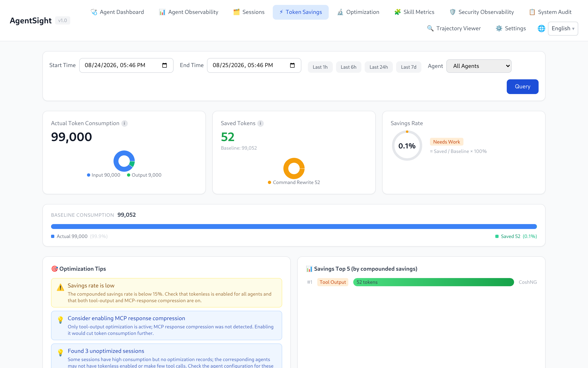

# AgentSight Integrations

[中文版](../../../zh/agent-observability/agentsight/integrations.md)

AgentSight observes Agents without being wired into them, and it shows data from the other ANOLISA
components when they happen to be installed. Nothing on this page is required to use AgentSight.

## Supported Agents

Any process matched by a discovery rule is traced. The shipped rule set (31 rules) covers:

| Agent | Reported name |
|---|---|
| cosh (Copilot Shell) | `Cosh` |
| cosh-ng (`cosh-shell`, `cosh-core`, `cosh-cli`) | `CoshNG` |
| Claude Code | `Claude` |
| Codex CLI | `Codex` |
| Qwen Code | `QwenCode` |
| OpenClaw (gateway) | `OpenClaw` |
| Hermes | `Hermes` |
| AgentScope | `AgentScope` |
| Runloop Node server | `Runloop` |

Anything else works too — add a rule, as described in
[Agent discovery rules](configuration.md#agent-discovery-rules). Two details worth knowing:

- **OpenClaw** is observed through its `openclaw-gateway` daemon, not the client. If Token data is
  missing, check that the client actually reaches the gateway.
- **Codex CLI** statically links its TLS library, so AgentSight falls back to byte-pattern matching
  and a per-version offset table. A brand-new Codex release may need a refreshed entry in
  `codex_offsets`.

## Tokenless: Token savings

With [Tokenless](../../token-saving/tokenless/QUICKSTART.md) installed, AgentSight shows how many
Tokens compression actually saved — no configuration on either side:

- the Token Savings page compares actual consumption against the baseline, by optimization type;
- the `SAVED TOKENS` column appears next to each session on the Agent Observability page;
- the Trajectory Viewer shows original versus optimized Tokens for the loaded session;
- `agentsight summary` includes a savings line;
- `GET /api/token-savings` exposes the same numbers.



The page reads Tokenless's own statistics database, so numbers appear only after Tokenless has
optimized something. A savings figure of 0 usually means Tokenless is installed but not active for
the Agent that produced those sessions.

Savings association also requires AgentSight to capture and parse the corresponding output tool-call
ID. Non-SSE HTTP/1.1 responses split across TLS reads are assembled using Content-Length or chunked
framing before usage and tool calls are extracted. Oversized responses are discarded with a collector
warning. Incomplete responses, including close-delimited responses without Content-Length or chunked
framing, cannot supply complete usage or tool-call IDs; Tokenless stats can therefore remain
unassociated. When SQLite storage is enabled, idle calls retain their request as pending evidence
for interruption detection and can still complete if the response resumes. Response buffering remains
bounded by the connection capacity and per-connection body limit.

## agent-sec-core: security observability and audit

When [agent-sec-core](../../agent-security/agent-sec-core/QUICKSTART.md) is installed, two more
Dashboard pages appear:

| Page | Content |
|---|---|
| Security Observability | Prompt-injection, PII, and code-scan verdicts per session and per run |
| System Audit | Audit events aggregated into cases you can review, and contain when the enforcer is present |

AgentSight detects the component by its daemon socket or its CLI binary, so the pages stay reachable
even while the daemon restarts.

One side effect worth knowing: agent-sec-core and Tokenless hooks run as short-lived helper
processes, and AgentSight records those too. They can dominate `agentsight audit` output — filter
them out with repeated `--exclude`:

```bash
sudo agentsight audit --last 1 --exclude agent-sec-cli --exclude observability_hook.py
```

## agentsight-enforcer: risk enforcement

`agentsight-enforcer` is the privileged daemon that can block risky Agent actions. It ships with the
package and is started by `agentsight-enforcer.service`. When its socket
(`/run/agentsight/enforcer.sock`) is missing, `serve` logs:

```
AgentSight enforcement unavailable: enforcer I/O failed: No such file or directory (os error 2)
```

Capture and analysis are unaffected; only the Risk Enforcement page and the
`/api/enforcement/*` endpoints disappear. Start the unit, or build with `make build-all` if you
built from source.

The daemon itself logs to the journal — engine startup, socket bind, policy apply outcomes
(including rollback detail when a kernel step fails), and poller errors:

```
$ sudo journalctl -u agentsight-enforcer
[INFO  agentsight_enforcer] agentsight-enforcer listening on /run/agentsight/enforcer.sock
```

The default level is `info`; add `Environment=RUST_LOG=debug` to the unit for verbose output.

Blocking also depends on the engine's hook budget: a `block` rule can only deny an operation when
the matching BPF LSM hook was reserved at engine start and BPF LSM is active on the kernel
(`bpf` listed in `/sys/kernel/security/lsm`). When a `block` rule matches on a backend that cannot
deny that operation — for example a `block connect` rule while the `enforce_socket_connect` hook is
not attached — the engine still reports the match as a violation with `effect=block` and
`blocked=false`. Treat such degraded reports as a signal that the policy cannot actually deny;
check the engine profile (`ACTPLANE_HOOK_PROFILE` / `ACTPLANE_PINNED_PROFILE`) and the kernel's LSM
configuration.

## cosh: ask in natural language

AgentSight ships a conversational Skill for cosh, so Token and audit questions can be asked in the
terminal instead of through the CLI:

- "How many Tokens did I use today?"
- "Show me today's LLM calls"
- "Were there any interruptions in the last hour?"

## Prometheus and Grafana

```bash
curl -s http://127.0.0.1:7396/metrics
```

`/metrics` is loopback-only by design. Scrape it with a node-local Prometheus agent (or a local
reverse proxy) using the counters `agentsight_token_input_total`, `agentsight_token_output_total`,
`agentsight_token_total_total`, and `agentsight_llm_requests_total`, all labelled by `agent`.

For richer panels, poll the JSON API instead — `/api/timeseries` for Token trends,
`/api/metrics/latency` for latency percentiles, `/api/interruptions/count` for open problems.

## Trajectories for offline analysis

`GET /api/export/atif/session/{id}` returns an ATIF v1.7 trajectory containing prompts, tool calls,
results, and Token totals. Use it to feed evaluation pipelines, attach a reproduction to a bug
report, or import the session into another AgentSight instance through the Trajectory Viewer.

## Related pages

- [Configuration](configuration.md) — add rules for your own Agent
- [Dashboard guide](dashboard.md#navigation-and-page-availability) — which pages appear when
- [Data and storage](data-and-storage.md#http-api) — API details

### Record statistics through the API

With `tokenless_api` configured, authenticated `POST /api/tokenless/refresh` accepts
`{"session_id":"source-session"}`, `{"tool_use_id":"captured-tool-id"}`, or `{}` to record one source page (100 records). Unfiltered replies include an optional
string `next_before_id`; pass `{"before_id":"42"}` to record the next page. This is an ordinary
query parameter, without a persisted checkpoint or restart-recovery guarantee. It records a
bounded query (at most 1,000 records / 8 MiB) atomically. An oversized query fails without
saving a partial result; narrow the filter. Refresh requires an AgentSight credential,
even from loopback. `GET /api/tokenless/records` lists saved metadata with optional
`start_ns`, `end_ns`, `session_id`, `tool_use_id`, and `limit` (1–100); the default window
is the last 24 hours. Network/query failures are explicit, and saved records remain readable.
Original fields are preserved. `agentsight_session_id` is populated only when a captured
tool-call ID uniquely matches a local session; missing or ambiguous associations remain null.

Saved lists also accept `before_cache_id` for descending local-ID pagination and return
`next_before_cache_id`. `GET /api/tokenless/records/{cache_id}?include_content=true` requests
full content; omitting the flag returns metadata. Configured API copies supply the existing
savings endpoints, excluding DryRun/unknown modes and avoiding duplicate local-database accounting.

The existing `GET /api/token-savings` and `GET /api/token-savings/session/{id}` refresh metadata
for their captured tool-call IDs before calculating results. No separate refresh request is needed
for these views. They require the existing AgentSight credential when an API is configured,
including loopback requests. The query deduplicates IDs and shares a 5-second, 1000-record/request,
8-MiB budget across source requests. A failed or oversized refresh returns an error without saving
a partial batch or presenting cached rows as current. Source records absent from this response are
excluded from current totals; saved records remain available through the records API. Without
`tokenless_api`, the existing local-database behavior is unchanged.

Historical call IDs remain available for compounding calculations. Source lookup batches at most
128 IDs per request, so a long session with few matching records can complete without discarding
earlier savings. All batches and their pages share the same recording budget. Saved metadata
lists also require the existing AgentSight credential, including on loopback.

The API-backed savings path requires the batch POST endpoint; upgrade AgentSight and the
Tokenless query service together. Existing single-filter GET queries remain available.
