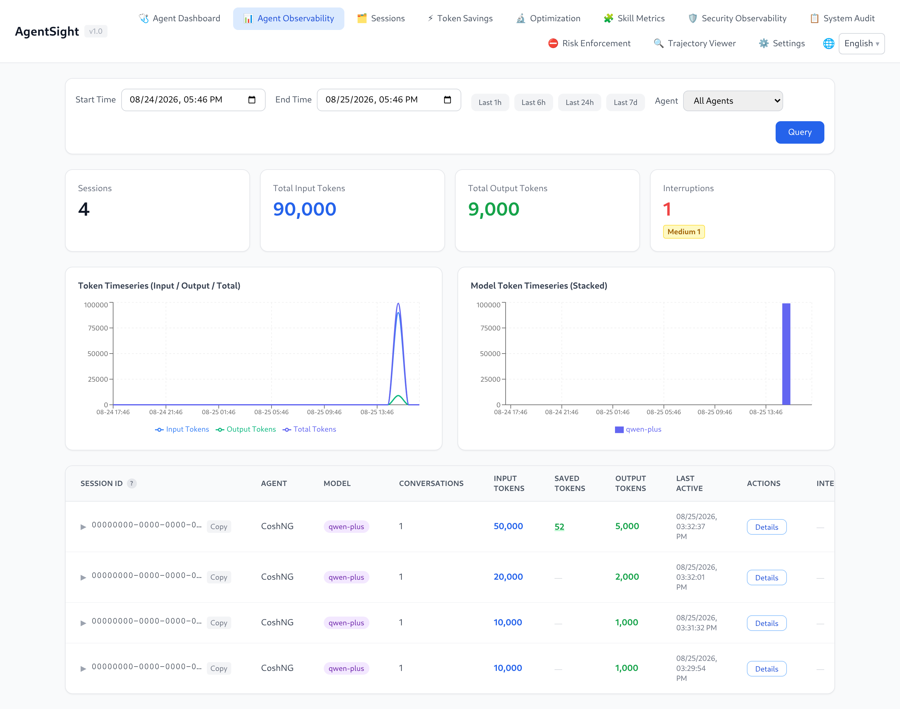
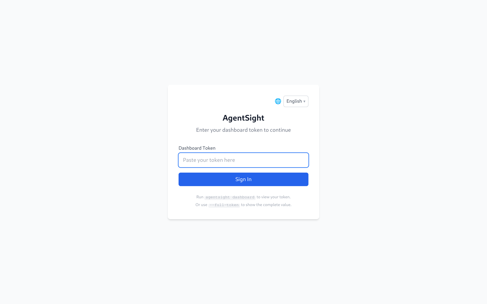
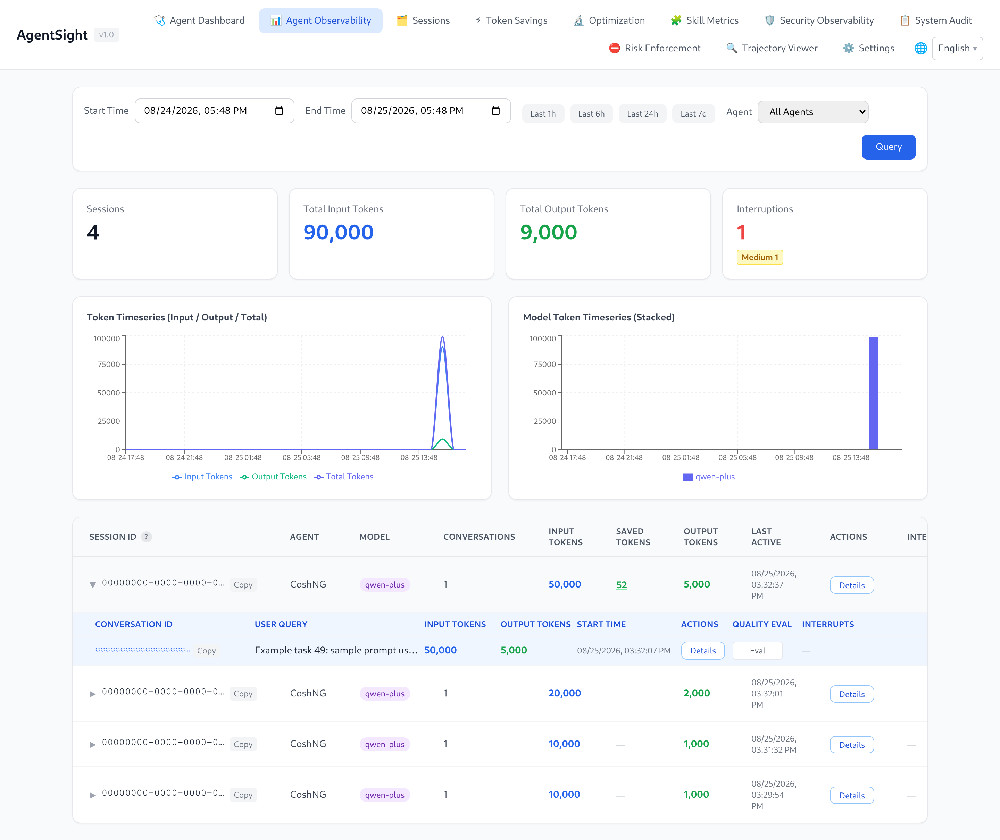
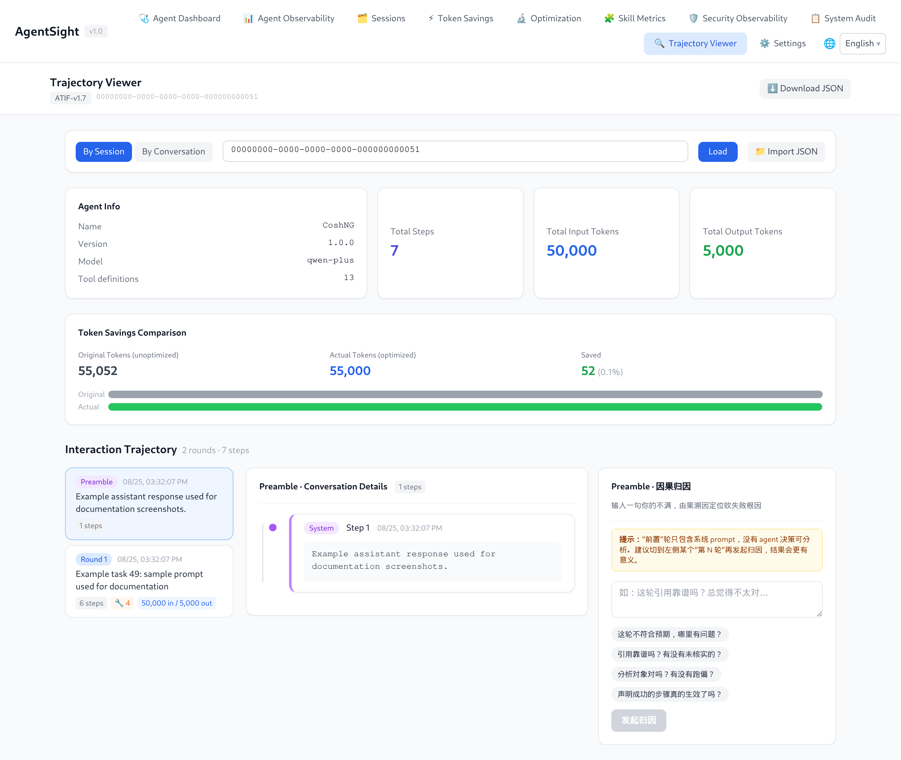

# AgentSight

[中文版](../../zh/agentsight/index.md)

AgentSight is a zero-instrumentation observability tool for AI Agents. It attaches eBPF probes
to processes that are already running, so it records LLM calls, Token consumption, tool calls,
and session interruptions without any change to Agent code, prompts, or configuration.



## Quick start

This page takes you from an empty machine to a Dashboard showing your own Agent traffic.
The commands were verified on an Alibaba Cloud Linux 4 host (kernel 6.6) running AgentSight 0.11;
the sample output keeps the real layout but uses placeholder IDs and round numbers, so nothing you
see below is a real capture.

### 1. Check the prerequisites

```bash
uname -r                                  # kernel must be >= 5.8
ls /sys/kernel/btf/vmlinux                # BTF must exist
id -u                                     # tracing needs root (0) or CAP_BPF
```

If `/sys/kernel/btf/vmlinux` is missing, the kernel was built without BTF and the eBPF probes
cannot load. Use a kernel with `CONFIG_DEBUG_INFO_BTF=y`.

### 2. Install

```bash
# Recommended: system mode, because eBPF needs root
sudo anolisa install agentsight

# Alternative on Alibaba Cloud Linux / Anolis with the repo configured
sudo yum install agentsight

# Developers building from source
cd src/agentsight && make build-all
```

> Use `make build-all` for source builds. It builds the Dashboard frontend, the main binary, and
> `agentsight-enforcer` in that order. Plain `make build` skips the enforcer, and `serve` then logs
> `AgentSight enforcement unavailable` on every start.

### 3. Start the service

```bash
sudo systemctl enable --now agentsight.service
systemctl is-active agentsight.service
```

The packaged unit starts a supervisor that runs both workers: `agentsight trace` (eBPF capture)
and `agentsight serve --host 0.0.0.0` (API + Dashboard). It also pulls in
`agentsight-enforcer.service` when that package is installed.

Data is written to `/var/log/sysak/.agentsight` with a private umask, so CLI queries against
service-owned data need `sudo`.

### 4. Produce some traffic

AgentSight only records processes it recognises as Agents, so run an Agent task. Any supported
Agent works — cosh, Claude Code, Codex, Qwen Code, OpenClaw, Hermes, AgentScope. Example with
cosh-ng in headless mode:

```bash
cosh-core --headless --approval-mode trust "explain what load average means in one sentence"
```

Confirm the process was recognised while it runs:

```bash
$ sudo agentsight discover
已发现 AI Agent（共 1 个）:
============================================================

  CoshNG [PID: 10000]
    类别: custom
    命令:  /usr/libexec/anolisa/cosh-ng/cosh-shell ...

总计: 1 个 Agent
```

> `discover` and `token` print in Chinese regardless of locale. `token` has a `--json` flag for
> language-neutral output; `discover` does not, so parse its text or query `/api/agent-health` when
> you need machine-readable discovery data.

### 5. Check that data landed

```bash
$ sudo agentsight summary --last 24
AgentSight Summary (last 24h)

Sessions      10
  Tokens      100.0K in / 10.0K out / 110.0K total

Interruptions 1
  critical    0
  high        0
  medium      1
  low         0

Tokenless     10% saved (110.0K -> 99.0K, 20 ops)
```

`summary` is the fastest health check: sessions and Tokens, interruptions grouped by severity, and
Tokenless savings if that component is installed. Each data source degrades on its own — a missing
database contributes zeros instead of failing the whole report.

### 6. Open the Dashboard

```bash
$ sudo agentsight dashboard --no-open

AgentSight 仪表盘状态
=====================

  认证:    已启用
  本机:    http://127.0.0.1:7396 (无需认证)
  局域网:   http://192.168.1.10:7396/?token=<TOKEN>
  公网:    http://203.0.113.10:7396/?token=<TOKEN>
```

- From the same host, open `http://127.0.0.1:7396` — loopback access skips authentication.
- From your laptop, use the printed URL including `?token=…`, and make sure the firewall or
  security group allows TCP 7396.

Without a valid token the Dashboard shows the login screen:



Paste the token from `agentsight dashboard --no-open` and you land on the Agent Dashboard
(`http://127.0.0.1:7396/#/health`) — live Agent health plus the unresolved interruption inbox.

The session analysis page keeps an address of its own: pick **Agent Observability** in the
navigation bar, or open `http://127.0.0.1:7396/#/observability` directly. It lists sessions with
their Token totals and interruption badges; clicking a row expands the conversations inside that
session:



Use **Details** on any row to open the step-by-step trajectory of that session or conversation:



### 7. Know where things live

| Item | Path |
|---|---|
| Binary | `/usr/local/bin/agentsight` |
| Configuration | `/etc/agentsight/config.json` |
| Databases and Dashboard token | `/var/log/sysak/.agentsight/` |
| systemd units | `agentsight.service`, `agentsight-enforcer.service` |
| Default Dashboard port | 7396 |

### Next steps

- Your Agent is not detected → [Agent discovery rules](configuration.md#agent-discovery-rules)
- A task failed or hung → [Interruption detection](interruption-detection.md)
- You want every flag → [CLI reference](cli-reference.md)
- You want the Dashboard tour → [Dashboard guide](dashboard.md)
- Nothing shows up at all → [Troubleshooting](troubleshooting.md)

## Start here

- [Quick start](index.md) — install, start tracing, produce the first session, open the Dashboard.
- [Dashboard guide](dashboard.md) — token access, page-by-page walkthrough.
- [CLI reference](cli-reference.md) — every command, flag, and real output.
- [Configuration](configuration.md) — config file, feature switches, Agent discovery rules.

## What you can do with it

| Goal | Read next |
|---|---|
| See which Agents are running and what they cost in Tokens | [Quick start](index.md) |
| Find out why an Agent task stalled, failed, or looped | [Interruption detection](interruption-detection.md) |
| Replay one session step by step (prompts, tool calls, results) | [Dashboard guide](dashboard.md#trajectory-viewer) |
| Add an Agent that AgentSight does not recognise yet | [Configuration](configuration.md#agent-discovery-rules) |
| Run it as a service, in a container, or on macOS | [Deployment](deployment.md) |
| Query data from scripts, Prometheus, or another system | [Data and storage](data-and-storage.md) |
| Combine it with Tokenless, agent-sec-core, or cosh | [Integrations](integrations.md) |
| Fix "no data", 401, or port problems | [Troubleshooting](troubleshooting.md) |

## Capabilities

| Capability | What it gives you |
|---|---|
| Zero-instrumentation capture | eBPF uprobes read plaintext from TLS calls; no SDK, proxy, or env var in the Agent |
| Agent auto-discovery | Recognises Agent processes by command line (cosh, Claude Code, Codex, Qwen Code, OpenClaw, Hermes, AgentScope, and custom rules) |
| Token accounting | Input/output/cached Tokens per Agent, session, conversation, and model |
| Session and conversation view | Sessions group conversations; each conversation keeps its LLM calls, messages, and tool calls |
| Interruption detection | 18 interruption types (crash, timeout, rate limit, context overflow, dead loop, tool failure, …) with severity and root-cause detail |
| Trajectory export | Any session, conversation, or trace exports as ATIF v1.7 JSON |
| Dashboard | Web UI with time-range filters, Token charts, latency percentiles, interruption badges, and per-step replay |
| Machine-readable output | `--json` on most commands, Prometheus `/metrics`, and a documented HTTP API |

## Requirements

| Requirement | Value |
|---|---|
| OS | Linux (x86_64); macOS runs a reduced trajectory-only mode |
| Kernel | >= 5.8 with BTF enabled |
| Privileges | root (or `CAP_BPF` + `CAP_PERFMON`) for `agentsight trace` |
| Install mode | system mode — eBPF needs root |
| Disk | A few hundred MB under `/var/log/sysak/.agentsight` (size-capped, see [Data and storage](data-and-storage.md)) |

> **macOS**: only `agentsight trace` (scans local Agent JSONL session files, no eBPF) and
> `agentsight serve` (Dashboard) are available. Every other command needs the Linux eBPF pipeline.

## How it works

```
Agent process ──TLS write/read──▶ eBPF uprobe ─┐
Agent process ──execve/exit─────▶ eBPF probe  ─┼─▶ parser ─▶ aggregator ─▶ analyzer
                                                │      (HTTP/SSE)   (req↔resp)   (tokens, audit)
                                                │                                     │
                                          ring buffer                                 ▼
                                                                    GenAI semantic events
                                                                              │
                                              ┌───────────────────────────────┼──────────────────┐
                                              ▼                               ▼                  ▼
                                      SQLite databases              interruption detector   external log export
                                              │                               │
                                              └────────▶ HTTP API + Dashboard ◀┘
```

Two processes do the work, and the packaged service starts both:

| Process | Role |
|---|---|
| `agentsight trace` | Loads eBPF probes, discovers Agents, writes events to SQLite (needs root) |
| `agentsight serve` | Serves the HTTP API and the Dashboard from the same SQLite databases |

Details: [ARCHITECTURE.md](../../../../src/agentsight/docs/ARCHITECTURE.md) in the source tree.

## Terminology

| Term | Meaning |
|---|---|
| Session | One Agent run as the Agent itself identifies it (a `session_id` from the Agent, e.g. a cosh session) |
| Conversation | One request/response cycle inside a session, including its tool calls |
| Trace | One captured LLM HTTP call (request + streamed response) |
| Interruption | A detected abnormal end or stall of a conversation, with a type and a severity |
| Agent name | The label a discovery rule assigns to a process, e.g. `CoshNG`, `Claude`, `Codex` |
| Trajectory | A session or conversation exported in ATIF v1.7 format for replay or offline analysis |

## Install and first run

```bash
# system mode is required — eBPF needs root
sudo anolisa install agentsight

# start tracing and the Dashboard together
sudo systemctl enable --now agentsight.service

# print the Dashboard URL and access token
sudo agentsight dashboard --no-open
```

Full walkthrough with expected output: [Quick start](index.md).

## Reference pages

| Page | Content |
|---|---|
| [Quick start](index.md) | Install, verify capture, first Dashboard visit |
| [Dashboard guide](dashboard.md) | Authentication and all Dashboard pages |
| [CLI reference](cli-reference.md) | `trace`, `serve`, `dashboard`, `token`, `audit`, `discover`, `metrics`, `summary`, `interruption`, `skill-metrics` |
| [Configuration](configuration.md) | `config.json` schema, feature switches, runtime limits, discovery rules |
| [Interruption detection](interruption-detection.md) | The 18 interruption types and the triage workflow |
| [Deployment](deployment.md) | systemd, foreground, container/sidecar, macOS, upgrade, uninstall |
| [Data and storage](data-and-storage.md) | Databases, retention, HTTP API, Prometheus, ATIF export |
| [Integrations](integrations.md) | Tokenless, agent-sec-core, enforcer, cosh, Prometheus |
| [Troubleshooting](troubleshooting.md) | No data, 401, unreachable port, database growth |
