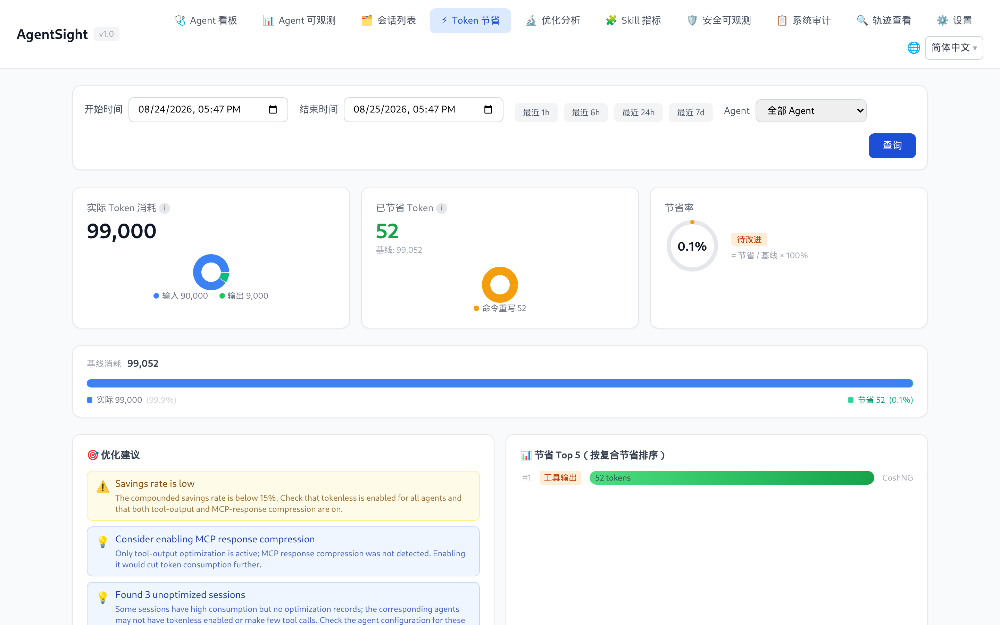

# AgentSight 集成

[English](../../en/agentsight/integrations.md)

AgentSight 观测 Agent 时不需要被嵌进 Agent 里；同样，当机器上恰好装了其他 ANOLISA 组件时，它会把这些
组件的数据一并展示出来。本页内容都不是使用 AgentSight 的必要条件。

## 支持的 Agent

只要被发现规则命中的进程都会被追踪。随包发布的规则集（31 条）覆盖：

| Agent | 上报名称 |
|---|---|
| cosh（Copilot Shell） | `Cosh` |
| cosh-ng（`cosh-shell`、`cosh-core`、`cosh-cli`） | `CoshNG` |
| Claude Code | `Claude` |
| Codex CLI | `Codex` |
| Qwen Code | `QwenCode` |
| OpenClaw（gateway） | `OpenClaw` |
| Hermes | `Hermes` |
| AgentScope | `AgentScope` |
| Runloop Node 服务 | `Runloop` |

其他 Agent 也能支持——按 [Agent 发现规则](configuration.md#agent-发现规则)加一条规则即可。需要注意的集成细节：

- **Claude Agent SDK** 轨迹复用 Claude Code JSONL 转换器。标准的 `~/.claude/projects` 和 AgentSight
  进程继承的 `CLAUDE_CONFIG_DIR` 会被自动发现。若 SDK options 只给 CLI 子进程设置配置目录，需向
  AgentSight 暴露相同变量；若每个租户工作区各有一个 `.claude`，则把工作区上层目录加入
  `features.trajectory_collection.scan_dirs`。有界递归发现会将这些会话正确标为 `claude-code`，不会误标为 Qoder。
- **OpenClaw** 观测的是它的 `openclaw-gateway` 守护进程，而不是客户端。缺 Token 数据时，先确认客户端
  确实连上了 gateway。
- **Codex CLI** 静态链接 TLS 库，AgentSight 会退化到字节模式匹配加逐版本 offset 表。刚发布的 Codex
  版本可能需要更新 `codex_offsets` 条目。
- **Hermes** 无需 eBPF 也能采集轨迹。轨迹采集器以只读方式打开 `$HERMES_HOME/state.db`，把有效消息、
  推理内容、工具调用、工具结果和会话 Token 汇总转换为 ATIF v1.7，并持续读取 SQLite WAL 中已提交的
  更新。设置 `scan_dirs` 后，需显式包含 Hermes home 目录或 `state.db` 路径。
  坏会话记录或坏消息按会话记录错误并跳过，其他健康会话继续采集；未变更会话仅查询元数据，不读取已存储的 ATIF 正文。
  会话指纹独立于轨迹正文保存，因此容量裁剪后不会重新入库未变化的会话；源新增消息仍触发更新。
  正文和扫描状态在同一事务内保存；扫描状态按源消息时间执行保留期清理，源数据库消失后也会清理。

Hermes 允许调用方自定义会话 ID。为隔离多个数据库，采集器使用由规范化后的数据库路径和原会话 ID
生成的稳定 `hermes:<SHA256>` 标识，数据库记录与 ATIF 的 `session_id` 保持一致。
轨迹 API 使用该采集标识；原始 ID 保存在 `extra.hermes_session_id`，供 Hermes API 和外部关联使用。
父会话引用使用同一命名空间，原父 ID 保存在 `extra.hermes_parent_session_id`。
这些采集标识不会自动与使用原始 ID 的 eBPF 会话合并。导出的标识和 extra 元数据不嵌入数据库本地路径。

采集器重启时应保持源库挂载路径稳定：指向相同规范化路径的别名共用一个身份；移动源库或将其副本
挂载到另一规范化路径会生成独立的采集身份。早期测试二进制使用原始 Hermes ID：对比不同测试版本时
建议使用新的输出数据库，否则旧 ID 记录会与新记录共存，直到保留期清理。该切换不会修改源 Hermes 库。

## Tokenless：Token 节省

装了 [Tokenless](../tokenless/index.md) 后，AgentSight 会展示压缩实际省下了多少
Token，两侧都不需要额外配置：

- Token 节省页按优化类型对比实际消耗与基线；
- Agent 可观测页面的每个会话旁出现「节省 Token」列；
- 轨迹查看页显示该会话优化前后的 Token 对比；
- `agentsight summary` 多出一行节省信息；
- `GET /api/token-savings` 暴露同样的数字。



该页面读取的是 Tokenless 自己的统计数据库，因此只有 Tokenless 真正优化过之后才会有数字。节省量为 0
通常意味着 Tokenless 装了但没有对产生这些会话的 Agent 生效。

节省统计的关联还要求 AgentSight 完整采集并解析对应的输出 tool-call ID。非 SSE HTTP/1.1 响应跨多次
TLS 读取时，会依据 Content-Length 或 chunked 消息边界完成组装，再提取 usage 和工具调用。超限响应
会被丢弃并在采集器日志中告警。不完整响应（包括没有 Content-Length 或 chunked 定界、仅靠关闭连接
确定结束的响应）无法提供完整的 usage 或 tool-call ID，Tokenless 已记录的 stats 因此仍可能无法关联。
启用 SQLite 存储时，空闲调用会保留请求作为 pending 证据供中断检测使用，响应恢复后仍可继续完成；
响应缓冲仍受连接数量和单连接响应体大小上限约束。

## agent-sec-core：安全可观测与审计

装了 [agent-sec-core](../agent-sec-core/index.md) 后，Dashboard 会多出两页：

| 页面 | 内容 |
|---|---|
| 安全可观测 | 按会话与运行展示提示词注入、PII、代码扫描的结论 |
| 系统审计 | 把审计事件聚合成可评审的案例；装了 enforcer 时还能执行处置 |

AgentSight 通过 daemon socket 或 CLI 二进制来识别该组件，因此 daemon 重启期间页面依然可达。

一个需要知道的副作用：agent-sec-core 与 Tokenless 的 hook 都是短生命周期的辅助进程，AgentSight 也会
记录它们，很容易把 `agentsight audit` 的输出占满。用多个 `--exclude` 过掉即可：

```bash
sudo agentsight audit --last 1 --exclude agent-sec-cli --exclude observability_hook.py
```

## agentsight-enforcer：风险拦截

`agentsight-enforcer` 是可以拦截高风险 Agent 动作的特权守护进程，随安装包发布，由
`agentsight-enforcer.service` 启动。当它的 socket（`/run/agentsight/enforcer.sock`）不存在时，`serve`
会打印：

```
AgentSight enforcement unavailable: enforcer I/O failed: No such file or directory (os error 2)
```

采集与分析不受影响，只是风险拦截页面和 `/api/enforcement/*` 端点会消失。启动对应 unit 即可；源码构建
请使用 `make build-all`。

守护进程自身会向 journal 写日志——引擎启动、socket 监听、策略注入结果（内核步骤失败时含回滚细节）
以及 poller 错误：

```
$ sudo journalctl -u agentsight-enforcer
[INFO  agentsight_enforcer] agentsight-enforcer listening on /run/agentsight/enforcer.sock
```

默认级别为 `info`；在 unit 中添加 `Environment=RUST_LOG=debug` 可获得更详细的输出。

拦截能力还取决于引擎的 hook 预算：只有当引擎启动时预留了对应的 BPF LSM hook、且内核启用了
BPF LSM（`/sys/kernel/security/lsm` 中包含 `bpf`）时，`block` 规则才能真正拒绝操作。当 `block`
规则命中在一个无法拒绝该操作的后端上——例如 `block connect` 规则命中时 `enforce_socket_connect`
hook 并未挂载——引擎仍会以 `effect=block` 且 `blocked=false` 的 violation 落账。遇到这类降级
报告，说明该策略实际无法拒绝；请检查引擎 profile（`ACTPLANE_HOOK_PROFILE` /
`ACTPLANE_PINNED_PROFILE`）与内核 LSM 配置。

## cosh：用自然语言提问

AgentSight 为 cosh 提供了对话式 Skill，Token 和审计相关的问题可以直接在终端里问，而不必敲 CLI：

- 「我今天用了多少 Token？」
- 「把今天的 LLM 调用列出来」
- 「最近一小时有中断吗？」

## Prometheus 与 Grafana

```bash
curl -s http://127.0.0.1:7396/metrics
```

`/metrics` 按设计只允许本机访问。请用节点本地的 Prometheus agent（或本机反向代理）抓取，指标为
`agentsight_token_input_total`、`agentsight_token_output_total`、`agentsight_token_total_total`、
`agentsight_llm_requests_total`，均带 `agent` 标签。

想做更丰富的看板，可以直接轮询 JSON API——`/api/timeseries` 看 Token 趋势、`/api/metrics/latency` 看延迟
分位、`/api/interruptions/count` 看未处理问题数。

## 用轨迹做离线分析

`GET /api/export/atif/session/{id}` 返回 ATIF v1.7 轨迹，包含提示词、工具调用、结果与 Token 汇总。可以
用它喂评测流水线、给缺陷报告附上可复现材料，或通过轨迹查看页导入到另一个 AgentSight 实例。

## 相关页面

- [配置](configuration.md)——为自己的 Agent 添加规则
- [Dashboard 指南](dashboard.md#导航与页面可见性)——哪些页面在什么条件下出现
- [数据与存储](data-and-storage.md#http-api)——API 细节

### 通过 API 记录统计数据

配置 `tokenless_api` 后，已认证的 `POST /api/tokenless/refresh` 接收
`{"session_id":"source-session"}`、`{"tool_use_id":"captured-tool-id"}` 或不筛选的 `{}`（每批 100 条），以事务保存
有界查询结果（最多 1,000 条 / 8 MiB）。超限时整体失败，不保存部分结果；请缩小过滤
范围。即使从 loopback 访问，刷新也需要 AgentSight 凭据。`GET /api/tokenless/records`
列出已保存的元数据，支持 `start_ns`、`end_ns`、`session_id`、`tool_use_id` 和 `limit`
（1–100），默认查询最近 24 小时。网络或查询失败会明确返回，已保存的数据仍可查看。
原始字段保持不变。仅当采集到的 tool-call ID 唯一对应本地会话时填充
`agentsight_session_id`；缺失或歧义关联保持 null。

已保存的列表还支持 `before_cache_id`，按本地 ID 倒序分页，返回 `next_before_cache_id`。
`GET /api/tokenless/records/{cache_id}?include_content=true` 请求完整内容；不传此标志时
返回元数据。配置 API 后，现有节省接口使用 API 副本，排除 DryRun 和未知模式，避免
与本地数据库统计重复计算。

不筛选的回复可包含字符串 `next_before_id`；传入 `{"before_id":"42"}` 记录下一批。这是普通查询参数，不保存 checkpoint，也不保证跨重启恢复。

现有 `GET /api/token-savings` 与 `GET /api/token-savings/session/{id}` 会先按已采集的
tool-call ID 刷新元数据，再计算结果，无需为这些视图额外调用 refresh。配置 API 后，
这些查询复用现有 AgentSight 凭据，即使访问来自 loopback。查询会对 ID 去重，并让所有
源请求共享 5 秒、1000 条记录/请求、8 MiB 的预算。刷新失败或超限时明确报错，不保存
部分批次，也不将缓存行当作最新数据返回。本次源回复中不存在的记录不计入当前汇总；
已保存的记录仍可通过记录 API 查询。未配置 `tokenless_api` 时保持现有本地数据库行为。

历史调用 ID 继续参与复合节省计算。源查询每次最多批量匹配 128 个 ID，因此匹配统计较少的
长会话可以完成查询，并保留早期压缩的节省量。所有批次及其分页共享同一个记录预算。
已保存元数据列表即使来自 loopback 也需要现有 AgentSight 凭据。

通过 API 查询节省量需要批量 POST 接口；请一起升级 AgentSight 与 Tokenless 查询服务。
原有按单个条件筛选的 GET 查询继续可用。
