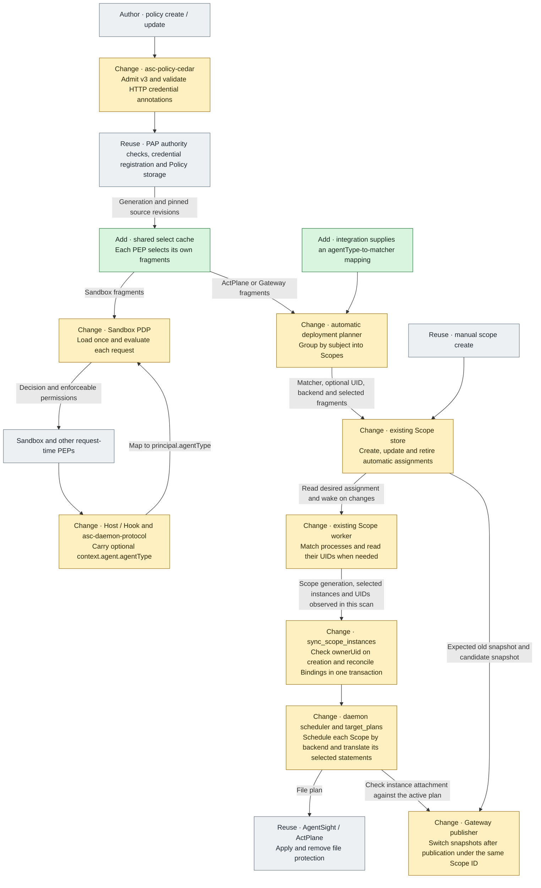

# Unified Cedar Policy Management and Automatic Deployment in AgentSecCore (Design Proposal)

[中文版](CEDAR_PRINCIPAL_POLICY_DEPLOYMENT_zh.md)

## Single-revision contract

`seccore.system` revision 3 is the public Cedar schema for both manual and automatic deployment. PAP selects statements separately. A bare file restriction can be pinned to a manual Scope. A supported file restriction that names an exact agent type can also reach matching processes through ActPlane. An automatic Gateway credential grant must name an exact agent type and a non-root owner UID on the grant itself. Sandbox evaluates the original subject predicates for each request. A single Policy can use all three consumers. See the [policy CLI guide](../../../../docs/user-guide/en/agent-sec-core/policy-cli.md#cedar-policy-source) for examples and the SQLite upgrade and rollback procedure.

The proposal below records the original rollout with three schema revisions. Its CLI defaults, revision-based placement and compatibility rules describe that rollout.

## Design overview

- **Background** Users define allowed and forbidden actions in Cedar and maintain Scopes by hand to select the processes a Policy applies to. With those choices recorded separately, the system cannot deploy a Policy from its Cedar source alone.
- **Goal** Use Cedar as the common policy format. An author writes one Policy that the system can deploy to matching processes and evaluate directly when an authorization request arrives.
- **Approach** Authors identify whom a Policy applies to in its Cedar `principal` conditions. For rules deployed to processes, the system maintains Scopes internally, matches processes and sends the applicable rules to ActPlane or Gateway. Each PEP selects the Cedar fragments it can consume and reuses them by version. The Sandbox PDP evaluates each request against its selected fragments.
- **Compatibility** Operators can continue to configure Scopes manually and assign existing Policies through the current workflow.

## 1. How one Qoder Policy takes effect

Suppose Qoder must not read `/work/data/secret.txt`, and a Qoder running as UID 1000 may use a GitHub credential for HTTPS GET requests to `api.github.com`. Submit both rules in one v3 Policy. Qoder need not be running yet.

- **Sandbox evaluates each request.** The shared PDP loads the file statement selected for Sandbox from the Qoder Policy. When the Host or Hook sends a Qoder request, the `file.read` prohibition overrides a general read permit for `secret.txt`. The HTTP credential rule applies to `network.send` and cannot grant Sandbox file or network permissions.
- **ActPlane enforces file protection after installation.** The daemon uses the integration's process matcher to discover a Qoder root. At first attachment, AgentSight protects the root and attempts to cover its existing descendants. Later children inherit protection from a protected parent. If AgentSight cannot confirm full coverage, AgentSight marks the Binding `Degraded` and records the reason in the enforcer log. The file rule in this example has no UID restriction. Each enforcer supports one active Binding. A second matching root can report a conflict. [First-attachment coverage][actplane-tree] · [Enforcer concurrency limit][actplane-limit]
- **Gateway supplies the credential after process verification and attachment.** The daemon verifies that the Qoder root belongs to UID 1000, and Gateway checks the attachment. Gateway injects the credential for a matching request from that root or from a descendant that passes the UID and cgroup membership checks. An unrelated same-UID process that does not match the configured process selector stays outside the assignment. Use a dedicated non-root UID when credential workloads need isolation from other user processes. [Gateway membership checks][gateway-members]

Save the following Policy as `qoder.cedar`. Replace the illustrative credential paths with the prepared credential files for the deployment.

```cedar
forbid (
    principal is SecCore::Subject,
    action == SecCore::Action::"file.read",
    resource is SecCore::File
)
when { principal has agentType && principal.agentType == "qoder" }
when { resource.path == "/work/data/secret.txt" };

@id("qoder-github")
@modify("inject_credential")
@real_token_file("/secure/github-real")
@fake_token_file("/secure/github-fake")
@inject_header("Authorization")
@inject_format("auto")
@response_rewrite("true")
permit (
    principal is SecCore::Subject,
    action == SecCore::Action::"network.send",
    resource is SecCore::HttpEndpoint
)
when {
    principal has agentType && principal.agentType == "qoder" &&
    principal has ownerUid && principal.ownerUid == 1000
}
when {
    resource.host == "api.github.com" &&
    context.input.scheme == "https" &&
    context.input.method == "GET"
};
```

The example includes a credential rule. Start the daemon with `--enable-gateway` to provide the credential registrar. The `agent-sec-cli gateway enable` command controls proxy activation. With v3 implemented, an authorized operator can create the Policy with the command below. The daemon assigns its Scopes automatically. Pass `--schema-revision 3` explicitly for a raw Cedar file. Omitting the flag keeps the v1 CLI default. Manual `scope create` accepts v1/v2 Policies. v3 uses automatic assignment. [CLI schema selection][cli-schema] · [Embedded default revision][schema-default]

```sh
agent-sec-cli policy create --name qoder --schema-revision 3 --file qoder.cedar
```

For a later update, set `policy_id` to the ID returned by creation and submit the edited file with the same schema revision.

```sh
agent-sec-cli policy update --policy-id "$policy_id" --name qoder --schema-revision 3 --file qoder.cedar
```

## 2. Architecture and data flow

**Baseline.** At commit `ce4aa771` of PR #10258, the request authorization path reads current Policies from PAP. It examines principal headers to decide whether the entire Policy enters the PDP set. ActPlane and Gateway use manually created Scopes. An operator selects Policy revisions and a process selector, the daemon creates Bindings for matching instances, and the planner projects file and network statements from the bound Policy. The PR already supports mixed Policy deployment. [Request eligibility][admission] · [PAP policy selection][read] · [File and network plans][plan]

The example produces two automatic Scopes. The file Scope selects Qoder. The credential Scope selects Qoder running under UID 1000. Each Binding identifies a specific process instance.

**The unified `select` extension uses `d41cede90` as its baseline.** All three PEPs use an in-process cache keyed by policy-set generation and PEP type. For a Qoder prohibition on ordinary writes, deletes and renames under `/work/reports`, Sandbox selects ordinary writes, ActPlane selects ordinary writes and deletes, and Gateway selects nothing. The interface returns source references, branch coverage and known stricter or weaker effects for future management queries and UI. [PEP selection contract and acceptance cases](CEDAR_PEP_SELECTION.md)

Green nodes add logic, yellow nodes change existing logic and grey nodes reuse existing components.



On `policy create/update`, extend `asc-policy-cedar` to validate v3 and recognize credential references in the original statements, retaining their subject conditions. Accept credential injection only on supported HTTP permits with the exact `network.send` action and `SecCore::HttpEndpoint` resource. Reject a credential annotation on an unconstrained action or one that can match an OS request. PAP checks the caller’s authority, validates and registers annotated credential rules, then saves the complete Policy. The target process may start later. Gateway checks whether it can enforce ordinary network rules when publishing the Scope. If the proxy is enabled, credential registration itself refreshes the serving Gateway configuration. A failed refresh fails the Policy write before the new revision commits. Gateway follows its existing procedure to stop the proxy and withdraw traffic, and status reflects actual availability. Admission of an automatic Scope candidate for that revision begins only after the Policy commits. [PAP write path][write] · [HTTP compiler][http-compiler] · [HTTP action and resource checks][http-action]

**Subject fields.** v3 adds two optional attributes to `SecCore::Subject` in `seccore.system`. `agentType` (String) names the Agent family. `ownerUid` (Long, within the valid Linux UID range) specifies the target process UID. Manual v1/v2 Scopes take the target from `scope create --owner-uid`. Automatic v3 Scopes read it from the Cedar condition. The daemon verifies the observed UID in `/proc`. A credential assignment requires a continuous process selector, an explicit non-root target UID and the existing credential administration checks. [Manual Scope argument][scope-cli] · [UID verification][uid-read] · [Credential Scope contract][scope]

## 3. Request path through the shared PDP

### Defaults when agentType is absent

`agentType` is optional for every action. When a request omits it, a general permit can still match. A permit or prohibition guarded by `has agentType && …` cannot. To restrict reads of a file to requests that explicitly declare Qoder, even with a broader read permit, use the prohibition below. A Qoder request still needs a matching permit. [Cedar authorization semantics][cedar]

```cedar
forbid (
    principal is SecCore::Subject,
    action == SecCore::Action::"file.read",
    resource is SecCore::File
)
when { resource.path == "/work/private/config.json" }
unless { principal has agentType && principal.agentType == "qoder" };
```

The request PDP can evaluate this exclusion. Automatic deployment initially supports the positive selectors described below, so the query result should identify the ActPlane targeting limitation for this rule. A caller-supplied category classifies a request. Credential access and privilege elevation require an independent basis for authorization.

### Load selected fragments and evaluate each request

- **Policy input.** PAP retains the source, ID, revision and schema. Preserve whole-Policy principal-header admission for v1/v2. For v3 the common cache returns complete statements or fragments selected for Sandbox, retaining every permit and forbid that could affect its requests. A request uses the loaded PDP when its generation matches. The receipt’s `policy_version` identifies the authorization set actually used. [Eligibility check][admission] · [PAP read path][read]
- **Sandbox enforcement.** At load time the PDP collects paths from statements that can match file access. It skips the file-path check for a statement restricted to `SecCore::HttpEndpoint`, even if its action is unrestricted. To build launch permissions, Sandbox queries an ordinary write with operation `write`. A `delete`-only branch can be excluded during selection. If the condition forbids deletion or any write to `/work/A`, the path check retains `/work/A`. Cedar then forbids an ordinary write to A. Other rules govern ordinary writes to B. A matching prohibition takes precedence, and a request with no matching permit is denied. ActPlane enforces deletion restrictions when the operation occurs. [PDP loading and evaluation][pdp-load] · [Sandbox file-condition check][sandbox-file-conditions] · [ActPlane delete protection][actplane-delete]
- **Request input.** Use a request schema that recognizes the optional `agentType` and `ownerUid` attributes. Map the Host or Hook’s `context.agent.agentType` to `principal.agentType` when supplied. Sandbox omits `ownerUid`, so `principal has ownerUid` evaluates to false. Cedar evaluates the original `&&` and `||` expressions. Sandbox uses the existing authorization request, decision and OS permission formats. [Request schema construction][request-schema] · [Request protocol][wire-agent] · [Subject construction][pdp-subject] · [OS authorization interface][auth]

## 4. Deployment path from source to running process

1. **Select statements for deployment.** All three PEPs register the same `select` interface. Each receives a full statement with its source, schema and annotations. The deployment planner reads that backend’s selected fragments from the cache and groups them into Scopes by subject. ActPlane selects possible file access and reports a statement as unassigned when it lacks an exact `agentType`. Gateway ignores process-spawn-only rules and includes restrictions that may affect HTTP credential use. Each credential grant must specify its own exact `agentType` and non-root `ownerUid`. An incomplete grant is reported as unassigned, and other grants can deploy independently. The initial process selector supports positive conjunctions of equality with constants and `has` guards. A new deployment backend implements and registers its selector. [Existing Cedar projections][projection] · [Backend plan entry point][plan]
2. **Resolve the process matcher.** At startup, load each integration’s mapping from `agentType` to an existing matcher and recompute assignments from current Policies. Supported matchers are `processName`, a normalized absolute `executable` or a whole path argument `cmdlineArg`. For a script Agent, configure its installed entry point so unrelated interpreters do not match merely because they run `node` or `python`. The Scope worker matches processes. For an automatic Scope with an explicit `ownerUid`, it passes the selected instances and the `ProcessFingerprint.uid` values read in this scan to `sync_scope_instances`, keyed by full `ProcessIdentity`. On Binding creation, compare that value directly with the target `ownerUid`. If the scan has no observation or no UID for that instance, wait for the next scan. The observation is local to this synchronization and requires no verification flag, database field or additional `/proc` read. Report a missing mapping separately from a configured matcher waiting for a process. [Process matchers][matcher] · [UID filtering][uid] · [Observed instance and UID][observed-uid] · [Existing synchronization interface][scope-sync-input]

   - **Gateway credentials.** Each scan admits only instances whose UID it verifies against `ownerUid` in that scan. If a bound instance's UID is unknown or differs from the target, remove it from the credential selection. Binding synchronization schedules cleanup of that instance's credential attachment.
   - **ActPlane file protection.** For a file rule with an explicit `ownerUid`, if this scan cannot read the UID, a previously verified file Binding still follows the latest revision of the same Policy while its process instance and target range remain the same. A second Policy with an `ownerUid` targeting that same process needs a matching UID observation from the scan that creates its Binding. A confirmed UID mismatch, process exit or PID reuse retires the original instance’s Binding. [Existing instance retention logic][uid-reconcile]

3. **Reuse Scopes and Bindings.** Group assignments by normalized matcher, optional UID and backend. Each group is an instance of the existing Scope type. Keep its Policy snapshots. A whole statement can reference its pinned source. For a partial selection, save the complete compilable fragment and its origin. The Qoder file Scope can keep protecting its root while the credential Scope withdraws its attachment. Automatic Scope validation, UID handling and credential membership use only that Scope’s statements. Manual Scopes continue to use their full snapshots. Both paths share process discovery and Binding synchronization. The daemon stores the bound instance’s boot ID, PID namespace, PID and start time in SQLite. [Scope snapshot and selector][scope-record] · [Binding and instance identity][binding]
4. **Schedule the Binding and translate its selected statements.** Before calling `target_plans`, the daemon decides whether this Binding needs the Gateway lock. For an automatic Binding, take the lock when the selected work uses Gateway or an earlier Gateway attachment still needs cleanup. A file-only Binding from a mixed Policy can then apply or remove protection while Gateway is busy. In `target_plans`, load the selected fragments from that snapshot, preserving each selection’s operation and path range. For the bound instance, discharge only subject conditions fully verified by the Scope and preserve the other predicates and source references. This lets the existing file translator handle the file rule. The request PDP retains the original conditions. [Baseline scheduling][schedule] · [File translator][translator] · [Plan compilation][plan]
5. **Update a credential Scope.** Each manual `scope create` allocates a new ID. If admission fails, PAP returns the error before saving the candidate. If preparation or discovery fails after the save, PAP attempts to clean up the newly created Scope. An automatic update reuses the Scope ID and its published snapshot. Build the candidate from current PAP Policies on each attempt. Include every potentially applicable network rule, including a `forbid` from another Policy without an injection annotation. Reuse whole-Scope compilation, owner UID checks and credential validation from manual admission. Manual creation retains its existing snapshot identity check. On rejection, record only the attempted revision, relevant statements and reason. The current Scope continues as before. A rejected first assignment supplies no credential route. Automatic `scope retry` checks the current PAP version and admits its candidate again. An installation retry for a published Binding reads its own pinned snapshot and checks the work revision. [Manual creation][scope-create] · [Manual admission][manual-admission] · [Cleanup after creation][manual-start-cleanup] · [Whole-Scope compilation][scope-compile]

   **Publication.** Pass the Scope ID, expected old snapshot and candidate snapshot explicitly to the existing Gateway publisher. Coordinate the switch with process attachment. Verify that the expected snapshot still serves and that PAP still calls for the candidate. Compile this Scope from the supplied candidate and all other Scopes from their serving snapshots. Switch the snapshot used for attachment only after publication succeeds. A prepared candidate waits for activation while Gateway is disabled. Failure to apply host routes follows the manual error path. Gateway attempts to stop the proxy and withdraw traffic, and status reflects actual availability. [Snapshot check][snapshot-check] · [Current plan lookup][active-plans] · [Gateway publisher][host-publish] · [Publication failures][gateway-publish-error] · [Traffic withdrawal][gateway-withdraw]

   **Process attachment.** A new Qoder can attach only to a Scope that is serving. Use the same snapshot’s statements for the Binding and the Scope network plan. Run the manual checks for process identity, UID, credentials and cross-Scope overlap in the actual cgroup. If the version changes during attachment, recheck against the current snapshot. A process matching only the rejected candidate, or one whose route has been withdrawn, receives no credential through this assignment. On failure after a partial attachment, Gateway uses its existing Binding isolation. Other Bindings continue serving if rerouting succeeds. If rerouting fails, the same proxy shutdown and traffic withdrawal apply. [Binding snapshot check][binding-snapshot] · [Attachment checks][gateway] · [Process overlap][overlap] · [Binding isolation][binding-isolation]

**Mixed Policies.** A single manual mixed Scope attempts file protection first. If that first deployment fails, it skips credential attachment for that attempt. The two automatic Scopes each run their own backend's manual deployment path. If file protection fails, Gateway can still publish an independently authorized credential. Report both outcomes. The caller writing a v3 Policy needs the same administrative authority as for manual assignment, including the existing credential checks. For example, a credential rule for Qoder without a valid non-root target UID yields a missing-UID error and no attachment. [Manual mixed deployment test][mixed-manual]

**ActPlane updates.** The AgentSight client validates the new target, removes the old targets, then applies the replacement. When changing “deny reads of A” to “deny reads of B”, removal of A can succeed before installation of B fails. Record the confirmed removal of A and the actual outcome for B. A timeout leaves B unconfirmed until reconciliation checks the result. [AgentSight client update][actplane-update]

## 5. Lifecycle, compatibility and status

- **Writes and recovery.** At startup, on retry and in its existing periodic task, the daemon compares current v3 Policies in PAP with stored automatic Scopes, even when either list is empty. A post-commit Policy notification triggers the same comparison sooner. Later passes create missing assignments, remove those whose sources are gone and retry transient failures. Identify an assignment by automatic origin, normalized matcher, UID and kind (file or credential). When the source revision or selected fragments change, check the current source revision, update the desired assignment and increment the Scope generation in one transaction. Wake the existing worker after commit. Check the generation on receipts and cleanup. Repeated notifications must not duplicate assignments. Current v3 snapshots are limited to 4096 policies and 16 MiB of serialized data. Check capacity within the write transaction. An older database over either limit can start and continue manual Scope cleanup. Automatic planning resumes once deleting or shrinking v3 policies brings it back within both limits.
- **Update live instances.** In one transaction, the worker uses `sync_scope_instances` to look up a Binding by Policy and full process identity. Apply the UID check in section 4 when creating a Binding. Skip an applied Binding if its pinned revision and executable fragments both match. When either changes for a file Binding, keep its ID, increment its revision and redeploy through the existing reconciler. If another Binding occupied the enforcer, retry installation with the original Binding on the next scan after release, provided the process still matches the current Policy. Credential Bindings attach or update against the Scope version Gateway is actually serving. Backend receipts determine deployment status. [Existing Binding synchronization][binding-sync]
- **Concurrent updates and retirement.** Serialize scans per Scope. At commit, check the Scope generation, process identity and Binding state in one transaction. Rescan if the generation is stale. Update a retained file Binding only for the original instance and target range. When the instance is confirmed to have stopped matching (including a UID change, exit or PID reuse), or its Policy leaves the Scope, retire only the corresponding Binding. Serialize deployment and cleanup per Binding and check receipts against its ID, revision and target instance so a stale scan or late receipt cannot reactivate it. ActPlane uses the manual apply and delete protocol. [Receipt checks][binding-receipt] · [ActPlane apply and detach][actplane-lifecycle]
- **Create and clean up automatic Scopes.** Create a Scope for its first source and retain it while any Policy references it, even with no matching processes. If an operator runs `scope delete` on an automatic Scope that still has a source, direct them to change or remove the source Policy and keep the current attachments. When the last source leaves, the daemon stops admitting new instances and uses the existing deletion path to clean up Bindings, routes and the Scope. In a shared Scope, explicitly deleting one Policy withdraws its grants even if the preceding candidate was rejected. If a route cannot be withdrawn separately, disable the affected Scope’s routes until a valid plan is published. Retry from the current PAP Policies. Operators continue to manage manual Scopes. [Scope deletion path][scope-cleanup]
- **Change Gateway target UIDs.** When two credentials from one Scope move from UID 1000 to UIDs 1001 and 1002, validate all affected targets together. If admission fails, the original range keeps serving. On success, commit the affected Scopes and their complete membership together and use the final membership to decide retirement. A new UID can use the credential after publication and instance verification. Unrelated Scopes publish independently. [Credential membership updates][creds]
- **Gateway restart.** First disable affected automatic routes, including data-plane routes left by the previous run. The daemon derives each Scope again from the current Policies in PAP and the integration’s current process matcher. Restore the saved plan only when the source Policy revisions, selected statements, matcher and target UID all match. Use the existing cleanup path for removed sources and obsolete assignments. Publish changed Scopes from the new selection and verify each process before attaching it. Keep the affected route disabled while verification is pending or has failed. For example, if the daemon restarts while Scope version 1 is serving and PAP still holds the sources for rejected Scope version 2, rebuild and check version 2. If validation still fails, the route stays disabled until a valid plan is published. A missing matcher file selects built-in mappings. An unreadable or malformed file reports a configuration error and suspends automatic assignments that depend on it. Automatic credential routes stay disabled until the mapping is repaired and the daemon restarted. The management interface, manual Scopes and Sandbox requests remain available. A retired credential stays disabled while other valid credentials in the same Scope can recover after revalidation. Manual Scopes recover from their pinned snapshots. [Baseline recovery and publication order][gateway-recovery] Manual and automatic withdrawal remove routing for new connections. An established proxy connection can keep using a shared listener while that listener still serves other Bindings. If withdrawal leaves a running process in a managed cgroup with no Binding, the existing Gateway overlap check can reject reattachment until the process exits.
- **Manual Scopes.** Schema revisions 1 and 2 retain their principal-based routing and manual deployment semantics. The first release deploys v3 through automatic assignments. If a `scope create` request references any v3 Policy revision, PAP rejects the entire creation request, identifies the revision and directs the user to automatic deployment. Cedar policies use `principal.agentType` and Sandbox/Hook requests use `context.agent.agentType`. The old `agent_type` spelling is incompatible in both positions. Manual Scopes retain `processName`. A manual Scope pins selected Policy snapshots and remains under operator control after an upstream Policy changes or is deleted. Treat existing records as manual. Preserve manual PID, process name, executable and script-argument selectors. A PID assignment pins the first confirmed instance. Automatic and manual assignments have independent lifecycles. Report an incompatible cross-Scope Gateway attachment while preserving the existing deployment. [Manual selectors][matcher] · [Gateway overlap check][overlap] Cedar admission rejects the retired attribute, including existence checks. During startup the repository checks current Policies and pinned Scope and Binding snapshots. If a stored copy still uses the attribute, startup reports its Policy ID and revision. Follow the upgrade procedure in the [policy CLI guide](../../../../docs/user-guide/en/agent-sec-core/policy-cli.md#cedar-policy-source).
- **Visibility and downgrade.** Policy queries should show status and reason by source revision, statement and execution path. Distinguish PDP availability, a missing category configuration, waiting for a process, unsupported backend semantics, partial success, applied and pending revocation. Report Policy persistence separately from enforcement. Gateway queries show the serving version or that routes are unavailable, alongside the most recent create or update attempt, its version, outcome and failure reason. The serving version identifies the Scope snapshot. Gateway's publication counter covers all Scopes and is recorded separately. Attribute late failures only to their originating attempts. Before downgrading, use the v3-aware daemon to remove v3 Policies or replace them with compatible revisions. Wait for their automatic deployments, attachments and credential references to clear. The old daemon checks the SQLite version and the full table and index definitions. Direct binary rollback requires the old version to open the cleaned database and read the retained manual Scope. A change to the database format requires a supported procedure for restoring the old format.

## 6. Implementation and acceptance

All four tasks use the Qoder Policy in section 1. The **main example** scopes only the credential rule to a UID. The **UID-scoped file variant** also checks the process UID for file protection. Replace the first `when` in the file rule with `when { principal has agentType && principal.agentType == "qoder" && principal has ownerUid && principal.ownerUid == 1000 }`. Both rules now require UID 1000.

1. **v3 writes and Sandbox requests.** Extend the shared v3 eligibility check, HTTP credential validation, request schema and Host/Hook subject mapping. Implement the shared `select` contract, transactional generation and cache. Implement fragment loading, path collection and request evaluation in the Sandbox PDP as described in section 3.

   - **Write through the CLI.** Import the main example with the create and update commands in section 1 and check the stored schema revision is 3. An authorized caller can register the credential before Qoder starts. A caller lacking credential authority cannot create or overwrite the rule. With a legacy source file, verify that omitting the revision still selects v1.
   - **From a real Hook to the PDP.** Trigger the Cosh Sandbox Hook with a file prohibition for `"cosh"` and a general read permit. Inspect the wire request for `context.agent.agentType = "cosh"`. Verify that the prohibition matches `principal.agentType` in the PDP and that the returned permissions reflect the read restriction. In a separate request, omit the category and verify the defaults in section 3. A request that sends only the old spelling `agent_type` is rejected as an unknown field by the protocol decoder. [Hook sender][hook-request] · [Request protocol][wire-agent] · [Subject construction][pdp-subject]
   - **Select from the mixed Policy.** Create and update the Qoder example. Verify that PAP retains the source, ID and revision and Sandbox loads only the file prohibition from it. With a general read permit, check that the target file is denied and the control file remains readable. Add an unannotated forbid with any action, resource `SecCore::HttpEndpoint` and `resource.host == "api.github.com"`. Sandbox still loads only the file prohibition. Gateway receives the credential statement and the HTTP restriction from that same revision and reports admission separately. Without a `network.use` permit the HTTP rule grants no OS network permission. Moving credential annotations to an unrestricted action still fails write admission.
   - **Concurrent load and revocation.** Pause loading v7, which contains the only read permit. Commit v8 removing the permit, issue concurrent requests and release the old load. All requests started after commit must be denied using the v8 authorization set. The late result cannot replace the newer set. A change that only affects manual deployment preserves the Sandbox receipt version.
   - **Delete-only prohibition.** Create and update a v3 Policy through the CLI with a Qoder delete-only prohibition and a supported read prohibition on a different file. Allow launch and grant read and write access to the test directory as a control. Submit Qoder and Cosh requests with and without the delete-only rule. For each caller, compare the Sandbox decision and OS permissions. They must agree across runs, and Qoder’s read prohibition must still apply. Use a file that the test process can otherwise delete and that has no other file protection. With Sandbox alone, deletion succeeds. Once ActPlane attaches the same revision to Qoder, deletion is blocked and ordinary writing still succeeds. Check the selected PDP input and decision, and the ActPlane plan and receipt. Change the condition to forbid deletion or any write to `/work/A`. With a general write permit and Sandbox alone, verify that an ordinary write to A is blocked and a control file B remains writable.

   Use `authorized_sandbox` to submit a `process.spawn` request to the daemon with `agentType = "qoder"` and no `ownerUid`. Permit the test program to start and read its runtime files and working directory, and request read access to the test directory. Use two initially readable files outside ActPlane file protection. Apply one of the following `forbid` conditions to the target file only. In each run, inspect the statement loaded by the PDP and the `effective_permissions`, then have the same test program open both the target and control files. [Sandbox authorization entry point][sandbox-pep]

   - `(principal has agentType && principal.agentType == "qoder") && (principal has ownerUid && principal.ownerUid == 1000)` evaluates to false because the UID check fails. The prohibition does not match. Both the target and control files can be read.
   - `(principal has agentType && principal.agentType == "qoder") || (principal has ownerUid && principal.ownerUid == 1000)` evaluates to true because the Qoder check succeeds. The prohibition denies access to the target even with the general permit. The control file remains readable. The PDP must reach the same decision when automatic Scope deployment cannot handle the `||` condition.

2. **Automatic Scopes and process discovery.** Derive assignments in the daemon, pin the selected fragments and their origins in Scope snapshots and connect them to the recovery flow in section 5. Verify both Scopes and their Bindings through the existing worker, using a fixture for the serving credential Scope snapshot. At the count or byte limit, verify a rejected write leaves the current revision intact. Reopen an over-limit database, finish a manual Scope deletion and reduce v3 sources until planning resumes.

   - **Cache reuse by all three PEPs.** Under one generation issue 1,000 Sandbox requests and repeated HTTP requests and match several Qoder processes across Scopes. Count one full selection pass per PEP. Verify each instance is still matched, UID-checked where required and attached separately.

   - **From configuration to a process.** Save the main example while Qoder has no matcher. Status reports a missing category configuration. Supply the integration's mapping and restart the daemon. The saved Policy now reports that it is waiting for a process. Start a matching Qoder and verify that eligible instances receive Bindings. Cover two roots of the same category, different UIDs, PID reuse and duplicate notifications. Restart with a malformed mapping, confirm the configuration error and verify that manual and Sandbox operations still work while automatic credential routes stay offline.
   - **Recover a missing or stale Scope.** Keep the daemon and a matching Qoder running. Rely on the periodic task for recovery throughout, without a restart or manual retry. First confirm Qoder can read the target file.

     - **Drop the create notification.** Start with no automatic Scopes. Create the first file-deny Policy and drop its notification. Verify that the Scope is created, the Binding attaches and Qoder is denied when it reopens the file.
     - **Drop the delete notification.** Delete the only source Policy and drop its notification. Verify that the Scope and Binding are cleaned up and Qoder can reopen and read the same file.
     - **Fail the first Scope write.** In a separate run, deliver the create notification and inject a transient storage error on the first Scope write. Clear the fault. Verify that a later pass attaches the Binding and Qoder is denied when it reopens the file.
   - **Scope ownership and cleanup.** With two Policies targeting the same range, the first creates the Scope. A direct `scope delete` directs the operator to the source Policies and preserves both assignments. Deleting one Policy retains the Scope. Removing the last source cleans it up. A Scope with a source but no processes waits for future instances. Manual snapshots retain their independent lifecycle. Manual v1/v2 references succeed. A v3 reference, on its own or mixed with legacy references, reports the unsupported revision and creates no Scope.
   - **Verify direct downgrade support.** Retain a legacy manual Scope and clean up v3 data as described in section 5. Have the old daemon open a copy of that database and query the retained Scope. Verify its ID and pinned Policy revision. Use this result to determine whether direct binary rollback is supported.
   - **Distinguish the two file selectors.** For a matching process with an unreadable UID, the main example can create a file Binding while the credential Scope waits for UID verification. With the UID-scoped file variant, neither Binding is created until UID 1000 is verified. Establish both, then make the UID unreadable for one scan. The credential Binding enters cleanup and the file Binding is retained. Confirmed UID mismatch or process exit retires the file Binding.
   - **Existing and new Bindings for the same process.** Bind file Policy A (`ownerUid == 1000`) to a matching Qoder. Keep the instance and selector fixed. Before the next scan, update A and add a separate file Policy B with the same `ownerUid == 1000` condition. Make the UID unreadable in that scan. A keeps its Binding ID and takes the new revision. B has no Binding. The next scan that reads 1000 creates one Binding for B. Inspect the stored Bindings here and verify backend installation separately. In a separate run, follow the unreadable scan with a UID of 1001. A enters cleanup and B still has no Binding. Verify that synchronization performs no additional `/proc` reads between the completed scan and the Binding write.

3. **ActPlane file enforcement.** Update plan compilation and the AgentSight translation entry point. On Linux, use the example Policy and have one Qoder start a helper before its first attachment. After attachment succeeds, have the same root start a second instance of that helper. Both helpers run under the root’s UID and neither independently matches the Qoder selector. Use an initially readable file with only this ActPlane protection enabled. Have all three processes open the file afresh and read it. When coverage is complete, all three reads must be denied. In a separate case where adoption cannot confirm coverage of an existing descendant, check for `state: "degraded"` in AgentSight’s `GET /api/enforcement/bindings`, then match `request.binding_id` to the coverage gap in the `agentsight-enforcer.service` log. AgentSecCore reports `AGENTSIGHT_DEPLOYMENT_NOT_READY` in this case. Then start an independent Qoder under another UID. Verify that discovery selects it and that its Binding reports a conflict. The second root and an unrelated same-UID process of another category retain access. Check the Sandbox request decision separately. A second file Policy for the bound root also reports a conflict while the active protection continues. In a separate single-Policy case, let root A exit, wait for its protection to be removed and keep root B running. When B still matches on the next scan, its existing Binding is retried automatically. Verify that B can no longer read the same file after installation, without running `scope retry`. A B process that has exited or no longer matches must not be attached.

   - **Replace a file rule.** Keep the root PID and start time fixed. Change the rule from denying reads of A to denying reads of B. Verify that the Binding ID stays constant, its revision increases, A becomes readable and B is protected. In a separate run with the UID-scoped file variant, make the previously verified instance's UID unreadable during the A-to-B update. The existing Binding switches to B, and another instance whose UID has never been verified waits for verification. In a separate run, let removal of A succeed and have installation of B return a definite failure before it takes effect. Before retry, check that both files are readable under the general grant and that status reports A removed and B failed.
   - **Enforce the file rule in a mixed Policy.** Use the three statements from task 1. Scope the ordinary HTTP prohibition to Qoder as well, keeping its unrestricted action and `SecCore::HttpEndpoint` resource. Run a Qoder root that can read both test files outside Sandbox, with ActPlane as its only file protection. Submit the Policy and wait for its file Binding to be installed. Have the root open the target and control files. The target read must be denied and the control read must succeed. Verify that the file plan contains only the original file prohibition and that Gateway reports its network plan outcome separately.
   - **Binding installation retry.** Retry a failed installation of the pinned two-branch fragment. Verify that the compiler receives the original snapshot contents. Replacement or revocation of the Binding prevents the obsolete work from being applied.
   - **Retire a Binding during an update.** Interleave the update with a confirmed UID mismatch, PID reuse or Policy deletion in both orders, then deliver stale scans, late receipts and cleanup retries. Check actual file access and Binding state. Stale results must not revive a retired Binding, and old cleanup must preserve the new revision. Keep one comparison with manual deployment. Delay an old apply until a delete reports the target absent, then deliver it and record actual enforcement on both paths. If both exhibit reinstatement, assess the backend protocol separately.

4. **Gateway and mixed-Policy enforcement.** Update network compilation, Scope publication and status reporting. In the publisher, transfer credential memberships together when the target UID changes and withdraw the effective route of a deleted grant in a shared Scope. Run the following Linux checks with the real backends.

   - **Independent enforcement.** Use the main example for a Qoder owned by UID 1000. Verify file protection on the Qoder root and check that the root and its eligible same-UID child of another category can use the credential for the specified host, scheme and method. An unrelated same-UID process of another category and a descendant with a different UID cannot inherit the route. Fail the first file deployment and verify that the independent credential works and that status shows file protection failed and the credential rule was applied. Then hold Gateway busy and verify that the file-only Binding from the mixed source can install and remove file protection while Gateway is waiting. Run the UID-scoped file variant separately. Once both rules are active for the instance, make the UID unreadable for one scan. After credential cleanup and before the next scan, verify that the credential is unavailable while the file still cannot be read.
   - **Candidate rejected at admission.** Start with a UID 1000 Qoder using the credential under version 1. Add an assignment for UID 1001 that fails to compile. A new UID 1001 process cannot use the credential through that assignment, and the original Qoder can still use it. Next, add an unsupported network prohibition for UID 1000 in another Policy, without an injection annotation. Confirm that whole-Scope compilation rejects version 2 and reports the reason. The original Qoder and a newly started Qoder that qualifies for version 1 and passes attachment checks can use its credential under version 1. Keep the same Scope ID and attached Qoder. Let version 1 allow only GET and the corrected version 3 allow GET and POST. Verify that POST cannot use the credential before the switch and that the same POST can use it after publication succeeds. Deliver a late failure receipt for version 2 and verify that version 3 still serves. Put a second credential grant without its own UID beside a valid one. Verify only the valid grant is deployed and an unrelated process-spawn statement does not enter the HTTP plan.
   - **Automatic Scope publication retry.** Serve GET with v1, add POST in v2 and make v2 fail admission. After fixing the fault, run `scope retry` and admit the current PAP candidate again. If v3 was committed in the meantime, attempt v3. Inspect actual POST results before and after publication. Also cover an initial failure without a published snapshot, a deleted source, and a UID 1001 restriction that must stay out of the UID 1000 Scope.
   - **Move from UID 1000 to UID 1001.** Start with one credential assignment for UID 1000. Update its target UID and make admission of the new range fail. Send the same request from both UIDs. UID 1000 can still use the credential and UID 1001 cannot. Correct the problem and publish successfully, then verify the opposite outcomes. Verify that the credential pair keeps the same ID and at least one member throughout the handoff. Changing only the UID also changes the Cedar source. When registering that new source for the first time, the registrar still needs access to the original credential files. Separately, restart after the old route is disabled but before handoff finishes. Recovery must complete the handoff without reopening access for the old UID. Also split two credentials from one old Scope across different target UIDs and verify both memberships and requests from the old UID.
   - **Delete an active grant after candidate rejection.** Have two Policies contribute distinguishable credential routes A and B to the same Scope. Introduce a rule that makes the new plan fail compilation. Verify that rejection before publication leaves A and B usable. Then delete the Policy granting A while the rule that prevents compilation is still present. After revocation, an attached process and a newly matching process must both be unable to obtain the credential on a request that matches only A. B can continue serving if A can be withdrawn independently. If they cannot be separated safely, status must show the Scope's routes disabled and requests must confirm it.
   - **Process attachment fails.** For each of a manual and an automatic assignment, keep one Qoder attached and fail the attachment of a second, independent Qoder partway through. When rerouting succeeds, verify with actual requests that the first can still use the credential and the second cannot obtain it through the failed Binding. Separately, present a process already owned by another Scope and verify that the conflict is reported at attachment time.
   - **Publication fault and restart.** Trigger the same host-route publication fault on manual and automatic assignments. Compare the errors, actual traffic and reported availability. Once the route has been withdrawn, neither the original nor a new Qoder can obtain the credential through it. Keep the Cedar revision and UID 1000 fixed, with two independent processes at executable paths A and B running throughout. Change Qoder’s executable matcher from A to B and restart the daemon. Send the same permitted request from both processes. A must have no access to the credential through this assignment during or after recovery. B can use it once verified and attached. Also restart after version 2 was rejected and confirm that failed revalidation keeps the route disabled. After grant deletion committed but before Scope cleanup finished, the revoked credential must stay unavailable during verification and after recovery. Cover both a shared Scope and removal of the last credential reference. Retire one of two credentials in a shared Scope, restart and verify that only the valid credential resumes serving.

Tasks 1 and 2 share the selection contract. Task 1 supplies the cache and Sandbox loader. Task 2 pins deployment fragments in automatic Scopes. Tasks 3 and 4 use those snapshots to verify file and credential enforcement.

[admission]: https://github.com/agentic-os-org/ANOLISA/blob/ce4aa771b64db15cc8740893f0b19873dd1e0275/src/agent-sec-core/v2/crates/asc-policy-cedar/src/lib.rs#L33-L72
[cli-schema]: https://github.com/agentic-os-org/ANOLISA/blob/ce4aa771b64db15cc8740893f0b19873dd1e0275/src/agent-sec-core/v2/apps/asc-cli/src/commands/policy.rs#L142-L173
[schema-default]: https://github.com/agentic-os-org/ANOLISA/blob/ce4aa771b64db15cc8740893f0b19873dd1e0275/src/agent-sec-core/v2/crates/asc-policy-cedar/src/schema.rs#L9-L29
[wire-agent]: https://github.com/agentic-os-org/ANOLISA/blob/ce4aa771b64db15cc8740893f0b19873dd1e0275/src/agent-sec-core/v2/crates/asc-daemon-protocol/src/authorization.rs#L7-L14
[hook-request]: https://github.com/agentic-os-org/ANOLISA/blob/ce4aa771b64db15cc8740893f0b19873dd1e0275/src/agent-sec-core/v2/apps/asc-cli/src/sandbox/hook.rs#L175-L184
[pdp-subject]: https://github.com/agentic-os-org/ANOLISA/blob/ce4aa771b64db15cc8740893f0b19873dd1e0275/src/agent-sec-core/v2/crates/asc-pdp-runtime/src/request.rs#L103-L116
[manual-admission]: https://github.com/agentic-os-org/ANOLISA/blob/ce4aa771b64db15cc8740893f0b19873dd1e0275/src/agent-sec-core/v2/crates/asc-pap/src/service.rs#L482-L490
[schedule]: https://github.com/agentic-os-org/ANOLISA/blob/ce4aa771b64db15cc8740893f0b19873dd1e0275/src/agent-sec-core/v2/apps/asc-daemon/src/reconciliation.rs#L35-L58
[mixed-manual]: https://github.com/agentic-os-org/ANOLISA/blob/ce4aa771b64db15cc8740893f0b19873dd1e0275/src/agent-sec-core/v2/apps/asc-daemon/src/reconciliation/mixed_tests.rs#L338-L369
[scope-create]: https://github.com/agentic-os-org/ANOLISA/blob/ce4aa771b64db15cc8740893f0b19873dd1e0275/src/agent-sec-core/v2/crates/asc-pap/src/service.rs#L455-L465
[snapshot-check]: https://github.com/agentic-os-org/ANOLISA/blob/ce4aa771b64db15cc8740893f0b19873dd1e0275/src/agent-sec-core/v2/crates/asc-gateway-runtime/src/service.rs#L187-L199
[binding-snapshot]: https://github.com/agentic-os-org/ANOLISA/blob/ce4aa771b64db15cc8740893f0b19873dd1e0275/src/agent-sec-core/v2/crates/asc-gateway-runtime/src/binding.rs#L58-L81
[host-publish]: https://github.com/agentic-os-org/ANOLISA/blob/ce4aa771b64db15cc8740893f0b19873dd1e0275/src/agent-sec-core/v2/crates/asc-gateway-runtime/src/service.rs#L757-L791
[actplane-lifecycle]: https://github.com/agentic-os-org/ANOLISA/blob/ce4aa771b64db15cc8740893f0b19873dd1e0275/src/agentsight/crates/agentsight-enforcer/src/actplane.rs#L642-L720
[binding-receipt]: https://github.com/agentic-os-org/ANOLISA/blob/ce4aa771b64db15cc8740893f0b19873dd1e0275/src/agent-sec-core/v2/crates/asc-pcp/src/state.rs#L252-L258
[scope-cleanup]: https://github.com/agentic-os-org/ANOLISA/blob/ce4aa771b64db15cc8740893f0b19873dd1e0275/src/agent-sec-core/v2/crates/asc-pap/src/service.rs#L669-L704
[gateway-publish-error]: https://github.com/agentic-os-org/ANOLISA/blob/ce4aa771b64db15cc8740893f0b19873dd1e0275/src/agent-sec-core/v2/crates/asc-gateway-runtime/src/service.rs#L265-L275
[manual-start-cleanup]: https://github.com/agentic-os-org/ANOLISA/blob/ce4aa771b64db15cc8740893f0b19873dd1e0275/src/agent-sec-core/v2/crates/asc-pap/src/service.rs#L499-L533
[binding-isolation]: https://github.com/agentic-os-org/ANOLISA/blob/ce4aa771b64db15cc8740893f0b19873dd1e0275/src/agent-sec-core/v2/crates/asc-gateway-runtime/src/binding.rs#L438-L485
[gateway-withdraw]: https://github.com/agentic-os-org/ANOLISA/blob/ce4aa771b64db15cc8740893f0b19873dd1e0275/src/agent-sec-core/v2/crates/asc-gateway-runtime/src/service.rs#L934-L965
[actplane-update]: https://github.com/agentic-os-org/ANOLISA/blob/ce4aa771b64db15cc8740893f0b19873dd1e0275/src/agent-sec-core/v2/crates/asc-agentsight-client/src/client/reconciliation.rs#L268-L297
[sandbox-pep]: https://github.com/agentic-os-org/ANOLISA/blob/ce4aa771b64db15cc8740893f0b19873dd1e0275/src/agent-sec-core/v2/crates/asc-pep-runtime/examples/authorized_sandbox.rs#L103-L121
[actplane-limit]: https://github.com/agentic-os-org/ANOLISA/blob/ce4aa771b64db15cc8740893f0b19873dd1e0275/src/agentsight/crates/agentsight-enforcer/src/actplane.rs#L650-L664
[read]: https://github.com/agentic-os-org/ANOLISA/blob/ce4aa771b64db15cc8740893f0b19873dd1e0275/src/agent-sec-core/v2/crates/asc-pap/src/service.rs#L361-L397
[plan]: https://github.com/agentic-os-org/ANOLISA/blob/ce4aa771b64db15cc8740893f0b19873dd1e0275/src/agent-sec-core/v2/apps/asc-daemon/src/reconciliation.rs#L154-L185
[auth]: https://github.com/agentic-os-org/ANOLISA/blob/ce4aa771b64db15cc8740893f0b19873dd1e0275/src/agent-sec-core/v2/crates/asc-daemon-protocol/src/authorization.rs#L93-L135
[matcher]: https://github.com/agentic-os-org/ANOLISA/blob/ce4aa771b64db15cc8740893f0b19873dd1e0275/src/agent-sec-core/v2/crates/asc-policy-types/src/scope.rs#L16-L61
[uid]: https://github.com/agentic-os-org/ANOLISA/blob/ce4aa771b64db15cc8740893f0b19873dd1e0275/src/agent-sec-core/v2/crates/asc-daemon-core/src/scope_discovery.rs#L82-L109
[uid-reconcile]: https://github.com/agentic-os-org/ANOLISA/blob/ce4aa771b64db15cc8740893f0b19873dd1e0275/src/agent-sec-core/v2/crates/asc-daemon-core/src/scope_discovery.rs#L122-L210
[binding]: https://github.com/agentic-os-org/ANOLISA/blob/ce4aa771b64db15cc8740893f0b19873dd1e0275/src/agent-sec-core/v2/crates/asc-policy-types/src/binding.rs#L11-L66
[gateway]: https://github.com/agentic-os-org/ANOLISA/blob/ce4aa771b64db15cc8740893f0b19873dd1e0275/src/agent-sec-core/v2/crates/asc-gateway-runtime/src/binding.rs#L84-L116
[scope-compile]: https://github.com/agentic-os-org/ANOLISA/blob/ce4aa771b64db15cc8740893f0b19873dd1e0275/src/agent-sec-core/v2/crates/asc-gateway-plan/src/compile.rs#L17-L79
[overlap]: https://github.com/agentic-os-org/ANOLISA/blob/ce4aa771b64db15cc8740893f0b19873dd1e0275/src/agent-sec-core/v2/crates/asc-gateway-runtime/src/binding.rs#L804-L839
[creds]: https://github.com/agentic-os-org/ANOLISA/blob/ce4aa771b64db15cc8740893f0b19873dd1e0275/src/agent-sec-core/v2/crates/asc-credential-store/src/store.rs#L280-L326
[translator]: https://github.com/agentic-os-org/ANOLISA/blob/ce4aa771b64db15cc8740893f0b19873dd1e0275/src/agent-sec-core/v2/crates/asc-policy-translator-agentsight/src/cedar.rs#L26-L57
[scope]: https://github.com/agentic-os-org/ANOLISA/blob/ce4aa771b64db15cc8740893f0b19873dd1e0275/src/agent-sec-core/v2/crates/asc-policy-types/src/scope.rs#L147-L182
[cedar]: https://docs.cedarpolicy.com/auth/authorization.html
[actplane-tree]: https://github.com/agentic-os-org/ANOLISA/blob/cc3e1e1ede1198ccbbb1f6a1271187c108d139b2/src/agentsight/crates/agentsight-enforcer/src/actplane.rs#L614-L636
[gateway-members]: https://github.com/agentic-os-org/ANOLISA/blob/ce4aa771b64db15cc8740893f0b19873dd1e0275/src/agent-sec-core/v2/crates/asc-gateway-runtime/src/binding.rs#L301-L328
[write]: https://github.com/agentic-os-org/ANOLISA/blob/ce4aa771b64db15cc8740893f0b19873dd1e0275/src/agent-sec-core/v2/crates/asc-pap/src/service.rs#L239-L315
[http-compiler]: https://github.com/agentic-os-org/ANOLISA/blob/ce4aa771b64db15cc8740893f0b19873dd1e0275/src/agent-sec-core/v2/crates/asc-policy-cedar/src/http.rs#L65-L125
[scope-cli]: https://github.com/agentic-os-org/ANOLISA/blob/ce4aa771b64db15cc8740893f0b19873dd1e0275/src/agent-sec-core/v2/apps/asc-cli/src/commands/scope.rs#L30-L40
[uid-read]: https://github.com/agentic-os-org/ANOLISA/blob/ce4aa771b64db15cc8740893f0b19873dd1e0275/src/agent-sec-core/v2/apps/asc-daemon/src/scope_discovery.rs#L382-L398
[observed-uid]: https://github.com/agentic-os-org/ANOLISA/blob/ce4aa771b64db15cc8740893f0b19873dd1e0275/src/agent-sec-core/v2/crates/asc-daemon-core/src/scope_discovery.rs#L16-L39
[scope-sync-input]: https://github.com/agentic-os-org/ANOLISA/blob/ce4aa771b64db15cc8740893f0b19873dd1e0275/src/agent-sec-core/v2/crates/asc-pap/src/lib.rs#L130-L139
[binding-sync]: https://github.com/agentic-os-org/ANOLISA/blob/ce4aa771b64db15cc8740893f0b19873dd1e0275/src/agent-sec-core/v2/crates/asc-policy-repository-sqlite/src/pap.rs#L357-L392
[gateway-recovery]: https://github.com/agentic-os-org/ANOLISA/blob/ce4aa771b64db15cc8740893f0b19873dd1e0275/src/agent-sec-core/v2/crates/asc-gateway-runtime/src/service.rs#L489-L530
[pdp-load]: https://github.com/agentic-os-org/ANOLISA/blob/ce4aa771b64db15cc8740893f0b19873dd1e0275/src/agent-sec-core/v2/crates/asc-pdp-runtime/src/cedar.rs#L23-L57
[sandbox-file-conditions]: https://github.com/agentic-os-org/ANOLISA/blob/ce4aa771b64db15cc8740893f0b19873dd1e0275/src/agent-sec-core/v2/crates/asc-pdp-runtime/src/path_conditions.rs#L90-L103
[actplane-delete]: https://github.com/agentic-os-org/ANOLISA/blob/ce4aa771b64db15cc8740893f0b19873dd1e0275/src/agent-sec-core/v2/crates/asc-policy-translator-agentsight/tests/cedar.rs#L101-L125
[active-plans]: https://github.com/agentic-os-org/ANOLISA/blob/ce4aa771b64db15cc8740893f0b19873dd1e0275/src/agent-sec-core/v2/crates/asc-gateway-runtime/src/service.rs#L718-L735
[request-schema]: https://github.com/agentic-os-org/ANOLISA/blob/ce4aa771b64db15cc8740893f0b19873dd1e0275/src/agent-sec-core/v2/crates/asc-pdp-runtime/src/lib.rs#L33-L44
[projection]: https://github.com/agentic-os-org/ANOLISA/blob/ce4aa771b64db15cc8740893f0b19873dd1e0275/src/agent-sec-core/v2/crates/asc-policy-cedar/src/lib.rs#L83-L137
[http-action]: https://github.com/agentic-os-org/ANOLISA/blob/ce4aa771b64db15cc8740893f0b19873dd1e0275/src/agent-sec-core/v2/crates/asc-policy-cedar/src/http.rs#L180-L200
[scope-record]: https://github.com/agentic-os-org/ANOLISA/blob/ce4aa771b64db15cc8740893f0b19873dd1e0275/src/agent-sec-core/v2/crates/asc-policy-types/src/scope.rs#L130-L145
