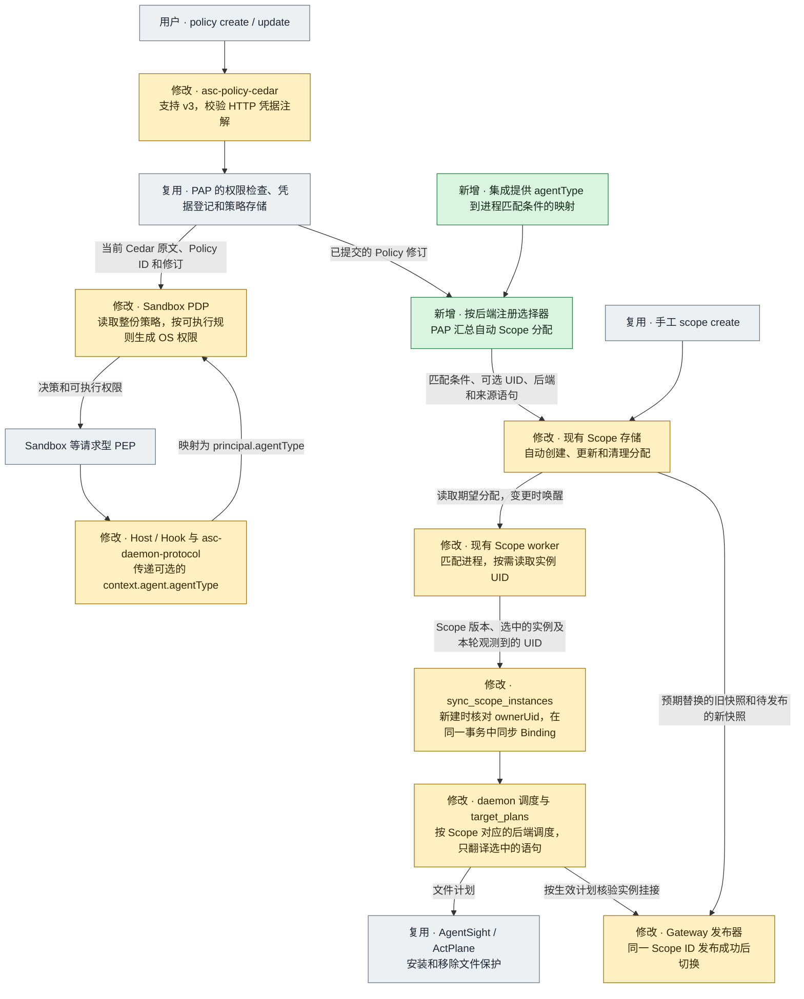

# AgentSecCore 基于 Cedar 的统一策略管理与自动下发（方案设计）

[English](CEDAR_PRINCIPAL_POLICY_DEPLOYMENT.md)

**设计提案**

## 方案概览

- **背景**　目前，用户在 Cedar 策略中定义允许或禁止的行为，还要手工维护 Scope，指定策略适用于哪些进程。Cedar 尚未统一表达这两部分信息，系统也就无法仅凭策略完成自动下发。
- **目标**　以 Cedar 作为统一的策略格式。用户只需写一份策略，系统就能将它自动下发到匹配的进程，也能在收到授权请求时直接使用它。
- **方法**　用户通过 Cedar 的 `principal` 条件指定策略适用于谁。对于下发类策略，系统在内部自动维护 Scope，匹配进程，再由 ActPlane 或 Gateway 执行相应规则。对于交互类策略，Sandbox 在收到授权请求时，由 PDP 按完整的 Cedar 原文求值。
- **兼容原则**　保留现有的手工 Scope 配置方式。已有策略可以继续按原流程分配和使用。

## 1. 一份 Qoder 策略如何生效

假设你希望 Qoder 不能读取 `/work/data/secret.txt`，并允许以 UID 1000 运行的 Qoder 在向 `api.github.com` 发送 HTTPS GET 请求时使用 GitHub 凭据。把两条规则写在同一份 v3 Policy 里，提交时 Qoder 可以还没启动。

- **Sandbox 在收到请求时判断。** 共享 PDP 从 PAP 装入整份 Qoder 策略。Host 或 Hook 声明本次请求来自 Qoder 时，`file.read` 禁止优先于通用读取许可，Sandbox 会挡住对 `secret.txt` 的读取。HTTP 凭据规则只匹配 `network.send`，不会给 Sandbox 增加文件或网络权限。
- **ActPlane 在文件保护安装成功后生效。** daemon 按集成提供的匹配条件找到 Qoder 根进程。首次挂接时，AgentSight 保护根进程，并尝试将已有后代纳入保护。随后从受保护父进程派生的子进程继承禁读规则。无法确认完整覆盖时，AgentSight 将 Binding 标为 `Degraded`，并在 enforcer 日志中记录原因。这个例子的文件规则没有 UID 限制。每个 enforcer 同时只支持一个活动 Binding，第二个根进程即使命中也可能报告冲突。[首次挂接的覆盖范围][actplane-tree] · [enforcer 并发限制][actplane-limit]
- **Gateway 在核验进程并挂接路由后提供凭据。** daemon 核实 Qoder 根进程属于 UID 1000，Gateway 核验挂接。该根及通过 UID、cgroup 成员检查的后代发起符合规则的请求时，Gateway 才注入凭据。同 UID 的独立进程若没有命中配置的选择条件，就不会加入分配。凭据工作负载若需要和其他用户进程隔离，请使用独立的非 root UID。[Gateway 成员核验][gateway-members]

将下面的策略保存为 `qoder.cedar`。两个凭据路径是示例，部署时填写已准备好的对应文件。

```cedar
forbid (
    principal is SecCore::Subject,
    action == SecCore::Action::"file.read",
    resource is SecCore::File
)
when { principal has agentType && principal.agentType == "qoder" }
when { resource.path == "/work/data/secret.txt" };

@id("qoder-github")
@modify("inject_credential")
@real_token_file("/secure/github-real")
@fake_token_file("/secure/github-fake")
@inject_header("Authorization")
@inject_format("auto")
@response_rewrite("true")
permit (
    principal is SecCore::Subject,
    action == SecCore::Action::"network.send",
    resource is SecCore::HttpEndpoint
)
when {
    principal has agentType && principal.agentType == "qoder" &&
    principal has ownerUid && principal.ownerUid == 1000
}
when {
    resource.host == "api.github.com" &&
    context.input.scheme == "https" &&
    context.input.method == "GET"
};
```

主示例包含凭据规则，daemon 须以 `--enable-gateway` 启动以装配凭据登记器。`agent-sec-cli gateway enable` 控制代理启用。实现 v3 后，有管理权限的调用者用下面的命令创建策略，daemon 自动分配 Scope。提交原始 Cedar 文件时显式选用 `--schema-revision 3`。省略该参数时 CLI 沿用 v1 默认值，v1/v2 继续支持手工 `scope create`，v3 只支持自动分配。[CLI 选择 schema][cli-schema] · [内置默认版本][schema-default]

```sh
agent-sec-cli policy create --name qoder --schema-revision 3 --file qoder.cedar
```

以后修改同一份策略时，将 `policy_id` 设为创建时返回的 Policy ID，使用同一 schema 版本提交更新。

```sh
agent-sec-cli policy update --policy-id "$policy_id" --name qoder --schema-revision 3 --file qoder.cedar
```

## 2. 架构与数据流

**基线**采用 PR #10258 的提交 `ce4aa771`。请求授权入口从 PAP 读取当前 Policy，按整份 Policy 的 principal 头部判断是否纳入 PDP。ActPlane 和 Gateway 的入口是手工 Scope，用户选择 Policy 修订和进程条件，daemon 为匹配实例建立 Binding，再从绑定的整份 Policy 分出文件和网络语句。PR 已支持混合 Policy 下发。[请求规则选择][admission] · [PAP 读取当前规则][read] · [文件与网络计划][plan]

上例生成两个自动 Scope。文件 Scope 匹配 Qoder，凭据 Scope 匹配以 UID 1000 运行的 Qoder。每个 Binding 对应一个具体进程实例。

图中绿色为新增，黄色为修改，灰色为复用。



`policy create/update` 调用 `asc-policy-cedar` 校验 v3，从原始语句识别凭据引用并保留主体条件。凭据注入只接受后端支持的 HTTP `permit`，其动作须明确为 `network.send`，资源须为 `SecCore::HttpEndpoint`。带凭据注解的语句若未限定动作或也可能匹配 OS 请求，写入时报错。PAP 检查管理权限，校验并登记带注解的凭据语句，随后保存整份 Policy。此时目标进程可以尚未启动。合法普通网络规则的可执行性由 Gateway 在发布 Scope 时检查。若代理已启用，凭据登记本身会刷新正在服务的 Gateway 配置。刷新失败时，Policy 写入失败，新修订未提交，Gateway 按现有流程尝试停代理并撤下流量。查询反映实际可用性。只有 Policy 提交后才会校验该修订的自动 Scope 候选。[PAP 写入路径][write] · [HTTP 编译器][http-compiler] · [HTTP 动作和资源校验][http-action]

**主体字段。** v3 在 `seccore.system` 的 `SecCore::Subject` 上提供两个可选属性。`agentType`（String）表示 Agent 类别，`ownerUid`（Long，取有效 Linux UID）指定目标进程的 UID。v1/v2 手工 Scope 用 `scope create --owner-uid` 提供目标值，v3 从 Cedar 条件读取，daemon 仍从 `/proc` 核实实际 UID。凭据分配需要持续匹配进程、显式指定非 root UID，并通过既有凭据管理检查。[手工 Scope 参数][scope-cli] · [UID 核验][uid-read] · [凭据 Scope 契约][scope]

## 3. 请求路径：共享 PDP 在请求到来时判定

### 未提供 agentType 时的默认行为

`agentType` 对所有动作都是可选的。请求省略类别时，通用许可仍可命中，带有 `has agentType && …` 的专属许可或禁止均不命中。若要在已有通用读取许可时仍只让明确声明 Qoder 的请求读取指定文件，可使用下面的禁止规则。声明 Qoder 的请求仍需匹配一条许可。[Cedar 授权语义][cedar]

```cedar
forbid (
    principal is SecCore::Subject,
    action == SecCore::Action::"file.read",
    resource is SecCore::File
)
when { resource.path == "/work/private/config.json" }
unless { principal has agentType && principal.agentType == "qoder" };
```

这条排除式规则可由请求 PDP 求值。首版自动分配只支持第 4 节列出的正向选择条件，因此查询结果应显示该规则在 ActPlane 上的范围限制。请求方自报的类别适合分类。凭据发放和权限提升需要独立的授权依据。

### 装载原文并按请求求值

- **策略从哪里来。** v3 的写入、读取和 PDP 装载入口都接纳第 1 节的混合策略。PAP 通过现有 `AuthorizationPolicySet` 返回完整 Cedar 原文、Policy ID 和修订。PDP 将全部语句交给 Cedar 求值。[准入判断][admission] · [PAP 读取][read]
- **Sandbox 执行哪些规则。** PDP 装载时从可能匹配文件访问的语句中收集路径。只匹配 `SecCore::HttpEndpoint` 的语句即使动作不限，也跳过文件路径检查。生成启动权限时，Sandbox 查询普通写入，操作为 `write`。只禁 `delete` 的条件可通过路径检查，在这次求值中不命中。若条件为“删除或路径等于 `/work/A`”，路径检查须保留 `/work/A`，Cedar 据此禁止普通写 A，普通写 B 仍由其他规则决定。匹配的禁止优先，没有匹配许可时默认拒绝。实际删除由 ActPlane 在操作发生时控制。[PDP 装载与求值][pdp-load] · [现有 Sandbox 文件条件检查][sandbox-file-conditions] · [ActPlane 的删除保护][actplane-delete]
- **主体从哪里来。** 请求 schema 识别可选的 `agentType` 和 `ownerUid`。Host 或 Hook 提供 `context.agent.agentType` 时，将其映射到 `principal.agentType`。Sandbox 省略 `ownerUid`，因此 `principal has ownerUid` 为假，含有 `&&` 或 `||` 的条件照原文交给 Cedar 求值。沿用现有请求、决策和 OS 权限格式。[请求 schema 构造][request-schema] · [请求协议][wire-agent] · [主体构造][pdp-subject] · [OS 授权接口][auth]

## 4. 部署路径：选择后端、发现进程、生成计划

1. **选择要下发的语句。** daemon 启动时注册 ActPlane 和 Gateway 的选择器。Cedar 编译器提取每条语句的动作、资源类型和主体条件，PAP 将同一结果交给各选择器，再按返回的进程范围生成 Scope。ActPlane 检查可能匹配文件访问的语句，缺少精确 agentType 时报告未分配。Gateway 跳过仅匹配进程启动的语句，收集可能影响 HTTP 凭据使用的限制。每条凭据授权都须在本条语句中给出可推导的 `agentType` 和非 root 的 `ownerUid`。条件缺失时仅报告该语句未分配，其他授权仍可独立下发。首版支持常量相等和 `has` 守卫的正向合取。新增下发后端时，实现并注册对应选择器即可。[现有 Cedar 文件和网络投影][projection] · [后端计划入口][plan]
2. **解析进程匹配条件。** daemon 启动时读取集成提供的 `agentType` 映射，按当前策略重算分配。每个类别使用一个现有 matcher，可选 `processName`、规范化的绝对 `executable` 或完整路径参数 `cmdlineArg`。脚本型 Agent 可配置安装入口，避免仅凭 `node` 或 `python` 进程名选中无关程序。Scope worker 匹配进程。对指定 `ownerUid` 的自动 Scope，worker 将本轮扫描实际读到的 `ProcessFingerprint.uid` 按完整 `ProcessIdentity` 随实例列表传给 `sync_scope_instances`。新建 Binding 时直接与目标 `ownerUid` 比较，缺少该实例的本轮观测或 UID 未知时等下一轮。观测值仅供本轮同步使用，无需核验标记、数据库字段或额外读取 `/proc`。查询区分“类别未配置”和“已配置，等待进程”。[进程匹配条件][matcher] · [UID 筛选][uid] · [扫描中的实例和 UID][observed-uid] · [现有同步接口][scope-sync-input]

   - **Gateway 凭据。** 每轮扫描只接纳本轮已核实 UID 等于 `ownerUid` 的实例。若已绑定实例的 UID 无法确认或已确认不匹配，将其移出凭据匹配集合，由 Binding 同步清理该实例的凭据挂接。
   - **ActPlane 文件保护。** 对带 `ownerUid` 的文件规则，若本轮读不到 UID，此前已核验的文件 Binding 继续跟随同一 Policy 的最新修订，前提是进程实例和策略范围都相同。另一份限定 `ownerUid` 的 Policy 即使命中同一进程，也要等本轮观测值与目标 UID 相符才能新建 Binding。确认 UID 不匹配、实例退出或 PID 被复用时，清理原实例的 Binding。[现有发现器的实例保留逻辑][uid-reconcile]

3. **复用 Scope 和 Binding。** 按规范化后的匹配条件、可选 UID 和后端分组。每组都是现有 Scope 类型的一个实例，沿用其中的 Policy 快照，用 Policy ID、修订和语句 ID 或位置记录本组的规则。这样 Qoder 的凭据挂接撤下时，文件 Scope 仍可继续保护该进程。自动 Scope 的校验、UID 处理和凭据成员登记或恢复均以本组语句为准，手工 Scope 继续使用完整快照。两者共用进程发现和 Binding 同步。实例的 boot ID、PID namespace、PID 和启动时间由 daemon 保存在 SQLite。[Scope 快照及选择条件][scope-record] · [Binding 与实例标识][binding]
4. **按 Binding 调度，再翻译选中的语句。** daemon 在调用 `target_plans` 前决定是否需要 Gateway 锁。对自动 Binding，只有本次选中了 Gateway 规则，或还有历史 Gateway 挂接待清理时，才取这把锁。这样，即使同一份 Policy 含凭据规则，纯文件 Binding 也可在 Gateway 忙时安装或撤销保护。`target_plans` 按 Scope 的引用从固定修订中取出语句。对已绑定实例，只消去 Scope 已完整核实的主体条件，保留其他谓词和来源，再交给现有文件翻译器。请求 PDP 仍保留原始条件。[基线调度判断][schedule] · [文件翻译器][translator] · [计划编译][plan]
5. **更新凭据 Scope。** 手工 `scope create` 每次创建新 ID，校验失败就返回错误，候选不会写入 Scope 存储。若已保存，随后准备或启动发现失败，PAP 会尝试清理本次新建的 Scope。自动更新复用原 Scope ID 和已发布的快照。每次从 PAP 当前策略重算候选，收齐可能适用的网络规则，包括其他 Policy 中无注入注解的 `forbid`，复用手工路径的整 Scope 编译、owner UID 和凭据校验。手工创建仍执行原有的快照一致性检查。校验被拒时，只记录本次修订、相关语句和原因。当前 Scope 继续按原状工作。首次校验被拒则没有该 Scope 的凭据路由。重试时重新读取 PAP。[手工创建][scope-create] · [手工准入][manual-admission] · [创建后清理][manual-start-cleanup] · [整 Scope 编译][scope-compile]

   **发布。** 自动更新将同一 Scope ID、预期替换的旧快照和候选新快照显式传给现有发布器。发布器与进程挂接串行切换，核对旧快照仍在生效、PAP 仍要求该候选。本 Scope 用传入的新快照编译，其他 Scope 使用各自的生效快照。发布成功后才切换供挂接的快照。Gateway 关闭时，准备完成只表示等待启用。若应用主机路由等发布操作失败，沿用手工路径的处理，尝试停止代理并撤下流量，查询反映实际可用性。[快照核验][snapshot-check] · [现有计划读取][active-plans] · [Gateway 发布][host-publish] · [发布失败处理][gateway-publish-error] · [停代理与撤路由][gateway-withdraw]

   **挂接进程。** 新 Qoder 只按仍在服务的 Scope 挂接。Binding 和 Scope 网络计划使用同一快照的语句，按手工路径核验进程实例、UID、凭据及实际 cgroup 是否与其他 Scope 重叠。若挂接期间版本切换，按当前快照重新核验。只满足被拒候选条件的进程，或路由已撤下的进程，都不能通过这次分配取得凭据。若挂接部分完成后失败，Gateway 按现有逻辑隔离该 Binding。其他 Binding 在路由重算成功时继续服务，重算也失败则进入同一停代理、撤路由流程。[Binding 快照检查][binding-snapshot] · [挂接核验][gateway] · [进程重叠检查][overlap] · [Binding 失败处理][binding-isolation]

**混合 Policy。** 手工把文件和凭据放在同一个 Scope 时，先装文件保护，首次失败就结束本轮挂接。自动下发会建两个 Scope，各自走对应后端的手工下发路径。文件保护失败时，只要凭据规则自身通过校验，Gateway 仍可发布，查询分别报告两条规则的结果。写入 v3 Policy 的调用者须具备手工分配所需的管理权限，涉及凭据时还须通过原有凭据管理检查。例如，凭据规则选中了 Qoder 却未指定有效的非 root UID，Gateway 报告缺少目标 UID，不创建挂接。[手工混合下发测试][mixed-manual]

**ActPlane 更新。** AgentSight 客户端先校验新目标，再移除旧目标，最后安装新目标。将“禁读 A”改为“禁读 B”时，可能 A 的保护已撤下，B 又安装失败。查询应记录 A 已撤下，并报告 B 的实际结果。如果安装请求超时，B 的状态先记为待核实，由协调器继续核对。[AgentSight 客户端更新流程][actplane-update]

## 5. 生命周期、兼容与查询

- **写入与恢复。** daemon 在启动、重试和现有周期任务中核对 PAP 当前的 v3 Policy 与已保存的自动 Scope，任一列表为空也要核对。Policy 提交后发出的通知会提前触发同一次核对。后续轮次补建遗漏分配、清理失去来源的分配，并重试临时失败的操作。使用自动来源、规范化 matcher、UID 和分配类型（文件或凭据）定位同一分配。来源修订或所选语句变化时，在同一事务中核对当前源修订、更新期望分配并递增 Scope 版本，提交后唤醒原有 worker。回执与清理均核对版本，重复通知不会重建同一分配。 当前 v3 原文快照合计最多 4096 份、序列化后最多 16 MiB。新增或更新在同一写事务中检查容量。旧库已超限时暂缓自动规划，仍可启动、清理手工 Scope，以及删除或缩小 v3 Policy，回到限额后恢复规划。
- **自动更新存活实例。** worker 通过 `sync_scope_instances` 在同一事务中按 Policy 和完整进程实例查找 Binding。新建时使用第 4 节的 UID 核验。已成功部署且目标修订和语句相同时跳过。文件 Binding 的目标修订或语句变化时，保留 ID、递增修订，由现有协调器重新部署。若另一个 Binding 占用 enforcer 导致安装失败，占用解除后的下一轮扫描确认进程与当前策略仍匹配，就用原 Binding 重试。凭据 Binding 按 Gateway 实际在服务的 Scope 版本挂接或更新。部署结果以后端回执为准。[现有 Binding 同步][binding-sync]
- **并发更新与撤销。** 同一 Scope 的扫描串行执行。提交时在同一事务中核对 Scope 版本、进程实例和 Binding 状态，版本过期就重新扫描。保留的文件 Binding 只在原实例和原范围内更新。确认实例失配（包括 UID 改变、退出或 PID 复用）或 Policy 移出时，只撤销对应 Binding。协调器按 Binding 串行下发和清理，按 ID、修订和目标实例核对回执，防止旧扫描或迟到回执重新激活已撤销的 Binding。ActPlane 沿用手工下发的安装和删除协议。[协调器回执检查][binding-receipt] · [ActPlane 安装与撤销][actplane-lifecycle]
- **自动 Scope 的创建和清理。** 首个来源出现时创建 Scope，只要仍有策略引用，即使没有匹配进程也保留。用户对有来源的自动 Scope 执行 `scope delete` 时，提示通过来源 Policy 修改或撤销分配，保留现有挂接。移出最后一个来源后，daemon 停止接纳新实例，调用现有删除流程清理 Binding、路由和 Scope。共享 Scope 中，显式删除一份 Policy 只撤回它的授权，即使上一次候选更新被拒也照常撤回。如果无法单独撤下该路由，就先停用受影响 Scope 的路由，待有效计划发布后恢复。重试时从 PAP 当前策略重算。手工 Scope 仍由用户管理。[Scope 删除流程][scope-cleanup]
- **Gateway 变更目标 UID。** 同一个旧 Scope 的两份凭据分别从 UID 1000 移到 UID 1001 和 1002 时，一起校验所有相关目标。准入失败，原范围继续服务；准入成功，一次提交相关 Scope 和完整成员关系，按最终成员列表决定凭据退役。新 UID 在路由发布且实例通过核验后使用凭据。无关 Scope 独立发布。[凭据成员更新][creds]
- **Gateway 重启恢复。** 先停用受影响的自动路由，包括上次运行遗留的数据面路由。daemon 用 PAP 当前的策略和集成当前的进程匹配配置重新推导 Scope。只有来源 Policy 修订、所选语句和进程范围（匹配条件及目标 UID）都一致时，才恢复原计划。来源已删除或不再匹配的旧分配按现有流程清理，其余变更按重新推导的 Scope 发布，并核验进程后挂接。在等待或核对失败期间，该路由持续停用。例如，Scope 版本 2 被拒、版本 1 仍在服务时重启，若 PAP 中的策略仍对应版本 2，就重建并重新校验版本 2。校验仍失败，路由保持停用，直到发布有效计划。映射文件缺失时使用内置映射；文件损坏或不可读时，报告配置错误，暂停依赖映射的自动分配，自动凭据路由保持停用。修复映射后重启。管理接口、手工 Scope 与 Sandbox 请求路径仍可用。同一 Scope 中单独退役的凭据保持停用，其余有效凭据在重新核验后恢复。手工 Scope 仍按固定快照恢复。[基线恢复与发布顺序][gateway-recovery] 手工和自动撤回都对新连接撤销路由。共享监听器继续服务其他 Binding 时，已建立的代理连接仍可能使用该监听器。若撤回后存活进程仍处于失去 Binding 的受管 cgroup，现有 Gateway 检查可能拒绝重新挂接，直至进程退出。
- **兼容手工 Scope。** schema revision 1/2 保留原有 principal 分流和手工部署语义。首版中 v3 的部署由 daemon 自动分配。如果 `scope create` 的引用列表中含 v3 Policy 修订，PAP 拒绝整次创建，指出该修订并提示使用自动部署。Cedar 策略使用 `principal.agentType`，Sandbox/Hook 请求使用 `context.agent.agentType`。两处旧拼写 `agent_type` 均不兼容，手工 Scope 仍使用 `processName`。既有 Scope 固定选定的 Policy 快照，源 Policy 更新或删除后仍由用户管理。存量记录按手工来源解释。原有 PID、进程名、可执行文件和脚本参数入口继续可用，PID 分配只绑定首次确认的实例。自动 Scope 与手工 Scope 的生命周期独立。若 Gateway 遇到无法共存的跨 Scope 挂接，保留已有部署并显示冲突。[手工 selector][matcher] · [Gateway 重叠检查][overlap] Cedar 校验拒绝旧属性，包括存在性检查。启动时检查当前 Policy、Scope 和 Binding 的固定快照；存量记录继续使用旧属性时，报告待迁移的 Policy ID 和修订。升级步骤见[策略 CLI 指南](../../../../docs/user-guide/zh/agent-sec-core/policy-cli.md#cedar-policy-源码)。
- **可观察与回退。** 在策略查询中，按修订、语句和执行路径显示原因及状态，例如 PDP 已可用、缺少类型配置、等待进程、后端不支持、部分成功、已应用或待撤销。Policy 保存成功与后端已应用分别呈现。Gateway 查询同时显示当前可服务的版本（或路由不可用）及最近一次新增或更新的版本、结果和失败原因。生效版本标识该 Scope 的快照。Gateway 的发布序号由所有 Scope 共享，单独记录。迟到的失败回执只归到对应尝试。降级前先用支持 v3 的 daemon 删除 v3 Policy 或将其改写为受支持的旧版策略，等待其自动部署、进程挂接和凭据引用清理完毕，旧 daemon 会检查 SQLite 版本及完整表结构。只有旧版能打开清理后的数据库并读出保留的手工 Scope 时，才支持直接切换二进制。若实现变更了数据库格式，须按该实现支持的旧格式恢复流程回退。

## 6. 实现拆分与验收

以下四项任务共用第 1 节的 Qoder 策略。**主示例**只给凭据规则指定 UID。**文件也限定 UID 的变体**用于验证进程 UID 核验。在主示例的文件规则中，将第一条 `when` 替换为 `when { principal has agentType && principal.agentType == "qoder" && principal has ownerUid && principal.ownerUid == 1000 }`。这样文件和凭据两条规则都明确要求 UID 1000。

1. **v3 写入与 Sandbox 请求。** 扩展共用的 v3 准入判断、HTTP 凭据校验、请求 schema 和 Host/Hook 主体映射。在 PAP 读取接口及 Sandbox PDP 中落实第 3 节的原文装载、路径收集和请求求值。

   - **从 CLI 写入。** 用第 1 节的创建和更新命令导入主示例，核对保存的 schema revision 为 3。有权限的调用者可在 Qoder 启动前登记凭据，缺少凭据管理权限的调用者不能创建或覆盖该规则。另用旧版文件验证省略版本参数仍按 v1 导入。
   - **从真实 Hook 到 PDP。** 触发一次真实 Cosh Sandbox Hook，用适用于 `"cosh"` 的文件禁读规则和通用读取许可验收。核对实际发出的请求包含 `context.agent.agentType = "cosh"`，PDP 中的 `principal.agentType` 命中该禁止，返回的文件权限应禁止读取目标文件。另发送省略类别的请求，按第 3 节默认逻辑求值。仅发送旧拼写 `agent_type` 的请求由协议层报告未知字段。[Hook 发送端][hook-request] · [请求协议][wire-agent] · [主体构造][pdp-subject]
   - **验证整份混合 Policy。** 通过创建和更新提交 Qoder 示例，核对 PAP 返回本次提交的原文、ID 和修订，PDP 装入其中的两条语句。保留旧版通用读取许可，对比“混合策略”和“仅有文件禁止”两种情况下的 Sandbox 决策和文件权限，两者应相同。在没有 `network.use` 许可时，HTTP 规则不能授予 OS 网络权限。Gateway 仍可从同一修订取得凭据语句。在同一份策略里加一条无凭据注解的普通禁止规则，动作不限，资源限定为 `SecCore::HttpEndpoint`，条件是 `resource.host == "api.github.com"`。核对 PAP 保存原文、PDP 装入全部三条语句。请求读取测试目录时，Sandbox 应挡住目标文件，并允许读取对照文件。Gateway 单独报告该候选计划的结果。将凭据注解改挂到未限定动作的语句上，写入应失败。
   - **只禁止删除。** 通过 CLI 保存并更新一份含 Qoder 删除禁止的 v3 策略，在同份策略中另加一条针对其他文件的禁读规则。用允许启动并读写测试目录的策略作对照。分别发送 Qoder、Cosh 请求，有无删除禁止时，每种请求的 Sandbox 决策和 OS 权限都应一致，Qoder 的禁读仍生效。再以无其他文件保护、原本可删除的测试文件验证实际执行。仅用 Sandbox 时这条规则不拦删除。同一修订由 ActPlane 成功挂接到 Qoder 后，删除被挡住，普通写入仍可成功。查询分别显示两个后端对该语句的结果。再把禁止条件改为“删除或路径等于 `/work/A`”，在有通用写许可时，单独通过 Sandbox 验证普通写 A 被阻止，对照文件 B 仍可写。

   用 `authorized_sandbox` 向 daemon 发起 `process.spawn`，声明 `agentType = "qoder"`，省略 `ownerUid`。允许测试程序启动、读取运行所需文件和工作目录，并申请测试目录的读取权限。选取两个原本都可读、且未受 ActPlane 文件保护的文件，仅对目标文件设置下列一条 `forbid`，另一文件作对照。每次核对 PDP 装载的语句和 `effective_permissions`，并让已启动的同一测试程序实际读取两个文件。[Sandbox 授权入口][sandbox-pep]

   - `(principal has agentType && principal.agentType == "qoder") && (principal has ownerUid && principal.ownerUid == 1000)` 中的 UID 条件为假，禁止未命中，目标文件和对照文件均可读取。
   - `(principal has agentType && principal.agentType == "qoder") || (principal has ownerUid && principal.ownerUid == 1000)` 中的 Qoder 条件为真，禁止命中，优先于通用许可，目标文件读不到，对照文件仍可读取。自动 Scope 无法下发这个含 `||` 的条件时，PDP 仍应得到相同结果。

2. **自动 Scope 与进程发现。** 在 daemon 中推导分配，将来源语句随 Scope 快照保存，并接入第 5 节的恢复流程。通过现有 worker 核对两个 Scope 及其 Binding，凭据 Scope 的生效快照由测试数据提供。 分别达到数量和字节限额后写入，确认被拒的写入保留旧修订。打开已有超限数据库，完成手工 Scope 删除，缩小 v3 数据后观察自动规划恢复。

   - **从配置到进程。** 用主示例先保存策略而不配置 Qoder 匹配条件，查询应显示“类别未配置”。补齐集成配置并重启 daemon，原策略应显示“等待进程”。启动匹配的 Qoder 后，为符合条件的实例建立 Binding。再覆盖两个同类实例、不同 UID、PID 复用和重复通知。 再使用损坏的映射重启，核对配置错误、手工和 Sandbox 操作仍可用，以及自动凭据路由保持停用。
   - **自动恢复漏建和漏删。** 保持 daemon 与匹配的 Qoder 运行，全程依靠周期任务恢复，不重启或手工重试。先确认 Qoder 能读取目标文件。

     - **丢失创建通知。** 从零个自动 Scope 开始，创建首份文件禁读 Policy，丢弃通知。核对 Scope 已创建、Binding 已挂接，Qoder 重新打开目标文件时读取被阻止。
     - **丢失删除通知。** 删除上述唯一来源 Policy，丢弃通知。核对 Scope 与 Binding 清理完毕，Qoder 重新打开同一文件时可以读取。
     - **首次写入失败。** 另起一轮，正常投递创建通知，让首次 Scope 写入遇到临时存储错误。解除故障，核对后续轮次完成挂接，Qoder 重新打开文件时读取被阻止。
   - **Scope 的归属和清理。** 两份策略共享同一范围时，首份创建 Scope，直接 `scope delete` 应提示修改来源 Policy，并保留两份分配。删除一份 Policy 后 Scope 继续存在，移出最后一份后自动清理。无进程时仍保留有来源的 Scope。手工 Scope 的旧快照独立存续。手工引用 v1/v2 可以成功，引用 v3 或混合引用时明确报错，整次创建不落库。
   - **验证直接降级条件。** 保留一份旧版手工 Scope，按第 5 节清理 v3 数据后，让旧版 daemon 打开这份数据库的副本并查询该 Scope，核对其 ID 和固定的 Policy 修订。将实测结果作为是否支持直接降级的依据。
   - **区分两种文件范围。** 在进程匹配且本轮 UID 未知的条件下，主示例的文件 Scope 可建立 Binding，凭据 Scope 等待 UID 核验。改用文件也限定 UID 的变体，首次 UID 未知时两边都不建 Binding。核实 UID 1000 后建立两个 Binding，再让该实例一轮读不到 UID，验证凭据 Binding 进入清理、文件 Binding 保留。确认 UID 失配或实例退出时，原文件 Binding 进入清理。
   - **同一进程的旧绑定与新绑定。** 先用文件 Policy A（`ownerUid == 1000`）绑定一个符合条件的 Qoder。保持进程实例及范围不变，在下一轮扫描前更新 A，并新增同样限定 `ownerUid == 1000` 的文件 Policy B。本轮读不到 UID 时，确认 A 保留 Binding ID 并更新到新修订，B 没有 Binding。下一轮实际读到 1000，才为 B 新建一个 Binding。本例检查数据库里的绑定，后端安装结果另行验证。另从 UID 未知这一步改为读到 1001，确认 A 进入清理，B 仍无 Binding。检查从扫描结束到 Binding 写入期间没有额外读取 `/proc`。

3. **ActPlane 文件规则闭环。** 扩展部署计划编译与 AgentSight 翻译入口。在 Linux 上用主示例，让一个 Qoder 在首次挂接前启动一个辅助进程，挂接成功后再由该根启动同一程序的第二个实例。两个辅助进程都使用根的 UID，且不单独匹配 Qoder。在目标文件原本可读、仅启用这份 ActPlane 文件保护的条件下，三个进程分别重新打开并读取同一文件。完整覆盖时，三次读取都应被阻止。另测无法确认某个已有后代受保护的情形。通过 AgentSight 的 `GET /api/enforcement/bindings` 核对该 Binding 的 `state: "degraded"`，再按 `request.binding_id` 在 `agentsight-enforcer.service` 日志中核对具体覆盖缺口。AgentSecCore 对此报告 `AGENTSIGHT_DEPLOYMENT_NOT_READY`。再启动另一个 UID 的独立 Qoder，确认发现器选中它、第二个 Binding 报告冲突。第二个根和同 UID 的独立异类进程仍可读取。Sandbox 的请求决策单独核验。同一根再匹配第二份文件 Policy 时也应报告冲突，原有保护继续生效。另用单份策略让根 A 退出，等待其保护撤销，保持根 B 运行。下一轮扫描仍匹配 B 时，应自动重试已有 Binding。验证安装成功后 B 对同一文件的读取被阻止，全程无需执行 `scope retry`。再验证已退出或已不匹配的 B 不会重新挂接。

   - **替换文件规则。** 保持根进程 PID 和启动时间不变，把禁读 A 改为禁读 B。验证 Binding ID 不变、修订递增，A 恢复可读、B 受保护。用文件也限定 UID 的变体另起一轮，让已核实的同一实例在 A 切换到 B 时暂时读不到 UID。验证已有 Binding 切换到 B，另一个从未核验 UID 的实例仍等待核验。另测 A 的保护已撤下、B 在安装生效前明确失败。重试前实际读取两个文件，在通用读取许可下两者都应可读，查询应显示 A 已撤下、B 安装失败。
   - **混合策略的文件禁读。** 使用任务 1 的三条语句，让普通 HTTP 禁止也匹配 Qoder，保留未限定的动作和 `SecCore::HttpEndpoint` 资源。让已知能读取两个文件的 Qoder 根进程在 Sandbox 外运行，只用 ActPlane 提供文件保护。提交策略并等待该根的文件 Binding 安装成功，再让它分别打开目标文件和对照文件。目标文件应被禁止读取，对照文件应可读。核对文件计划只包含原文件禁令，Gateway 单独报告网络计划的结果。
   - **更新中撤销 Binding。** 分别让 UID 失配、PID 复用或 Policy 删除发生在更新前后，再送达旧扫描、迟到回执和清理重试。核对实际文件访问和 Binding 状态，确认旧结果不能恢复已撤销的绑定，旧清理也不会撤下新修订。另保留一项手工与自动路径的对照回归。延迟旧安装请求，等删除返回“目标不存在”后再送达，记录两条路径的实际结果。若两者均出现旧保护重新生效，单独评估后端协议。

4. **Gateway 与混合 Policy 闭环。** 扩展网络计划编译、Scope 发布与查询状态。对目标 UID 的变更，在发布流程中将新旧 Scope 的凭据成员一次移交。对共享 Scope 中已删除的授权，撤销其实际路由。在 Linux 上用实际后端验证以下行为。

   - **分别下发。** 用主示例验证 UID 1000 的 Qoder 读不到受保护文件，并确认该根进程及通过成员核验的同 UID 异类子进程可在规定的 host、scheme、method 上使用凭据。同 UID 的独立异类进程和不同 UID 的后代不能继承路由。让首次文件保护失败，验证独立的凭据仍可用，查询分别显示文件保护失败、凭据规则已应用。再让 Gateway 持续忙，验证来自同一混合 Policy 的纯文件 Binding 在此期间仍能安装和撤销文件保护。另用文件也限定 UID 的变体部署。待该实例的两条规则都生效后，让发现器一轮读不到 UID。在凭据挂接清理完成后、下一轮扫描前，确认该实例已不能使用凭据，受保护文件仍读不到。
   - **候选校验被拒。** 先让 UID 1000 的 Qoder 按版本 1 使用凭据。新增一条面向 UID 1001 但编译失败的分配，确认 UID 1001 的新进程无法通过这次分配取得凭据，原 Qoder 仍可使用。再在另一份 Policy 中为 UID 1000 加入无注入注解且当前编译器不支持的网络禁止，使版本 2 在整 Scope 编译时被拒。核对失败原因。原 Qoder 和新启动、符合版本 1 且通过挂接核验的 Qoder，均可按版本 1 使用凭据。保持同一 Scope ID 和同一个已挂接的 Qoder。让版本 1 只允许 GET，修正后的版本 3 允许 GET 和 POST。实测切换前 POST 无法使用凭据，发布成功后同一 POST 可以使用。再送达版本 2 的迟到失败回执，确认仍按版本 3 服务。 再将缺少 UID 的第二条凭据授权与一条合法授权同时提交，确认仅合法授权下发，独立的进程启动语句不进入 HTTP 计划。
   - **从 UID 1000 移到 UID 1001。** 从只给 UID 1000 的一份凭据授权开始。更新目标 UID，让新范围校验失败。两端发起同一请求，确认 UID 1000 仍可使用凭据，UID 1001 不能使用。修正并成功发布后，结果应相反。核对移交前后使用同一凭据对 ID，移交期间始终保有成员。只改 UID 也会改变 Cedar 源码，首次提交该新源码时，登记器仍须能读取原始凭据文件。另将同一旧 Scope 的两份凭据分别移到两个 UID，核对两份归属和旧 UID 的实际请求。再在旧路由停用后、移交完成前重启，验证恢复完成移交，期间旧 UID 无法重新取得凭据。
   - **候选被拒后删除已生效的授权。** 让两份 Policy 各向同一 Scope 提供一条可区分的凭据路由 A、B，再引入使新计划无法编译的规则。先验证候选在发布前被拒时 A、B 仍可用，然后删除提供 A 的 Policy，保留导致编译失败的规则。撤销完成后，分别用已挂接进程和新匹配进程发起只命中 A 的请求，两者都不能获得凭据。若能独立撤下 A，B 可继续服务。若无法安全拆开，查询显示该 Scope 的路由停用，真实请求应与状态一致。
   - **进程挂接失败。** 在手工和自动分配下分别保留一个正常挂接的 Qoder，让第二个独立 Qoder 在挂接过程中失败。路由重算成功时，实际请求应显示前者仍能使用凭据，后者不能通过本次绑定取得凭据。另用跨 Scope 的进程模拟重叠，确认在挂接时报告冲突。
   - **发布故障与重启。** 在手工和自动下发时触发相同的主机路由发布故障，比较错误、实际流量和查询状态。路由已撤下时，原 Qoder 和新 Qoder 均不能通过该路由使用凭据。保持 Cedar 修订和 UID 1000 不变，让路径 A、B 的两个独立进程持续运行。将 Qoder 的可执行文件匹配从 A 改为 B，重启 daemon，用同一条允许的请求核对两者：A 在恢复期间及恢复后都不能通过这份分配使用凭据，B 在通过核验并挂接后可以使用。另测版本 2 被拒后重启，重新校验仍失败时路由保持停用。授权删除已提交但 Scope 尚未清理时重启，核对期间和恢复后均不能使用已撤销的凭据。另在有两份凭据的同一 Scope 中退役其中一份并重启，核对只有剩余凭据恢复。

v3 主体字段确定后，任务 1 和 2 即可并行。任务 2 为部署记录来源语句。任务 3 和 4 使用生成的 Scope 和 Binding 验证实际文件访问、凭据请求及两者同时生效时的表现。

[admission]: https://github.com/agentic-os-org/ANOLISA/blob/ce4aa771b64db15cc8740893f0b19873dd1e0275/src/agent-sec-core/v2/crates/asc-policy-cedar/src/lib.rs#L33-L72
[cli-schema]: https://github.com/agentic-os-org/ANOLISA/blob/ce4aa771b64db15cc8740893f0b19873dd1e0275/src/agent-sec-core/v2/apps/asc-cli/src/commands/policy.rs#L142-L173
[schema-default]: https://github.com/agentic-os-org/ANOLISA/blob/ce4aa771b64db15cc8740893f0b19873dd1e0275/src/agent-sec-core/v2/crates/asc-policy-cedar/src/schema.rs#L9-L29
[wire-agent]: https://github.com/agentic-os-org/ANOLISA/blob/ce4aa771b64db15cc8740893f0b19873dd1e0275/src/agent-sec-core/v2/crates/asc-daemon-protocol/src/authorization.rs#L7-L14
[hook-request]: https://github.com/agentic-os-org/ANOLISA/blob/ce4aa771b64db15cc8740893f0b19873dd1e0275/src/agent-sec-core/v2/apps/asc-cli/src/sandbox/hook.rs#L175-L184
[pdp-subject]: https://github.com/agentic-os-org/ANOLISA/blob/ce4aa771b64db15cc8740893f0b19873dd1e0275/src/agent-sec-core/v2/crates/asc-pdp-runtime/src/request.rs#L103-L116
[manual-admission]: https://github.com/agentic-os-org/ANOLISA/blob/ce4aa771b64db15cc8740893f0b19873dd1e0275/src/agent-sec-core/v2/crates/asc-pap/src/service.rs#L482-L490
[schedule]: https://github.com/agentic-os-org/ANOLISA/blob/ce4aa771b64db15cc8740893f0b19873dd1e0275/src/agent-sec-core/v2/apps/asc-daemon/src/reconciliation.rs#L35-L58
[mixed-manual]: https://github.com/agentic-os-org/ANOLISA/blob/ce4aa771b64db15cc8740893f0b19873dd1e0275/src/agent-sec-core/v2/apps/asc-daemon/src/reconciliation/mixed_tests.rs#L338-L369
[scope-create]: https://github.com/agentic-os-org/ANOLISA/blob/ce4aa771b64db15cc8740893f0b19873dd1e0275/src/agent-sec-core/v2/crates/asc-pap/src/service.rs#L455-L465
[snapshot-check]: https://github.com/agentic-os-org/ANOLISA/blob/ce4aa771b64db15cc8740893f0b19873dd1e0275/src/agent-sec-core/v2/crates/asc-gateway-runtime/src/service.rs#L187-L199
[binding-snapshot]: https://github.com/agentic-os-org/ANOLISA/blob/ce4aa771b64db15cc8740893f0b19873dd1e0275/src/agent-sec-core/v2/crates/asc-gateway-runtime/src/binding.rs#L58-L81
[host-publish]: https://github.com/agentic-os-org/ANOLISA/blob/ce4aa771b64db15cc8740893f0b19873dd1e0275/src/agent-sec-core/v2/crates/asc-gateway-runtime/src/service.rs#L757-L791
[actplane-lifecycle]: https://github.com/agentic-os-org/ANOLISA/blob/ce4aa771b64db15cc8740893f0b19873dd1e0275/src/agentsight/crates/agentsight-enforcer/src/actplane.rs#L642-L720
[binding-receipt]: https://github.com/agentic-os-org/ANOLISA/blob/ce4aa771b64db15cc8740893f0b19873dd1e0275/src/agent-sec-core/v2/crates/asc-pcp/src/state.rs#L252-L258
[scope-cleanup]: https://github.com/agentic-os-org/ANOLISA/blob/ce4aa771b64db15cc8740893f0b19873dd1e0275/src/agent-sec-core/v2/crates/asc-pap/src/service.rs#L669-L704
[gateway-publish-error]: https://github.com/agentic-os-org/ANOLISA/blob/ce4aa771b64db15cc8740893f0b19873dd1e0275/src/agent-sec-core/v2/crates/asc-gateway-runtime/src/service.rs#L265-L275
[manual-start-cleanup]: https://github.com/agentic-os-org/ANOLISA/blob/ce4aa771b64db15cc8740893f0b19873dd1e0275/src/agent-sec-core/v2/crates/asc-pap/src/service.rs#L499-L533
[binding-isolation]: https://github.com/agentic-os-org/ANOLISA/blob/ce4aa771b64db15cc8740893f0b19873dd1e0275/src/agent-sec-core/v2/crates/asc-gateway-runtime/src/binding.rs#L438-L485
[gateway-withdraw]: https://github.com/agentic-os-org/ANOLISA/blob/ce4aa771b64db15cc8740893f0b19873dd1e0275/src/agent-sec-core/v2/crates/asc-gateway-runtime/src/service.rs#L934-L965
[actplane-update]: https://github.com/agentic-os-org/ANOLISA/blob/ce4aa771b64db15cc8740893f0b19873dd1e0275/src/agent-sec-core/v2/crates/asc-agentsight-client/src/client/reconciliation.rs#L268-L297
[sandbox-pep]: https://github.com/agentic-os-org/ANOLISA/blob/ce4aa771b64db15cc8740893f0b19873dd1e0275/src/agent-sec-core/v2/crates/asc-pep-runtime/examples/authorized_sandbox.rs#L103-L121
[actplane-limit]: https://github.com/agentic-os-org/ANOLISA/blob/ce4aa771b64db15cc8740893f0b19873dd1e0275/src/agentsight/crates/agentsight-enforcer/src/actplane.rs#L650-L664
[read]: https://github.com/agentic-os-org/ANOLISA/blob/ce4aa771b64db15cc8740893f0b19873dd1e0275/src/agent-sec-core/v2/crates/asc-pap/src/service.rs#L361-L397
[plan]: https://github.com/agentic-os-org/ANOLISA/blob/ce4aa771b64db15cc8740893f0b19873dd1e0275/src/agent-sec-core/v2/apps/asc-daemon/src/reconciliation.rs#L154-L185
[auth]: https://github.com/agentic-os-org/ANOLISA/blob/ce4aa771b64db15cc8740893f0b19873dd1e0275/src/agent-sec-core/v2/crates/asc-daemon-protocol/src/authorization.rs#L93-L135
[matcher]: https://github.com/agentic-os-org/ANOLISA/blob/ce4aa771b64db15cc8740893f0b19873dd1e0275/src/agent-sec-core/v2/crates/asc-policy-types/src/scope.rs#L16-L61
[uid]: https://github.com/agentic-os-org/ANOLISA/blob/ce4aa771b64db15cc8740893f0b19873dd1e0275/src/agent-sec-core/v2/crates/asc-daemon-core/src/scope_discovery.rs#L82-L109
[uid-reconcile]: https://github.com/agentic-os-org/ANOLISA/blob/ce4aa771b64db15cc8740893f0b19873dd1e0275/src/agent-sec-core/v2/crates/asc-daemon-core/src/scope_discovery.rs#L122-L210
[binding]: https://github.com/agentic-os-org/ANOLISA/blob/ce4aa771b64db15cc8740893f0b19873dd1e0275/src/agent-sec-core/v2/crates/asc-policy-types/src/binding.rs#L11-L66
[gateway]: https://github.com/agentic-os-org/ANOLISA/blob/ce4aa771b64db15cc8740893f0b19873dd1e0275/src/agent-sec-core/v2/crates/asc-gateway-runtime/src/binding.rs#L84-L116
[scope-compile]: https://github.com/agentic-os-org/ANOLISA/blob/ce4aa771b64db15cc8740893f0b19873dd1e0275/src/agent-sec-core/v2/crates/asc-gateway-plan/src/compile.rs#L17-L79
[overlap]: https://github.com/agentic-os-org/ANOLISA/blob/ce4aa771b64db15cc8740893f0b19873dd1e0275/src/agent-sec-core/v2/crates/asc-gateway-runtime/src/binding.rs#L804-L839
[creds]: https://github.com/agentic-os-org/ANOLISA/blob/ce4aa771b64db15cc8740893f0b19873dd1e0275/src/agent-sec-core/v2/crates/asc-credential-store/src/store.rs#L280-L326
[translator]: https://github.com/agentic-os-org/ANOLISA/blob/ce4aa771b64db15cc8740893f0b19873dd1e0275/src/agent-sec-core/v2/crates/asc-policy-translator-agentsight/src/cedar.rs#L26-L57
[scope]: https://github.com/agentic-os-org/ANOLISA/blob/ce4aa771b64db15cc8740893f0b19873dd1e0275/src/agent-sec-core/v2/crates/asc-policy-types/src/scope.rs#L147-L182
[cedar]: https://docs.cedarpolicy.com/auth/authorization.html
[actplane-tree]: https://github.com/agentic-os-org/ANOLISA/blob/cc3e1e1ede1198ccbbb1f6a1271187c108d139b2/src/agentsight/crates/agentsight-enforcer/src/actplane.rs#L614-L636
[gateway-members]: https://github.com/agentic-os-org/ANOLISA/blob/ce4aa771b64db15cc8740893f0b19873dd1e0275/src/agent-sec-core/v2/crates/asc-gateway-runtime/src/binding.rs#L301-L328
[write]: https://github.com/agentic-os-org/ANOLISA/blob/ce4aa771b64db15cc8740893f0b19873dd1e0275/src/agent-sec-core/v2/crates/asc-pap/src/service.rs#L239-L315
[http-compiler]: https://github.com/agentic-os-org/ANOLISA/blob/ce4aa771b64db15cc8740893f0b19873dd1e0275/src/agent-sec-core/v2/crates/asc-policy-cedar/src/http.rs#L65-L125
[scope-cli]: https://github.com/agentic-os-org/ANOLISA/blob/ce4aa771b64db15cc8740893f0b19873dd1e0275/src/agent-sec-core/v2/apps/asc-cli/src/commands/scope.rs#L30-L40
[uid-read]: https://github.com/agentic-os-org/ANOLISA/blob/ce4aa771b64db15cc8740893f0b19873dd1e0275/src/agent-sec-core/v2/apps/asc-daemon/src/scope_discovery.rs#L382-L398
[observed-uid]: https://github.com/agentic-os-org/ANOLISA/blob/ce4aa771b64db15cc8740893f0b19873dd1e0275/src/agent-sec-core/v2/crates/asc-daemon-core/src/scope_discovery.rs#L16-L39
[scope-sync-input]: https://github.com/agentic-os-org/ANOLISA/blob/ce4aa771b64db15cc8740893f0b19873dd1e0275/src/agent-sec-core/v2/crates/asc-pap/src/lib.rs#L130-L139
[binding-sync]: https://github.com/agentic-os-org/ANOLISA/blob/ce4aa771b64db15cc8740893f0b19873dd1e0275/src/agent-sec-core/v2/crates/asc-policy-repository-sqlite/src/pap.rs#L357-L392
[gateway-recovery]: https://github.com/agentic-os-org/ANOLISA/blob/ce4aa771b64db15cc8740893f0b19873dd1e0275/src/agent-sec-core/v2/crates/asc-gateway-runtime/src/service.rs#L489-L530
[pdp-load]: https://github.com/agentic-os-org/ANOLISA/blob/ce4aa771b64db15cc8740893f0b19873dd1e0275/src/agent-sec-core/v2/crates/asc-pdp-runtime/src/cedar.rs#L23-L57
[sandbox-file-conditions]: https://github.com/agentic-os-org/ANOLISA/blob/ce4aa771b64db15cc8740893f0b19873dd1e0275/src/agent-sec-core/v2/crates/asc-pdp-runtime/src/path_conditions.rs#L90-L103
[actplane-delete]: https://github.com/agentic-os-org/ANOLISA/blob/ce4aa771b64db15cc8740893f0b19873dd1e0275/src/agent-sec-core/v2/crates/asc-policy-translator-agentsight/tests/cedar.rs#L101-L125
[active-plans]: https://github.com/agentic-os-org/ANOLISA/blob/ce4aa771b64db15cc8740893f0b19873dd1e0275/src/agent-sec-core/v2/crates/asc-gateway-runtime/src/service.rs#L718-L735
[request-schema]: https://github.com/agentic-os-org/ANOLISA/blob/ce4aa771b64db15cc8740893f0b19873dd1e0275/src/agent-sec-core/v2/crates/asc-pdp-runtime/src/lib.rs#L33-L44
[projection]: https://github.com/agentic-os-org/ANOLISA/blob/ce4aa771b64db15cc8740893f0b19873dd1e0275/src/agent-sec-core/v2/crates/asc-policy-cedar/src/lib.rs#L83-L137
[http-action]: https://github.com/agentic-os-org/ANOLISA/blob/ce4aa771b64db15cc8740893f0b19873dd1e0275/src/agent-sec-core/v2/crates/asc-policy-cedar/src/http.rs#L180-L200
[scope-record]: https://github.com/agentic-os-org/ANOLISA/blob/ce4aa771b64db15cc8740893f0b19873dd1e0275/src/agent-sec-core/v2/crates/asc-policy-types/src/scope.rs#L130-L145
