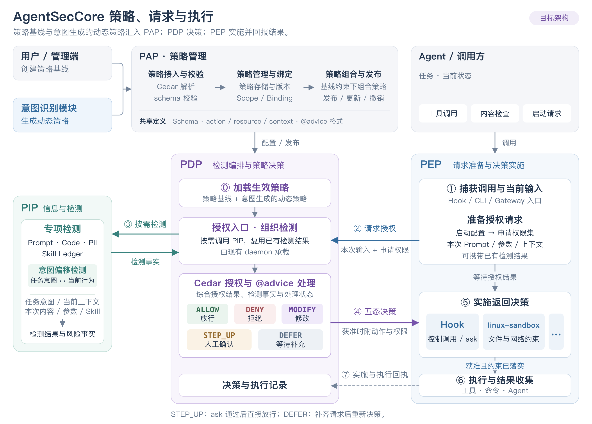

# AgentSecCore linux-sandbox PEP 设计

> 实现设计，更新日期：2026-10-29。验证命令与覆盖范围见第 6 节。
> 接入基线：主线 Rust V2，`b9850da71771efdd5d85fd250ad37f1fb45f6715`，不是当前工作树 HEAD。
> 运行时 schema 见 [`seccore-v2.cedarschema`](../../v2/crates/asc-policy-cedar/schema/seccore-v2.cedarschema)，用法见 [Sandbox 指南](../../../../docs/user-guide/zh/agent-sec-core/sandbox.md)。

## 1. 范围与架构

目标是复用现有 `linux-sandbox`，根据输入权限启动命令或 Agent，并返回实施和执行结果。CLI 直接接收权限集合；接入 PDP 时，由上层 PEP 完成授权、审批和回执，复用同一执行后端。首期支持文件只读、读写和禁止访问，网络 off/full，并扩展挂载级 noexec。权限在一次运行期间固定；不引入 Landlock，不提供目录 POSIX X 配置。



[查看 SVG 原图](assets/linux-sandbox-policy-flow.svg)

PAP 将用户策略基线和意图生成的动态策略作为可变策略对象管理，维护内容、版本和作用范围，校验后发布带版本的有效策略集及对应 schema、资源定义。PDP 在每次授权时从 PAP 读取所选策略的当前版本；PAP 管理和 PDP 授权均保留基线上限，动态策略只能在上限内授予权限，不能将两组 permit 简单合并来建立上限。`policies.cedar` 仅是示例或导入导出载体，不是运行时必需的固定文件。

PAP CREATE/UPDATE 接受 Cedar 源码并保存版本，PDP 按配置选择基线及可选任务策略；启动前授权、五态决策和执行回执由 PDP/PEP 实现，不要求 PAP 接管执行流程，也不把执行回执混入后端规则部署状态。

图展示整体策略架构，本设计聚焦 sandbox 启动，首期不接入 scanner。PEP 提交当前输入与申请权限；PDP 将请求转换为 Cedar 授权查询，结合策略中的 advice 形成五态决策和有效权限。PEP 内的 Linux adaptor 将权限转换成执行计划，`linux-sandbox` 安装约束并启动目标，沙箱外 supervisor 监督执行。

**PDP 负责授权，执行后端负责完整实施输入权限。** CLI 与上层 PEP 均通过 sandbox 执行，不能准确实施时拒绝启动，不回退宿主执行。文件和网络约束由子进程继承。接入 PDP 时，启动授权同时考虑 `process.spawn` 与 `file.exec` 两个视角，首期不逐次授权后代进程。

| 入口 | 权限来源与职责 |
|---|---|
| `sandbox run` | 调用方提供 `OsPermissionSet` 和命令；直接实施，不调用 PDP |
| 上层 PEP 启动命令或 Agent | 向 PDP 申请程序调用、文件及网络权限，再交给执行后端 |
| Hook 拦截工具调用 | `tool.invoke`；启动进程还涉及进程、文件和网络权限，组合流程另行设计 |
| 输入、工具结果或模型输出检查 | `content.accept`，由应用层 PEP 在交付前实施 |

## 2. 授权流程与接口

以下是上层 PEP 接入 PDP 的流程；纯执行 CLI 不参与该流程，入口见第 5 节。

1. **准备请求。** PEP 按实际 PATH、cwd 和执行视图解析程序，保留原始程序名及完整有序参数；从固定配置生成 `requested_permissions: OsPermissionSet`，纳入运行依赖、临时目录等需求，准备路径事实和后端能力。
2. **请求决策。** PDP 按请求类型映射 Cedar 查询与实体数据，依据已发布策略、请求范围及环境上限生成 `effective_permissions: OsPermissionSet`；必要运行依赖未获准则拒绝。
3. **完成处理要求。** STEP_UP 由 PEP 调用 ask，用户确认后直接继续；DEFER 补齐事实后再次 evaluate。修改后由 PDP 完成最终授权，流程见第 4 节。
4. **准备执行计划。** ALLOW/MODIFY 或已确认的 STEP_UP 经 PEP 核验后，adaptor 生成 `ExecutionSpec`；后端复核能力并固定对象；能准确实施才继续，否则返回具体的不支持原因。
5. **安装并执行。** 仅接受 exact 映射；后端报告约束安装成功后才能执行目标。准备成功不等于已经安装。
6. **回报结果。** supervisor 收集安装情况和进程退出结果，由 PEP 调用 report；等待、拒绝、安装失败也形成回执。

请求权限的生成在上层 PEP 内保留一个可替换接口：

```text
generate_requested_permissions(task, state, launch) → OsPermissionSet
```

默认读取固定配置，保留按任务与状态生成申请范围的接口；意图识别生成的动态策略通过 PAP 管理并进入 PDP。申请范围仍须 PDP 授权。申请范围在首次准备时确定，后续补充事实不扩大它；不新增服务，也不动态修改运行中权限。

PDP 新增两个内部 RPC，复用现有 daemon 通信；补充事实仍放在 request 中，策略更新经现有 PAP CRUD 接入：

```text
authorization.evaluate(request) → Decision
authorization.report(receipt)   → Ack
```

| 数据 | 必要内容 |
|---|---|
| request | 自定义 JSON：type=os、principal、请求/执行标识、launch（程序、完整有序 argv、cwd、相关环境）、requested_permissions、路径对象事实、PEP 能力 |
| Decision | decision_id、五态及对应载荷、最终动作绑定、策略集版本、接收期限、warnings；ALLOW/MODIFY/STEP_UP 附 effective_permissions |
| receipt | 决策引用、ask 确认结果、实施状态、是否启动、退出码/终止信号、时间及错误 |
| Ack | PDP 已记录回执，不表示命令成功 |

Pull 从 evaluate 开始；Push 接收已绑定动作的 Decision，进入相同的核验和实施流程。策略发布通知本身不构成执行授权。

回执进入现有安全事件日志，结构化结果放入 `SecurityEvent.details`，复用 SQLite/JSONL 存储，不另建回执库。每条回执直接上报一次；失败时保留实际执行结果并向调用方说明，不重新执行命令，不建设重试队列。审批信息不传入目标进程。

## 3. 权限及 Linux 映射

### 3.1 OS 权限结构与路径

`OsPermissionSet` 表达文件权限、挂载级执行限制和网络权限，供 `requested_permissions` 与 `effective_permissions` 共用；它不是 Cedar schema，也不是 Linux 执行配置。主体、动作、上下文和回执由通用授权类型表达。

权限条目采用实际绝对路径，不设 `scope/kind`，不定义请求侧通配符。文件路径表示文件自身，目录路径表示目录及其后代；按实际文件系统对象识别，不用尾部 `/` 判断类型。Cedar 文件资源仍只含 `path`，策略用相等或带目录分隔符的前缀条件匹配，不维护目录实体层级。

| Cedar 授权或条件 | 执行权限 |
|---|---|
| 文件读 / 写授权 | `rights` 中的 read / write；接入共享 schema 时对齐 `file.read / file.write` |
| OS 申请权限或环境上限中的禁执行范围 | 合并其 `execution.deny_paths`，按 noexec 语义实施；不从 Cedar 调用规则推导 |
| `resource.path == "/work/result.txt"`（目标为文件） | `path=/work/result.txt`，仅该文件 |
| `resource.path == "/work" \|\| resource.path like "/work/*"`（目标为目录） | `path=/work`，目录及后代，不含 `/work-other`；权限路径无需写 `*` |
| permit / forbid | allow / deny，保留禁止范围及对应处理要求 |
| `network.use` 对全网络资源 `all` 获准 | 请求 full 时授予 full；不请求网络时为 off |
| `process.spawn` / `file.exec` | 本次程序调用授权；不直接转换为挂载 X 权限 |

`effective_permissions` 示例，省略运行依赖；示例路径均为实际目录：

```json
{
  "version": 1,
  "filesystem": {
    "default": "deny",
    "rules": [
      {"effect": "allow", "path": "/opt/agent", "rights": ["read"]},
      {"effect": "allow", "path": "/work", "rights": ["read", "write"]},
      {"effect": "deny", "path": "/work/.git", "rights": ["write"]}
    ]
  },
  "execution": {"deny_paths": ["/work/downloads"]},
  "network": {"mode": "off"}
}
```

版本必须受支持，默认禁止未授权的文件访问，未知字段或冲突输入拒绝。首期 `rights` 仅含 read/write，W 包含 R；只读不承诺禁止执行。W 涵盖文件修改及目录内创建、删除、重命名。deny 优先于 allow，规则顺序或更深的路径不能越过明确禁止。`execution.deny_paths` 的实施边界见下节。

PDP 只转换文件精确路径、约定的目录前缀及启动时可固定的条件，有效权限不得超出申请范围、策略基线或环境上限。目录内的禁止范围和 advice 必须保留；不能用目录的一次 Allow 或当前文件枚举推导整棵子树授权。仅匹配目录本身的授权不能扩大为递归权限。依赖未来调用程序、操作类型等无法在启动时固定的限制，不能用本次启动参数代替；后端不能准确实施时返回 unsupported。

PEP 解析路径并绑定执行环境，将对象事实随请求交给 PDP；Linux adaptor 在实施前核验实际对象。目录通路由后端提供，不另设 POSIX 遍历 ACL。权限不改变宿主 chmod，实际操作仍受宿主 DAC 等限制。

### 3.2 后端能力与边界

复用 **bubblewrap 建立文件系统视图与 namespace，seccomp 实施基础和网络限制**。新增 noexec 在建立挂载时安装，既支持单文件 bind mount，也支持目录挂载；它是挂载属性，不改变宿主文件 mode，也不禁止目录遍历。

严格接口依赖系统 bubblewrap 0.10 或更高版本，通过 bind FD 固定挂载源。内层 helper 使用 `mount_setattr(AT_RECURSIVE)` 安装 noexec，再清空 capabilities、设置 no_new_privs、关闭控制 FD 并启动目标；不维护 bubblewrap fork。内层 helper 必须是静态 ELF，避免降权前加载目标文件视图内的动态库。`make build-sandbox` 生成该产物，发布校验同时验证静态链接。缺少 user namespace、bind FD 或所需 mount_setattr 支持时拒绝执行。

| 要求 | 实施方式或限制 |
|---|---|
| 只读 / 读写 / 禁止访问 | 复用只读挂载、可写挂载与路径遮蔽；保留宿主文件权限限制 |
| 指定文件 / 目录范围 noexec | 对对应挂载设置 noexec，覆盖该范围内可见子挂载；范围无法保持时拒绝 |
| 禁止脚本解释、复制后执行或所有别名执行 | 超出 noexec 能力；明确提出此类要求时 unsupported |
| 只允许写内容、禁止删除/重命名 | 不属于粗粒度 W，不能自动映射为目录 RW |
| 缺失对象、路径替换或别名 | 无法确定对象或保持授权范围时拒绝；新文件在已授权目录内创建，正确处理 symlink、hardlink 和子挂载 |
| network=off | 阻断 IP 网络，包括 IPv4/IPv6、DNS、连接和监听；Unix socket/FD 通道另行隔离 |
| network=full | 普通 IP 联网及绑定/监听，不按目标和端口过滤；仍受宿主网络与基础隔离限制 |

请求 full 未获准时拒绝启动，不静默改为 off。域名、端口、方向等细粒度限制首期 unsupported，不能擅自改成 full 或 off。

继承 FD 只保留 stdio 和安装协议所需 FD；目标不继承控制 FD，socket 类型的 stdio 拒绝。调用方显式提供的终端、管道和普通文件 stdio 保留。使用独立 PID namespace 与 /proc；strict 模式不允许访问外部 Unix socket；full/off 均须保留 no_new_privs、能力降权及基础 seccomp。目录的 POSIX x 是遍历权限，由后端处理。noexec 不阻止获准的解释器读取脚本，也不保证文件经其他获准路径执行时仍被禁止；路径限制与全局文件身份限制不能混用。

adaptor 根据命令、输入权限和实际能力形成 `ExecutionSpec`，涵盖命令、挂载、网络约束、权限范围内的依赖及 FD/进程约束；不能临时补权限或改写命令。映射遵循以下规则；当前 API 只返回准确实施的结果或明确错误，不提供放宽后继续执行的选项：

- **exact**：能按声明语义实施，仍须成功安装约束后执行。
- **widened**：会扩大输入权限范围，禁止启动。
- **unsupported**：无法实施或证明，禁止启动。

执行后端不自行改变动作或补充权限；无法实施时返回调用方。是否重新向 PDP 申请由上层 PEP 决定。旧 CLI/JSON 通过兼容层保留原语义；外部格式的范围和优先级必须显式转换。

## 4. PDP 决策

PDP 的请求转换按请求类型复用，不按每个 PEP 建立 adaptor；不同接入方提交相同 OS 请求时共用转换。首期只实现 OS 请求：将主体、启动目标和上下文映射为 Cedar 的 principal/action/resource/context 及实体数据，结合申请的文件、网络范围组织授权检查。策略集来自 PAP，PEP 请求不携带 Cedar policy。

Cedar 接入以 [#9298](https://github.com/agentic-os-org/ANOLISA/pull/9298) 的 `asc-policy-cedar`、`PolicySource::Cedar` 和精确 schema 引用为基础，复用其 PST（公共语法树），还原 `PolicySet` 后由进程内 `cedar-policy::Authorizer` 求值。策略快照固定版本，Request 表达本次主体、动作、资源引用和 context，Entities 提供所引用对象的属性。

共享前端保留 revision 1 的原有限制；新增 revision 2 支持 `Subject.agent_type`、主体条件、`process.spawn` 和约定的 `@advice`。PDP 只接收 revision 2，仍经过共享前端及 Cedar schema 校验。Scope/Binding 的实例选择不替代主体授权。

### 4.1 程序调用与文件执行

`process.spawn` 用于直接管控 tool call 中的命令，例如允许 `gh pr view`、禁止 `gh pr merge`；`file.exec` 用于按具体程序文件路径及参数控制调用。

| 视角 | 目标与条件 | 适用场景 |
|---|---|---|
| `process.spawn` | 原始程序名或路径、解析结果、参数、cwd | 以 `gh`、`pip`、`python` 等命令发起的启动请求 |
| `file.exec` | 已解析的具体程序文件路径、参数、cwd | 按 `/usr/bin/python3` 等入口约束执行调用 |

两者保留，可覆盖同一次调用；`file.exec` 继续支持参数，不改为纯文件 X，也不与 `process.spawn` 互作别名。PEP 只准备一份最终调用，PDP 生成两个适用视角，调用方不能通过选择 action 避开另一侧禁止规则。程序解析结果必须用于实际启动；`bash -c` 仅代表本次 shell 调用，不声称已授权每条内部命令。

同一次调用的两个视角由 PDP 组合：**任一明确 forbid 或求值错误即拒绝；否则至少一个视角命中 permit 才可继续，合并全部相关 advice。** 未匹配 permit 的单个视角不另作硬拒绝；两侧均无 permit 则默认拒绝。该组合在各自策略边界内完成，再满足基线上限；一条 permit 不能越过另一视角的 forbid。文件、网络及必需依赖仍须分别获准。

`process.spawn` 已纳入 revision 2 schema；`file.exec` 沿用共享前端的参数约定：排除 argv[0]，将后续参数投影为 `{index, value}`，index 0 对应 argv[1]。请求转换检查参数总数、索引唯一与连续，并保持与实际启动一致。

### 4.2 五态与处理要求

Cedar 给出每次查询的 Allow/Deny、原因规则 ID 和 diagnostics；PDP 结合调用授权、范围计算及相关 permit 的 advice，形成五态与有效权限。不能仅凭一次目录查询或 Cedar Allow 启动；advice 汇总也不能遗漏其他相关许可规则。

advice 沿用 AGT 的 `warn / escalate / transform` JSON 结构，例如 `{"verdict":"escalate","reason":"approval_required"}`；transform 使用 `{"path":"$target.args","value":["--safe"]}` 结构。普通 permit 不能取消重叠规则的审批要求；带 advice 的 permit 本身也必须包含完整授权条件。

| 决策 | 条件与 PEP 行为 |
|---|---|
| ALLOW | 原动作获准且全部要求完成；核验后安装约束并执行 |
| DENY | 调用组合授权或必要资源授权未通过、求值错误、无效 advice 或要求无法履行；不执行 |
| MODIFY | 修改后候选已经完整授权；安装约束并执行该版本，无须再请求 ALLOW |
| STEP_UP | 动作和权限已确定，仅待人工确认；PEP 调用 ask，通过后直接安装约束并执行，不再 evaluate；拒绝或确认失败不执行 |
| DEFER | 必要输入仍在获取；补齐后再次 evaluate，等待期间无执行权 |

PDP 保留并去重全部 warn，放入 Decision.warnings；接入方在执行或 ask 前展示，回执日志保留这些警告。warn 不新增决策态，也不要求审批。任一 escalate 都需完成审批。相同静态 transform 去重，不同 transform 冲突拒绝；变换只能修改执行目标字段，不能改身份或检查事实。首期只接受一个不同的变换，再次命中相同变换视为已应用。

**修改后的动作由 PDP 完整授权。** PDP 应用 transform，并用已有事实重新检查最终命令和权限；事实齐备时，在同一次 evaluate 中返回 MODIFY，需要审批则返回 STEP_UP。只有缺少程序解析或路径事实时才返回 DEFER，由 PEP 补充后继续。原请求的权限申请保持为上限，原动作和最终动作的警告、审批要求合并保留。Decision 绑定原请求摘要并携带最终命令；PEP 核对最终路径和对象身份后执行，不因发生修改而固定增加一次 RPC。

STEP_UP 的确认由上层 PEP 使用接入方提供的 ask 能力获取，并在回执中报告；没有可用确认渠道时不执行。纯执行 CLI 不处理审批。PEP 在 expires_at 前核验完整请求绑定并一次性接收决定；接收后等待审批、安装和运行不再受该期限限制。STEP_UP 仍须明确批准，且只能执行已绑定的命令与权限；执行前继续核验路径身份。拒绝或执行失败即结束，不能复用决定。策略更新影响后续新请求，不撤回已经接收的决定。硬拒绝或求值错误直接终止，不能靠审批或变换绕过。

## 5. 文件结构与调用关系

以下路径相对 `src/agent-sec-core/`，以主线 Rust V2 为基准。**`asc-policy-types` 是已有 crate；新增的是其中三个类型文件及 PDP、PEP 两个库。** `asc-policy-cedar` 来自 #9298。接入已有 Rust CLI、client、protocol 和 daemon，不新增服务；已有 `asc-policy-runtime` 继续负责规则部署协调。

```text
v2/crates/
├── asc-policy-cedar/            # #9298 新增；复用并对齐共享前端契约
├── asc-policy-types/src/        # 扩展已有 crate，保留 PAP 类型
│   ├── lib.rs                  # 修改：保留已有 PAP 类型，导出新增类型
│   ├── authorization.rs        # 新增：请求、五态、动作绑定、回执与 Ack
│   ├── permissions.rs          # 新增：权限类型导出
│   └── permissions/
│       └── os.rs               # 新增：OsPermissionSet
├── asc-pdp-runtime/src/         # 新增 crate
│   ├── lib.rs                  # 组件入口
│   ├── decision.rs             # 协调授权、advice 与五态流程
│   ├── request.rs              # 按请求类型映射 Cedar 查询与实体，首期仅 OS
│   ├── cedar.rs                # 衔接共享前端、加载策略集并封装 Cedar 求值
│   ├── path_conditions.rs      # 限定可投影的路径条件，提取授权边界
│   └── os_permissions.rs       # 组织范围授权并生成有效 OS 权限
└── asc-pep-runtime/src/         # 新增 crate
    ├── lib.rs                  # 导出授权编排及独立执行能力
    ├── runtime.rs              # 上层编排：请求准备、决策/审批处理、事实补充与回执
    ├── linux_sandbox.rs        # 共用执行入口：命令 + OS 权限 → 执行计划，无 PDP 调用
    └── supervisor.rs           # 安装握手、等待退出、故障清理

linux-sandbox/src/
├── main.rs / lib.rs / cli.rs    # 入口、准备/启动能力及旧参数兼容
├── policy.rs                   # 保留旧权限结构；新接口复用 asc-policy-types
├── path.rs                     # 复用路径工具；严格模式对象固定在 runtime.rs
├── bwrap_args.rs               # 保留旧接口挂载参数逻辑
├── runtime.rs                  # 新增：严格接口的对象固定、安装握手与生命周期
├── seccomp.rs                  # 分离基础过滤和网络过滤
├── proxy.rs                    # 保留，首期新接口不开放代理模式
└── error.rs                    # 失败阶段与原因
```

`linux-sandbox/src/` 仅新增 `runtime.rs`，其余扩展或保留现有实现；noexec 使用内层 helper 的 mount_setattr，不修改 bubblewrap；构建与发布保留静态 helper 校验。其他权限类型按需增加 `permissions/` 下的同级模块；其他场景的请求和上下文另按职责组织，不预建空模块。后端 `runtime.rs` 承接严格接口的 bwrap 外层/helper 内层启动链，复用已有路径、过滤与错误类型；旧 `cli.rs` 保留原有参数和权限语义。严格权限模式只安装输入权限声明的资源，不自动补充 cwd/系统目录权限。

Rust V2 接入集中在以下位置，均复用现有进程和通信设施：

| 位置 | 职责 |
|---|---|
| `v2/apps/asc-cli` | 新增 `src/sandbox.rs` 承接 `sandbox run`，读取权限文件与命令，直接调用共用执行入口；无需 daemon |
| `asc-daemon-protocol`、`asc-daemon-client` | 注册 `authorization.evaluate/report` 及类型化载荷，复用 Unix socket 与 JSON 信封 |
| `asc-daemon-handler` | 新增 `authorization.rs`，在 dispatcher 中分派两个方法、解码参数并返回响应 |
| `asc-daemon-core` | 新增授权用例接口，连接 PDP 求值及回执存储，供 handler 调用 |
| `asc-pap`、`asc-policy-repository-sqlite` | 校验并保存 Cedar 策略；同一事务读取所选策略的当前版本，保留旧 JSON 策略兼容 |
| `v2/apps/asc-daemon` | 从 PAP 读取当前策略，按版本复用编译结果并调用 PDP；首期不调用 scanner |
| `asc-security-events`、`asc-event-sink` 及现有存储 | 回执复用 `SecurityEvent.details` 和 SQLite/JSONL；补能返回写入错误的记录路径 |

未标完整路径的 crate 位于 `v2/crates/`。客户端发送 `{method, params}` JSON，通过 Unix socket 调用；两个授权方法是新增接口，须加入现有方法注册表和调用方权限检查。授权 request_id/execution_id 在载荷中传递，与传输层标识分开。

```text
PAP 管理策略对象与当前版本（SQLite）
                           ↑ 每次授权读取所选版本
                      daemon 授权接入 → PDP 加载策略与 schema

接入方 → 上层 PEP runtime：准备路径、对象事实、能力与申请权限
  → asc-daemon-client → Unix socket → dispatcher → authorization handler
      → asc-daemon-core 授权用例
      → PIP 接入位置（首期跳过 scanner）
      → PDP decision
          → request 映射两个调用视角与实体 → cedar 求值并组合启动授权
          → os_permissions 组织范围检查、复用 request/cedar → 有效 OS 权限
          → 汇总 advice 与授权结果 → 五态 Decision
  ← Decision → PEP 核验并完成必要审批 → 命令 + effective_permissions
                                             ↓
CLI sandbox run → 命令 + 输入权限 ───→ 共用 Linux adaptor
                                      → 后端准备 → supervisor
                                      → linux-sandbox 安装约束并运行目标
                                      → 返回实施与执行结果

上层 PEP 收到结果 → 构造回执 → client → dispatcher → report handler
  → 校验决策/执行引用 → 安全事件日志确认写入 → Ack
CLI 收到结果 → 返回调用方（不调用 report）
```

daemon 的 `--authorization-config <file>` 只配置 baseline_policy、可选 task_policy、environment_permissions 和 ttl_seconds，不保存策略正文。策略由 PAP CREATE/UPDATE 校验并写入已有 SQLite；每次 evaluate 在同一事务读取所选策略的当前版本，版本未变才复用已编译 PDP。更新成功后，新授权使用新版本；策略缺失、删除或不可用于授权时失败，不沿用旧授权。已有 Scope/Binding 的固定版本不变。配置文件及祖先由 root 管理且不可被组/其他用户写入，调整选择或运行参数需重启；PEP 请求不能上传策略。

`evaluate` 只返回授权结果，不在 daemon 中启动目标。PDP 在进程内依赖 `cedar-policy`，复用加载后的策略，单次求值固定同一版本；待完成决策保留与候选的关联。ask 在 PEP 侧等待，不占用 daemon RPC，确认后按已绑定的 STEP_UP 继续。

`report` 校验并记录回执，不再次求值 Cedar，也不触发命令重跑；约定的持久化写入成功才返回 Ack。现有日志接口若吞掉写入错误，需增加返回结果的路径，不能将 best-effort 调用完成视为记录成功。后端探测及隔离安装在独立 `linux-sandbox` helper 中完成；supervisor 等待安装握手和退出结果，不接管宿主信号、不提供主动取消或目标运行超时。helper 启动后 30 秒未完成安装则清理；父进程退出或主目标结束时清理后代。宿主被外部终止时不保证最终回执。 已知待验证边界：bubblewrap 0.10 在内部 clone 后等待父进程完成初始化时，父进程若被终止，可能留下尚未启动目标的安装子进程；初始 helper 和已安装进程树的回归不覆盖这个窗口。

纯执行入口：

```bash
agent-sec-cli sandbox run --permissions permissions.json -- python3 agent.py
```

`--permissions` 必填，文件内容为第 3 节的 `OsPermissionSet`；`--` 后是目标命令及参数。CLI 校验输入和后端能力，安装约束、运行命令并返回结果，不生成申请权限、不调用 PDP、不 ask、不上报 PDP 回执，也不要求 Decision。缺少权限或无法准确实施时直接失败，不自动补权限。

上层 PEP 将获准的命令和 `effective_permissions` 传给同一执行入口，无须借道 CLI。直接调用 CLI 的权限由调用方提供，不代表已经 PDP 授权。两条路径共用 adaptor、supervisor 和 `linux-sandbox`，不新增 crate 或服务；旧底层 CLI/JSON 接口继续保留。

## 6. 实施与验收

| 顺序 | 工作 | 验收重点 |
|---|---|---|
| 1. 契约 | 策略对象与版本、共享 schema/advice/主体支持、OS 请求、五态与回执 | 对齐 #9298 接入边界；策略与请求分离；必要依赖必须获准 |
| 2. 后端 | 读写/禁用权限、noexec 扩展及交付、网络、FD 和进程管理 | 文件/目录 noexec、子挂载、禁止子范围、新建文件、路径替换、FD、子进程继承及 off/full；能力缺失不得放行 |
| 3. PDP 与 adaptor | 按请求类型转换、范围授权、Rust daemon 接入、evaluate/report、安装握手 | 两种调用视角 forbid 优先、不突破请求及基线上限、保留禁止子范围；advice 合并、修改后同次授权及缺事实补充、PAP 更新立即影响新请求、ask 通过直行、绑定/过期/重放、并发不串权限；安装失败不得执行 |
| 4. 真实运行 | 纯 CLI 与上层 PEP 分别启动 Python/Node Agent，兼容旧 CLI/JSON | CLI 无 daemon 可用；两条路径实施同等约束，覆盖正常退出、父进程终止与进程树清理；上层回执失败不重跑 |

后端沿用 `tests/all.rs` 聚合入口，扩充现有文件/网络 suite，按需增加生命周期用例。CLI 测试验证权限文件、无 daemon 执行、能力缺失拒绝、保留宿主信号行为及父进程退出清理；授权接入测试另行覆盖上层 PEP → client → daemon → PDP、审批及回执链路，写入失败不得返回 Ack。真实 Linux 验证必须覆盖约束安装和实际访问结果，不能用参数快照或 Mock 代替隔离验收；Mock 只用于协议与故障测试。

可运行的上层接入示例是 `asc-pep-runtime/examples/authorized_sandbox.rs`；`tests/e2e/linux-sandbox/authorized_cli.py` 使用真实 daemon、PDP、helper 及两种日志验证授权流程。纯 CLI 的真实隔离用例是 `strict_cli.py`。CI 工作流 `sandbox-pep.yaml` 执行 Linux 构建、协议测试、实际隔离、终端与信号测试；通过情况以对应提交的运行结果为准。

首期不包含 Landlock、完整文件 X 模型、目录 POSIX X 配置、意图识别算法、scanner/Hook 组合流程、AgentSight/Gateway PEP 实现、细粒度网络策略、运行中权限更新、后代进程逐次授权或任意 Cedar 策略的静态编译。

后续 TODO（sandbox PEP，#9311 合入后）：单独制定旧 sandbox Hook 迁移至上层 PEP/PDP 的实现设计与计划，覆盖命令与申请权限准备、原生 ask、实际执行及回执、失败重试行为。本 PR 不实现该迁移，现有 Hook 链路保持不变。

参考：[Cedar 前端开发基线](https://github.com/agentic-os-org/ANOLISA/tree/934760ea038b595b406683cbbb07292ed6b3e4b7/src/agent-sec-core/v2/crates/asc-policy-cedar) · [Codex 权限模型](https://github.com/openai/codex/blob/1c0c45bfc372fb7d7d581508fdef5eef8235eab7/codex-rs/protocol/src/permissions.rs) · [Claude Code sandbox](https://code.claude.com/docs/en/sandboxing) · [Cedar 授权规则](https://docs.cedarpolicy.com/auth/authorization.html) · [AGT advice](https://github.com/microsoft/agent-governance-toolkit/blob/70a4ab8e8a0434f481ba85a52ccf988a0572ceeb/policy-engine/spec/schema/cedar_advice.schema.json) · [Linux 挂载选项](https://man7.org/linux/man-pages/man2/mount.2.html) · [bubblewrap 挂载接口](https://github.com/containers/bubblewrap/blob/main/bwrap.xml)。
