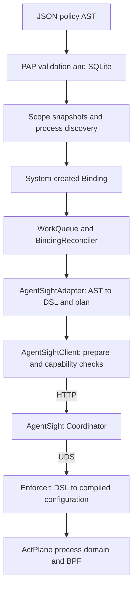
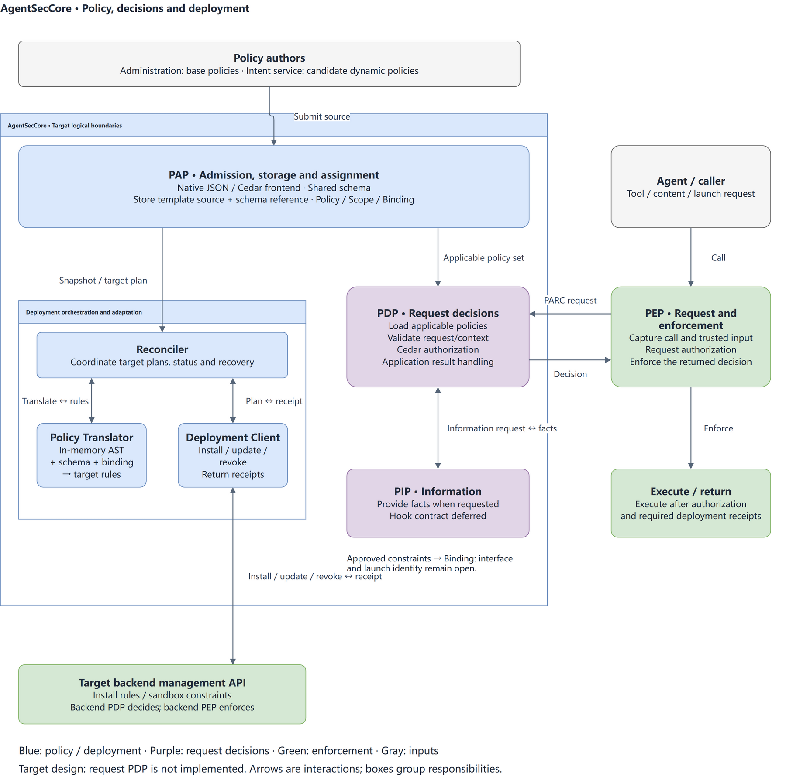
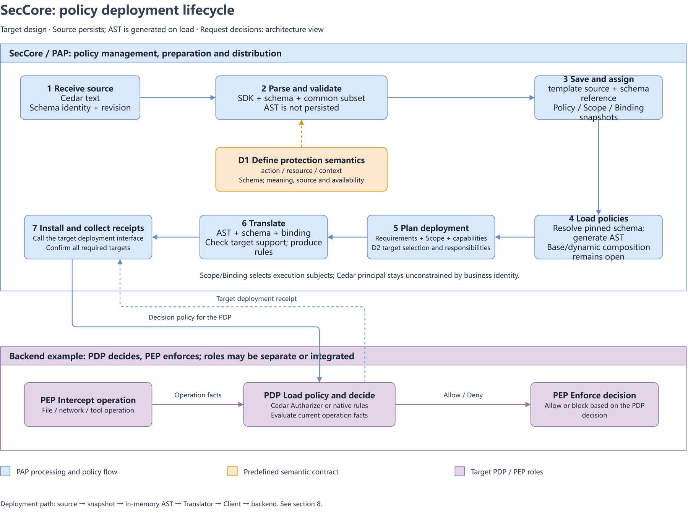
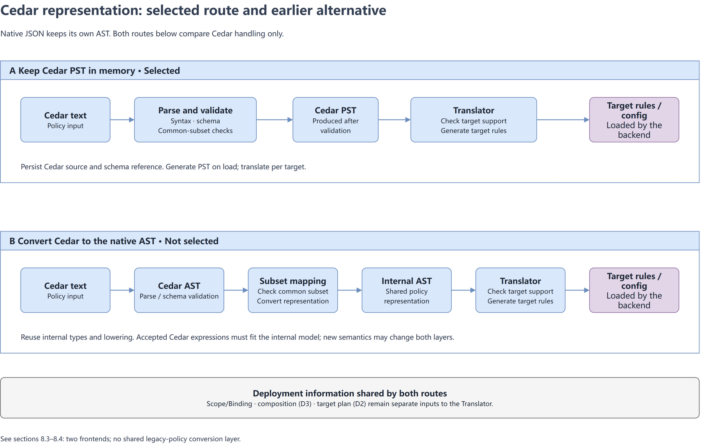

# Policy frontend, AST and statement translation

[中文版](POLICY_FRONTEND_AST_AND_TRANSLATION_zh.md)

This document describes the existing AgentSecCore V2 policy pipeline and the
Cedar integration design. Sections 1–4 cover the current implementation;
sections 5–7 retain the earlier Cedar/Dogwood import assessment. Section 8 records
the selected architecture, data structures, versioning and persistence contracts.
The selected design has two frontends and no Cedar/native JSON policy converter.

Design updated: 2026-10-29. The workspace contains a Cedar frontend library and
standalone data types. PAP/RPC, SQLite, target Translators and runtime authorization
are not yet connected; the following sections distinguish implementation from design.

Original native-policy and import-assessment baseline:
`51c781fce6352fb7ff12c4d4e1d3cf3484d05cf6`. Cedar library interfaces were checked
against `977fe24054da128042aa6ebe99f68c69a4b98d7d`.
External references were checked on 2026-10-19. Dogwood means the
[dogwood-policy/dogwood project](https://github.com/dogwood-policy/dogwood).
Assignment and persistence remain governed by the existing
[Policy/Scope/Binding contract](POLICY_SCOPE_BINDING_CONTRACT_zh.md) and
[SQLite design](POLICY_SQLITE_PERSISTENCE_DESIGN_zh.md).

## 1. Current frontend and internal representation

The existing PAP/RPC frontend accepts JSON that directly encodes a typed policy AST.
The Cedar library described in section 8 is not connected to that entrypoint. `serde`
deserializes the JSON into Rust types; `Validate` checks the structure and
registered attribute vocabulary. There is no standalone JSON Schema file in this
path: the Rust types and validation code define the accepted representation.

Validation establishes a well-formed policy, not a request's authorization result.
The current delivery path has no general evaluator for all accepted conditions,
history and effects. A valid template may be stored even when its target Adapter
cannot execute it.

```text
PolicyTemplate
  specVersion, description?
  rules[]: Rule
    effect: block | allow | require_confirmation
    category: file | network | agenthook
    action: read | write | exec
    target: Resource::File { path }
    where?: Condition
      And | Or | Not | registered attribute comparison
    previous?: HistoryCondition
      Event { category, action, target, where? } | And | Or | Not
    because?: string
```

The root is a list of rules; `where` and `previous` contain expression trees.
`category` has three enum values, but validation currently accepts only `file`
because only a file resource is defined. Unknown resource types and incompatible
category/resource combinations reject.

`PreparedPolicy` wraps the template with `policyId`, `policyName` and `revision`.
Subject assignment is separate: a Scope owns a selector and complete policy
snapshots. A system-created Binding carries one snapshot and a concrete process
identity. Cedar's `(principal, action, resource)` scope is therefore not the same
object as a SecCore Scope.

Sources: [authoring AST](../../v2/crates/asc-policy-types/src/authoring.rs),
[condition AST](../../v2/crates/asc-policy-types/src/authoring/condition.rs),
[policy snapshot](../../v2/crates/asc-policy-types/src/policy.rs),
[Scope](../../v2/crates/asc-policy-types/src/scope.rs),
[Binding](../../v2/crates/asc-policy-types/src/binding.rs).

## 2. Accepted syntax and static checks

| Field | Accepted representation | Current meaning or boundary |
|---|---|---|
| `effect` | `block`, `allow`, `require_confirmation` | Typed effects; general effect combination and confirmation execution are not implemented |
| `target` | `{"type":"file","path":"/absolute/path"}` | Literal path or bounded authoring glob |
| `where` | One attribute comparison, or `and`/`or`/`not` | Attributes are action-specific; no arbitrary context lookup or function call |
| `previous` | Historical event predicate, or `and`/`or`/`not` | No time window, ordering, aggregation, variable binding or current/history field join |
| `because` | Optional static string | Explanation, not a predicate |

### 2.1 Current-operation attributes

| Action | Attributes | Operand and operator restrictions |
|---|---|---|
| `read` | `program`, `file` | Normalized literal paths; scalar `eq`/`ne` or nonempty `in` list |
| `write` | `program` | Same literal-path comparisons |
| `write` | `operation` | `write`, `create`, `delete`, `rename`, `setattr`; `eq`/`ne`/`in` |
| `write` | `mode`, `ownerUid`, `ownerGid` | Integers in the u32 range; `eq`/`ne`/`in`/`gt`/`ge`/`lt`/`le` |
| `exec` | `argsPrefix` | Nonempty string array; `eq`/`ne` mean argv-token prefix / negated prefix, excluding argv[0] |
| `exec` | `cwd` | Same literal-path comparisons |

For example, this is a `Condition` fragment accepted inside a file-write rule:

```json
{
  "and": [
    { "operation": { "eq": "delete" } },
    { "program": { "eq": "/usr/bin/python3" } }
  ]
}
```

It can be represented and validated, but the current AgentSight Adapter rejects
it: that adapter accepts only the single `operation == delete` condition.

`Scalar` can deserialize strings, integers and booleans, but the current attribute
catalog has no boolean-valued attribute. A generic boolean context field is not
made available merely by that enum variant. Comparisons are attribute-to-literal,
not arbitrary expression-to-expression comparisons.

### 2.2 History and bounds

`HistoryEvent` records a file action, its target and an optional condition on that
event. Events cannot recursively contain `previous`. Historical `and` means a
logical conjunction, not a sequence. The comments reserve unknown handling for
missing facts/incomplete history; the current path supplies no general history
evaluator or persisted policy-history domain. No historical rule is currently
translated by AgentSight.

`specVersion` must be `0.1`; there must be 1–1024 rules. Conditions/history have a
maximum depth of 16 and a shared 4096-node budget. Paths are absolute, at most
4096 bytes, with no dot segments, repeated separators, trailing separator except
root, NUL, home expansion or environment expansion. Authoring globs support
`*`, `?` and whole-segment `**`. Paths inside comparisons are literal, not glob
patterns. `description` and `because` are at most 4096 bytes and reject NUL.

Sources: [validation code](../../v2/crates/asc-policy-types/src/authoring.rs),
[attribute checks](../../v2/crates/asc-policy-types/src/authoring/condition.rs),
[authoring regression tests](../../v2/crates/asc-policy-types/tests/authoring.rs).

## 3. Current AST-to-DSL translation

`AgentSightAdapter::translate` reads the complete Binding snapshot. It validates
the whole input, lowers its rules to ActPlane DSL and packages a target plan.
It does not query the latest template, evaluate a request or perform target I/O.

| AST property | Adapter accepts | Otherwise |
|---|---|---|
| Effect | `block` | `RULE_<index>_UNSUPPORTED_EFFECT` |
| Category/action | `file` / `write` | `RULE_<index>_UNSUPPORTED_ACTION` |
| Condition | Exactly `{"operation":{"eq":"delete"}}` | `RULE_<index>_UNSUPPORTED_CONDITION` |
| History | Absent | `RULE_<index>_UNSUPPORTED_HISTORY` |
| Pattern | Literal or literal prefix followed by `/**` | Unsupported-glob rejection |
| Size | At most 128 rules; lowered pattern at most 63 bytes | Explicit limit rejection |
| DSL literals | No quotes, backslashes or control characters in path/reason | Explicit pattern/reason rejection |
| Attachment | Process tree rooted at the Binding's pinned instance | cgroup selector rejected |

A valid but unsupported rule rejects the entire Binding translation; no supported
subset is silently sent. Rule order determines stable generated names, not a
general first-match/last-match decision algorithm. Multiple supported block rules
cover the union of their matches. No complex-condition simplification occurs.

This template uses the first rule from the
[prepared-Binding fixture](../../v2/crates/asc-policy-types/tests/fixtures/prepared-binding.json):

```json
{
  "specVersion": "0.1",
  "rules": [
    {
      "effect": "block",
      "category": "file",
      "action": "write",
      "target": { "type": "file", "path": "/etc/agent/config.yaml" },
      "where": { "operation": { "eq": "delete" } }
    }
  ]
}
```

Its DSL is:

```text
source AGENT = exec "**"
rule agentseccore-unlink-0000:
  block unlink file "/etc/agent/config.yaml" if AGENT
  because "AgentSecCore file deletion policy"
```

An explicit `because` replaces the fallback reason. SecCore emits a
`TargetBindingPlan` with format `agentsight.actplane.binding.v2`, containing source
IDs/revisions, the DSL and the pinned process-tree attachment.

Sources: [translator](../../v2/crates/asc-policy-adapter-agentsight/src/translate.rs),
[plan](../../v2/crates/asc-policy-adapter-agentsight/src/plan.rs),
[translation tests](../../v2/crates/asc-policy-adapter-agentsight/tests/translation.rs).

## 4. Assignment, delivery and execution



1. Creating a template stores authored rules; it does not deploy them. Creating a
   Scope resolves exact current policy revisions and saves complete snapshots.
   PID or exact process-name/executable selectors find instances; cgroup assignment
   is currently rejected. Template changes/deletion do not mutate saved snapshots.
2. Discovery admits one Binding per Scope/policy/instance, with PID, start time,
   boot ID and PID namespace. Queue notifications carry IDs; the Reconciler reads
   authoritative state and serializes attempts through the runtime queue.
3. The Adapter compiles the snapshot. The Client prepares fixed request bytes and
   a target reference. Before modifying target I/O, the Reconciler persists
   possibly-present target responsibility as `UNKNOWN`.
4. The Client rechecks process identity and requires health `ready=true`, backend
   `actplane` and `capabilities.file_delete_guard=true`. It sends an authenticated
   `POST /api/enforcement/bindings` with the DSL, policy ID/revision, root PID,
   start time and `policy_mode=enforce`. The default API root is
   `http://127.0.0.1:7396/api`. Product Bindings currently supply no Agent identity;
   `agent_id` is empty and `session_id` is omitted.
5. AgentSight forwards through its Coordinator to the local Enforcer over UDS.
   The Enforcer compiles DSL, seeds the target domain/label and submits compiled
   policy bytes to ActPlane. The Client accepts a matching response only when it
   reports `Enforced` and a domain ID. Conditional repository writes then record
   observations and `READY`; transient failures use bounded retries.

Scope deletion triggers asynchronous target cleanup. Only confirmed target
absence permits responsibility removal. The Client's replacement operation
deletes old targets before creating the new one; it is not an atomic switch.

There are two different compilations: SecCore AST → DSL, then Enforcer DSL →
execution configuration. The current ActPlane compiler lowers both `write` and
`unlink` to `OP_WRITE`; generated DSL or a deployment response does not prove
delete-only behavior on a real kernel. Live deny tests remain separate evidence.

Sources: [PAP](../../v2/crates/asc-pap/src/service.rs),
[instance admission](../../v2/crates/asc-policy-repository-sqlite/src/pap.rs),
[Reconciler](../../v2/crates/asc-pcp/src/reconciler.rs),
[Client](../../v2/crates/asc-agentsight-client/src/client.rs),
[prepared requests](../../v2/crates/asc-agentsight-client/src/client/reconciliation.rs),
[Enforcer](../../../agentsight/crates/agentsight-enforcer/src/actplane.rs),
[operation lowering](../../../agentsight/crates/actplane-ifc-compiler/src/dsl/lower.rs).

## 5. Cedar import capability boundary

Assessment has two separate questions: can a construct produce a valid current
AST, and can that AST pass the current Adapter? The table evaluates a prospective
importer; neither Cedar nor Dogwood import is implemented in this checkout.

Cedar's authorization rules include default deny, forbid-overrides and
skip-on-error. Importing statements does not automatically import those
policy-set evaluation rules.
Reference: [Cedar authorization](https://docs.cedarpolicy.com/auth/authorization.html).

| Cedar construct | Valid current SecCore AST? | Current AgentSight Adapter? |
|---|---|---|
| File `forbid` with literal target and delete action/condition | Yes, with an explicit action/resource mapping | Yes, if it produces exactly the supported deletion rule |
| `permit` | Effect maps to `allow` | No |
| `when` with supported attribute-to-literal comparisons | Yes, after mapping known attributes | Only the single deletion condition |
| `&&`, `||`, `!`; multiple `when`; `unless` | `And`/`Or`/`Not`; clauses can be combined with `And` | No general logical conditions |
| Principal equality/type/group/attributes | No corresponding field inside Rule | External subject assignment must resolve it; arbitrary principal logic unsupported |
| Entity `in` hierarchy or cross-entity attribute comparison | No entity graph or attribute-to-attribute operands | No |
| Scalar membership via a fixed set's `.contains(...)` | `Comparison::In`, if operands fit the registered attribute | No general membership condition |
| General `context`, records, sets, arithmetic, extension calls or `has` | No generic expression/value model for these constructs | No |
| `like` | Only a separately checked, explicitly supported pattern subset | No direct reuse of Cedar string wildcard syntax |
| Policy annotations and template slots | No rule annotation/slot field; resolve or retain externally | Only the resulting supported concrete rule |

An import profile must declare the entity/action namespace, which resource field
means a normalized file path, and how subjects become authenticated process
assignments. Principal-to-process mapping requires an explicit contract. Cedar's
entity `in` tests identity or hierarchy membership; SecCore's scalar-list `in`
tests membership in a literal list. Cedar's `[...]` constructs an unordered Set.
Matching an ordered argv prefix requires positions and token values, as shown
by the `{index, value}` representation in section 8.6. Integer inputs must fit
the target attribute's u32 range. These boundaries follow from the current AST and Cedar's
[scope syntax](https://docs.cedarpolicy.com/policies/syntax-policy.html) and
[operators](https://docs.cedarpolicy.com/policies/syntax-operators.html).

### 5.1 Example of an importable statement shape

With a proposed import profile defining `SecCore::Action::"file.write"` as file
write, `SecCore::File` IDs as literal normalized paths, and `context.operation` as
the trusted operation kind, the following statement can produce the template in
§3:

```cedar
forbid (
  principal,
  action == SecCore::Action::"file.write",
  resource == SecCore::File::"/etc/agent/config.yaml"
)
when { context.operation == "delete" };
```

This namespace/profile is an illustrative convention, not a registered SecCore
API. Application to a concrete process is supplied by Scope assignment. The
import extracts a blocking rule; it does not make SecCore implement Cedar's full
authorization result. In particular, a Cedar set containing only this `forbid`
still defaults to deny elsewhere, while the extracted SecCore rule only adds its
specified restriction. The import UI/contract must state that boundary.

## 6. Dogwood import capability boundary

Dogwood's core is Cedar-derived, so plain core statements have the same bounded
mapping above. Its temporal language and information providers need additional
capabilities; a JSON AST encoding alone does not supply their runtime inputs.
Reference: [Dogwood core language](https://dogwood-policy.github.io/dogwood/guide/02-policy-language.html).

| Dogwood construct | Current AST boundary | Current Adapter boundary |
|---|---|---|
| Plain Cedar-style file rule | Same as §5 | Supported deletion rule only |
| Macro | Expand with Dogwood's parser/schema environment, then inspect the result | Only if the expanded result fits the supported subset |
| Simple historical file-event predicate with fixed literals | `HistoryEvent` can describe the event shape, but supplies no Dogwood temporal semantics | Every `previous` is rejected |
| `formerly within ...` | No window/duration node | Unsupported |
| `previous within ...` | No immediate-predecessor operator; SecCore's field named `previous` is not this operator | Unsupported |
| `since`, event ordering, `exists`, `tp`, `count`, `sum` | No corresponding temporal, binding or aggregation nodes | Unsupported |
| Same-user/resource correlation between history and current request | No bound variables or current/history field-reference operands | Unsupported |
| Provider calls or provider output fields | No provider-call node or general dynamic attribute namespace | Unsupported |
| `guardrails { E }` | Syntax wrapper can be removed; `E` must still fit the allowed core subset | No implicit provider execution |

For example, Dogwood can require a login in the last hour before a read. Replacing
that condition with a SecCore historical event would discard its window and
current-user correlation. Such temporal rules should be reported as unsupported,
rather than imported under the shared word `previous`. See
[temporal expressions](https://dogwood-policy.github.io/dogwood/guide/04-temporal-expressions.html).

Provider calls require arguments, declared outputs and runtime evaluation.
Removing the `guardrails` wrapper does not remove that dependency. The current
AST cannot even name an arbitrary provider boolean; supplying one would require
an attribute contract and an executor, not just a new JSON key. See
[information providers](https://dogwood-policy.github.io/dogwood/guide/05-information-providers.html).

Dogwood can lower temporal/provider checks into generated Cedar context fields,
but those fields still need Dogwood's runtime monitor/resolvers. Exported Cedar
is not necessarily self-contained. See
[API and workflow](https://dogwood-policy.github.io/dogwood/guide/07-api-and-workflow.html).

## 7. Scope and validation of the earlier import option

For the route that imports into the existing AST, an initial scope is a bounded
Cedar/Dogwood statement importer producing the existing `PolicyTemplate`;
no AST/schema expansion is necessary for supported deletion rules.
Its capability report should separately identify:

1. Statements that can form a valid AST, including authoring-only rules.
2. Statements that can also pass the current target Adapter.
3. Unsupported fields/expressions and required external subject/resource mapping.

Import must not silently drop a principal condition, temporal clause or provider
call. Source locations and import diagnostics can remain outside the AST; there
is no need to introduce a second policy model for this assessment. Supporting
general Cedar authorization or Dogwood monitoring would be a separate runtime
feature, beyond statement import.

The possible importer assessed in sections 5–7 is neither implemented nor part
of the architecture selected in section 8.
Existing [authoring tests](../../v2/crates/asc-policy-types/tests/authoring.rs) and
[translation tests](../../v2/crates/asc-policy-adapter-agentsight/tests/translation.rs)
cover the current local boundaries. Future importer tests should check accepted
output ASTs and explicit rejection of unsupported constructs; full-language
semantic equivalence is not an acceptance goal here.

## 8. Overall Cedar integration design

This section records the current local design. Earlier discussion is in
[SecCore Cedar integration: remaining design questions and options](https://alidocs.dingtalk.com/i/nodes/gvNG4YZ7Jnxop15OCoadooMLW2LD0oRE).
The architecture includes a request-decision path that is not implemented.
Section 8.6 describes the library today; section 8.9 gives the integration order.

### 8.1 Component responsibilities and two processing paths

The Cedar SDK provides parsing, schema validation, structured representation and
authorization for concrete `principal / action / resource / context` requests.
SecCore defines system-operation semantics, constructs trusted requests, manages
policies and scope, selects protection targets and applies policies or decisions
to backends. Native Cedar returns Allow/Deny and diagnostics; deployment and
application workflows belong to the integration. See
[Cedar authorization](https://docs.cedarpolicy.com/auth/authorization.html).

| Logical component | Responsibility | Implementation or status |
|---|---|---|
| Policy frontends and shared schema | Deserialize native JSON; parse Cedar, validate types and check the common subset; define action/resource/context contracts | `asc-policy-types`, `asc-policy-cedar`; Cedar is not connected to PAP |
| PAP policy management | Store source and revision, associate Scope and retain assignment/Binding snapshots; accept base and dynamic Cedar policies after integration | `asc-pap` and repository currently manage native JSON policies; Cedar admission and composition remain open |
| PDP request decisions | Load applicable policies, receive concrete requests, obtain PIP information as needed and authorize | Target design; may share the SecCore daemon with PAP while remaining a separate logical responsibility |
| Deployment orchestration | Create/update Bindings, select targets and use Reconciler for installation, update, revocation and recovery | Existing Scope/Binding and `asc-pcp`; mapping authorization results to deployment inputs remains open |
| Backend adaptation | Translator checks capabilities and translates; Deployment Client handles backend protocols and deployment calls | Existing target contracts and AgentSight implementation; no Cedar translation yet |
| PEP and backend PDP | PEP intercepts requests and enforces decisions; some backends also contain a PDP for continuous system-operation checks | Depends on Hook, sandbox, ActPlane or other scenarios; schema support does not establish backend support |



Boxes group responsibilities; arrows name exchanged content. PAP and PDP may
share a process, and backends may integrate PDP and PEP. Policy admission,
request construction and target translation share the frontend/schema contracts.

**Policy deployment:** source → frontend validation → PAP persistence →
Scope/Binding snapshots → load source and generate an in-memory representation →
target selection → Reconciler invokes Translator and Deployment Client → backend
management API → receipt. This path establishes ongoing protection configuration.

**Request decisions:** PEP intercepts a call → constructs a trusted request →
PDP loads applicable policies and decides → PEP enforces the result. Ordinary
tool/content requests generally do not create a persistent Binding each time.
A launch or sandbox request that needs approved constraints installed must wait
for the required deployment receipts before execution.

Dynamic generation submits candidate policies to PAP; successful generation is
not authorization. Base/dynamic composition determines the effective policy set.
Unioning permits does not establish a base permission ceiling. A Cedar Allow for
one concrete request also cannot establish a deployable grant for an entire
directory or operation set. Mapping approved constraints to Bindings, and the
identity/timing needed to install protection before launch, remain open. Existing
Bindings pin already-identified processes; they do not provide pre-launch admission.

Future support for MODIFY, STEP_UP, DEFER and `@advice` requires SecCore to define
their handling protocol. The frontend currently rejects policy annotations.
Detailed PIP/Agent Hook detection facts are deferred.

### 8.2 Translation, deployment access and coordination

| Component | Inputs and outputs | Current implementation counterpart |
|---|---|---|
| Policy Translator | Accept an in-memory representation, Cedar schema reference where applicable, binding information and target capabilities; produce target rules/configuration without deployment I/O | `TargetBindingAdapter::translate`; `AgentSightAdapter` currently consumes only the native AST |
| Deployment Client | Accept a target plan, encode protocols, install/update/revoke and return receipts | `TargetDeploymentClient`: `prepare_apply`, `create`, `update`, `delete` |
| Reconciler | Invoke Translator for a plan, then Client; track state, retry and recover | Reconciler in `asc-pcp` |

Reconciler invokes both adaptation components. Runtime requests go through PDP
and PEP; they enter deployment orchestration when constraints must be installed.
Adding Cedar does not turn synchronous authorization into a Reconciler retry task.

Client connects to the target backend's **management API**. A standalone PDP may
expose policy loading, an integrated PDP/PEP backend may expose one rule API, and
a sandbox may accept isolation/access configuration. Each Client contract specifies
the installation target and receipt meaning; the destination is not fixed across
all backends. SecCore records deployment success from that API's successful receipt;
the backend contract defines what taking effect guarantees.

This section uses Translator for translation. Adapter in sections 1–7 follows
source names. See the [target contracts](../../v2/crates/asc-policy-target-contracts/src/lib.rs)
and [Reconciler](../../v2/crates/asc-pcp/src/reconciler.rs).
The target interface does not yet accept Cedar representations.

### 8.3 Representation choice and remaining design questions

Native JSON deserializes into `PolicyTemplate`. The Cedar `validate` interface
checks source; `pst` returns the SDK's PST for translation after the same checks.
The integration design reuses PAP, Scope/Binding and deployment lifecycle for both
frontends. Each Translator will declare which representation it accepts; the
current AgentSight Adapter accepts only `PolicyTemplate`.
There is no common native-JSON-to-Cedar or Cedar-to-native-AST conversion layer.
Sections 5–7 retain the earlier alternative assessment only.

The frontend checks syntax, schema and the common subset. Translator checks whether
the backend can express conditions, effects and matching behavior within its limits.
Unsupported semantics must reject the unit as a whole, not disappear during deployment.

| Design question | Processing stages | Decisions and remaining boundaries |
|---|---|---|
| D1: System protection semantics | Frontend schema, runtime request construction, Translator | File/invocation/coarse-network fields exist; trusted field sources, request mapping, backend translation and approved-constraint mapping remain to be implemented; Hook contracts are deferred |
| D2: Multiple PEP selection and cooperation | Target planning, deployment orchestration, PEP enforcement | Match capabilities to Scope and policy needs; alternatives/cooperation, required targets and receipt aggregation remain open |
| D3: Base and runtime composition | PAP policy assembly, PDP loading and decisions | Permission ceiling, composition, conflicts, lifetime and recovery after revocation need separate design; dynamic policies must not implicitly expand permissions |
| D4: AST and validation placement | Frontend admission, loading, Translator | Native `PolicyTemplate` and Cedar PST; `validate` checks source, `pst` checks and converts it; Cedar source persistence and Translator integration remain open |

Scope/Binding continues to select execution subjects. Cedar retains the principal
syntax position, but users do not supply identity constraints; the frontend rejects
principal constraints/references. Direct evaluation supplies a schema-conformant
`SecCore::Subject` reference and ensures the request belongs to the selected subject.

The deployment lifecycle diagram expands the deployment path.



The AST route comparison shows the selected route and the earlier alternative.
The selected route completes parsing, schema validation and common-subset checks
before producing PST for Translator. The planned create/update path calls
`validate`; loading for translation calls `pst`.



### 8.4 Policy structure, in-memory AST and SQLite

Current [`PreparedPolicy`](../../v2/crates/asc-policy-types/src/policy.rs) already
stores source in `template: PolicyTemplate`; its deserialized value is also the
native typed AST. Keep `template` and extend its type to the existing `PolicySource`:

```rust
// Target design; PAP/RPC and persisted snapshots have not adopted it yet.
pub struct PreparedPolicy {
    pub policy_id: ResourceId,
    pub policy_name: String,
    pub revision: Revision,
    pub template: PolicySource,
}
```

| Type or field | Purpose | Planned persistence contract |
|---|---|---|
| `PolicySource::SecCore(PolicyTemplate)` | Preserve native JSON authoring and semantics | Store as the native `template` branch |
| `PolicySource::Cedar(CedarPolicySource)` | `schema` + `text`: original Cedar and exact schema reference | Store as the Cedar `template` branch |
| `CedarSchemaReference` | `schemaId` + `revision`: select the shared application schema | Store with Cedar source and carry into Scope/Binding policy snapshots |
| `cedar_policy::pst::PolicySet` | Official SDK PST returned by `pst` | Generate when loading for translation; persist the source |

Source types remain in [authoring.rs](../../v2/crates/asc-policy-types/src/authoring.rs)
and [cedar.rs](../../v2/crates/asc-policy-types/src/cedar.rs), independent of the
Cedar SDK. The `pst` interface returns `cedar_policy::pst::PolicySet`.
The source union exists, but `PreparedPolicy`, create/update RPC, PAP and
persisted snapshots still accept only `PolicyTemplate`.

The intended `template` shape below is not an enabled RPC contract:

```json
{
  "language": "cedar",
  "content": {
    "schema": { "schemaId": "seccore.system", "revision": 1 },
    "text": "forbid(principal, action, resource);"
  }
}
```

The planned create/update path calls `validate` before saving `template`.
Syntax, schema or common-subset failures reject the request before persistence.
Loading for deployment reads the snapshot source and calls `pst`, which resolves
the exact schema, validates the source and returns the in-memory PST. Carry the
schema reference alongside that PST to Translator; the source reference determines
the application schema revision. The two calls parse their own input. Persistence
stores source; the loading consumer may retain the PST in memory.

Dependency management and regression tests cover SDK upgrades. Define an AST
exchange protocol when a cross-process consumer needs one. The source contract
carries the `PolicySource` `language/content` input and exact schema reference.

The planned Cedar Translator consumes the public syntax tree (PST). Its typed
Rust nodes describe policy expressions. The source envelope carries a reference
to a shared schema definition; the frontend resolves that reference separately.

Current SQLite storage is defined in
[`table.rs`](../../v2/crates/asc-policy-repository-sqlite/src/table.rs):

| Location | Current content | Cedar integration impact |
|---|---|---|
| `policies.current_json` | Current `PreparedPolicy`; no separate content-revision history table | Extend `template` to the source union |
| `scopes.assignment_json` | Assignment and complete Policy snapshots | Retain source, Policy revision and schema reference at assignment time |
| `bindings.spec_json` | Complete `PreparedBinding`, including Policy snapshot | Deployment/recovery reads this snapshot, not the latest Policy revision |
| `bindings.deployments_json` and other status fields | Deployment ownership, receipts and cleanup state | Keep persisting these; they are not a complete AST or translation plan |

SQL primary keys are `policy_id`, `scope_id` and `binding_id`. Bindings also have a
Scope/Policy/process-identity uniqueness constraint and a `scope_id` foreign key.
Cedar `File.path`, action names, context fields and enum values are source/schema
content, not current SQLite columns, indexes or keys. Application schema evolution
normally leaves SQL tables unchanged, while old referenced versions still need
explicit parsing and execution support.

The first switch from bare `PolicyTemplate` to tagged `PolicySource` changes JSON
wire format. It requires an explicit compatibility reader or data migration for
old requests and all three snapshot locations, even if SQL columns stay unchanged.
By contrast, SQL `phase` values appear in CHECK constraints, so changing them
requires storage migration; changing Cedar `WriteOperation` is a different contract.

### 8.5 How Strands Box organizes its schema

This comparison uses Strands Box commit `7cf6bad7728410c6c28cd7bebd802ff2e18af7ee`:

| File | Responsibility |
|---|---|
| [schema/actions.cedarschema](https://github.com/strands-agents/box/blob/7cf6bad7728410c6c28cd7bebd802ff2e18af7ee/crates/policy/schema/actions.cedarschema) | Define built-in entities, actions and each action's input/output fields |
| [src/schema.rs](https://github.com/strands-agents/box/blob/7cf6bad7728410c6c28cd7bebd802ff2e18af7ee/crates/policy/src/schema.rs) | Embed and parse the schema, compose MCP extensions, map runtime Requests to Cedar requests and check schema conformance |
| [src/policy.rs](https://github.com/strands-agents/box/blob/7cf6bad7728410c6c28cd7bebd802ff2e18af7ee/crates/policy/src/policy.rs) | Retain source text and origin in `Policy`; accept MCP schema fragments separately when loading the engine |
| [src/mcp_schema.rs](https://github.com/strands-agents/box/blob/7cf6bad7728410c6c28cd7bebd802ff2e18af7ee/crates/policy/src/mcp_schema.rs) | Generate tool actions and parameter schemas from MCP `tools/list` |

The useful pattern is to maintain an application schema separately and use the
same definitions for policy validation and runtime request mapping. Strands Box
does use `action` for operations such as `fs:delete`; concrete paths and operation
parameters live in `context.input`, while principal/resource use fixed entities.
Its input/output grouping also supports Dogwood event derivation;
`events.dwschema` belongs to that temporal extension. SecCore must choose fields
and mappings for its protection scenarios rather than inherit these conventions
simply by adopting Cedar. Scope/Binding continues to select the subject; when a
runtime uses a Cedar PDP, integration code supplies a schema-compatible principal.

### 8.6 Cedar frontend library

[`asc-policy-cedar`](../../v2/crates/asc-policy-cedar/src/lib.rs) exposes two
source-based interfaces:

| Interface | Intended caller | Success result |
|---|---|---|
| `validate(&CedarPolicySource) -> Result<Vec<ValidationWarning>, CedarError>` | Policy creation/update | Non-blocking SDK warnings; no PST is generated |
| `pst(&CedarPolicySource) -> Result<cedar_policy::pst::PolicySet, CedarError>` | Policy loading for Translator | Official SDK PST after the same admission checks |

Both require original text and an exact schema reference. Both resolve the schema,
parse the source, check the common supported subset and run strict SDK validation.
`pst` validates independently; the caller need not call `validate` first. Its return
value contains only the PST; callers displaying warnings use `validate`.
Additional common validators belong in the shared validation path.

Envelope, schema-resolution, syntax and common-subset failures stop the call.
SDK schema-validation errors and rejected `InvalidActionApplication` warnings
are collected in `CedarError::Validation`. Non-blocking SDK warnings are returned
on successful `validate`. Error variants identify the failure class;
SDK diagnostics retain policy IDs and source locations where available. A failed
call returns no partial PST. Neither interface checks target backend capabilities.

The principal-condition check borrows the parsed SDK AST. This private function
uses the SDK's hidden `AsRef<ast::Policy>` interface and `subexpressions()` iterator.
`cedar-policy-core` and `cedar-policy` are both pinned to 4.14.0; SDK upgrades must
verify this internal access and the principal-reference tests. Only `pst` converts
the validated policy set to PST. The workspace minimum is Rust 1.89; the build
environment can continue using Rust 1.93.1.

| File | Responsibility |
|---|---|
| `schema/seccore.cedarschema` | Entity, action and per-action input definitions |
| `src/schema.rs` | Resolve the exact built-in schema identity and revision |
| `src/validation.rs` | Shared parsing, schema validation and common-subset checks |
| `src/lib.rs` | Public `validate` and `pst` functions, PST conversion and typed diagnostics |

The schema covers file access, executable invocation and whole-network permission.
It retains `SecCore::File` and `file.read/write/exec`; `file.exec` continues to mean
an executable invocation, not a Linux filesystem X permission check.
`SecCore::Subject` is an attribute-free request principal type supplied by the
integration; process identity remains in Scope/Binding. `SecCore::File.path` is
the concrete file or executable path, not a stored policy pattern. Policies
express path predicates explicitly. `SecCore::Network::"all"` represents network
use as a whole; it does not model hosts, IP addresses, ports or protocols.

| Action | Resource | Context | Meaning |
|---|---|---|---|
| `file.read` | `File` | `input.program: String` | Requesting executable path |
| `file.write` | `File` | `input.program: String`, `operation: WriteOperation`, optional `mode`, `ownerUid`, `ownerGid: Long`, all under `input` | Write subtype and requested setattr values |
| `file.exec` | `File` | `input.cwd: String`, `input.arg_count: Long`, `input.args: Set<ProcessArgument>` | Executable invocation; `resource.path` is the executable path |
| `network.use` | `Network::"all"` | `{}` | Whole-network permission |

`WriteOperation` is an enum entity with `write`, `create`, `delete`, `rename`,
`setattr`; comparisons use e.g. `SecCore::WriteOperation::"delete"`. Optional
fields require Cedar `has` guards. String paths and numeric fields are type-checked;
trusted request producers must establish path normalization and u32 value bounds.
The producer must supply `mode`, `ownerUid` and `ownerGid` only for `setattr`, and
only for attributes actually requested. Missing attributes are not zero values.
These runtime checks are not supplied by schema validation. `program` remains
the requesting executable; it is not an Agent type or the executable being launched.

```cedar
forbid(principal, action == SecCore::Action::"file.write", resource)
when {
    resource.path == "/etc/agent/config.yaml" &&
    context.input.operation == SecCore::WriteOperation::"delete"
};
```

`ProcessArgument` is `{ index: Long, value: String }`. Both `args` and `arg_count`
exclude `argv[0]`; index 0 denotes `argv[1]`. An indexed record set preserves
positions and repeated argument values despite Cedar sets being unordered. The
producer must supply the complete argument list with exactly one record for
each index from 0 to `arg_count - 1`, and a nonnegative count. A truncated or
unavailable list must not be represented as an empty list. Cedar schema typing
does not enforce these cross-field invariants; runtime mapping remains unimplemented.

An ordered prefix is a conjunction of positional matches, without an exact total
argument count. For example, the following permits additional trailing arguments:

```cedar
permit(principal, action == SecCore::Action::"file.exec", resource)
when {
    resource.path == "/usr/bin/cc" &&
    context.input.cwd == "/workspace" &&
    context.input.args.containsAll([
        { index: 0, value: "-I" },
        { index: 1, value: "/workspace/include" },
        { index: 2, value: "-I" }
    ])
};
```

With the complete-argument contract above, this expresses the ordered-token
prefix predicate used by native `argsPrefix`. An exact argument list also
requires the corresponding `context.input.arg_count` equality. Native
`where.file` is expressed with `resource.path`, and `cwd` remains in `context.input`.

The frontend accepts nonempty static policy sets with `permit`/`forbid` and
schema-valid conditions. It rejects unknown schema revisions, principal constraints
or principal references in conditions, template slots, and all annotations
(including `advice`). Agent hooks, history (`previous`) and confirmation workflows
have no contract in this schema. No native JSON policy conversion occurs, and
the existing JSON entrypoint remains unchanged.

The action-specific `FileReadContext`, `FileWriteContext` and `FileExecContext`
keep system inputs separate. Future Agent Hook support can add its own resource,
actions and context types, reusing `SecCore::Subject` from a separate namespace
if needed. No placeholder Hook entities, scanner verdicts, generic JSON field or
schema plugin loader are introduced. Hook policy tests use a test-only schema
extension; the shipped schema still rejects those actions. The initial schema
is unreleased and stays at revision 1. Once published, extensions must update
the pinned schema contract and revalidate policies, including policies whose
unconstrained actions or resources could include new domains.

This is a new V2 library contract, not a V1 migration or an authorization service.
PAP/RPC, stored snapshots, target translation and runtime request mapping remain
unconnected. Successful validation establishes frontend acceptance only.

Acceptance is exercised by
[`tests/validation.rs`](../../v2/crates/asc-policy-cedar/tests/validation.rs):
validate/pst admission parity, returned warnings, official PST round trips,
file/network fields, argument-prefix decisions, required request
shapes, a test-only Hook extension, whole-set rejection, pinned schema identity,
principal restrictions, unsupported templates/annotations and schema diagnostics.
The existing policy-type fixtures continue to check the native wire format.
Run from `src/agent-sec-core/v2`:

```bash
cargo test -p asc-policy-cedar -p asc-policy-types --locked
cargo clippy -p asc-policy-cedar -p asc-policy-types --all-targets --locked -- -D warnings
cargo doc -p asc-policy-cedar -p asc-policy-types --no-deps --locked
```

The test crate is the first direct consumer; no daemon call path is claimed.
Rollback removes the new workspace member/dependency and its lockfile additions;
there is no persisted-state migration or deployment to undo. The source types
in `asc-policy-types` can remain for subsequent integration.

### 8.7 Schema versioning and policy loading

| Version | Identifies | Changes when |
|---|---|---|
| SQLite storage version | Tables, indexes, constraints and persistence-format migrations | Database structure or stored-data upgrades require a change |
| Policy `revision` | Content revision of one Policy | Name, source or its schema reference changes |
| `schemaId` + schema `revision` | A fixed application contract for fields, actions, types and meaning | A new schema changing those definitions is published |
| Cedar SDK dependency version | SDK used to compile, pinned by Cargo dependencies and lockfile | Dependency upgrades; not included in AST or used to select the application schema |

`seccore.system@1` versions the whole application schema, not the `SecCore`
namespace independently. A future Hook namespace can ship in the same schema
without its own version. Independent schema identities and composition rules
should be designed only if independent publication becomes necessary.

The planned file metadata lives on the designated `SecCore` namespace. SecCore's
loader reads it as the identity of the entire schema; definitions are omitted here:

```cedar
@schema_id("seccore.system")
@schema_revision("1")
namespace SecCore {
    // Entity and action definitions belong here.
}
```

Cedar supports [namespace annotations](https://docs.cedarpolicy.com/schema/human-readable-schema.html#namespace),
but `schema_id` and `schema_revision` are SecCore conventions. Cedar does not
select versions or migrate policies from them. **The implementation uses constants
in `schema.rs`; file annotations and metadata loading are planned work.** Schema
metadata and policy annotations have separate handling rules.

Incoming Cedar text must carry `CedarSchemaReference`. A creation UI may preselect
the current version, but submission, validation and persistence must use an explicit
reference. Updating a policy without changing its schema reference keeps the old
version. Parsing follows Cedar grammar; application schema governs subsequent type
validation. Current `load_schema` compares the reference with the constants
`SCHEMA_ID` and `SCHEMA_REVISION`, then parses the embedded schema. The planned
loading path after persistence and file-metadata integration is:

1. Read the exact `{schemaId, revision}` from the saved source and resolve a
   supported schema; reject loading if none exists.
2. Check the schema file metadata against that reference. The SDK parses source
   and validates its types against the schema; SecCore checks the common subset.
3. For translation, pass the PST and schema reference to Translator. A future
   Cedar PDP uses the SDK's evaluable `PolicySet` and constructs requests under
   the same schema. Its loading interface remains to be defined.

Do not mutate published definitions behind an existing reference. Changing the
reference creates a new Policy revision. Updating the current Policy record does
not change existing Scope/Binding snapshots; upgrade assignments and complete
deployment separately. Adding Hook/actions still requires revalidating policies
with unconstrained action/resource rather than assuming an additive change has no
effect. See [Cedar validation](https://docs.cedarpolicy.com/policies/validation.html).

Publishing an application schema revision normally needs no SQLite storage upgrade
when the storage envelope and SQL constraints remain unchanged. PAP admission, PDP
loading and Translator each check their supported versions rather than relying on
PEP alone. File metadata identifies a definition; the Policy reference chooses the
definition that the policy uses. Both are required by this design.

### 8.8 Translator compatibility and retiring the native frontend

Translator declares two separate capabilities: application schema versions it
understands, and actions, fields, expressions and effects it supports within them.
Supporting a schema revision does not imply supporting every policy under it.
If a new revision only adds Hook definitions, a file Translator may reuse its
implementation and declare both versions after verification while still rejecting
Hook rules. Renamed fields, changed meanings or matching behavior require explicit
support or rejection.

A Translator need not support every historical schema forever. Keep support for
versions used by Bindings it must deploy, recover or update, or explicitly migrate
and reassign those Bindings first. Unsupported recovery must report failure, not
reinterpret old source as the latest version or discard rules. Letting an existing
deployment keep running does not establish rebuild/update support.

The native JSON frontend can be deprecated later: first restrict new native policies
while retaining reads, deployment recovery and deletion. Remove `PolicySource::SecCore`
and its translation support only after relevant Policy and Scope/Binding snapshots
no longer depend on it and rollback/historical-read requirements are addressed.
Retirement does not require an automatic JSON-to-Cedar converter; replacements
need semantic and deployment validation for the selected backends.

### 8.9 Implementation status and integration order

| Part | Current status | Next step |
|---|---|---|
| Types and Cedar frontend | Source union; embedded revision 1; `validate` returns non-blocking warnings, `pst` validates and returns SDK PST | Schema-file metadata and loading; retain common-subset diagnostics |
| Policy/PAP/RPC/SQLite | Still use native `PolicyTemplate` | `template: PolicySource`; call `validate` on Cedar create/update; compatibility for old requests and all three snapshot locations |
| Policy loading and translation | AgentSight supports only native AST | Call `pst` on Cedar snapshot source; carry schema reference and implement/declare support per target |
| PDP and deployment connection | Existing pipeline is asynchronous deployment, without general Cedar request authorization | Define request/decision contracts, composition, approved-constraint-to-Binding mapping and launch ordering separately |
| Agent Hook/PIP | Not supported by the embedded schema | Define resources, actions, request fields and detection contracts separately, then publish a corresponding schema revision |

First connect Cedar source persistence, loading and one target Translator through
the existing lifecycle. Add PDP/PEP request handling for concrete runtime scenarios.
Version checks apply at admission, loading and translation. Do not introduce an
external schema registry, persistent AST cache or generic legacy-model converter first.

Implementation checks must cover reading/recovering old SQLite snapshots, rejecting
unknown schemas and unsupported source on creation, loading the snapshot's original
version after restart, whole-unit rejection at unsupported targets and preserving
existing Bindings on Policy updates. Verify request authorization, deployment success
and actual PEP enforcement separately; compilation or persistence alone establishes
neither deployment nor enforcement.
