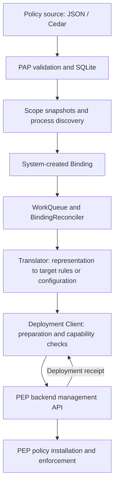
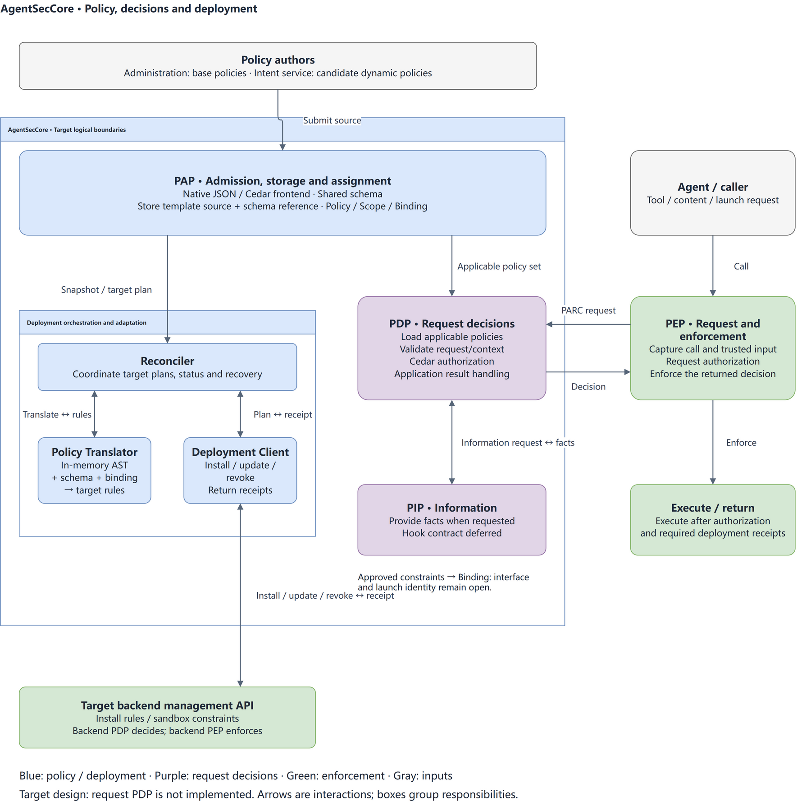
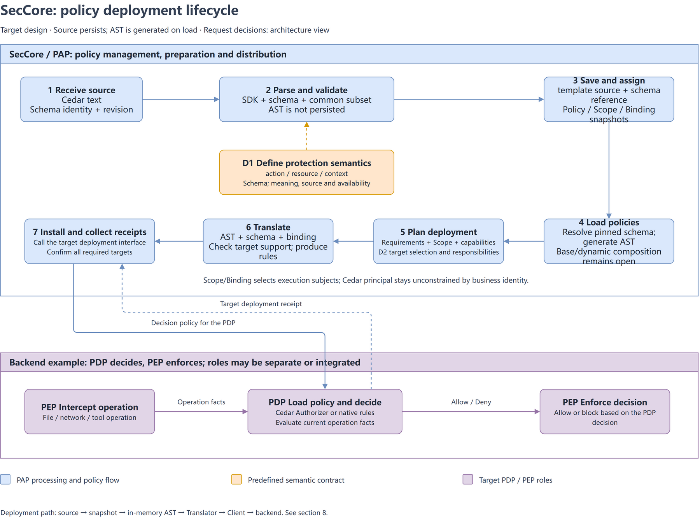
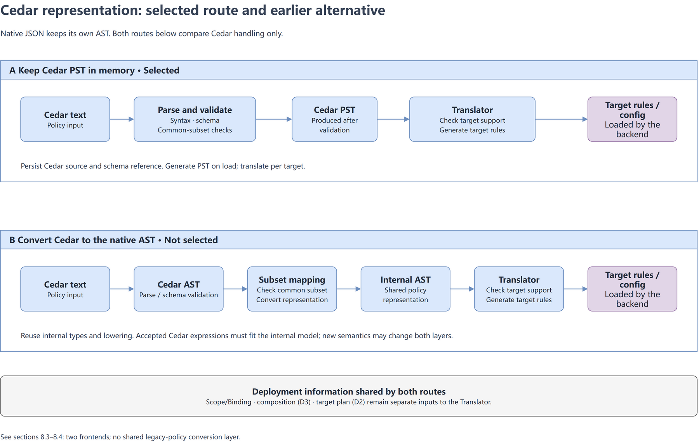

# Policy frontend, AST and statement translation

[中文版](POLICY_FRONTEND_AST_AND_TRANSLATION_zh.md)

This document describes the existing AgentSecCore V2 policy pipeline and the
Cedar integration design. Sections 1–4 cover the current implementation;
sections 5–7 retain the earlier Cedar/Dogwood import assessment. Section 8 records
the selected architecture, data structures, versioning and persistence contracts.
The selected design has two frontends and no Cedar/native JSON policy converter.

Cedar admission and PAP/RPC source persistence
are connected; tests reparse saved source through the existing `pst` interface.
Cedar deletion/ordinary-write/exact-file read translation and deployment are connected through the existing PEP Adapter;
sandbox runtime authorization uses the current PAP-selected policy and schema revision 1. See [the target contract](AGENTSIGHT_CEDAR_TRANSLATION.md).

Original native-policy and import-assessment baseline:
`51c781fce6352fb7ff12c4d4e1d3cf3484d05cf6`. Cedar library interfaces were checked
against `977fe24054da128042aa6ebe99f68c69a4b98d7d`.
External references were checked on 2026-10-19. Dogwood means the
[dogwood-policy/dogwood project](https://github.com/dogwood-policy/dogwood).
Assignment and persistence remain governed by the existing
[Policy/Scope/Binding contract](POLICY_SCOPE_BINDING_CONTRACT_zh.md) and
[SQLite design](POLICY_SQLITE_PERSISTENCE_DESIGN_zh.md).

## 1. Current frontend and internal representation

PAP/RPC accepts native JSON and the Cedar source envelope in section 8.
This section describes the native JSON representation. `serde`
deserializes the JSON into Rust types; `Validate` checks the structure and
registered attribute vocabulary. There is no standalone JSON Schema file in this
path: the Rust types and validation code define the accepted representation.

Validation establishes a well-formed policy, not a request's authorization result.
The current delivery path has no general evaluator for all accepted conditions,
history and effects. A valid template may be stored even when its target Adapter
cannot execute it.

```text
PolicyTemplate
  specVersion, description?
  rules[]: Rule
    effect: block | allow | require_confirmation
    category: file | network | agenthook
    action: read | write | exec
    target: Resource::File { path }
    where?: Condition
      And | Or | Not | registered attribute comparison
    previous?: HistoryCondition
      Event { category, action, target, where? } | And | Or | Not
    because?: string
```

The root is a list of rules; `where` and `previous` contain expression trees.
`category` has three enum values, but validation currently accepts only `file`
because only a file resource is defined. Unknown resource types and incompatible
category/resource combinations reject.

`PreparedPolicy` wraps the template with `policyId`, `policyName` and `revision`.
Subject assignment is separate: a Scope owns a selector and complete policy
snapshots. A system-created Binding carries one snapshot and a concrete process
identity. Cedar's `(principal, action, resource)` scope is therefore not the same
object as a SecCore Scope.

Sources: [authoring AST](../../v2/crates/asc-policy-types/src/authoring.rs),
[condition AST](../../v2/crates/asc-policy-types/src/authoring/condition.rs),
[policy snapshot](../../v2/crates/asc-policy-types/src/policy.rs),
[Scope](../../v2/crates/asc-policy-types/src/scope.rs),
[Binding](../../v2/crates/asc-policy-types/src/binding.rs).

## 2. Accepted syntax and static checks

| Field | Accepted representation | Current meaning or boundary |
|---|---|---|
| `effect` | `block`, `allow`, `require_confirmation` | Typed effects; general effect combination and confirmation execution are not implemented |
| `target` | `{"type":"file","path":"/absolute/path"}` | Literal path or bounded authoring glob |
| `where` | One attribute comparison, or `and`/`or`/`not` | Attributes are action-specific; no arbitrary context lookup or function call |
| `previous` | Historical event predicate, or `and`/`or`/`not` | No time window, ordering, aggregation, variable binding or current/history field join |
| `because` | Optional static string | Explanation, not a predicate |

### 2.1 Current-operation attributes

| Action | Attributes | Operand and operator restrictions |
|---|---|---|
| `read` | `program`, `file` | Normalized literal paths; scalar `eq`/`ne` or nonempty `in` list |
| `write` | `program` | Same literal-path comparisons |
| `write` | `operation` | `write`, `create`, `delete`, `rename`, `setattr`; `eq`/`ne`/`in` |
| `write` | `mode`, `ownerUid`, `ownerGid` | Integers in the u32 range; `eq`/`ne`/`in`/`gt`/`ge`/`lt`/`le` |
| `exec` | `argsPrefix` | Nonempty string array; `eq`/`ne` mean argv-token prefix / negated prefix, excluding argv[0] |
| `exec` | `cwd` | Same literal-path comparisons |

For example, this is a `Condition` fragment accepted inside a file-write rule:

```json
{
  "and": [
    { "operation": { "eq": "delete" } },
    { "program": { "eq": "/usr/bin/python3" } }
  ]
}
```

It can be represented and validated. Deployment additionally requires a PEP
Adapter that supports both the operation and program conditions; neither
condition may be dropped to obtain a target plan.

`Scalar` can deserialize strings, integers and booleans, but the current attribute
catalog has no boolean-valued attribute. A generic boolean context field is not
made available merely by that enum variant. Comparisons are attribute-to-literal,
not arbitrary expression-to-expression comparisons.

### 2.2 History and bounds

`HistoryEvent` records a file action, its target and an optional condition on that
event. Events cannot recursively contain `previous`. Historical `and` means a
logical conjunction, not a sequence. The comments reserve unknown handling for
missing facts/incomplete history; the current path supplies no general history
evaluator or persisted policy-history domain. Deploying such rules requires a
PEP integration with explicit historical evaluation support.

`specVersion` must be `0.1`; there must be 1–1024 rules. Conditions/history have a
maximum depth of 16 and a shared 4096-node budget. Paths are absolute, at most
4096 bytes, with no dot segments, repeated separators, trailing separator except
root, NUL, home expansion or environment expansion. Authoring globs support
`*`, `?` and whole-segment `**`. Paths inside comparisons are literal, not glob
patterns. `description` and `because` are at most 4096 bytes and reject NUL.

Sources: [validation code](../../v2/crates/asc-policy-types/src/authoring.rs),
[attribute checks](../../v2/crates/asc-policy-types/src/authoring/condition.rs),
[authoring regression tests](../../v2/crates/asc-policy-types/tests/authoring.rs).

## 3. Translating policy representations into PEP policies

`TargetBindingAdapter::translate` accepts the complete Binding snapshot. Translator
reads native `PolicyTemplate` or calls `asc_policy_cedar::pst` for Cedar PST,
checks whether the target PEP can express the policy semantics, and produces
that target's DSL, rules or configuration. It does not fetch the latest template,
authorize a request or perform deployment I/O.

`TargetBindingPlan` carries a target format and opaque content. Each Adapter
defines its format, capacity, path matching and supported effects. A valid but
unsupported statement rejects the entire Binding translation; no partial rule
set may be silently deployed.

For example, this native policy restricts deletion of a specific file:

```json
{
  "specVersion": "0.1",
  "rules": [
    {
      "effect": "block",
      "category": "file",
      "action": "write",
      "target": { "type": "file", "path": "/etc/agent/config.yaml" },
      "where": { "operation": { "eq": "delete" } }
    }
  ]
}
```

Translator must preserve the path, deletion operation and blocking effect.
Whether it can produce a deployable artifact depends on the target PEP.
See the [specific Adapter contract](AGENTSIGHT_CEDAR_TRANSLATION.md) for mappings,
output and rejection rules.

Sources: [target interfaces](../../v2/crates/asc-policy-target-contracts/src/lib.rs),
[target plan](../../v2/crates/asc-policy-types/src/target.rs).

## 4. Assignment, delivery and execution



1. Creating a Policy stores source without deploying it. Scope creation resolves
   the selected Policy revision and saves a complete snapshot. Later Policy updates
   or deletion do not change existing snapshots. Scope selectors and Discovery
   determine process instances.
2. Discovery admits one Binding per Scope/policy/instance, pinning PID, start time,
   boot ID and PID namespace. Queue notifications carry IDs; Reconciler reads
   authoritative state and coordinates deployment.
3. Translator converts the snapshot. Client prepares the deployment request and
   target reference. Before modifying target I/O, Reconciler persists
   possibly-present target responsibility as `UNKNOWN`.
4. Client checks identity and live capabilities according to the target contract,
   then sends the policy to the PEP backend management API. The backend compiles
   or interprets the artifact as needed and installs the protection.
5. Client verifies the receipt according to the target contract; Reconciler records
   observations and `READY`, with bounded retries for transient failures. Scope
   deletion triggers asynchronous cleanup. Responsibility is removed only after
   target absence is confirmed.

Request protocols, success receipts and replacement order belong to each Client's
[specific Adapter contract](AGENTSIGHT_CEDAR_TRANSLATION.md). Rule generation,
deployment success and actual PEP protection require separate validation; live
interception requires operation tests in the corresponding runtime environment.

Sources: [PAP](../../v2/crates/asc-pap/src/service.rs),
[instance admission](../../v2/crates/asc-policy-repository-sqlite/src/pap.rs),
[Reconciler](../../v2/crates/asc-pcp/src/reconciler.rs),
[deployment interfaces](../../v2/crates/asc-policy-target-contracts/src/lib.rs).

## 5. Cedar import capability boundary

Assessment has two separate questions: can a construct produce a valid native
AST, and can the selected PEP Adapter translate it? The table addresses AST
representability; each Adapter declares its translation boundary separately.
This prospective Cedar/Dogwood-to-native-AST importer is not implemented.

Cedar's authorization rules include default deny, forbid-overrides and
skip-on-error. Importing statements does not automatically import those
policy-set evaluation rules.
Reference: [Cedar authorization](https://docs.cedarpolicy.com/auth/authorization.html).

| Cedar construct | Valid current SecCore AST? |
|---|---|
| File `forbid` with literal target and delete action/condition | Yes, with an explicit action/resource mapping |
| `permit` | Effect maps to `allow` |
| `when` with supported attribute-to-literal comparisons | Yes, after mapping known attributes |
| `&&`, `\|\|`, `!`; multiple `when`; `unless` | `And`/`Or`/`Not`; clauses can be combined with `And` |
| Principal equality/type/group/attributes | No corresponding field inside Rule |
| Entity `in` hierarchy or cross-entity attribute comparison | No entity graph or attribute-to-attribute operands |
| Scalar membership via a fixed set's `.contains(...)` | `Comparison::In`, if operands fit the registered attribute |
| General `context`, records, sets, arithmetic, extension calls or `has` | No generic expression/value model for these constructs |
| `like` | Only a separately checked, explicitly supported pattern subset |
| Policy annotations and template slots | No rule annotation/slot field; resolve or retain externally |

An import profile must declare the entity/action namespace, which resource field
means a normalized file path, and how subjects become authenticated process
assignments. Principal-to-process mapping requires an explicit contract. Cedar's
entity `in` tests identity or hierarchy membership; SecCore's scalar-list `in`
tests membership in a literal list. Cedar's `[...]` constructs an unordered Set.
Matching an ordered argv prefix requires positions and token values, as shown
by the `{index, value}` representation in section 8.6. Integer inputs must fit
the target attribute's u32 range. These boundaries follow from the current AST and Cedar's
[scope syntax](https://docs.cedarpolicy.com/policies/syntax-policy.html) and
[operators](https://docs.cedarpolicy.com/policies/syntax-operators.html).

### 5.1 Example of an importable statement shape

With a proposed import profile defining `SecCore::Action::"file.write"` as file
write, `SecCore::File` IDs as literal normalized paths, and `context.operation` as
the trusted operation kind, the following statement can produce the template in
§3:

```cedar
forbid (
  principal,
  action == SecCore::Action::"file.write",
  resource == SecCore::File::"/etc/agent/config.yaml"
)
when { context.operation == "delete" };
```

This namespace/profile is an illustrative convention, not a registered SecCore
API. Application to a concrete process is supplied by Scope assignment. The
import extracts a blocking rule; it does not make SecCore implement Cedar's full
authorization result. In particular, a Cedar set containing only this `forbid`
still defaults to deny elsewhere, while the extracted SecCore rule only adds its
specified restriction. The import UI/contract must state that boundary.

## 6. Dogwood import capability boundary

Dogwood's core is Cedar-derived, so plain core statements have the same bounded
mapping above. Its temporal language and information providers need additional
capabilities; a JSON AST encoding alone does not supply their runtime inputs.
Reference: [Dogwood core language](https://dogwood-policy.github.io/dogwood/guide/02-policy-language.html).

| Dogwood construct | Current AST boundary |
|---|---|
| Plain Cedar-style file rule | Same as §5 |
| Macro | Expand with Dogwood's parser/schema environment, then inspect the result |
| Simple historical file-event predicate with fixed literals | `HistoryEvent` can describe the event shape, but supplies no Dogwood temporal semantics |
| `formerly within ...` | No window/duration node |
| `previous within ...` | No immediate-predecessor operator; SecCore's field named `previous` is not this operator |
| `since`, event ordering, `exists`, `tp`, `count`, `sum` | No corresponding temporal, binding or aggregation nodes |
| Same-user/resource correlation between history and current request | No bound variables or current/history field-reference operands |
| Provider calls or provider output fields | No provider-call node or general dynamic attribute namespace |
| `guardrails { E }` | Syntax wrapper can be removed; `E` must still fit the allowed core subset |

For example, Dogwood can require a login in the last hour before a read. Replacing
that condition with a SecCore historical event would discard its window and
current-user correlation. Such temporal rules should be reported as unsupported,
rather than imported under the shared word `previous`. See
[temporal expressions](https://dogwood-policy.github.io/dogwood/guide/04-temporal-expressions.html).

Provider calls require arguments, declared outputs and runtime evaluation.
Removing the `guardrails` wrapper does not remove that dependency. The current
AST cannot even name an arbitrary provider boolean; supplying one would require
an attribute contract and an executor, not just a new JSON key. See
[information providers](https://dogwood-policy.github.io/dogwood/guide/05-information-providers.html).

Dogwood can lower temporal/provider checks into generated Cedar context fields,
but those fields still need Dogwood's runtime monitor/resolvers. Exported Cedar
is not necessarily self-contained. See
[API and workflow](https://dogwood-policy.github.io/dogwood/guide/07-api-and-workflow.html).

## 7. Scope and validation of the earlier import option

For the route that imports into the existing AST, an initial scope is a bounded
Cedar/Dogwood statement importer producing the existing `PolicyTemplate`;
no AST/schema expansion is necessary for supported deletion rules.
Its capability report should separately identify:

1. Statements that can form a valid AST, including authoring-only rules.
2. Statements that can also pass the current target Adapter.
3. Unsupported fields/expressions and required external subject/resource mapping.

Import must not silently drop a principal condition, temporal clause or provider
call. Source locations and import diagnostics can remain outside the AST; there
is no need to introduce a second policy model for this assessment. Supporting
general Cedar authorization or Dogwood monitoring would be a separate runtime
feature, beyond statement import.

The possible importer assessed in sections 5–7 is neither implemented nor part
of the architecture selected in section 8.
Existing [authoring tests](../../v2/crates/asc-policy-types/tests/authoring.rs)
cover the native AST boundary. Target translation tests are described in the
[specific Adapter contract](AGENTSIGHT_CEDAR_TRANSLATION.md). Future importer tests should check accepted
output ASTs and explicit rejection of unsupported constructs; full-language
semantic equivalence is not an acceptance goal here.

## 8. Overall Cedar integration design

This section records the current local design. Earlier discussion is in
[SecCore Cedar integration: remaining design questions and options](https://alidocs.dingtalk.com/i/nodes/gvNG4YZ7Jnxop15OCoadooMLW2LD0oRE).
The OS sandbox request-decision path is connected; broader PIP and dynamic
constraint mapping remain target designs. Section 8.6 describes the library.

### 8.1 Component responsibilities and two processing paths

The Cedar SDK provides parsing, schema validation, structured representation and
authorization for concrete `principal / action / resource / context` requests.
SecCore defines system-operation semantics, constructs trusted requests, manages
policies and scope, selects protection targets and applies policies or decisions
to backends. Native Cedar returns Allow/Deny and diagnostics; deployment and
application workflows belong to the integration. See
[Cedar authorization](https://docs.cedarpolicy.com/auth/authorization.html).

| Logical component | Responsibility | Implementation or status |
|---|---|---|
| Policy frontends and shared schema | Deserialize native JSON; parse Cedar, validate types and check the common subset; define action/resource/context contracts | `asc-policy-types`, `asc-policy-cedar`; PAP uses Cedar admission |
| PAP policy management | Store source and revision, associate Scope and retain assignment/Binding snapshots | `asc-pap` and repository manage both source formats; composition remains open |
| PDP request decisions | Load applicable policies, receive concrete requests, obtain PIP information as needed and authorize | `asc-pdp-runtime` and daemon sandbox authorization use PAP-selected policies; HTTP credential injection stays in the Gateway compiler/data plane |
| Deployment orchestration | Create/update Bindings, select targets and use Reconciler for installation, update, revocation and recovery | Existing Scope/Binding and `asc-pcp`; mapping authorization results to deployment inputs remains open |
| Backend adaptation | Translator checks capabilities and translates; Deployment Client handles backend protocols and deployment calls | Native DSL and Cedar structured deletion/ordinary-write/exact-file read translation; target capabilities checked by Client |
| PEP and backend PDP | PEP intercepts requests and enforces decisions; some backends also contain a PDP for continuous system-operation checks | Depends on Hook, sandbox, system-call interception or other scenarios; schema support does not establish backend support |



Boxes group responsibilities; arrows name exchanged content. PAP and PDP may
share a process, and backends may integrate PDP and PEP. Policy admission,
request construction and target translation share the frontend/schema contracts.

**Policy deployment:** source → frontend validation → PAP persistence →
Scope/Binding snapshots → load source and generate an in-memory representation →
target selection → Reconciler invokes Translator and Deployment Client → backend
management API → receipt. This path establishes ongoing protection configuration.

**Request decisions:** PEP intercepts a call → constructs a trusted request →
PDP loads applicable policies and decides → PEP enforces the result. Ordinary
tool/content requests generally do not create a persistent Binding each time.
A launch or sandbox request that needs approved constraints installed must wait
for the required deployment receipts before execution.

Dynamic generation submits candidate policies to PAP; successful generation is
not authorization. Base/dynamic composition determines the effective policy set.
Unioning permits does not establish a base permission ceiling. A Cedar Allow for
one concrete request also cannot establish a deployable grant for an entire
directory or operation set. Mapping approved constraints to Bindings, and the
identity/timing needed to install protection before launch, remain open. Existing
Bindings pin already-identified processes; they do not provide pre-launch admission.

The OS authorization PDP handles validated permit advice for warnings, approval and command transforms.
Detailed PIP/Agent Hook detection facts are deferred.

### 8.2 Translation, deployment access and coordination

| Component | Inputs and outputs | Current implementation counterpart |
|---|---|---|
| Policy Translator | Read the Binding source and schema reference, load its representation and translate the target's supported subset without deployment I/O | `TargetBindingAdapter::translate`; PEP Adapters declare the supported native AST and Cedar PST subsets |
| Deployment Client | Accept a target plan, encode protocols, install/update/revoke and return receipts | `TargetDeploymentClient`: `prepare_apply`, `create`, `update`, `delete` |
| Reconciler | Invoke Translator for a plan, then Client; track state, retry and recover | Reconciler in `asc-pcp` |

Reconciler invokes both adaptation components. Runtime requests go through PDP
and PEP; they enter deployment orchestration when constraints must be installed.
Adding Cedar does not turn synchronous authorization into a Reconciler retry task.

Client connects to the target backend's **management API**. A standalone PDP may
expose policy loading, an integrated PDP/PEP backend may expose one rule API, and
a sandbox may accept isolation/access configuration. Each Client contract specifies
the installation target and receipt meaning; the destination is not fixed across
all backends. SecCore records deployment success from that API's successful receipt;
the backend contract defines what taking effect guarantees.

Translator denotes pure conversion; Adapter includes Translator and Deployment
Client. The translation port remains `TargetBindingAdapter`. See the [target contracts](../../v2/crates/asc-policy-target-contracts/src/lib.rs)
and [Reconciler](../../v2/crates/asc-pcp/src/reconciler.rs).
The target interface carries a source snapshot; the PEP Translator calls `pst` for Cedar translation.

### 8.3 Representation choice and remaining design questions

Native JSON deserializes into `PolicyTemplate`. The Cedar `validate` interface
checks source; `pst` returns the SDK's PST for translation after the same checks.
The integration design reuses PAP, Scope/Binding and deployment lifecycle for both
frontends. Each Translator will declare which representation it accepts; the
existing PEP Adapter handles `PolicyTemplate` and a Cedar PST subset; see
[its supported subset](AGENTSIGHT_CEDAR_TRANSLATION.md).
There is no common native-JSON-to-Cedar or Cedar-to-native-AST conversion layer.
Sections 5–7 retain the earlier alternative assessment only.

The frontend checks syntax, schema and the common subset. Translator checks whether
the backend can express conditions, effects and matching behavior within its limits.
Unsupported semantics must reject the unit as a whole, not disappear during deployment.

| Design question | Processing stages | Decisions and remaining boundaries |
|---|---|---|
| D1: System protection semantics | Frontend schema, runtime request construction, Translator | File/invocation/coarse-network fields exist; file deletion/ordinary-write translation is connected to the existing PEP Adapter; trusted runtime field sources, request mapping and approved-constraint mapping remain open; Hook contracts are deferred |
| D2: Multiple PEP selection and cooperation | Target planning, deployment orchestration, PEP enforcement | Match capabilities to Scope and policy needs; alternatives/cooperation, required targets and receipt aggregation remain open |
| D3: Base and runtime composition | PAP policy assembly, PDP loading and decisions | Permission ceiling, composition, conflicts, lifetime and recovery after revocation need separate design; dynamic policies must not implicitly expand permissions |
| D4: AST and validation placement | Frontend admission, loading, Translator | Native `PolicyTemplate` and Cedar PST; PAP validates and saves source, `pst` reparses saved Cedar source; Cedar file translation is connected to the existing PEP Adapter |

Scope/Binding selects the processes protected by AgentSight. The OS authorization PDP
evaluates principal conditions against the logical Subject supplied with each request.

The deployment lifecycle diagram expands the deployment path.



The AST route comparison shows the selected route and the earlier alternative.
The selected route completes parsing, schema validation and common-subset checks
before producing PST for Translator. The create/update path calls
`validate`; loading for translation calls `pst`.



### 8.4 Policy structure, in-memory AST and SQLite

Current [`PreparedPolicy`](../../v2/crates/asc-policy-types/src/policy.rs) stores
`template: PolicySource`: native JSON or original Cedar with an exact schema reference.

```rust
pub struct PreparedPolicy {
    pub policy_id: ResourceId,
    pub policy_name: String,
    pub revision: Revision,
    pub template: PolicySource,
    pub credential_bindings: Vec<CredentialBinding>,
}
```

| Type or field | Purpose | Persistence contract |
|---|---|---|
| `PolicySource::SecCore(PolicyTemplate)` | Preserve native JSON authoring and semantics | Store as the native `template` branch |
| `PolicySource::Cedar(CedarPolicySource)` | `schema` + `text`: original Cedar and exact schema reference | Store as the Cedar `template` branch |
| `CedarSchemaReference` | `schemaId` + `revision`: select the shared application schema | Store with Cedar source and carry into Scope/Binding policy snapshots |
| `cedar_policy::pst::PolicySet` | Official SDK PST returned by `pst` | Generate when loading for translation; persist the source |

Source types remain in [authoring.rs](../../v2/crates/asc-policy-types/src/authoring.rs)
and [cedar.rs](../../v2/crates/asc-policy-types/src/cedar.rs), independent of the
Cedar SDK. The `pst` interface returns `cedar_policy::pst::PolicySet`.
`PreparedPolicy`, create/update RPC, PAP and saved snapshots accept `PolicySource`.
Saved Cedar source can be passed directly to the existing `asc-policy-cedar::pst`
interface. It returns official PST after resolving the saved exact schema and
validating the source. The PEP Translator invokes it from the existing Binding translation path.

The Cedar `template` RPC shape is:

```json
{
  "language": "cedar",
  "content": {
    "schema": { "schemaId": "seccore.system", "revision": 1 },
    "text": "forbid(principal, action == SecCore::Action::\"file.write\", resource);"
  }
}
```

The create/update path calls `validate` once before conflict retries and saves `template`.
Syntax, schema or common-subset failures reject the request before persistence.
Loading for deployment reads the snapshot source and calls `pst`, which resolves
the exact schema, validates the source and returns the in-memory PST. Carry the
schema reference alongside that PST to Translator; the source reference determines
the application schema revision. The two calls parse their own input. Persistence
stores source; the loading consumer may retain the PST in memory.

Dependency management and regression tests cover SDK upgrades. Define an AST
exchange protocol when a cross-process consumer needs one. The source contract
carries the `PolicySource` `language/content` input and exact schema reference.

The Cedar Translator for a target PEP consumes the public syntax tree (PST). Its typed
Rust nodes describe policy expressions. The source envelope carries a reference
to a shared schema definition; the frontend resolves that reference separately.

Current SQLite storage is defined in
[`table.rs`](../../v2/crates/asc-policy-repository-sqlite/src/table.rs):

| Location | Current content | Cedar integration impact |
|---|---|---|
| `policies.current_json` | Current `PreparedPolicy`; no separate content-revision history table | Extend `template` to the source union |
| `scopes.assignment_json` | Assignment and complete Policy snapshots | Retain source, Policy revision and schema reference at assignment time |
| `bindings.spec_json` | Complete `PreparedBinding`, including Policy snapshot | Deployment/recovery reads this snapshot, not the latest Policy revision |
| `bindings.deployments_json` and other status fields | Deployment ownership, receipts and cleanup state | Keep persisting these; they are not a complete AST or translation plan |

SQL primary keys are `policy_id`, `scope_id` and `binding_id`. Bindings also have a
Scope/Policy/process-identity uniqueness constraint and a `scope_id` foreign key.
Cedar `File.path`, action names, context fields and enum values are source/schema
content, not current SQLite columns, indexes or keys. Application schema evolution
normally leaves SQL tables unchanged, while old referenced versions still need
explicit parsing and execution support.

`authoring::source_serde` reads bare `PolicyTemplate` or `language/content` at
CLI, RPC and snapshot boundaries. Native output retains its historical shape;
Cedar uses the envelope. Typed decoding rejects duplicate fields and unknown
languages. Historical file-policy snapshots at all three locations remain readable
without rewriting; SQLite storage version stays at 1. HTTP snapshots additionally
pin server-owned `credentialBindings: [{ruleId,pairId}]`, omitted when empty for file
policies; authoring requests cannot supply them. Legacy Gateway credential snapshots
are explicitly rejected without migration (see §8.6.1). Older binaries cannot read new Cedar records,
so rollback requires a pre-upgrade database backup. SQL `phase` values appear
in CHECK constraints, so changing them
requires storage migration; changing Cedar `WriteOperation` is a different contract.

### 8.5 How Strands Box organizes its schema

This comparison uses Strands Box commit `7cf6bad7728410c6c28cd7bebd802ff2e18af7ee`:

| File | Responsibility |
|---|---|
| [schema/actions.cedarschema](https://github.com/strands-agents/box/blob/7cf6bad7728410c6c28cd7bebd802ff2e18af7ee/crates/policy/schema/actions.cedarschema) | Define built-in entities, actions and each action's input/output fields |
| [src/schema.rs](https://github.com/strands-agents/box/blob/7cf6bad7728410c6c28cd7bebd802ff2e18af7ee/crates/policy/src/schema.rs) | Embed and parse the schema, compose MCP extensions, map runtime Requests to Cedar requests and check schema conformance |
| [src/policy.rs](https://github.com/strands-agents/box/blob/7cf6bad7728410c6c28cd7bebd802ff2e18af7ee/crates/policy/src/policy.rs) | Retain source text and origin in `Policy`; accept MCP schema fragments separately when loading the engine |
| [src/mcp_schema.rs](https://github.com/strands-agents/box/blob/7cf6bad7728410c6c28cd7bebd802ff2e18af7ee/crates/policy/src/mcp_schema.rs) | Generate tool actions and parameter schemas from MCP `tools/list` |

The useful pattern is to maintain an application schema separately and use the
same definitions for policy validation and runtime request mapping. Strands Box
does use `action` for operations such as `fs:delete`; concrete paths and operation
parameters live in `context.input`, while principal/resource use fixed entities.
Its input/output grouping also supports Dogwood event derivation;
`events.dwschema` belongs to that temporal extension. SecCore must choose fields
and mappings for its protection scenarios rather than inherit these conventions
simply by adopting Cedar. Scope/Binding continues to select the subject; when a
runtime uses a Cedar PDP, integration code supplies a schema-compatible principal.

### 8.6 Cedar frontend library

[`asc-policy-cedar`](../../v2/crates/asc-policy-cedar/src/lib.rs) exposes two
source-based interfaces:

| Interface | Intended caller | Success result |
|---|---|---|
| `validate(&CedarPolicySource) -> Result<Vec<ValidationWarning>, CedarError>` | Policy creation/update | Non-blocking SDK warnings; no PST is generated |
| `pst(&CedarPolicySource) -> Result<cedar_policy::pst::PolicySet, CedarError>` | Policy loading for Translator | Official SDK PST after the same admission checks |

Both require original text and an exact schema reference. Both resolve the schema,
parse the source, check the common supported subset and run strict SDK validation.
`pst` validates independently; the caller need not call `validate` first. Its return
value contains only the PST; callers displaying warnings use `validate`.
Additional common validators belong in the shared validation path.

Envelope, schema-resolution, syntax and common-subset failures stop the call.
SDK schema-validation errors and rejected `InvalidActionApplication` warnings
are collected in `CedarError::Validation`. Non-blocking SDK warnings are returned
on successful `validate`. Error variants identify the failure class;
SDK diagnostics retain policy IDs and source locations where available. A failed
call returns no partial PST. Neither interface checks target backend capabilities.

Only `pst` converts a validated policy set to the SDK public syntax tree for a consumer.

| File | Responsibility |
|---|---|
| `schema/seccore.cedarschema` | Revision 1 entity, action and per-action input definitions |
| `src/schema.rs` | Resolve the exact built-in schema identity and revision |
| `src/validation.rs` | Shared parsing, schema validation and common-subset checks |
| `src/lib.rs` | Public `validate` and `pst` functions, PST conversion and typed diagnostics |

The revision 1 schema covers file access, executable invocation and whole-network permission.
It retains `SecCore::File` and `file.read/write/exec`; `file.exec` continues to mean
an executable invocation, not a Linux filesystem X permission check.
The integration supplies a `SecCore::Subject` with optional `agent_type`. Scope/Binding selects processes for AgentSight. `SecCore::File.path` is
the concrete file or executable path, not a stored policy pattern. Policies
express path predicates explicitly. `SecCore::Network::"all"` represents network
use as a whole; it does not model hosts, IP addresses, ports or protocols.

| Action | Resource | Context | Meaning |
|---|---|---|---|
| `file.read` | `File` | `input.program: String` | Requesting executable path |
| `file.write` | `File` | `input.program: String`, `operation: WriteOperation`, optional `mode`, `ownerUid`, `ownerGid: Long`, all under `input` | Write subtype and requested setattr values |
| `file.exec` | `File` | `input.cwd: String`, `input.arg_count: Long`, `input.args: Set<ProcessArgument>` | Executable invocation; `resource.path` is the executable path |
| `process.spawn` | `Process` | Same input as `file.exec` | Command token and resolved executable on the process resource |
| `network.use` | `Network::"all"` | `{}` | Whole-network permission |

`WriteOperation` is an enum entity with `write`, `create`, `delete`, `rename`,
`setattr`; comparisons use e.g. `SecCore::WriteOperation::"delete"`. Optional
fields require Cedar `has` guards. String paths and numeric fields are type-checked;
trusted request producers must establish path normalization and u32 value bounds.
The producer must supply `mode`, `ownerUid` and `ownerGid` only for `setattr`, and
only for attributes actually requested. Missing attributes are not zero values.
These runtime checks are not supplied by schema validation. `program` remains
the requesting executable; it is not an Agent type or the executable being launched.

```cedar
forbid(principal, action == SecCore::Action::"file.write", resource)
when {
    resource.path == "/etc/agent/config.yaml" &&
    context.input.operation == SecCore::WriteOperation::"delete"
};
```

`ProcessArgument` is `{ index: Long, value: String }`. Both `args` and `arg_count`
exclude `argv[0]`; index 0 denotes `argv[1]`. An indexed record set preserves
positions and repeated argument values despite Cedar sets being unordered. The
producer must supply the complete argument list with exactly one record for
each index from 0 to `arg_count - 1`, and a nonnegative count. A truncated or
unavailable list must not be represented as an empty list. Cedar schema typing
does not enforce these cross-field invariants; runtime mapping remains unimplemented.

An ordered prefix is a conjunction of positional matches, without an exact total
argument count. For example, the following permits additional trailing arguments:

```cedar
permit(principal, action == SecCore::Action::"file.exec", resource)
when {
    resource.path == "/usr/bin/cc" &&
    context.input.cwd == "/workspace" &&
    context.input.args.containsAll([
        { index: 0, value: "-I" },
        { index: 1, value: "/workspace/include" },
        { index: 2, value: "-I" }
    ])
};
```

With the complete-argument contract above, this expresses the ordered-token
prefix predicate used by native `argsPrefix`. An exact argument list also
requires the corresponding `context.input.arg_count` equality. Native
`where.file` is expressed with `resource.path`, and `cwd` remains in `context.input`.

The frontend accepts nonempty static policies, including principal conditions, nonempty
`@id` labels and validated `@advice` on permit. It rejects unknown schema revisions,
template slots and unsupported annotations. Each target checks its supported subset.

The action-specific `FileReadContext`, `FileWriteContext` and `FileExecContext`
keep system inputs separate. Future Agent Hook support can add its own resource,
actions and context types, reusing `SecCore::Subject` from a separate namespace
if needed. No placeholder Hook entities, scanner verdicts, generic JSON field or
schema plugin loader are introduced. Hook policy tests use a test-only schema
extension. The embedded schema rejects those actions.

This is a V2 frontend and policy-management contract. PAP/RPC and source snapshots
are connected. The existing PEP Adapter translates a Cedar forbid subset for deletion, ordinary
writes and exact-file read denial; the Client submits structured protection rules. See [the target contract](AGENTSIGHT_CEDAR_TRANSLATION.md).
Sandbox runtime requests use schema revision 1.
Validation establishes frontend acceptance only. Before SDK parsing, a non-recursive
scanner bounds source to 256 KiB, nesting and consecutive prefix operators to 64,
and each statement to 64 `if` tokens and 512 tokens. Strings and comments do not
contribute to structural counts; flat binary conditions are bounded by tokens,
not by an operator-count limit.
Credential lowering separately bounds the resulting AST to 16 levels/4096 nodes;
these limits do not establish runtime authorization.

Acceptance is exercised by
[`tests/validation.rs`](../../v2/crates/asc-policy-cedar/tests/validation.rs):
validate/pst admission parity, returned warnings, official PST round trips,
file/network fields, argument-prefix decisions, required request
shapes, a test-only Hook extension, whole-set rejection, pinned schema identity,
principal conditions, unsupported templates/annotations and schema diagnostics.
The existing policy-type fixtures continue to check the native wire format.
Run from `src/agent-sec-core/v2`:

```bash
cargo test -p asc-policy-cedar -p asc-policy-types --locked
cargo clippy -p asc-policy-cedar -p asc-policy-types --all-targets --locked -- -D warnings
cargo doc -p asc-policy-cedar -p asc-policy-types --no-deps --locked
```

PAP consumes admission for create/update; CLI process tests cover RPC round trips
and rejection. SQLite contracts cover all three snapshots, fixed revisions after
update/deletion and PST loading after close/reopen. Removing Cedar support
requires handling existing Cedar snapshots; this change adds no SQL migration.

The sandbox PDP evaluates `Subject.agent_type`, principal constraints, `process.spawn` and
validated `warn`/`escalate`/`transform` advice on permit. It loads the current effective
policy set derived by PAP through `pst`, combines it into one SDK `PolicySet`, and
evaluates requests in process. Each request consistently reads all current policies
and includes Cedar sources whose statements all have explicit principal headers;
a source mixing bare and constrained headers is rejected as a whole. Updates,
deletions and eligibility changes affect later requests while Scope/Binding snapshots
retain their saved revisions. Configuration contains only `environment_permissions`
and `ttl_seconds`, which set the OS-permission ceiling and decision acceptance deadline.
The old `baseline_policy` and `task_policy` keys are rejected. When adapting old request
policies, review their previous intersection semantics: permits in the combined set
can add grants, and matching forbids override permits across the set. See the
[sandbox guide](../../../../docs/user-guide/en/agent-sec-core/sandbox.md) for configuration
and migration, and [sandbox authorization](LINUX_SANDBOX_PEP_DESIGN_zh.md) for decisions
and receipts.

### 8.6.1 HTTP injection extension

The V2 HTTP frontend preserves `seccore.system@1`, native JSON **file** authoring and the
existing OS PDP. Revision 2 (`schema/seccore-v2.cedarschema`) adds
`SecCore::HttpEndpoint {host: String}`, `HttpRequestContext.input` with actual
`scheme/method/path`, and `SecCore::Action::"network.send"`. Resolve both revisions
exactly; never silently upgrade saved revision 1 references. HTTP injection lowers
to Gateway plans, not the OS PDP or a general network allow/deny service.

Each injection permit requires these six annotations:

```cedar
@modify("inject_credential")
@real_token_file("/secure/github-real")
@fake_token_file("/secure/github-fake")
@inject_header("Authorization")
@inject_format("auto")
@response_rewrite("true")
```

`auto` requires one complete fake in the specified header; `basic` matches the
decoded password and preserves the username; other formats must be whole-value
templates with exactly one `{fake}`, such as `Bearer {fake}`. Header and format
have no defaults. `@response_rewrite` requires exactly the annotation string
`"true"` or `"false"`, lowered to a required JSON boolean in Plan/Decision.
Reject missing, empty, legacy `buffered/none` and other values, orphan annotations,
inline Tokens and unknown combinations. Shared frontend support for `@id`, principal
conditions and valid permit `@advice` remains; Gateway separately rejects principal
constraints/references, advice, forbid, slots and any unconsumed condition.

This internal target combines ANOLISA `89fe4fec0` with the `46738d58d` Cedar
injection design and preserves `46e2a8682` streaming behavior. When enabled, only
injected response headers, identity bodies and trailers are rewritten; identity
matches span chunks with bounded pending suffixes. Gzip and other encoded bodies
pass through unchanged and may expose real credentials. When disabled, all response
fields pass through unchanged; request injection is independent. Fixed chunk and
HTTP/2 queue limits abort failed or over-budget injected flows, with no unchecked
fallback, whole-body buffering or new configurable limits. Already-sent bytes
cannot be recalled. See the [response contract](V2_SECRET_GATEWAY_DESIGN_zh.md#43-响应改写).
Gateway is not publicly available; this is not a runtime-validation result.

Gateway accepts only bounded conjunctions of exact host, HTTPS scheme, method
literal equality/fixed-set contains and path literal equality/Cedar like. Exact
host is mandatory; omitted method allows the six existing methods, and omitted
path adds no restriction. It never supplies GET or `/` as request defaults.
Cedar `*` spans `/`; it is not native segmented glob. Actual path ambiguity,
HTTPS, Host/SNI/authority and retirement checks remain independent of the permit.
Same effective pair/header/format/response candidates deduplicate; different
instructions conflict, with no first-rule precedence or recursive rewriting.
No managed credential means safe unchanged forwarding; an unauthorized managed
fake is rejected even on an unmatched host/header/format. No fake means no injection.

Validation is pure. Both file annotations must contain normalized absolute paths
on the daemon host; reject relative paths, `~`, environment expansion, NUL and
`.`/`..` before I/O. Only after full admission and root authorization does management
safely read root-owned private regular single-link files and register pairs once.
Store registration is atomic; PAP saves trusted non-secret rule-to-opaque-pair-ID
associations, and Scope/Binding save those associations with source snapshots.
Author inputs cannot supply derived associations. Paths are import sources, not
identity or rotation triggers. Deployment/recovery never reread source files;
CAS retries and missing receipts require authoritative revision/association checks,
not deletion of concurrently shared pairs or an assumed successful result.

Scopes may explicitly share a supplied fake. Revoking one leaves other Active
Scopes usable; the last Active Scope deletion permanently tombstones it, including
zero-instance Scopes. Recovery first checks all canonical associations, then rebuilds
cached memberships. Generation and registration share equal-length visible-ASCII
validation: `mismatch_count * 5 >= length * 4` over the whole string, including
prefixes and punctuation. Local `key generate-fake` defaults to `--format auto`,
uses exclusive 0600 output and prints no Token; unknown heuristics fail explicitly.

Native credential execution, KeyAdd, `gateway credentials` and corresponding RPCs
are removed. Old Gateway policy/Store/plan/snapshot data is explicitly rejected;
there is no migration, overwrite or inferred conversion. Root pair list/remove uses
opaque IDs. Scope-free `gateway ca` returns only `{caBundlePath}` for one shared
public CA after actual Gateway readiness checks; no GitHub environment mapping.
Pair removal returns `{pairid}`, and listing returns `{pairids: string[]}`.
The sole `github.cedar` asset covers eight auto/basic REST/Smart HTTP rules;
source/raw/RPM deliver no `github.json` or `github-policy.json` wrapper. Rewriting
is enabled for all eight rules, including streaming git-upload-pack responses.
This source asset is not automatically registered. `PolicyInput::template()` in
[`policy.rs`](../../v2/apps/asc-cli/src/commands/policy.rs) defaults to raw Cedar
for Policy create/update (`--language cedar`), regardless of the file extension,
preserving UTF-8 source text in a Cedar envelope. Optional `--schema-id` and
`--schema-revision` select its schema; omitted values use
`embedded_reference()` (`seccore.system`, revision 1). HTTP credential Policy input
uses `--file github.cedar --schema-revision 2`; revision 2 is not selected implicitly.
Invalid UTF-8 is rejected, and both raw and JSON file reads remain bounded to 4 MiB.
`--language json` selects native JSON templates or Cedar envelopes; either schema
option is rejected, and typed `source_serde::from_slice` decoding retains duplicate-key rejection.
[`PermissionInput::parse`](../../v2/crates/asc-pep-runtime/src/permissions.rs) remains
a separate revision 1 OS permission input path. See the
[Gateway contract](V2_SECRET_GATEWAY_DESIGN_zh.md).

### 8.7 Schema versioning and policy loading

| Version | Identifies | Changes when |
|---|---|---|
| SQLite storage version | Tables, indexes, constraints and persistence-format migrations | Database structure or stored-data upgrades require a change |
| Policy `revision` | Content revision of one Policy | Name, source or its schema reference changes |
| `schemaId` + schema `revision` | A fixed application contract for fields, actions, types and meaning | A new schema changing those definitions is published |
| Cedar SDK dependency version | SDK used to compile, pinned by Cargo dependencies and lockfile | Dependency upgrades; not included in AST or used to select the application schema |

`seccore.system@1` versions the whole application schema, not the `SecCore`
namespace independently. A future Hook namespace can ship in the same schema
without its own version. Independent schema identities and composition rules
should be designed only if independent publication becomes necessary.

The planned file metadata lives on the designated `SecCore` namespace. SecCore's
loader reads it as the identity of the entire schema; definitions are omitted here:

```cedar
@schema_id("seccore.system")
@schema_revision("1")
namespace SecCore {
    // Entity and action definitions belong here.
}
```

Cedar supports [namespace annotations](https://docs.cedarpolicy.com/schema/human-readable-schema.html#namespace),
but `schema_id` and `schema_revision` are SecCore conventions. Cedar does not
select versions or migrate policies from them. **The implementation uses constants
in `schema.rs`; file annotations and metadata loading are planned work.** Schema
metadata and policy annotations have separate handling rules.

Incoming Cedar text must carry `CedarSchemaReference`. A creation UI may preselect
the current version, but submission, validation and persistence must use an explicit
reference. Updating a policy without changing its schema reference keeps the old
version. Parsing follows Cedar grammar; application schema governs subsequent type
validation. Current `load_schema` compares the reference with the constants
`SCHEMA_ID` and `SCHEMA_REVISION`, then parses the embedded schema. The planned
loading path after persistence and file-metadata integration is:

1. Read the exact `{schemaId, revision}` from the saved source and resolve a
   supported schema; reject loading if none exists.
2. Check the schema file metadata against that reference. The SDK parses source
   and validates its types against the schema; SecCore checks the common subset.
3. For translation, pass the PST and schema reference to Translator. The sandbox
   PDP already reconstructs the SDK's evaluable `PolicySet` from validated PST
   and constructs requests under revision 1; schema-file metadata remains separate work.

Do not mutate published definitions behind an existing reference. Changing the
reference creates a new Policy revision. Updating the current Policy record does
not change existing Scope/Binding snapshots; upgrade assignments and complete
deployment separately. Adding Hook/actions still requires revalidating policies
with unconstrained action/resource rather than assuming an additive change has no
effect. See [Cedar validation](https://docs.cedarpolicy.com/policies/validation.html).

Publishing an application schema revision normally needs no SQLite storage upgrade
when the storage envelope and SQL constraints remain unchanged. PAP admission, PDP
loading and Translator each check their supported versions rather than relying on
PEP alone. File metadata identifies a definition; the Policy reference chooses the
definition that the policy uses. Both are required by this design.

### 8.8 Translator compatibility and retiring the native frontend

Translator declares two separate capabilities: application schema versions it
understands, and actions, fields, expressions and effects it supports within them.
Supporting a schema revision does not imply supporting every policy under it.
If a new revision only adds Hook definitions, a file Translator may reuse its
implementation and declare both versions after verification while still rejecting
Hook rules. Renamed fields, changed meanings or matching behavior require explicit
support or rejection.

A Translator need not support every historical schema forever. Keep support for
versions used by Bindings it must deploy, recover or update, or explicitly migrate
and reassign those Bindings first. Unsupported recovery must report failure, not
reinterpret old source as the latest version or discard rules. Letting an existing
deployment keep running does not establish rebuild/update support.

The native JSON frontend can be deprecated later: first restrict new native policies
while retaining reads, deployment recovery and deletion. Remove `PolicySource::SecCore`
and its translation support only after relevant Policy and Scope/Binding snapshots
no longer depend on it and rollback/historical-read requirements are addressed.
Retirement does not require an automatic JSON-to-Cedar converter; replacements
need semantic and deployment validation for the selected backends.

### 8.9 Implementation status and integration order

| Part | Current status | Next step |
|---|---|---|
| Types and Cedar frontend | Source union; exact embedded revisions 1 and 2; `validate` returns non-blocking warnings, `pst` validates and returns SDK PST; revision 2 HTTP injection target uses the two-value response switch | Schema-file metadata and loading; retain common-subset diagnostics; verify the final HTTP implementation separately |
| Policy/PAP/RPC/SQLite | `template: PolicySource`; Cedar admission and source persistence; historical file requests and three file snapshot locations remain compatible; HTTP snapshots pin pair associations and reject legacy Gateway data without migration | Preserve version and snapshot contracts |
| Policy loading and translation | Saved Cedar source is loaded through `pst`; deletion/ordinary-write/exact-file read translation and Client deployment are connected for the existing PEP Adapter | Validate live backend enforcement within the documented limits; declare support for other targets |
| Sandbox runtime authorization | Current PAP reads, OS authorization PDP, five-state decisions, local PEP approval/execution and checked receipts | Confirm Linux and CI results for the final revision; retain separate Binding deployment semantics |
| Agent Hook/PIP | Not supported by the embedded schema | Define resources, actions, request fields and detection contracts separately, then publish a corresponding schema revision |

The sandbox PDP reads current PAP policies. The AgentSight adapter deploys its supported file-protection subset.
Version checks apply at admission, loading and translation. Do not introduce an
external schema registry, persistent AST cache or generic legacy-model converter first.

Implementation checks must cover reading/recovering old SQLite snapshots, rejecting
unknown schemas and unsupported source on creation, loading the snapshot's original
version after restart, whole-unit rejection at unsupported targets and preserving
existing Bindings on Policy updates. Verify request authorization, deployment success
and actual PEP enforcement separately; compilation or persistence alone establishes
neither deployment nor enforcement.
