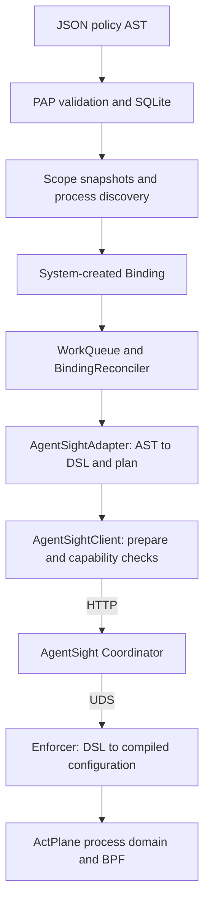
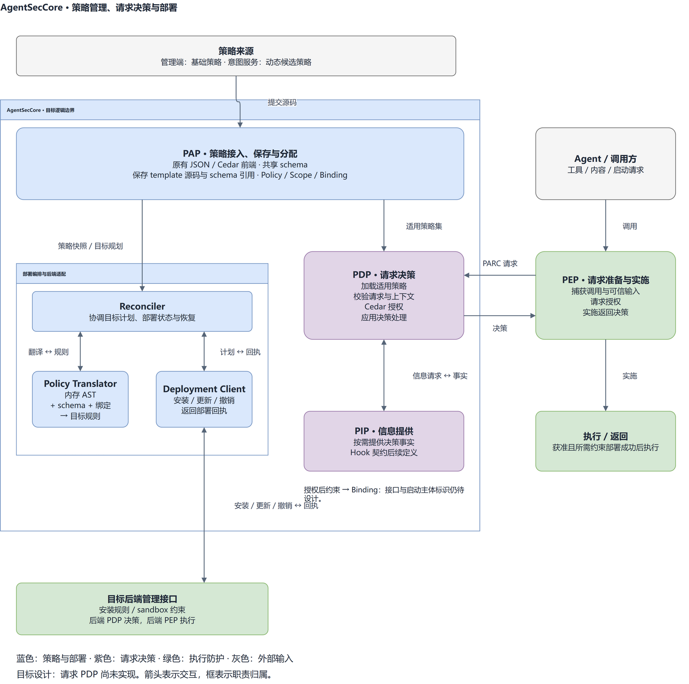
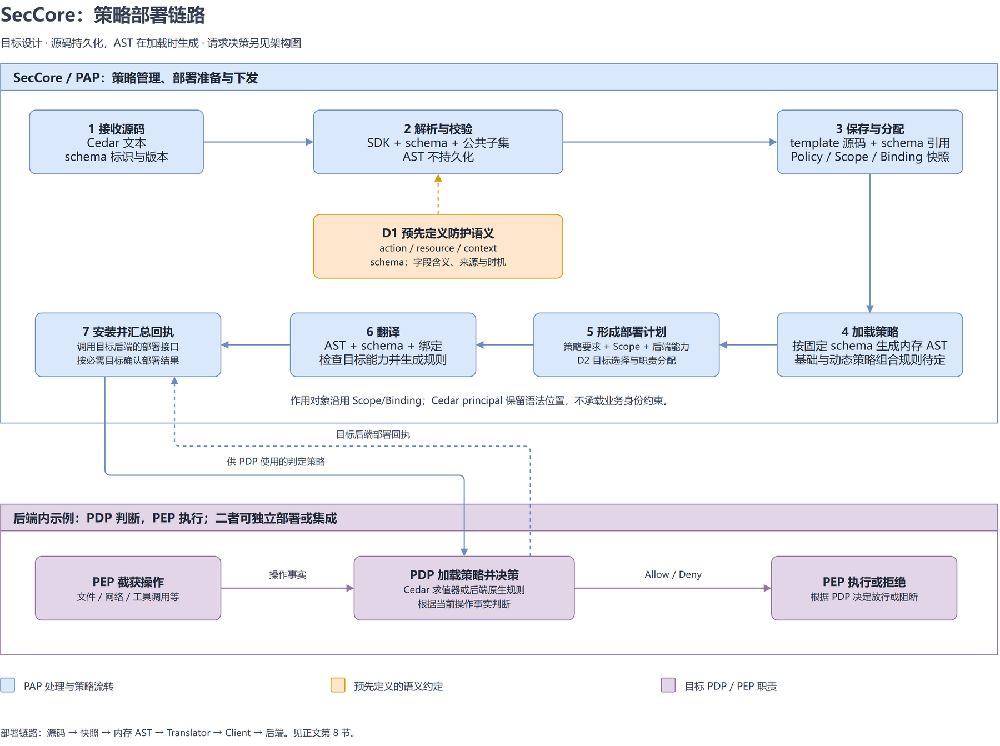
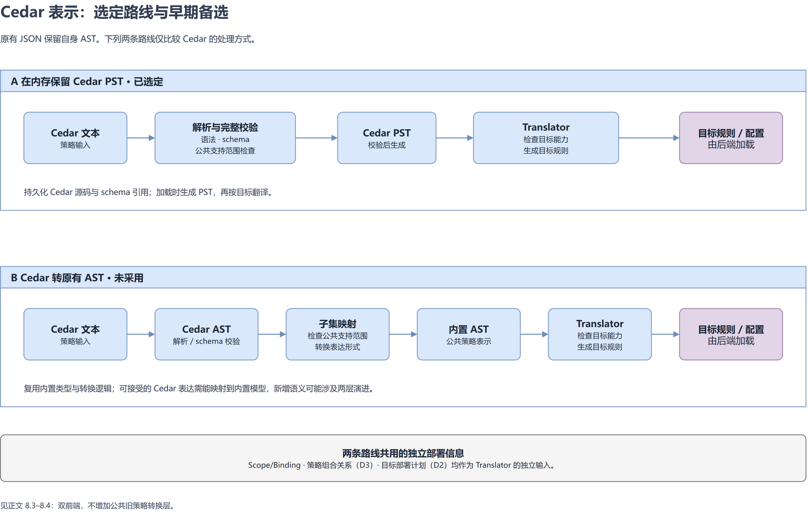

# 策略前端、AST 与语句翻译

[English](POLICY_FRONTEND_AST_AND_TRANSLATION.md)

本文整理 AgentSecCore V2 的现有策略链路与 Cedar 集成设计。第 1–4 节说明现有实现，
第 5–7 节保留早期 Cedar/Dogwood 导入评估，第 8 节记录当前选定的架构、数据结构、
版本与持久化约定。选定方案采用双前端，不实施 Cedar 与原有 JSON 策略之间的转换器。

设计更新日期：2026-10-29。Cedar 前端库与独立数据类型已添加到工作区，尚未接入
PAP/RPC、SQLite、目标 Translator 或运行时授权服务；下文分别标明现状与后续设计。

原有 JSON 链路与早期导入评估的核查基线：
`51c781fce6352fb7ff12c4d4e1d3cf3484d05cf6`。Cedar 库接口本次核对基于
`977fe24054da128042aa6ebe99f68c69a4b98d7d`。
外部资料核查日期：2026-10-19。Dogwood 特指
[dogwood-policy/dogwood 项目](https://github.com/dogwood-policy/dogwood)。
主体分配与持久化继续遵循既有
[Policy/Scope/Binding 契约](POLICY_SCOPE_BINDING_CONTRACT_zh.md)和
[SQLite 设计](POLICY_SQLITE_PERSISTENCE_DESIGN_zh.md)。

## 1. 当前前端与内部表示

现有 PAP/RPC 前端接收直接编码类型化策略 AST 的 JSON，第 8 节的 Cedar 库尚未接入该入口。
`serde` 将 JSON 反序列化为 Rust 类型，`Validate` 检查结构及已注册的属性目录。
这条路径没有独立的 JSON Schema 文件，接受的表示由 Rust 类型和校验代码共同定义。

校验只确认策略合法，不产生具体请求的授权结果。当前下发路径没有覆盖全部合法条件、
历史和效果的通用求值器；合法模板可以保存，即使目标 Adapter 不能执行它。

```text
PolicyTemplate
  specVersion, description?
  rules[]: Rule
    effect: block | allow | require_confirmation
    category: file | network | agenthook
    action: read | write | exec
    target: Resource::File { path }
    where?: Condition
      And | Or | Not | registered attribute comparison
    previous?: HistoryCondition
      Event { category, action, target, where? } | And | Or | Not
    because?: string
```

根节点是一组规则，`where` 和 `previous` 内部是表达式树。`category` 虽有三个枚举值，
但当前只定义了文件资源，校验只接受 `file`；未知资源类型及不匹配的 category/resource
组合会被拒绝。

`PreparedPolicy` 在模板外包装 `policyId`、`policyName` 和 `revision`。主体分配独立处理：
Scope 保存 selector 和完整策略快照；系统生成的 Binding 保存一个策略快照及具体进程身份。
Cedar 的 `(principal, action, resource)` scope 因而不等同于 SecCore 的 Scope 对象。

源码：[authoring AST](../../v2/crates/asc-policy-types/src/authoring.rs)、
[条件 AST](../../v2/crates/asc-policy-types/src/authoring/condition.rs)、
[策略快照](../../v2/crates/asc-policy-types/src/policy.rs)、
[Scope](../../v2/crates/asc-policy-types/src/scope.rs)、
[Binding](../../v2/crates/asc-policy-types/src/binding.rs)。

## 2. 可接受的语法与静态校验

| 字段 | 可接受的表示 | 当前语义或边界 |
|---|---|---|
| `effect` | `block`、`allow`、`require_confirmation` | 已有类型；尚未实现通用效果组合及人工确认执行 |
| `target` | `{"type":"file","path":"/absolute/path"}` | 字面路径或受限 authoring glob |
| `where` | 单属性比较，或 `and`/`or`/`not` | 属性按动作限定；不能任意读取 context 或调用函数 |
| `previous` | 历史事件谓词，或 `and`/`or`/`not` | 没有时间窗口、顺序、聚合、变量绑定或当前/历史字段关联 |
| `because` | 可选静态字符串 | 解释文本，不参与匹配 |

### 2.1 当前操作属性

| 动作 | 属性 | 操作数与运算符限制 |
|---|---|---|
| `read` | `program`、`file` | 规范化字面路径；标量 `eq`/`ne` 或非空列表 `in` |
| `write` | `program` | 同上，按字面路径比较 |
| `write` | `operation` | `write`、`create`、`delete`、`rename`、`setattr`；`eq`/`ne`/`in` |
| `write` | `mode`、`ownerUid`、`ownerGid` | u32 范围整数；`eq`/`ne`/`in`/`gt`/`ge`/`lt`/`le` |
| `exec` | `argsPrefix` | 非空字符串数组；`eq`/`ne` 表示 argv token 前缀及其否定，不含 argv[0] |
| `exec` | `cwd` | 同上，按字面路径比较 |

例如，下面是可以放入文件写规则中的合法 `Condition` 片段：

```json
{
  "and": [
    { "operation": { "eq": "delete" } },
    { "program": { "eq": "/usr/bin/python3" } }
  ]
}
```

该条件可以表示并通过校验，但当前 AgentSight Adapter 会拒绝：Adapter 只接受单独的
`operation == delete` 条件。

`Scalar` 可以反序列化字符串、整数和布尔值，但当前属性目录没有布尔属性，不能因为
存在这个枚举分支就使用通用布尔 context 字段。比较是“属性对字面量”，不是任意表达式
之间的比较。

### 2.2 历史与规模限制

`HistoryEvent` 描述文件动作、目标及该事件自身的可选条件，不能递归携带 `previous`。
历史 `and` 是逻辑合取，不表示事件顺序。源码注释为事实缺失、历史不完整保留了 unknown
语义，但当前路径尚无通用历史求值器，也没有已落地的策略历史持久化域。AgentSight
当前不会翻译任何历史规则。

`specVersion` 必须是 `0.1`，规则数为 1–1024。条件/历史最大深度为 16，全策略共享
4096 个节点预算。路径必须绝对、最多 4096 bytes，拒绝 `.`/`..` 段、重复分隔符、
根目录以外的尾分隔符、NUL、home 展开及环境变量展开。Authoring glob 支持 `*`、`?`
及占完整路径段的 `**`；条件里的路径比较只接受字面路径，不接受 glob。
`description` 和 `because` 各最多 4096 bytes，拒绝 NUL。

源码：[模板校验](../../v2/crates/asc-policy-types/src/authoring.rs)、
[属性校验](../../v2/crates/asc-policy-types/src/authoring/condition.rs)、
[authoring 回归测试](../../v2/crates/asc-policy-types/tests/authoring.rs)。

## 3. 当前 AST 到 DSL 的翻译

`AgentSightAdapter::translate` 读取完整 Binding 快照，校验全部输入，将规则降低为
ActPlane DSL，再包装为目标计划。它不查询最新模板，不执行请求求值，也不进行目标 I/O。

| AST 要素 | Adapter 接受范围 | 超出范围时 |
|---|---|---|
| 效果 | `block` | `RULE_<index>_UNSUPPORTED_EFFECT` |
| category/action | `file` / `write` | `RULE_<index>_UNSUPPORTED_ACTION` |
| 条件 | 精确为 `{"operation":{"eq":"delete"}}` | `RULE_<index>_UNSUPPORTED_CONDITION` |
| 历史 | 不携带 | `RULE_<index>_UNSUPPORTED_HISTORY` |
| 路径模式 | 字面路径，或字面前缀后接 `/**` | 拒绝不支持的 glob |
| 规模 | 最多 128 条；降低后的路径模式最多 63 bytes | 明确的上限错误 |
| DSL 字面量 | 路径/理由不含引号、反斜杠或控制字符 | 明确的路径/理由错误 |
| 挂载范围 | 以 Binding 固定实例为根的进程树 | 拒绝 cgroup selector |

任意一条合法规则不受支持，整个 Binding 转换失败，不会静默下发其中一部分。规则顺序
决定稳定生成的名称，不表示通用 first-match/last-match 判定。多条受支持的 block 规则
覆盖其匹配范围的并集。当前不做复杂条件化简。

以下模板取自
[prepared-Binding fixture](../../v2/crates/asc-policy-types/tests/fixtures/prepared-binding.json)
中的第一条规则：

```json
{
  "specVersion": "0.1",
  "rules": [
    {
      "effect": "block",
      "category": "file",
      "action": "write",
      "target": { "type": "file", "path": "/etc/agent/config.yaml" },
      "where": { "operation": { "eq": "delete" } }
    }
  ]
}
```

生成的 DSL 为：

```text
source AGENT = exec "**"
rule agentseccore-unlink-0000:
  block unlink file "/etc/agent/config.yaml" if AGENT
  because "AgentSecCore file deletion policy"
```

显式 `because` 会替换默认理由。SecCore 生成格式为 `agentsight.actplane.binding.v2`
的 `TargetBindingPlan`，其中携带来源 ID/revision、DSL 和固定实例的进程树挂载信息。

源码：[翻译器](../../v2/crates/asc-policy-adapter-agentsight/src/translate.rs)、
[计划结构](../../v2/crates/asc-policy-adapter-agentsight/src/plan.rs)、
[翻译测试](../../v2/crates/asc-policy-adapter-agentsight/tests/translation.rs)。

## 4. 分配、下发与执行



1. 创建模板只保存规则，不触发下发。创建 Scope 时解析指定的 Policy current revision，
   保存完整快照。通过 PID 或精确进程名/executable selector 发现实例；当前拒绝 cgroup
   assignment。模板更新/删除不改变已有快照。
2. Discovery 为每个 Scope/策略/实例准入一个 Binding，固定 PID、start time、boot ID
   及 PID namespace。队列通知只携带 ID，Reconciler 重读权威状态，通过 Runtime 队列
   串行处理同一 Binding。
3. Adapter 编译快照；Client 准备固定请求字节与目标引用。执行修改性目标 I/O 前，
   Reconciler 先持久化可能存在的目标责任，记为 `UNKNOWN`。
4. Client 重查进程身份，并要求健康接口 `ready=true`、backend 为 `actplane`、
   `capabilities.file_delete_guard=true`。随后携带认证 POST 到
   `/api/enforcement/bindings`，请求包含 DSL、Policy ID/revision、root PID、start time
   和 `policy_mode=enforce`。默认 API 根为 `http://127.0.0.1:7396/api`。产品 Binding
   当前不提供 Agent 身份，`agent_id` 为空，省略 `session_id`。
5. AgentSight 经 Coordinator、UDS 调用本地 Enforcer；Enforcer 编译 DSL，为目标进程
   建立执行域/标签，并向 ActPlane 提交编译后的策略字节。Client 只接受内容匹配且状态为
   `Enforced`、带 domain ID 的响应；随后通过 Repository 条件写保存观测和 `READY`。
   暂时性失败进入有界重试。

删除 Scope 会异步清理远端目标，确认目标不存在后才能回收责任。Client 的替换操作先删除
旧目标、再创建新目标，不提供原子切换。

这里有两次不同的编译：SecCore AST → DSL，以及 Enforcer DSL → 执行配置。当前
ActPlane 编译器将 `write` 与 `unlink` 都降低为 `OP_WRITE`；生成 DSL 或收到部署响应
不证明真实内核只阻止删除。真实 deny 测试仍是独立证据。

源码：[PAP](../../v2/crates/asc-pap/src/service.rs)、
[实例准入](../../v2/crates/asc-policy-repository-sqlite/src/pap.rs)、
[Reconciler](../../v2/crates/asc-pcp/src/reconciler.rs)、
[Client](../../v2/crates/asc-agentsight-client/src/client.rs)、
[请求准备](../../v2/crates/asc-agentsight-client/src/client/reconciliation.rs)、
[Enforcer](../../../agentsight/crates/agentsight-enforcer/src/actplane.rs)、
[操作降低](../../../agentsight/crates/actplane-ifc-compiler/src/dsl/lower.rs)。

## 5. Cedar 导入能力边界

评估区分两个问题：能否生成当前合法 AST，以及生成的 AST 能否通过当前 Adapter。
下表针对拟议的导入器；当前 checkout 尚未实现 Cedar 或 Dogwood 导入。

Cedar 的授权规则包括默认拒绝、forbid 优先及错误策略跳过；导入语句不会自动引入这些
策略集求值规则。参阅 [Cedar 授权过程](https://docs.cedarpolicy.com/auth/authorization.html)。

| Cedar 结构 | 能否生成当前合法 AST | 能否通过当前 AgentSight Adapter |
|---|---|---|
| 文件 `forbid`，字面目标及 delete 动作/条件 | 可以，需要显式动作/资源映射 | 可以，前提是结果精确落在受支持的删除规则内 |
| `permit` | 效果可以映射为 `allow` | 不可以 |
| 已支持属性与字面量比较的 `when` | 可以，需要映射已知属性 | 仅接受单独的删除条件 |
| `&&`、`||`、`!`、多个 `when`、`unless` | 可用 `And`/`Or`/`Not`，多个子句用 `And` 组合 | 不接受通用逻辑条件 |
| principal 相等、类型、分组、属性条件 | Rule 内没有对应字段 | 需要外部主体分配解析；不支持任意 principal 逻辑 |
| 实体层级 `in` 或跨实体属性比较 | 没有实体图和属性对属性操作数 | 不可以 |
| 固定标量集合的 `.contains(...)` 成员判断 | 可用 `Comparison::In`，需满足属性操作数限制 | 不接受通用成员条件 |
| 通用 `context`、record、set、算术、扩展函数、`has` | 没有承载这些结构的通用表达式/值模型 | 不可以 |
| `like` | 只能另行检查并约定支持的模式子集 | 不能直接复用 Cedar 字符串通配语法 |
| annotation、template slot | 没有规则 annotation/slot 字段，需外部保留或先实例化 | 仅接受最终落入支持范围的具体规则 |

导入 profile 必须声明实体/动作 namespace、哪个资源字段表示规范化文件路径，以及主体
如何绑定到可信进程分配。principal 与进程身份之间需要显式映射。Cedar 的实体 `in`
检查实体相等或层级成员关系；SecCore 的标量列表 `in` 检查字面量列表中的成员关系。
Cedar 的 `[...]` 构造无序 Set，有序 argv 前缀匹配需要同时保留位置和 token 值，
第 8.6 节的 `{index, value}` 表达实现了这一点。整数还需满足目标属性的 u32 范围。
这些边界来自当前 AST，以及 Cedar 的
[scope 语法](https://docs.cedarpolicy.com/policies/syntax-policy.html)和
[运算符定义](https://docs.cedarpolicy.com/policies/syntax-operators.html)。

### 5.1 一种可导入的语句形态

假设拟议的导入 profile 约定：`SecCore::Action::"file.write"` 表示文件写操作，
`SecCore::File` 的 ID 表示规范化字面路径，`context.operation` 表示可信操作类型，
那么下面的语句可以生成第 3 节中的模板：

```cedar
forbid (
  principal,
  action == SecCore::Action::"file.write",
  resource == SecCore::File::"/etc/agent/config.yaml"
)
when { context.operation == "delete" };
```

这里的 namespace/profile 是说明性约定，不是 SecCore 已注册 API。具体进程由 Scope
分配指定。该导入提取一条阻断规则，不表示 SecCore 已实现 Cedar 的完整授权结果。
例如，只有这条 `forbid` 的 Cedar 策略集仍会在其他请求上默认拒绝，而提取出的 SecCore
规则只增加指定限制。导入界面/契约需要明确这一边界。

## 6. Dogwood 导入能力边界

Dogwood 核心语法来自 Cedar，因此普通核心语句可采用第 5 节的受限映射。其时序语言及
information provider 需要额外能力；JSON AST 编码本身不提供这些运行时输入。
参阅 [Dogwood 核心语言](https://dogwood-policy.github.io/dogwood/guide/02-policy-language.html)。

| Dogwood 结构 | 当前 AST 边界 | 当前 Adapter 边界 |
|---|---|---|
| 普通 Cedar 风格文件规则 | 同第 5 节 | 仅支持删除阻断规则 |
| 宏 | 用 Dogwood parser/schema 环境展开后再检查结果 | 展开后仍须落在受支持子集内 |
| 固定字面量的简单历史文件事件谓词 | `HistoryEvent` 可描述事件形状，但不提供 Dogwood 时序语义 | 拒绝所有 `previous` |
| `formerly within ...` | 没有窗口/时长节点 | 不支持 |
| `previous within ...` | 没有“紧邻前一个事件”的运算符；SecCore 的同名字段不是该运算符 | 不支持 |
| `since`、事件顺序、`exists`、`tp`、`count`、`sum` | 没有对应时序、绑定或聚合节点 | 不支持 |
| 历史与当前请求之间的同用户/资源关联 | 没有绑定变量及当前/历史字段引用操作数 | 不支持 |
| provider 调用及其输出字段 | 没有 provider-call 节点或通用动态属性 namespace | 不支持 |
| `guardrails { E }` | 可以去除语法包装，但 `E` 仍须落在允许的核心子集内 | 不会自动获得 provider 执行能力 |

例如，Dogwood 可以要求用户在读取前一小时内登录。把该条件换成 SecCore 历史事件会丢失
时间窗口及与当前用户的关联；应报告不支持，而不是因为都有 `previous` 字样就导入。
参阅[时序表达式](https://dogwood-policy.github.io/dogwood/guide/04-temporal-expressions.html)。

Provider 调用需要参数、输出声明和运行时求值，移除 `guardrails` 包装不能消除这些依赖。
当前 AST 也无法引用任意 provider 布尔结果；需要属性契约和执行器，不能只添加一个 JSON
键。参阅 [information provider](https://dogwood-policy.github.io/dogwood/guide/05-information-providers.html)。

Dogwood 可以把时序/provider 检查降低成 Cedar context 中的生成字段，但这些字段仍需
Dogwood 的运行时 monitor/resolver 填充，导出的 Cedar 不一定自包含。
参阅 [API 与工作流](https://dogwood-policy.github.io/dogwood/guide/07-api-and-workflow.html)。

## 7. 早期导入方案的范围与验证

若选择导入既有 AST 的路线，首阶段可实现受限 Cedar/Dogwood 语句导入器，输出既有 `PolicyTemplate`。
受支持的删除规则无需扩展 AST/schema。能力报告应分开列出：

1. 能生成合法 AST 的语句，包括仅可保存、尚不能执行的规则。
2. 还能通过当前目标 Adapter 的语句。
3. 不支持的字段/表达式，以及必需的外部主体/资源映射。

导入不能静默丢掉 principal 条件、时序子句或 provider 调用。源位置与导入诊断可以保留在
AST 外，不需要为本次评估引入第二套策略模型。通用 Cedar 授权或 Dogwood monitor 支持
属于额外的运行时功能，超出语句导入范围。

第 5–7 节评估的候选导入器尚未实现，也不属于第 8 节选定的架构。现有
[authoring 测试](../../v2/crates/asc-policy-types/tests/authoring.rs)及
[翻译测试](../../v2/crates/asc-policy-adapter-agentsight/tests/translation.rs)覆盖当前本地边界。
后续导入器只需针对接受语句检查输出 AST，并检查不支持结构被明确拒绝；完整语言语义
等价不属于这里的验收目标。

## 8. Cedar 集成整体设计

本节作为当前本地设计约定。前期讨论见
[SecCore 集成 Cedar：剩余设计问题与待定选项](https://alidocs.dingtalk.com/i/nodes/gvNG4YZ7Jnxop15OCoadooMLW2LD0oRE)。
以下架构包含尚未实现的请求决策路径；代码现状见 8.6，接入顺序见 8.9。

### 8.1 组件职责与两条处理链路

Cedar SDK 提供策略解析、schema 校验、结构化表示，以及针对具体
`principal / action / resource / context` 请求的授权求值。SecCore 负责定义系统操作的
字段语义、生成可信请求、管理策略与作用范围、选择防护目标，并把策略或决策落实到后端。
Cedar 原生授权结果是 Allow/Deny 与诊断信息；策略部署和业务处理流程由集成层承担。
参阅 [Cedar 授权接口](https://docs.cedarpolicy.com/auth/authorization.html)。

| 逻辑部分 | 承载的作用 | 实现位置或状态 |
|---|---|---|
| 策略前端与共享 schema | 原有 JSON 反序列化；Cedar 解析、类型校验与公共子集检查；定义 action/resource/context 的字段契约 | `asc-policy-types`、`asc-policy-cedar`；Cedar 库尚未接入 PAP |
| PAP 策略管理 | 保存源码及 revision，关联 Scope，保留分配和 Binding 快照；接入后接收基础和动态 Cedar 策略 | `asc-pap`、repository 当前管理原有 JSON 策略；Cedar 准入与策略组合待接入 |
| PDP 请求决策 | 加载适用策略，接收具体请求，按需组织 PIP 信息并执行授权 | 目标设计；可以与 PAP 同处 SecCore daemon，逻辑职责独立 |
| 部署编排 | 生成或更新 Binding、选择目标，由 Reconciler 驱动安装、更新、撤销与恢复 | 现有 Scope/Binding 与 `asc-pcp`；从授权结果生成部署输入仍待接入 |
| 后端适配 | Translator 负责目标能力检查与翻译；Deployment Client 负责后端协议和部署调用 | 现有目标接口与 AgentSight 实现；Cedar 翻译尚未接入 |
| PEP 与后端 PDP | PEP 捕获请求并落实决策；部分后端还包含自己的 PDP，持续判断系统操作 | 按 Hook、sandbox、ActPlane 等具体场景确定；不能由 schema 推断支持情况 |



图中框表示职责归属，箭头标注交互内容。PAP 与 PDP 可部署在同一个进程，后端也可集成
PDP 与 PEP。前端和 schema 是策略接入、请求构造及目标翻译共同遵守的契约。

**策略部署链路**：源码 → 前端校验 → PAP 保存 → Scope/Binding 快照 →
加载源码并生成内存表示 → 目标选择 → Reconciler 调用 Translator 与 Deployment Client →
后端管理接口 → 部署回执。它负责建立持续生效的防护配置。

**请求决策链路**：PEP 捕获当前调用 → 构造可信请求 → PDP 加载适用策略并决策 →
PEP 实施结果。普通工具或内容请求通常不需要逐次生成持久化 Binding。启动或 sandbox
场景若需要安装授权后的约束，则在允许执行前完成所需部署并确认回执。

动态策略生成模块向 PAP 提交候选策略；生成成功不等于请求获准。基础策略与动态策略的
组合规则决定 PDP 加载什么策略，尚不能靠合并所有 `permit` 保证基础权限上限。
单次 Cedar Allow 只针对当前请求，也不能直接推导出整个目录或一组操作的可下发权限。
授权结果到约束、Binding 的映射，以及“先安装再启动”所需的主体标识与时序，仍需设计。
现有 Binding 绑定已识别的进程实例，不能直接视为已经支持启动前授权。

后续支持 MODIFY、STEP_UP、DEFER 和 `@advice` 时，SecCore 需要定义相应的处理协议。
当前前端拒绝策略注解。PIP/Agent Hook 的具体检测事实本次不展开。

### 8.2 翻译、部署接入与协调

| 组件 | 输入与输出 | 当前实现对应 |
|---|---|---|
| Policy Translator（策略翻译器） | 输入内存策略表示、Cedar schema 引用（如适用）、绑定信息及目标能力；输出目标规则与执行配置；不承担部署 I/O | `TargetBindingAdapter::translate`；当前 AgentSight 实现为 `AgentSightAdapter`，仅消费原有 AST |
| Deployment Client（部署客户端） | 输入目标计划，封装协议，执行安装、更新和撤销，返回回执 | `TargetDeploymentClient` 的 `prepare_apply`、`create`、`update`、`delete` |
| Reconciler（部署协调） | 调用 Translator 取得计划，再调用 Client；跟踪状态、重试与恢复 | `asc-pcp` 中的 Reconciler |

Reconciler 调用两个适配组件。运行时请求先由 PDP 判断，PEP 实施结果；需要安装约束时
才进入部署编排。同步授权入口不会因为新增 Cedar 而变成 Reconciler 的一次重试任务。

Client 的接收方是目标后端的**管理接口**：独立 PDP 可提供策略加载接口，集成 PDP/PEP
后端可提供统一规则接口，sandbox 可接收隔离与访问配置。每个 Client 的目标契约明确
安装位置与回执含义，不能把“翻译给 PDP 还是 PEP”当成所有后端共用的固定答案。
SecCore 以该接口的成功回执记录部署成功，具体生效保证由后端契约承担。

本节用 Translator 表示翻译组件。第 1–7 节中的 Adapter 沿用源码名称。
职责对应参见[目标接口](../../v2/crates/asc-policy-target-contracts/src/lib.rs)和
[Reconciler](../../v2/crates/asc-pcp/src/reconciler.rs)。目标接口目前尚未接受 Cedar 表示。

### 8.3 表示选择与剩余设计问题

原有 JSON 反序列化为 `PolicyTemplate`。Cedar 的 `validate` 接口校验源码，`pst` 在相同
校验通过后返回用于翻译的 SDK PST。接入方案让两个前端共用 PAP、Scope/Binding 与
部署生命周期。各 Translator 需要声明接受的表示；当前 AgentSight Adapter 只接受
`PolicyTemplate`。
不新增旧 JSON 转 Cedar、Cedar 转旧 AST 的公共转换层。第 5–7 节仅保留早期方案评估。

前端检查语法、schema 和公共支持子集；Translator 检查后端能否表达条件、效果、匹配方式
和容量约束。当前支持范围之外的语义须整体拒绝，不能删除不支持的语句后继续下发。

| 设计问题 | 对应阶段 | 已确定与待定边界 |
|---|---|---|
| D1：系统防护语义映射 | 前端 schema、运行时请求构造、Translator | 文件/程序调用/整体网络字段已定义；字段可信来源、请求映射、后端翻译和授权结果到约束的接口待实现；Hook 契约另议 |
| D2：多 PEP 选择与协同 | 目标规划、部署编排、PEP 实施 | 按 Scope 与策略要求匹配能力；替代/协同关系、必需目标集合及回执汇总待定 |
| D3：基础与运行时策略叠加 | PAP 组织策略、PDP 加载与决策 | 权限上限、组合方式、冲突、有效期、撤销后的恢复仍需单独设计；动态策略不能默认扩权 |
| D4：AST 与检查位置 | 前端准入、加载、Translator | 原生 `PolicyTemplate` 与 Cedar PST；`validate` 校验源码，`pst` 校验并转换；Cedar 源码持久化与 Translator 接入待实现 |

作用对象继续由 Scope/Binding 管理。Cedar 语法仍有 principal 位置，但用户策略不填写
具体主体条件；当前前端拒绝 principal 约束与引用。直接求值时，由接入层提供符合 schema
的 `SecCore::Subject` 引用，并保证请求对应已选定的作用对象。

部署流程图展开策略部署链路。



AST 路线图展示选定方案与早期备选。选定方案先完成解析、schema 校验和公共支持范围
检查，再生成 PST 供 Translator 使用。拟接入的创建/更新流程调用 `validate`，
加载并准备翻译时调用 `pst`。



### 8.4 Policy 数据结构、内存 AST 与 SQLite

当前 [`PreparedPolicy`](../../v2/crates/asc-policy-types/src/policy.rs) 的
`template: PolicyTemplate` 已经是策略源码，反序列化后也就是原有类型化 AST。
继续使用 `template`，后续把其类型扩展为已经定义的 `PolicySource`：

```rust
// Target design; PAP/RPC and persisted snapshots have not adopted it yet.
pub struct PreparedPolicy {
    pub policy_id: ResourceId,
    pub policy_name: String,
    pub revision: Revision,
    pub template: PolicySource,
}
```

| 类型或字段 | 用途 | 拟接入的持久化约定 |
|---|---|---|
| `PolicySource::SecCore(PolicyTemplate)` | 保留原有 JSON 前端与语义 | 作为 `template` 的原生分支保存 |
| `PolicySource::Cedar(CedarPolicySource)` | `schema` + `text`，保存 Cedar 原文和精确 schema 引用 | 作为 `template` 的 Cedar 分支保存 |
| `CedarSchemaReference` | `schemaId` + `revision`，选择共享应用 schema | 随 Cedar 源码保存，进入 Scope/Binding 的策略快照 |
| `cedar_policy::pst::PolicySet` | `pst` 接口返回的 SDK 官方 PST | 翻译加载时生成；持久化保存源码 |

源码类型保留在 [authoring.rs](../../v2/crates/asc-policy-types/src/authoring.rs)和
[cedar.rs](../../v2/crates/asc-policy-types/src/cedar.rs)，保持独立于 Cedar SDK。
`pst` 接口返回 `cedar_policy::pst::PolicySet`。
源码联合类型已存在，但
`PreparedPolicy`、创建/更新 RPC、PAP 服务及存储快照仍只接受 `PolicyTemplate`。

目标中的 `template` 形状如下，尚不是已启用的 RPC：

```json
{
  "language": "cedar",
  "content": {
    "schema": { "schemaId": "seccore.system", "revision": 1 },
    "text": "forbid(principal, action, resource);"
  }
}
```

拟接入的创建/更新流程先调用 `validate`，成功后保存 `template`。
语法、schema 或公共子集校验失败时直接拒绝，不写库。部署加载时读取快照内的源码，
调用 `pst` 解析精确 schema、校验源码并生成内存 PST；将 PST 连同 schema 引用交给
Translator，应用 schema 版本仍以源码中的引用为准。两次调用各自解析输入。
持久化保存源码，加载方可在内存中保留 PST。

SDK 升级由依赖管理和回归测试验证；需要跨进程传递 AST 时再定义相应协议。
源码契约包含 `PolicySource` 的 `language/content` 输入及精确 schema 引用。

拟接入的 Cedar Translator 消费公开语法树 PST，通过类型化 Rust 节点读取策略表达式。
源码封装携带共享 schema 定义的引用，由前端单独解析该引用。

当前 SQLite 的存储位置和约束见
[`table.rs`](../../v2/crates/asc-policy-repository-sqlite/src/table.rs)：

| 存储位置 | 当前内容 | Cedar 接入影响 |
|---|---|---|
| `policies.current_json` | 当前 `PreparedPolicy`；旧内容 revision 不单独形成历史表 | 将 `template` 扩展为源码联合类型 |
| `scopes.assignment_json` | 分配信息与完整 Policy 快照 | 快照保留当时的源码、Policy revision 与 schema 引用 |
| `bindings.spec_json` | 完整 `PreparedBinding`，含 Policy 快照 | 部署和恢复读取该快照，不跟随 Policy 最新版本 |
| `bindings.deployments_json` 等状态字段 | 部署责任、回执及清理所需状态 | 继续保存；不等同于完整 AST 或翻译计划 |

SQL 主键是 `policy_id`、`scope_id`、`binding_id`；Binding 还以 Scope、Policy 和进程身份
建立唯一约束，`scope_id` 有外键。Cedar 的 `File.path`、action 名、context 字段、枚举取值
属于源码/schema 的内容，当前没有作为 SQLite 列、索引或 key。应用 schema 改动通常不改
SQL 表结构，但仍需保持对应旧版本可解析、可执行。

首次将裸 `PolicyTemplate` 改为带 `language/content` 的 `PolicySource` 会改变 JSON wire
format，必须明确旧请求与上述三处旧快照的兼容读取或数据迁移方案。即使 SQL 列没变，
也不能直接替换类型后假定旧数据库可读。相反，SQL `phase` 的取值写在 CHECK 约束中，
修改它需要存储迁移；这与修改 Cedar `WriteOperation` 枚举是两类变更。

### 8.5 Strands Box 的 schema 组织方式

以下对照基于 Strands Box 提交 `7cf6bad7728410c6c28cd7bebd802ff2e18af7ee`：

| 文件 | 职责 |
|---|---|
| [schema/actions.cedarschema](https://github.com/strands-agents/box/blob/7cf6bad7728410c6c28cd7bebd802ff2e18af7ee/crates/policy/schema/actions.cedarschema) | 定义内置实体、动作及各动作的 input/output 字段 |
| [src/schema.rs](https://github.com/strands-agents/box/blob/7cf6bad7728410c6c28cd7bebd802ff2e18af7ee/crates/policy/src/schema.rs) | 嵌入并解析 schema，组合 MCP 扩展，将运行时 Request 映射到 Cedar 请求并检查 schema 一致性 |
| [src/policy.rs](https://github.com/strands-agents/box/blob/7cf6bad7728410c6c28cd7bebd802ff2e18af7ee/crates/policy/src/policy.rs) | `Policy` 保存源码文本及来源；引擎加载时另行接收 MCP schema 片段 |
| [src/mcp_schema.rs](https://github.com/strands-agents/box/blob/7cf6bad7728410c6c28cd7bebd802ff2e18af7ee/crates/policy/src/mcp_schema.rs) | 从 MCP `tools/list` 生成工具动作和参数 schema |

可借鉴的是独立维护应用 schema，并让策略校验和运行时请求映射遵守同一份定义。
Strands Box 的 `action` 实际承载 `fs:delete` 等动作，具体路径和操作参数位于
`context.input`；principal/resource 使用固定实体。其 input/output 分组还服务于
Dogwood 事件派生，`events.dwschema` 属于该时序扩展。SecCore 需要按自身防护场景确定
字段及映射，不能仅因采用 Cedar 就继承这些约定。Scope/Binding 继续负责作用主体，
运行时使用 Cedar PDP 时，再由集成代码提供符合 schema 的 principal。

### 8.6 Cedar 前端库

[`asc-policy-cedar`](../../v2/crates/asc-policy-cedar/src/lib.rs)提供两个接收源码的接口：

| 接口 | 调用场景 | 成功结果 |
|---|---|---|
| `validate(&CedarPolicySource) -> Result<Vec<ValidationWarning>, CedarError>` | 创建/更新策略 | 非阻断的 SDK warnings；不生成 PST |
| `pst(&CedarPolicySource) -> Result<cedar_policy::pst::PolicySet, CedarError>` | 为 Translator 加载策略 | 通过相同准入校验后的 SDK 官方 PST |

两个接口都要求原始文本和精确 schema 引用，均解析 schema 和源码、检查公共支持范围，
并执行 SDK 严格校验。`pst` 独立完成校验，调用方无需先调用 `validate`。
`pst` 仅返回 PST；需要展示 warnings 的调用方使用 `validate`。
新增公共 validator 放在这条共享校验流程内部。

输入、schema 解析、语法或公共子集检查失败时结束调用；SDK schema 校验错误及被拒绝的
`InvalidActionApplication` warnings 通过 `CedarError::Validation` 汇总返回；
非阻断的 SDK warnings 在 `validate` 成功时返回。错误枚举区分失败类别，SDK 诊断保留
可获得的策略 ID 和源码位置。失败时不返回部分 PST。目标后端的能力由 Translator 检查。

principal 条件检查借用 SDK 已解析的 AST。该私有函数使用 SDK 隐藏的
`AsRef<ast::Policy>` 接口和 `subexpressions()` 遍历器。`cedar-policy-core` 与
`cedar-policy` 均固定为 4.14.0；升级 SDK 时需要核对这处内部访问及 principal 引用测试。
仅 `pst` 将校验后的策略集转换为 PST。工作区最低 Rust 版本为 1.89，构建环境可继续使用 1.93.1。

| 文件 | 职责 |
|---|---|
| `schema/seccore.cedarschema` | 实体、动作及各动作 input 字段定义 |
| `src/schema.rs` | 精确解析内置 schema 标识及版本 |
| `src/validation.rs` | 共用的解析、schema 校验及公共子集检查 |
| `src/lib.rs` | `validate`、`pst` 公开函数、PST 转换与类型化诊断 |

schema 覆盖文件访问、程序调用和整体网络权限，保留 `SecCore::File` 与
`file.read/write/exec` 命名。`file.exec` 继续表示程序调用，不是 Linux 文件系统 X 权限检查。
`SecCore::Subject` 是由集成层提供的无属性请求主体类型，具体进程身份仍由 Scope/Binding
管理。`SecCore::File.path` 表示具体文件或程序路径，不保存策略中的路径模式；
路径条件直接写在策略中。`SecCore::Network::"all"` 表示整体网络使用权限，
尚未定义主机、IP、端口或协议过滤。

| 动作 | 资源 | Context | 含义 |
|---|---|---|---|
| `file.read` | `File` | `input.program: String` | 发起请求的可执行程序路径 |
| `file.write` | `File` | `input` 下的 `program: String`、`operation: WriteOperation`，可选的 `mode`、`ownerUid`、`ownerGid: Long` | 写操作子类型及请求设置的 setattr 值 |
| `file.exec` | `File` | `input.cwd: String`、`input.arg_count: Long`、`input.args: Set<ProcessArgument>` | 程序调用，`resource.path` 为程序路径 |
| `network.use` | `Network::"all"` | `{}` | 整体网络使用权限 |

`WriteOperation` 是枚举实体，取值为 `write`、`create`、`delete`、`rename`、`setattr`，
比较时使用如 `SecCore::WriteOperation::"delete"`。可选字段必须用 Cedar `has` 保护。
路径字符串和数值字段会做类型检查；路径规范化和 u32 值域仍需可信请求提供方保证，
`mode`、`ownerUid`、`ownerGid` 仅在 `setattr` 且确实请求修改对应属性时提供，缺失不代表零值。
schema 校验不提供这些运行时检查。`program` 仍是发起操作的可执行程序，
不是 Agent 类型，也不是即将启动的程序。

```cedar
forbid(principal, action == SecCore::Action::"file.write", resource)
when {
    resource.path == "/etc/agent/config.yaml" &&
    context.input.operation == SecCore::WriteOperation::"delete"
};
```

`ProcessArgument` 为 `{ index: Long, value: String }`。`args` 和 `arg_count` 均排除
`argv[0]`，index 0 对应 `argv[1]`。Cedar 的集合无序，通过位置字段保留参数顺序和重复值。
提供方必须传入完整参数列表：`arg_count` 非负，索引从 0 到 `arg_count - 1`，
每个索引恰好对应一条记录。参数截断或无法获取时，不得以空列表代替。
schema 类型检查不能保证这些跨字段约束，运行时请求映射尚未实现。

有序前缀通过多个位置匹配表达，不限制总参数个数。例如下面的策略允许追加尾部参数：

```cedar
permit(principal, action == SecCore::Action::"file.exec", resource)
when {
    resource.path == "/usr/bin/cc" &&
    context.input.cwd == "/workspace" &&
    context.input.args.containsAll([
        { index: 0, value: "-I" },
        { index: 1, value: "/workspace/include" },
        { index: 2, value: "-I" }
    ])
};
```

在满足上述完整参数约定时，这种表达对应原有 `argsPrefix` 的有序 token 前缀匹配。
若要求完整参数列表相等，还需限制 `context.input.arg_count`。
旧 `where.file` 可用 `resource.path` 表达，`cwd` 保留在 `context.input`。

前端接受非空静态策略集中的 `permit`/`forbid` 及符合 schema 的条件。未知 schema 版本、
principal 约束或条件中的 principal 引用、模板 slot、全部策略注解（包括 `advice`）均被拒绝。
Agent Hook、历史条件（`previous`）和确认流程尚无 schema 契约。
本库不转换原有 JSON 策略，原有 JSON 入口保持现状。

系统操作分别使用 `FileReadContext`、`FileWriteContext`、`FileExecContext`。
后续 Agent Hook 可以新增独立资源、action 和 context，必要时使用单独 namespace，
复用 `SecCore::Subject`。本次没有添加占位 Hook 实体、扫描 verdict、通用 JSON 字段或
schema 插件加载器。Hook 扩展仅在测试中定义，当前内置 schema 仍拒绝这些动作。
初始 schema 尚未发布，因此仍保留 revision 1；发布后扩展需要更新固定版本契约并重新
校验策略，尤其注意未限制 action 或 resource 的策略可能覆盖新领域。

这是新增 V2 库契约，不是 V1 迁移或授权服务。PAP/RPC、存储快照、目标翻译和运行时请求映射
尚未接入。校验成功只证明前端接受该策略。

验收由 [`tests/validation.rs`](../../v2/crates/asc-policy-cedar/tests/validation.rs)执行：
`validate`/`pst` 准入一致性、warnings 返回、官方 PST 往返、文件与网络字段、
参数前缀决策、请求必填结构、测试用 Hook 扩展、
整组拒绝、schema 版本限定、principal 限制、
模板/注解拒绝及 schema 诊断。既有 policy-types fixtures 继续检查原生 wire format。
在 `src/agent-sec-core/v2` 下运行：

```bash
cargo test -p asc-policy-cedar -p asc-policy-types --locked
cargo clippy -p asc-policy-cedar -p asc-policy-types --all-targets --locked -- -D warnings
cargo doc -p asc-policy-cedar -p asc-policy-types --no-deps --locked
```

测试 crate 是首个直接消费者，尚无 daemon 调用路径。回滚时移除新增 workspace member、
依赖及对应 lockfile 变更；没有需要撤销的持久化迁移或部署。
`asc-policy-types` 中的源码类型可继续保留，用于后续接入。

### 8.7 Schema 版本与策略加载

| 版本 | 标识什么 | 何时变化 |
|---|---|---|
| SQLite 存储版本 | 表、索引、约束与持久化格式的迁移 | 数据库结构或旧数据升级需要变化时 |
| Policy `revision` | 某一条 Policy 的内容版本 | 修改名称、源码或其 schema 引用时生成新 revision |
| `schemaId` + schema `revision` | 应用字段、动作、类型及含义的一份固定契约 | 发布改变了这些定义的新 schema 时 |
| Cedar SDK 依赖版本 | 编译使用的 SDK，由 Cargo 依赖和 lockfile 固定 | 依赖升级时；不放入 AST，也不作为应用 schema 选择依据 |

`seccore.system@1` 是整个应用 schema 的版本，不是 `SecCore` namespace 的独立版本。
后续 Hook 可增加 namespace，但仍随同一份 schema 发布，无需在每个 namespace 上增加
版本。只有实际需要独立发布时，才另行设计独立 schema 标识与组合规则。

计划把以下元数据放在 schema 文件约定的 `SecCore` namespace 上，由 SecCore loader
读取，作为整份 schema 的身份；这里省略实体和 action 定义：

```cedar
@schema_id("seccore.system")
@schema_revision("1")
namespace SecCore {
    // Entity and action definitions belong here.
}
```

Cedar 支持 [namespace 注解](https://docs.cedarpolicy.com/schema/human-readable-schema.html#namespace)，
但 `schema_id`、`schema_revision` 是 SecCore 定义的约定，Cedar 不会自动据此选择版本或迁移
策略。**当前代码在 `schema.rs` 中定义常量；文件注解及元数据读取属于后续实现。**
Schema 元数据与策略注解分别约定处理规则。

进入前端的 Cedar 文本必须携带 `CedarSchemaReference`。创建界面可以预选当前版本，但
在提交、校验和存储前须形成明确引用；更新未改变 schema 引用的策略继续使用原版本。
Cedar parser 根据语言语法解析文本，应用 schema 用于后续类型校验，二者不应混称为
“按 schema 解析语言”。当前 `load_schema` 只将引用与 `SCHEMA_ID`、`SCHEMA_REVISION`
常量比较，再解析内嵌 schema。以下是持久化及文件元数据接入后的加载流程：

1. 读取已保存源码中的精确 `{schemaId, revision}`，查找受支持的 schema；不存在则拒绝加载。
2. 校验 schema 文件元数据与引用一致。SDK 解析文本并按 schema 校验类型；SecCore 检查
   公共支持子集。
3. 翻译路径将 PST 与 schema 引用交给 Translator。后续 Cedar PDP 使用 SDK 可求值的
   `PolicySet`，并按同一 schema 构造请求；PDP 加载接口仍待定义。

保持旧 schema 引用时不应原地改写已发布定义；修改引用则产生新的 Policy revision。
仅更新 Policy 当前记录不会更新已有 Scope/Binding 快照，升级须另行更新分配并完成部署。
增加 Hook/action 也需重新校验未限制 action/resource 的策略，不能一概视为无影响扩展。
参阅 [Cedar 策略校验](https://docs.cedarpolicy.com/policies/validation.html)。

只要存储封装与 SQL 约束不变，发布应用 schema 新版本通常无需升级 SQLite 存储版本。
但 PAP 接入校验、PDP 加载和 Translator 都需要检查自身支持的版本，不能仅依赖最终 PEP
兜底。Schema 文件元数据也不能替代 Policy 中的引用：前者说明“这是什么定义”，后者说明
“这条策略使用哪份定义”。

### 8.8 Translator 兼容范围与旧前端退出

Translator 分开声明两类能力：理解哪些应用 schema 版本，以及在这些版本下支持哪些
action、字段、表达式和效果。支持一个 schema 版本不代表支持其中所有策略。
例如新版只增加 Hook 定义，文件 Translator 经验证后可共用实现并声明支持两个版本，
但仍拒绝 Hook 规则；字段改名、含义变化或匹配语义变化则需要实现对应处理或拒绝。

不要求每个 Translator 永久兼容全部历史 schema。对仍由该目标负责部署、恢复或更新的
Binding，必须保留其版本支持，或先完成显式迁移和目标重新分配。启动恢复遇到不支持的
版本要报告失败，不能把旧策略当成最新版本或丢掉规则。仅允许旧部署继续运行不代表
已经具备重建和更新能力。

原有 JSON 前端可以后续废弃：先限制新建原生策略，保留已有策略的读取、部署恢复和删除；
待相关 Policy、Scope/Binding 快照不再使用原生分支，并确认回滚和历史数据读取需求后，
再移除 `PolicySource::SecCore` 与对应翻译支持。退出过程不依赖自动 JSON → Cedar 转换；
策略替换需要按所选后端验证语义与部署结果。

### 8.9 当前完成范围与后续接入顺序

| 部分 | 当前状态 | 下一步 |
|---|---|---|
| 类型与 Cedar 前端 | 源码联合类型；内置 revision 1；`validate` 返回非阻断 warnings，`pst` 校验并返回 SDK PST | schema 文件元数据及读取；保持公共子集诊断 |
| Policy/PAP/RPC/SQLite | 全部仍走原有 `PolicyTemplate` | `template: PolicySource`；Cedar 创建/更新调用 `validate`；旧请求与三处持久化快照兼容方案 |
| 策略加载与目标翻译 | AgentSight 仅支持原有 AST | 对 Cedar 快照源码调用 `pst`；携带 schema 引用；逐目标实现并声明支持范围 |
| PDP 与部署衔接 | 现有链路负责异步部署，无通用 Cedar 请求授权入口 | 独立定义请求/决策契约、策略组合、约束到 Binding 的接口及启动时序 |
| Agent Hook/PIP | 内置 schema 尚未支持 | 另定资源、动作、请求字段与检测契约，再发布对应 schema 版本 |

先接通已有策略生命周期中的 Cedar 源码保存、加载与单个目标翻译，再依据具体运行时场景
实现 PDP/PEP 请求路径。版本支持检查贯穿接入、加载与翻译；不先引入外部 schema 注册服务、
持久化 AST 缓存或通用旧模型转换器。

实现时的关键验证包括：旧 SQLite 快照仍可读取和恢复；Cedar 创建拒绝未知 schema 与不支持
语义；重启按快照原版本加载；目标不支持时整组拒绝；Policy 更新不隐式改变已有 Binding。
请求授权、部署成功和实际 PEP 防护分别验证，不以编译通过或写库成功替代后两者。
