# HTTP payload ownership and memory limits

[中文版](payload-memory_zh.md)

AgentSight bounds retained capture payloads and reports incomplete calls when correlation ends early.
The implementation targets concurrent streaming workloads by releasing duplicated payloads before
delivery and reducing SSE deltas during the stream. Process RSS remains a measurement of the whole
runtime, including the ring buffer, native decoding state and allocator retention.

## Ownership boundaries

```mermaid
flowchart LR
    Probe[Probe payload] --> Capture[Queue with slot and byte limits]
    Capture --> HTTP[HTTP correlation]
    HTTP --> Stream[Dechunk and decode fragments]
    Stream --> Reduce[Reduce SSE deltas]
    Reduce --> Analysis[Shared parsed JSON]
    Analysis --> Call[Owned semantic call]
    Call --> Queue[Byte-limited FFI queue]
    Queue --> Callback[Borrowed callback buffers]
```

Executable SSL scans use vectorized substring searches in bounded 4 MiB windows with signature
overlap. Every overlapping match and cross-window start is preserved; inode caching and symbol
selection keep their existing behavior.

Fragmented requests reserve the declared body size within the body cap, copy the initial fragment
once, and replace the initial TLS source with metadata. Completed bodies release excess capacity.
Chunk framing is tracked incrementally, while the original request body remains available to the
existing content-decoding helpers.

The SSE pipeline retains unfinished event bytes and provider delta groups instead of TLS history.
OpenAI chat, Responses, Anthropic and DashScope deltas are coalesced; lifecycle events retain their
order. Unrecognized events stay individually available within the same byte limit. Responses
lifecycle events discard echoed `instructions`, `input`, `tools` and `prompt`, which are already
captured on the request. The original event count, first meaningful output timestamp, usage and
completion timestamp remain available to semantic delivery.

gzip, zstd, deflate and Brotli decode incrementally; deflate accepts both zlib and raw framing.
HTTP chunk framing, UTF-8 and SSE event boundaries may cross captured records. HTTP/2 DATA uses
the same decoder and reducer. Decoder contexts and large scratch buffers are released before
reduced events are materialized for completion or abandonment. `retain_raw_sse` and FFI raw HTTPS
fallback select the existing sequence-preserving path, which also observes retention limits.

Analysis shares request and response JSON across audit, token fallback and GenAI construction.
It builds full HTTP body strings for raw export or unsupported-format fallback. Capture ownership
ends before building the semantic call; analysis payloads end before FFI queue admission. Pending
SQLite JSON is constructed only when a SQLite sink exists.

Standalone persists the HTTP view before semantic construction, then transfers its body strings
into the call. Raw fallback keeps its HTTP ownership. Serializer capacity above 125% of body length
is released before the call enters deferred delivery. Parsed analysis payloads and pending-row
summaries end before queue admission or completion. First/last user text and a single system message
are borrowed when they contain one text part; multiple text parts keep their newline-join semantics.

Deferred calls keep large request text and `user_query` as exact ranges into their owned raw body
or message text when possible. Fields without an exact source range retain their original allocation.
Queue accounting includes the compact payload and its range descriptors. Each batch restores its
fields immediately before delivery, including limit, timeout, process-exit and shutdown drains;
draining several calls does not restore all payload copies simultaneously. Session mapping disabled
by configuration, and sessions explicitly supplied by the request, bypass the deferral window.

Delivery with SQLite as the only active sink also bypasses payload deferral: a completed capture is
inserted once, without
constructing a pending-row body summary. Existing pending or idle-snapshot rows still follow normal
promotion and preserve captured request evidence. Calls awaiting a session mapping retain only their
IDs in the existing retroactive fix-up registry; a later file write repairs both the session column
and completed-event JSON. FFI and active non-SQLite exporters keep deferred delivery because an
already delivered event cannot be repaired in those consumers.

Registered sinks report their current activity; unknown exporters default to active. The default
Logtail sink checks the same required-file and telemetry-sentinel gates for routing and writing.
Dynamic sinks also re-read their current path so a paused exporter can resume without registration
changes. Inactive sinks are still called during immediate fan-out: activation during persistence
does not discard the current call, which may carry its fallback session metadata. Subsequent calls
to an active external sink use the existing resolution window.

GenAI session and conversation resolution prepares lookup keys once per call and reuses them for
turn eviction and crash draining. Identical first/last user text shares its unfinished SHA-256
state. Repeated long text can reuse exact-byte-checked prefixes in a cache bounded by 2 MiB and
64 entries; eviction never changes anchors. Anchors retain domain-separated IDs and binary lookup
digests, preserving external ID bytes, process/message-count isolation and sliding TTL behavior.

SQLite completion serializes JSON before taking the connection lock. Capacity selection uses
`octet_length` on stored JSON columns to read their byte lengths without fetching and scanning whole
payloads while holding that lock. Delivery remains synchronous; these changes shorten its critical
sections rather than introducing another persistence queue.
Completed-event JSON reserves from the retained-payload estimate and releases excess serializer
capacity. SQLite message columns borrow `RawValue` arrays from that JSON when the full message array
is needed; incremental subsets retain their existing serialization and exact field content.
Direct insertion and promotion fallback reuse the same serialization, including capacity retries.

GenAI maintenance opens its own registered connection with a zero lock-wait timeout and no automatic WAL
checkpoint. Age and capacity deletion use transactions bounded by 128 rows and a 4 MiB estimated
payload target, allowing one oversized row to make progress. Batches yield between transactions;
write contention defers the remaining work. A passive checkpoint copies WAL frames before a
non-waiting truncate attempt, and an incomplete checkpoint stops further capacity pruning.
Separate age, pruning and checkpoint timings identify which maintenance phase is slow.

FFI delivery moves calls and records into boxed queue items. A byte reservation survives dequeue
until callbacks return, and failed sends or receiver destruction refund it. Large JSON fields are
serialized directly into NUL-terminated byte buffers; lengths exclude the terminator. Raw HTTP
fields borrow their record's storage for the callback lifetime. The C layout and function signatures
are unchanged; consumers must continue copying borrowed fields before returning.

## Connection lifecycle

HTTP/1 forced removals own the old state and retire all side caches together. HTTP/2 follows the
same abandonment semantics and retires decoded-header and continuation state. Removal reasons
include `lru_evicted`, `capacity_rejected`, `replaced`, `hard_timeout`, `over_budget`, `pid_exited`, `protocol_error`
and `shutdown`. Completed and empty soft-expired entries are counted separately.

Unfinished evidence becomes `AggregatedResult::Abandoned` with an owned request or partial response.
Capacity and byte-pressure removals strip bodies, raw TLS sources, SSE reducers and decoder buffers
before queuing. At most eight routing/correlation headers and 2 KiB per field are retained. A metadata
analyzer and builder skip body decompression, JSON/message parsing, token calculation and request
hashing, and set `metadata_only=true`. Other lifecycle removals retain their captured evidence.
Both delivery paths produce `finish_reason="incomplete"` with `abandon_reason` and
`incomplete=true` metadata. Byte-limit removal also sets `truncated=true`. Such calls bypass
session deferral and the empty-call raw HTTPS fallback, so missing SQLite or an unparseable partial
request does not suppress delivery. FFI queue overload remains a counted newest-event drop.

Soft inactivity snapshots borrow the request and persist one pending row without cloning connection
state. Hard inactivity removes the call. Both standalone and FFI loops run maintenance without
capture traffic. New traffic refreshes inactivity; a late SSE response can restart as response-only
after its original request was retired. Process exit and shutdown transfer remaining evidence before
releasing it.

HTTP/2 completion before END_STREAM leaves a bounded marker instead of a payload state. Late
compressed epilogues cannot recreate an in-flight stream, and trailer decoding keeps HPACK coherent.
Resource and protocol abandonment use the same closed-stream path; discarded DATA payloads are
counted by `agentsight_http2_closed_stream_discarded_bytes_total`.

HTTP/1 SSE activity promotes both the connection and activity LRUs. Resource eviction or a protocol
error emits one diagnostic and leaves a marker bounded by the connection capacity.
Reads matching that marker are counted by `agentsight_http_sse_discarded_bytes_total{reason}` instead
of restarting response-only correlation. A new request or HTTP response clears the marker; periodic
maintenance expires it after the larger of the configured soft timeout, hard timeout, and 60 seconds.
Capacity-rejected exchanges suppress even response headers until a new request arrives.
PID cleanup and reset also release markers. Capacity displacement can remove a marker earlier.

Capacity admission skips in-flight calls with traffic inside the last 5 seconds in both HTTP versions,
including request assembly, response waiting, response streaming and raw retention. If every entry is protected, admission emits a metadata-only `capacity_rejected`
diagnostic. Existing streams stay within the configured count cap. Hard byte limits may reclaim
protected streams after trying unprotected entries; activity protection cannot override memory safety.
HTTP/1 completion releases all payload caches but reserves the same connection's count slot for
5 seconds using only its ID and completion time. A returning request consumes its reservation;
new connections cannot occupy it between keep-alive exchanges. Active states plus reservations
never exceed the configured capacity. Expiration, PID cleanup and reset release reservations;
duplicate completion cleanup does not renew them. They do not appear as pending calls or retain
capture allocations. HTTP/2 stream IDs cannot be reused and do not need these reservations.
Hard-timeout removal still permits late response-only recovery.

## Budgets and observability

Defaults are 128 HTTP/1 entries, 512 HTTP/2 streams, a shared 64 MiB correlation budget, a 64 MiB probe
queue, a 64 MiB FFI budget, a 16 MiB deferred GenAI budget and a 64 MiB ring buffer. Bodies have an
8 MiB limit and SSE payloads a 2 MiB per-stream limit. Soft and hard inactivity default to 60 and
300 seconds.

Accounting uses capacities and owned strings, deduplicates shared HTTP/1 TLS sources, and includes
continuation, HPACK and decoder storage. Aggregate admission enforces the shared byte budget in LRU
order. Body and SSE limits are checked as fragments arrive. These estimates cover retained payloads;
temporary parsing, callback serialization, C++ copies and allocator overhead require separate headroom.

Connection and stream totals are updated at mutation and removal boundaries. Raw SSE source dedup
and HTTP/2 frame accounting visit newly appended items, while periodic maintenance retains the
oversize safety check. Persistent HTTP/1 source-dedup sets are charged to the shared budget.
Compact reduction updates allocation estimates within changed JSON subtrees and uses structured
delta keys. Completion transfers parsed values to semantic delivery; byte-oriented consumers request
serialization lazily. Compact SSE framing borrows single-line payloads directly from the continuation
buffer and joins only multiline payloads, avoiding an owned capture and result vector per frame.
The reducer scans literal JSON markers before parsing. Frames that cannot affect reduction or
completion retain their payload for downstream analysis without a speculative JSON parse. Escaped
field names conservatively take the JSON path, and parsed pass-through events keep their value.
The raw parser retains multiline capture provenance until framing has consumed it.
Explicit DashScope `parameters.incremental_output` selects append or snapshot semantics without
prefix comparisons; unknown modes retain exact per-event prefix detection, including mode switches.

Metrics expose active and retained-byte gauges, removals by reason and state, abandoned emissions,
FFI bytes through callback completion and FFI drops by slot or byte limit. The existing
`AGENTSIGHT_METRICS_FILE` exporter makes them available in either runtime mode.
Stage timings also expose pending insertion, completion, connection-lock wait and GenAI maintenance.

Regression tests cover 32 simultaneous 1 MiB requests with 1000 interleaved SSE deltas per call,
complete text and token usage, retained ownership, replacement and LRU eviction, mixed HTTP byte
budgets, traffic-free hard timeouts, partial responses, fragmented compressed SSE, provider field
equivalence with and without raw export, and FFI reservation lifetimes. RSS and throughput benchmarks
remain separate from these correctness checks. Byte budgets do not guarantee a process RSS ceiling.

See the [runtime configuration reference](../../../../docs/user-guide/en/agentsight/configuration.md#runtime-limits).
