# AW

[中文版](README_zh.md)

AW provides a shared configuration and local service for Agent policies. On
Linux, it starts Qoder CLI >=1.1.64, OpenClaw, QwenPaw, Hermes and explicit Claude SDK workers through supported native
entrypoints, runs external Providers and retains execution metadata after Agent
sessions end. Frameworks keep their native interfaces, model configuration,
scheduling and permissions. It also manages public Pi SDK workers and explicitly
wired AgentScope SDK 2.0.6 public factories in a foreground Python worker.
The current release is a Preview.

## Start here

| Task | Guide |
| --- | --- |
| Observe the Agent lifecycle with an optional source | [AgentSight through aw run](../../docs/user-guide/en/user-entrypoint/aw-agentsight.md) |
| Install prebuilt core and optional sec-core packages | [Preview installation](../../docs/user-guide/en/user-entrypoint/aw-preview.md) |
| Build from source and connect your component | [Integration walkthrough](../../docs/developer-guide/en/aw/integration.md) |
| Write and validate configuration | [Configuration reference](../../docs/developer-guide/en/aw/configuration.md) |
| Launch four frameworks with one policy, verify and clean up | [User guide](../../docs/user-guide/en/user-entrypoint/aw.md#use-one-configuration-for-four-frameworks) |
| Compress model-visible tool results | [Tokenless Provider](../../docs/user-guide/en/user-entrypoint/aw-tokenless.md) |
| Use an existing sec-core backend | [sec-core Provider](../../docs/user-guide/en/user-entrypoint/aw-sec-core.md) |
| Deploy in a container and retain audit data | [Runtime and persistence](../../docs/user-guide/en/user-entrypoint/aw.md#containers-and-persistent-data) |

Optional AgentSight observation follows `aw run`; loopback HTTP needs no token,
while HTTPS requires a private token file. Source failure leaves native actions
and local audit active; semantic evaluation remains a later stage.

AW is not yet distributed through `anolisa install` or RPM. Preview package
installation uses `aw-package`; it does not install an Agent or its model
credentials. Core works without sec-core or any Provider. The source walkthrough
includes a [shared YAML](crates/aw-service/examples/aw.shared.yaml) and a small
[boolean policy](crates/aw-service/examples/check-tool.py) that need no backend.

The sec-core package also includes its authenticated health helper and official
service/configuration reference assets. Optional explicit diagnostics are documented
in the sec-core guide; `aw inspect` remains unchanged and does not probe the backend.

## Supported native entrypoints

| Framework | Native prerequisite | Entrypoint |
| --- | --- | --- |
| Qoder CLI | Native command Hook contract; detected version recorded | Interactive or print |
| OpenClaw | 2026.9.6 | A new Gateway |
| AgentScope SDK | 2.0.6 | Explicit public factory in one foreground Python worker |
| QwenPaw / AgentScope | 2.2.2b4 / 2.0.9 | App/API |
| Hermes | Official revision `952c941e` | Local chat after explicit plugin installation |
| Pi Coding Agent / Core | 0.84.2 / 0.84.2 | Public SDK factory in an AW-owned foreground Node worker |
| Claude Agent SDK | 0.2.88 / bundled CLI 2.1.161 | Foreground Python worker using its public AW client factory |

AgentScope factories also support the shared PreTool/PostTool operations; use the
[SDK lifecycle YAML](crates/aw-service/examples/aw.agentscope-lifecycle.yaml) to
combine sec-core checks/observation with Tokenless retry suggestions and final
text compression. See the [SDK launch guide](../../docs/user-guide/en/user-entrypoint/aw.md#start-agentscope-sdk).

Runtime supports tool-before `observe`/`block` and tool-after `observe` or single-text
`replace_result`, plus
framework-specific native commands. Completion observers and user Hooks can
precede one final replacement step (OpenClaw observes natively after compression); the combined sec-core/Tokenless template
retains scanning/observation and adds Tokenless PreTool retry suggestions before
execution plus final PostTool compression. Suggested commands require a fresh call
and pass sec-core/native permissions again; Preview Tokenless packages include the pinned RTK for PreTool; PostTool stays usable without it.
RTK ownership survives quoted arguments, symlinked state paths and the execution
prefix forms listed in the user guide. After-event coverage varies by framework.
If OpenClaw lacks the replacement middleware API, startup reports degraded
compression while retaining before enforcement and completion observation.
The configuration vocabulary includes more events/effects than the runtime
supports; static validation alone does not certify native adoption. Cross-Agent
approval, input rewriting and OS enforcement are outside this Preview.
See the user guide for each Adapter's profile requirements and coexistence.
Pi uses an application factory module with `adapter: pi` and shares PreTool retry
reasons and PostTool single-text replacement. Its per-invocation UUID pairs both
hooks while preserving the SDK session and original tool ID; see the
[SDK launch guide](../../docs/user-guide/en/user-entrypoint/aw.md#start-a-pi-sdk-worker).

## One configuration, native Agents

The preferred path is `aw run --config aw.yaml --agent <target>`. Select another
configured target while keeping security, Tokenless and user Hook policy in the
same file. Native permissions still apply to every new tool call.

```mermaid
flowchart LR
    Config["Unified AW configuration"] --> Run["aw run --config aw.yaml --agent target"]
    Run --> Native["Native Agent / SDK worker"]
    Native --> Before["tool.before: observe / block"]
    Before --> Security["Optional sec-core checks + Tokenless retry suggestion"]
    Security --> Tool["Native permission and tool execution"]
    Tool --> After["tool.after: observe / final text replacement"]
    After --> Result["Model-visible result + metadata audit"]
```



A Tokenless retry suggestion stops the original call. The Agent must submit a
fresh call through the same security and native permission checks. A rejection
never becomes approval because another policy is neutral.

## Hook coverage and roadmap

The grid is generated from the [regression matrix](tests/regression-matrix.json).
A checkmark means the runtime declares the capability and the required CI gate
checks its callback/service contract. It does not certify every native tool type
or a real SDK run on every push.

<!-- aw-regression-matrix:start -->
| Agent | `tool.before` / `observe` | `tool.before` / `block` | `tool.after` / `observe` | `tool.after` / `replace_result` |
| --- | --- | --- | --- | --- |
| `agentscope` | ✓ | ✓ | ✓ | ✓ |
| `claude-sdk` | ✓ | ✓ | ✓ | ✓ |
| `hermes` | ✓ | ✓ | ✓ | ✓ |
| `openclaw` | ✓ | ✓ | ✓ | ✓ |
| `pi` | ✓ | ✓ | ✓ | ✓ |
| `qoder` | ✓ | ✓ | ✓ | ✓ |
| `qwenpaw` | ✓ | ✓ | ✓ | ✓ |
<!-- aw-regression-matrix:end -->

Replacement is limited to one supported text slot. Claude SDK supports Bash
stdout replacement; MCP results remain observation-only. OpenClaw completion
observers run after native compression, and compression can be degraded when
its replacement middleware is unavailable. Other native adoption constraints
remain in the linked Adapter guides above. The required matrix also tracks
lifecycle, security denial/failure, fresh-call retry and final replacement
composition; real SDK acceptance is separate.

| Stage | Supported or planned points | Completion condition |
| --- | --- | --- |
| Current | `tool.before` and `tool.after` across the seven registered Agents | Required runnable contract cases, native capability admission and documented adoption limits |
| Next: deeper acceptance | Real SDK/CLI checks at the pinned versions, including security + Tokenless coexistence | Isolated, bounded fixtures and explicit native adoption evidence; keep heavyweight acceptance separate from the push gate |
| Planned: lifecycle and context | Session start/end, user prompt and model/context preparation | Define native semantics and failure policy, then add catalog entries and per-Agent matrix cases before declaring support |
| Planned: broader effects | Additional result shapes and explicit approval/context effects where native APIs allow them | Versioned contracts, preserved native authorization and tests for denied/unsupported combinations |

These are priorities, not delivery dates or capabilities enabled by configuration.
New Agent or Hook support must extend the matrix and pass CI before it is listed
as supported. See [contribution checks](CONTRIBUTING.md) for the local workflow.

Daily PR checks run only for changes under `src/aw/`. Nightly builds all-in-one
and tests real component contracts plus pinned Agent/SDK native hooks. The
[native inventory](tests/native-matrix.json) records versions and acceptance
boundaries; see [CI coverage](CONTRIBUTING.md#daily-ci-and-nightly-integration).
Qoder remains manual; OpenClaw Gateway and QwenPaw App/model flows are not covered
by their automated Hook/middleware suites.

## Basic use

From the repository root on Linux with rustup and Qoder CLI available:

```bash
cd src/aw
cargo build --locked -p aw-service --bin aw
target/debug/aw validate --config crates/aw-service/examples/aw.qoder.yaml
target/debug/aw run --config crates/aw-service/examples/aw.qoder.yaml --agent qoder
```

This neutral example connects Hooks without security rules. After exiting Qoder:

```bash
target/debug/aw status --config crates/aw-service/examples/aw.qoder.yaml
target/debug/aw stop --config crates/aw-service/examples/aw.qoder.yaml
```

Initialize Qoder/OpenClaw YAML with `aw-package configure`; omit `--provider`
for an empty policy, or select `--provider command` / `--provider sec-core` / `--provider tokenless` /
`--provider sec-core+tokenless` (with `--socket`).
For four targets, copy the shared template. Simple scripts omit `protocol` and
`operation`, return JSON true/false and declare matched effects in each YAML
step. AW validates admission and constructs results without script handshake
methods. Follow the [initialization and editing flow](../../docs/user-guide/en/user-entrypoint/aw-preview.md#edit-existing-provider-and-hook-configuration)
before adding rules. `aw-package config` views,
validates and edits Providers and Hook steps in existing YAML/JSON offline.
Neither edits a running service; exit Agents and stop the original service
before changing its configuration. `aw install` is the separate, explicit
Hermes native-plugin installation command; it does not install software.

## Development references

`aw inspect --config ABS_FILE --json` returns a bounded, read-only Panel snapshot
without starting AW or executing tool Hooks. Explicit optional view registration
enables Tokenless statistics; unknown admission/readiness stays unknown. See the
[Tokenless guide](../../docs/user-guide/en/user-entrypoint/aw-tokenless.md#read-only-panel-queries)
and the [presentation contract](docs/design/provider-views.md).

Component integrations normally use the Provider protocol; they do not need an
AW crate dependency. Adapter and service-client developers can use the detailed
contracts below. Configuration, Provider messages and local service messages
are independently versioned.

- [Development environment, crate responsibilities and tests](CONTRIBUTING.md)
- [Provider protocol](docs/design/provider-protocol.md) and [Host](docs/design/provider-host.md)
- [Local service and client](docs/design/local-service.md)
- [Bounded command execution](docs/design/bounded-execution.md)
- [Core execution and durable journal](docs/design/core-execution.md)

- [AgentSight lifecycle and phase-one contracts](docs/design/agentsight-integration.md)
- [AgentScope public factory Bridge](docs/design/agentscope-adapter.md)

Claude SDK workers explicitly compose `aw_claude.create_client(options)`; see the
[factory and launcher guide](../../docs/user-guide/en/user-entrypoint/aw.md#start-a-claude-sdk-worker)
and [Adapter contract](docs/design/claude-sdk-adapter.md).

Claude SDK additionally supports Tokenless Bash retry suggestions and stdout compression; MCP results remain observation-only.
