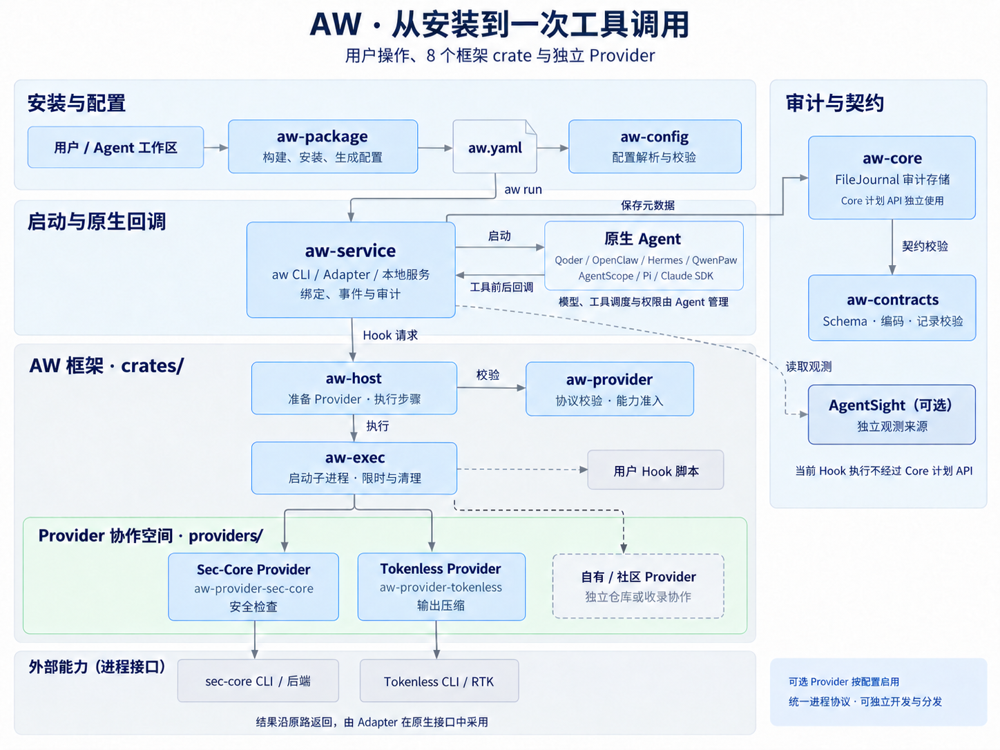

# AW

[English](README.md)

AW 让不同 Agent 共用安全检查、工具输出压缩和自定义规则。
它通过一份配置启动原生 Agent，并在工具调用前后运行所选 Provider。
Agent 继续管理自己的模型、界面和权限；AW 保存本地执行记录，便于检查运行情况。
当前为 Linux Preview。

## 安装与使用

AW 使用 Preview 包分发，尚未接入 `anolisa install` 或 RPM。
从[安装指南](../../docs/user-guide/zh/aw/installation.md)下载并安装 core
或 all-in-one，用 `aw config init` 生成配置后运行。

已有 AW 后，可用 `aw install --prefix ABS_DIR --bundle ABS_DIR` 安装解压后的本地
软件包，用 `aw config` 编辑配置，用 `aw uninstall --prefix ABS_DIR --yes` 移除其拥有的文件。
原生 Hook 注册使用 `aw agent connect --config FILE --agent TARGET`。
旧的原生 `aw install --config ... --agent ...` 保持兼容。独立 `aw-package` 命令已删除，
Rust 库保留。每个 bundle 根目录携带 `aw` 用于首次安装，必须显式提供绝对 `--bundle` 路径。
此 Preview 安装器尚不支持按组件名、直接 URL 或系统包后端安装。

用 `--dry-run` 查看安装或卸载计划，不创建文件。
`aw uninstall PACKAGE --prefix ABS_DIR --yes` 在检查依赖、文件归属和运行引用后，
移除指定包。新操作会提交本地包数据库；`aw recover` 清理已提交但中断的操作，或回滚
尚未提交的操作。默认使用当前用户的数据库。root 管理的 raw 安装必须显式使用
`sudo aw install ... --scope system`，权限不会自动选择 system。RPM/DEB 暂未接入。

新卸载入口仅在 stdin 和 stderr 都是交互终端时询问确认。
脚本或 JSON 输出必须使用 `aw uninstall --prefix ABS_DIR --yes`（或 `-y`）。
确认不覆盖包检查或系统权限。

使用 `aw list --installed --prefix ABS_DIR` 列出安装记录中的包，使用
`aw doctor --prefix ABS_DIR` 检查这些包的文件。两个命令只读，都支持 `--json`。
省略 `--prefix` 时读取当前用户的已安装包数据库。显式指定安装目录时，查询会按该目录
记录的位置读取数据库，普通用户也可查询可读的 system 安装。旧 Preview 安装仍需显式
指定目录；查询不会导入 `.aw-packages` 安装记录。只有记录中的 AW 可执行文件与当前命令
一致时，成功的软件包写入才会存档旧记录并登记目录；否则在写入前以 `runtime_unknown`
阻断迁移，请把新 AW 安装到另一目录。详见
[已安装包与文件检查](../../docs/user-guide/zh/aw/operations.md#已安装包与文件检查)。

```bash
aw validate --config "$HOME/aw/aw.yaml"
aw run --config "$HOME/aw/aw.yaml" --agent qoder
```

用 `aw validate --config next.yaml --against current.yaml` 离线检查仅涉及策略的修改，
详见[配置](../../docs/user-guide/zh/aw/configuration.md#比较策略修改)；
此命令不更新运行中的实例。

通过 `aw run --reloadable` 为 Qoder 1.1.73 TUI 或 QwenPaw 2.2.2b4 /
AgentScope 2.0.9 App 预装实验性空闲更新桥接。
`aw update --config current.yaml --agent TARGET --policy next.yaml` 选择目标的唯一实例，
保留宿主进程，忙碌实例返回 busy；见[预热实例更新](../../docs/user-guide/zh/aw/configuration.md#更新预热实例)。

退出 Agent 后，本地服务仍可查询，使用结束后显式停止。

```bash
aw status --config "$HOME/aw/aw.yaml"
aw stop --config "$HOME/aw/aw.yaml"
```

上述操作也可使用 `aw service status` 和 `aw service stop`。
`aw service serve` 在前台运行服务，不安装系统服务单元。
使用 `aw service --help` 查看参数，`aw --version` 查看 CLI crate 版本。

通过 `aw --help`、`aw config --help`、`aw config validate --help` 逐级查看
已实现的命令。公开命令也支持 `-h`，`aw -V` 显示 CLI 版本。
帮助选项须放在最后；未知或重复参数会在开始操作前报错。
`--json` 等参数只在对应命令有效，详见[命令帮助](../../docs/user-guide/zh/aw/operations.md#命令帮助与参数)。

使用 `aw commands` 查看已实现的公开命令，`aw commands --json` 获取带版本的
命令元数据。`aw completion bash` 输出补全脚本，也支持 Zsh、Fish、PowerShell
和 Elvish；不会自动安装脚本。详见[命令发现与补全](../../docs/user-guide/zh/aw/operations.md#命令发现与补全)。

本地包安装/卸载、`config init`、`config validate` 和离线配置编辑支持 `--json`，返回带版本的管理结果。
默认仍为人类摘要，已有服务和协议 JSON 保持不变。

这些管理命令支持局部 `--quiet`、`--verbose` 和 `--color auto|always|never`，
用于人类输出，不能与 `--json` 同用；原生输出与协议流保持不变。
包报告区分提交、取消、恢复不完整和清理警告，不从退出码推断回滚。
详见[终端输出](../../docs/user-guide/zh/aw/operations.md#终端输出)。
支持范围与失败语义见[管理结果](../../docs/user-guide/zh/aw/operations.md#管理结果)。

core 可独立使用。Tokenless 包自带 RTK 和 TOON 编码，安全检查需要启动 sec-core
后端；这些能力都要通过配置启用。AW 不安装 Agent，也不配置模型凭据。

## 文档导航

| 任务 | 文档 |
| --- | --- |
| 选择能力和开始使用 | [AW 用户指南](../../docs/user-guide/zh/aw/index.md) |
| 安装包、生成配置和首次运行 | [安装 AW](../../docs/user-guide/zh/aw/installation.md) |
| 选择 Agent、启用 Provider 和修改配置 | [配置 AW](../../docs/user-guide/zh/aw/configuration.md) |
| 压缩工具输出 | [Tokenless](../../docs/user-guide/zh/aw/tokenless.md) |
| 启用命令安全检查 | [安全检查](../../docs/user-guide/zh/aw/security.md) |
| 查看 Agent 运行记录 | [接入 AgentSight](../../docs/user-guide/zh/aw/observability.md) |
| 查询状态、升级、卸载和排错 | [运行维护](../../docs/user-guide/zh/aw/operations.md) |
| 客户本地编译和打包 | [从源码构建 AW](../../docs/developer-guide/zh/aw/building.md) |
| 编写规则、集成 Provider 或 SDK | [AW 开发指南](../../docs/developer-guide/zh/aw/README.md) |

用户手册集中在 `docs/user-guide/{en,zh}/aw/`，接入参考在
`docs/developer-guide/{en,zh}/aw/`。组件协议设计保留在本目录的 `docs/design/`。

## Hook 支持

下表由[回归矩阵](tests/regression-matrix.json)生成，表示运行时声明并由 CI 契约测试
覆盖的能力。支持版本、工具类型和文本替换范围见
[原生 Agent 接入参考](../../docs/developer-guide/zh/aw/native-agents.md)。

<!-- aw-regression-matrix:start -->
| Agent | `tool.before` / `observe` | `tool.before` / `block` | `tool.after` / `observe` | `tool.after` / `replace_result` |
| --- | --- | --- | --- | --- |
| `agentscope` | ✓ | ✓ | ✓ | ✓ |
| `claude-sdk` | ✓ | ✓ | ✓ | ✓ |
| `hermes` | ✓ | ✓ | ✓ | ✓ |
| `openclaw` | ✓ | ✓ | ✓ | ✓ |
| `pi` | ✓ | ✓ | ✓ | ✓ |
| `qoder` | ✓ | ✓ | ✓ | ✓ |
| `qwenpaw` | ✓ | ✓ | ✓ | ✓ |
<!-- aw-regression-matrix:end -->

Tokenless 重试建议会阻止原调用，Agent 需发起新调用并重新经过安全和原生权限检查。
结果替换仅适用于受支持的文本位置；AW 不提供 OS 沙箱或跨 Agent 审批。
真实 SDK 和模型会话的验收范围见[贡献指南](CONTRIBUTING_zh.md)。

## 代码架构



根目录是纯 workspace。`crates/` 保存 10 个框架 crate，仓库根 `providers/` 收录可独立协作的
具体实现。Provider 也可以在外部仓库开发、单独分发，见[协作入口](../../providers/README_zh.md)。
Hook 请求由 `aw-service` 交给 `aw-host`，通过 `aw-exec` 调用 Provider；
`aw-core` 提供独立的计划执行接口，服务只复用它的 Journal。

`aw-cli` 负责命令解析和呈现，调用 `aw-package` 库完成安装与配置，调用
`aw-service` 完成运行时操作。

[架构总览](../../docs/developer-guide/zh/aw/architecture.md)说明各包职责与运行顺序，
[设计索引](docs/design/zh/README.md)按调用流程组织详细协议。

## 开发与验证

从仓库根目录运行 AW 的 CI 检查。

```bash
python3 src/aw/scripts/check.py
```

Qoder CLI 和 QwenPaw App/API 各自通过临时容器中的真实 sec-core 验证正常放行、
扫描拒绝、后端异常和超时阻断。Qoder 使用 nightly 账号 Secret，QwenPaw 使用
本地确定性模型。完整验收边界见 [CI 看护](CONTRIBUTING_zh.md#日常-ci-与-nightly-集成)。

- [开发环境和测试](CONTRIBUTING_zh.md)
