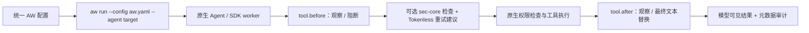

# AW

[English](README.md)

AW 为 Agent 策略提供统一配置和本地服务。在 Linux 上，它通过受支持的原生入口
启动 Qoder CLI >=1.1.64、OpenClaw、QwenPaw、Hermes 及显式接入的 Claude SDK worker，运行外部 Provider，并在 Agent
会话结束后保留执行元数据。框架继续管理自己的界面、模型配置、调度与权限。
同时支持公开 Pi SDK worker 的受管启动，以及 AgentScope SDK 2.0.6 在前台 Python
worker 中显式接线的公共工厂。当前交付为 Preview。

## 从这里开始

| 任务 | 指南 |
| --- | --- |
| 通过可选来源观测 Agent 生命周期 | [通过 aw run 接入 AgentSight](../../docs/user-guide/zh/user-entrypoint/aw-agentsight.md) |
| 安装预编译 core 和可选 sec-core 包 | [Preview 安装](../../docs/user-guide/zh/user-entrypoint/aw-preview.md) |
| 从源码构建并接入自己的组件 | [组件接入教程](../../docs/developer-guide/zh/aw/integration.md) |
| 编写和校验配置 | [配置参考](../../docs/developer-guide/zh/aw/configuration.md) |
| 四框架共用策略、验证并清理 | [使用指南](../../docs/user-guide/zh/user-entrypoint/aw.md#四框架使用同一份配置) |
| 模型可见工具结果压缩 | [Tokenless Provider](../../docs/user-guide/zh/user-entrypoint/aw-tokenless.md) |
| 使用已有 sec-core 后端 | [sec-core Provider](../../docs/user-guide/zh/user-entrypoint/aw-sec-core.md) |
| 容器部署与审计持久化 | [运行与持久化](../../docs/user-guide/zh/user-entrypoint/aw.md#容器与持久化数据) |

可选 AgentSight 观测贯穿 `aw run`：loopback HTTP 无需 token，HTTPS 要求私有
token 文件。来源失败保留原生动作与本地审计，语义评估仍属后续阶段。

AW 尚未通过 `anolisa install` 或 RPM 分发。Preview 包使用 `aw-package` 安装，
不安装 Agent 或配置其模型凭据。core 无需 sec-core 或任何 Provider 即可使用。
源码教程提供[共用 YAML](crates/aw-service/examples/aw.shared.yaml)和无需后端的
[布尔策略](crates/aw-service/examples/check-tool.py)。

sec-core 包还包含认证健康探测 helper 和官方服务/配置参考资产。可选显式诊断见
sec-core 指南；`aw inspect` 保持原合同，不探测后台。

## 支持的原生入口

| 框架 | 原生前提 | 入口 |
| --- | --- | --- |
| Qoder CLI | 原生命令 Hook 合同，记录实际版本 | 交互或 print |
| OpenClaw | 2026.9.6 | 新 Gateway |
| AgentScope SDK | 2.0.6 | 单个前台 Python worker 中显式接线的公共工厂 |
| QwenPaw / AgentScope | 2.2.2b4 / 2.0.9 | App/API |
| Hermes | 官方提交 `952c941e` | 显式安装插件后的本地 chat |
| Pi Coding Agent / Core | 0.84.2 / 0.84.2 | AW 管理的前台 Node worker 中的公共 SDK 工厂 |
| Claude Agent SDK | 0.2.88 / bundled CLI 2.1.161 | 使用公共 AW client 工厂的前台 Python worker |

AgentScope 工厂支持共用 PreTool/PostTool 操作；可使用
[SDK 生命周期 YAML](crates/aw-service/examples/aw.agentscope-lifecycle.yaml) 组合
sec-core 检查/观察与 Tokenless 重试建议、最终文本压缩。
接线方式见 [SDK 启动指南](../../docs/user-guide/zh/user-entrypoint/aw.md#启动-agentscope-sdk)。

运行时支持工具前 `observe`/`block`、工具后 `observe` 或单文本 `replace_result`，以及各框架的原生命令。
完成观察和用户 Hook 可位于最后一个替换步骤之前（OpenClaw 在压缩后执行原生观察）；sec-core/Tokenless 联合模板保留扫描及观察，新增执行前的 Tokenless PreTool 重试建议和最终 PostTool 压缩。
建议命令必须作为新调用重新通过 sec-core/原生权限检查；Preview Tokenless 包为 PreTool 附带固定版本 RTK；PostTool 不依赖它。
带引号的参数、符号链接状态路径和使用指南列明的执行前缀形式均保留 RTK 归属。
OpenClaw 缺少替换 middleware API 时，启动会报告压缩降级，保留 before 阻断和完成观察。
不同框架的 after 事件覆盖不同。配置词汇包含尚未接通的事件/效果，静态校验本身
不能证明原生效果生效。跨 Agent 审批、输入改写和 OS 强制执行不在当前
Preview 范围内。各 Adapter 的 profile 要求与共存方式见使用指南。
Pi 使用应用工厂模块与 `adapter: pi`，复用 PreTool 重试理由和 PostTool 单文本替换；
每次调用的 UUID 配对前后 Hook，保留 SDK 会话和模型原工具 ID。见 [SDK 启动指南](../../docs/user-guide/zh/user-entrypoint/aw.md#启动-pi-sdk-worker)。

## 一份配置，接入原生 Agent

推荐入口是 `aw run --config aw.yaml --agent <target>`。切换配置中的 Agent
目标时，安全、Tokenless 和用户 Hook 策略仍由同一份文件管理；每次新的工具
调用仍须通过原生权限检查。



Tokenless 给出重试建议时会阻止原调用；Agent 必须发起一次新的调用，重新经过
安全和原生权限检查。其他策略的中性结果不能把已有拒绝变成批准。

## Hook 覆盖与路线图

下表由[回归矩阵](tests/regression-matrix.json)生成。勾选表示运行时声明该能力，
必需 CI 门禁覆盖其回调与服务契约；它不表示所有原生工具形态都支持，也不表示
每次推送都完成真实 SDK 验收。

<!-- aw-regression-matrix:start -->
| Agent | `tool.before` / `observe` | `tool.before` / `block` | `tool.after` / `observe` | `tool.after` / `replace_result` |
| --- | --- | --- | --- | --- |
| `agentscope` | ✓ | ✓ | ✓ | ✓ |
| `claude-sdk` | ✓ | ✓ | ✓ | ✓ |
| `hermes` | ✓ | ✓ | ✓ | ✓ |
| `openclaw` | ✓ | ✓ | ✓ | ✓ |
| `pi` | ✓ | ✓ | ✓ | ✓ |
| `qoder` | ✓ | ✓ | ✓ | ✓ |
| `qwenpaw` | ✓ | ✓ | ✓ | ✓ |
<!-- aw-regression-matrix:end -->

结果替换限于一个受支持的文本位置。Claude SDK 支持 Bash stdout 替换，MCP
结果仅观察；OpenClaw 的完成观察发生在原生压缩之后，缺少替换 middleware API
时压缩会降级。其他原生采纳边界见上方链接的各 Adapter 指南。必需矩阵同时
覆盖生命周期、安全拒绝与失败、重新授权的重试、最终替换的组合行为；真实 SDK
验收单独执行。

| 阶段 | 已支持或计划中的点位 | 完成条件 |
| --- | --- | --- |
| 当前 | 七个已注册 Agent 的 `tool.before`、`tool.after` | 可运行的必需契约测试、原生能力准入和明确的采纳边界 |
| 下一步：深化验收 | 固定版本的真实 SDK/CLI，包括安全与 Tokenless 共存 | 隔离、有时限的 fixture 与真实效果采纳证据；重验收与推送门禁分开 |
| 计划：生命周期与上下文 | 会话开始/结束、用户输入、模型调用/上下文准备 | 先明确原生语义和失败策略，再增加 catalog 与各 Agent 的矩阵用例，最后声明支持 |
| 计划：扩展效果 | 原生 API 允许的更多结果形态、显式批准与上下文效果 | 版本化契约、保留原生授权，以及拒绝和不支持组合的回归 |

上述内容表示优先方向，不是交付日期或配置即生效的承诺。新增 Agent 或 Hook
须先补齐矩阵并通过 CI，再列为支持。开发入口见[贡献检查](CONTRIBUTING_zh.md)。

日常 PR 仅在改动 `src/aw/` 时运行 AW 检查。Nightly 构建 all-in-one，验证真实组件
契约和固定版本 Agent/SDK 的原生 Hook。[原生清单](tests/native-matrix.json) 记录
版本及验收边界，执行分工见 [CI 看护](CONTRIBUTING_zh.md#日常-ci-与-nightly-集成)。
Qoder 仍需人工验收；OpenClaw Gateway 和 QwenPaw App/模型流程不在自动
Hook/middleware 套件覆盖范围内。

## 基本使用

在 Linux 上准备 rustup 和 Qoder CLI，从仓库根目录执行：

```bash
cd src/aw
cargo build --locked -p aw-service --bin aw
target/debug/aw validate --config crates/aw-service/examples/aw.qoder.yaml
target/debug/aw run --config crates/aw-service/examples/aw.qoder.yaml --agent qoder
```

这个中性示例接通 Hook，但不包含安全规则。退出 Qoder 后执行：

```bash
target/debug/aw status --config crates/aw-service/examples/aw.qoder.yaml
target/debug/aw stop --config crates/aw-service/examples/aw.qoder.yaml
```

用 `aw-package configure` 初始化 Qoder/OpenClaw YAML，不传 `--provider` 就生成
空策略，也可选择 `--provider command` / `--provider sec-core` / `--provider tokenless` /
`--provider sec-core+tokenless`（配合 `--socket`）。四框架使用共用模板。
简单脚本省略 `protocol` 和 `operation`，返回 JSON true/false，命中后的效果放在
各 YAML 步骤中；AW 校验准入并构造结果，不调用脚本握手方法。添加规则前按
[初始化与编辑流程](../../docs/user-guide/zh/user-entrypoint/aw-preview.md#编辑已有-provider-与-hook-配置)准备配置。`aw-package config` 离线查看、校验和编辑已有 YAML/JSON
中的 Provider 与 Hook 步骤，不修改运行中的服务。更改配置前先退出 Agent 并停止
原服务。`aw install` 是独立、显式的 Hermes 原生插件安装命令，不负责安装软件。

## 开发参考

`aw inspect --config ABS_FILE --json` 返回有界只读 Panel 快照，不启动 AW，也不执行
工具 Hook。显式登记可选 view 后可查询 Tokenless 统计，未知准入/原生就绪状态保持未知。
参阅 [Tokenless 指南](../../docs/user-guide/zh/user-entrypoint/aw-tokenless.md#panel-只读查询)
和[展示协议](docs/design/provider-views_zh.md)。

组件通常通过 Provider 协议接入，无需依赖 AW crate。Adapter 与服务客户端开发者
可查阅下方详细合同。配置、Provider 消息和本地服务消息分别版本化。

- [开发环境、Crate 职责与测试](CONTRIBUTING_zh.md)
- [Provider 协议](docs/design/provider-protocol_zh.md)与 [Host](docs/design/provider-host_zh.md)
- [本地服务与客户端](docs/design/local-service_zh.md)
- [有界命令执行](docs/design/bounded-execution_zh.md)
- [Core 执行与持久 Journal](docs/design/core-execution_zh.md)

- [AgentSight 生命周期与一期合同](docs/design/agentsight-integration_zh.md)
- [AgentScope 公共工厂 Bridge](docs/design/agentscope-adapter_zh.md)

Claude SDK 0.2.88（bundled CLI 2.1.161）的前台 Python worker 在公共工厂中显式
使用 `aw_claude.create_client(options)`；见[接入指南](../../docs/user-guide/zh/user-entrypoint/aw.md#启动-claude-sdk-worker)
及 [Adapter 合同](docs/design/claude-sdk-adapter_zh.md)。

Claude SDK 另外支持 Tokenless Bash 重试建议与 stdout 压缩；MCP 结果保持仅观察。
