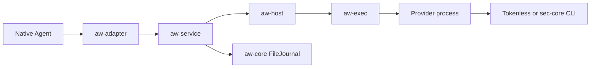

# AW design index

[中文版](README_zh.md)

Start with the [architecture overview](../../../../docs/developer-guide/en/aw/architecture.md)
for crate dependencies and source entry points. The current Hook path is:

Read [Architecture boundaries](architecture-boundaries.md) for source ownership,
internal interfaces and release work deferred from this migration.

`aw-cli` owns the `aw` and compatibility `aw-package` frontends. Software
installation and offline edits call `aw-package` APIs directly; runtime commands
call `aw-service`. The extraction preserves the Hook path and protocol versions.

Arrows show request and audit flow. Results return to the Adapter for native
adoption. `aw-core::Core` plan execution is a separate API, described below.

## Follow a request

| Read in order | Owner and boundary |
| --- | --- |
| [Configuration](configuration.md) | `aw-config` validates desired input before runtime preparation |
| [Policy update boundary](policy-reload.md) | Offline comparison and explicit idle-only activation; external attachment remains planned |
| [Adapter dispatch](adapter-dispatch.md) | The CLI registers native callbacks, normalizes events, and adopts effects |
| [Local service](local-service.md) | `aw-service` manages bindings, events, and audit; dispatches steps to Host |
| [Provider Host](provider-host.md) | `aw-host` prepares Providers and invokes admitted steps |
| [Provider protocol](provider-protocol.md) | `aw-provider` validates request/reply messages and capabilities |
| [Bounded execution](bounded-execution.md) | `aw-exec` owns command transport and process cleanup |

## Choose an integration

| Integration | Design |
| --- | --- |
| Native Agent callbacks | [AgentScope](agentscope-adapter.md), [Claude SDK](claude-sdk-adapter.md), [Hermes](hermes-adapter.md), [OpenClaw](openclaw-adapter.md), [Pi](pi-adapter.md), [QwenPaw](qwenpaw-adapter.md); Qoder is covered by [Adapter dispatch](adapter-dispatch.md) and [Local service](local-service.md) |
| Independent Provider development and contribution | [Shared directory](../../../../providers/README.md) and [distribution guide](../../../../docs/developer-guide/en/aw/providers.md) |
| Security Provider and backend readiness | [sec-core Provider](sec-core-provider.md), then [sec-core health](sec-core-health.md) |
| Tokenless Provider | [Integration reference](../../../../docs/developer-guide/en/aw/tokenless.md) |
| Packaging and configuration editing | [Build guide](../../../../docs/developer-guide/en/aw/building.md), then [Configuration editing](configuration-editing.md) |
| Read-only inspection | [Provider views](provider-views.md); independent of Hook admission |

## Audit, evidence, and capability plans

| Topic | Relationship to the Hook path |
| --- | --- |
| [Core execution and storage](core-execution.md) | The service reuses FileJournal. The plan executor separately requires embedding Host/Journal ports |
| [Read-only AgentSight connector](agentsight-readonly.md) | Optional source reads used by the service |
| [Evidence and context](evidence-context.md) | Native identity, observation, and explicit context freezing; schemas belong to `aw-contracts` |
| [AgentSight integration roadmap](agentsight-integration.md) | Relates observation to future coverage, incremental export, and semantic evaluation; these later stages are not current capabilities |

For install and daily use, see the [user guide](../../../../docs/user-guide/en/user-entrypoint/aw/README.md).
