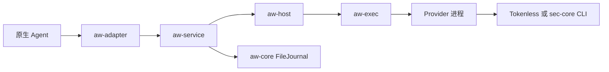

# AW 设计索引

[English](README.md)

先读[架构总览](../../../../docs/developer-guide/zh/aw/architecture.md)，了解 crate 依赖和代码入口。
当前 Hook 调用与审计经过以下路径。

源码归属、内部接口与后续发布工作的范围见[架构边界](architecture-boundaries_zh.md)。

`aw-cli` 提供 `aw` 与兼容 `aw-package` 入口；安装和离线编辑直接调用 `aw-package`
库，运行时命令调用 `aw-service`。此次拆分不改变 Hook 路径或协议版本。

结果沿原路返回，由 Adapter 在原生接口中采用。
`aw-core::Core` 的能力计划执行是另一套 API，见后文。

## 沿一次请求阅读

| 阅读顺序 | 负责的部分 |
| --- | --- |
| [配置](configuration_zh.md) | `aw-config` 在运行前校验期望配置 |
| [策略更新边界](policy-reload_zh.md) | 离线比较和显式空闲激活；外部接入仍在规划中 |
| [Adapter 分发](adapter-dispatch_zh.md) | aw-adapter 准备原生注册、转换事件并采用效果 |
| [本地服务](local-service_zh.md) | `aw-service` 管理绑定、事件和审计，把步骤交给 Host |
| [Provider Host](provider-host_zh.md) | `aw-host` 准备 Provider，执行已准入的步骤 |
| [Provider 协议](provider-protocol_zh.md) | `aw-provider` 校验请求、响应和能力 |
| [有界执行](bounded-execution_zh.md) | `aw-exec` 管理命令传输和进程清理 |

## 按接入对象阅读

| 接入对象 | 文档 |
| --- | --- |
| 原生 Agent 回调 | [AgentScope](agentscope-adapter_zh.md)、[Claude SDK](claude-sdk-adapter_zh.md)、[Hermes](hermes-adapter_zh.md)、[OpenClaw](openclaw-adapter_zh.md)、[Pi](pi-adapter_zh.md)、[QwenPaw](qwenpaw-adapter_zh.md)；Qoder 见 [Adapter 分发](adapter-dispatch_zh.md)与[本地服务](local-service_zh.md) |
| Provider 独立开发与收录 | [协作目录](../../../../providers/README_zh.md)与[开发分发指南](../../../../docs/developer-guide/zh/aw/providers.md) |
| 安全 Provider 与后端就绪检查 | [sec-core Provider](sec-core-provider_zh.md)，再读 [sec-core 健康检查](sec-core-health_zh.md) |
| Tokenless Provider | [接入参考](../../../../docs/developer-guide/zh/aw/tokenless.md) |
| 打包和配置编辑 | [构建指南](../../../../docs/developer-guide/zh/aw/building.md)，再读[配置编辑](configuration-editing_zh.md) |
| 只读查看状态 | [Provider 视图](provider-views_zh.md)，独立于 Hook 准入 |

## 审计、证据与能力计划

| 主题 | 与 Hook 路径的关系 |
| --- | --- |
| [Core 执行与存储](core-execution_zh.md) | 服务复用 FileJournal；计划执行器由嵌入方另外接入 Host/Journal 接口 |
| [AgentSight 只读连接器](agentsight-readonly_zh.md) | 供服务读取可选的外部观测数据 |
| [证据与上下文](evidence-context_zh.md) | 原生身份关联、观测和显式上下文冻结；Schema 由 `aw-contracts` 管理 |
| [AgentSight 集成规划](agentsight-integration_zh.md) | 说明观测与后续覆盖率、增量导出、语义评估的关系；这些后续阶段尚未提供 |

安装和日常使用见[用户指南](../../../../docs/user-guide/zh/user-entrypoint/aw/README.md)。
