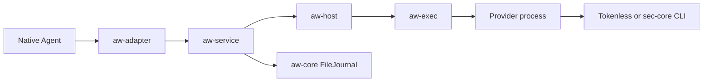

# AW design index

[中文版](../zh/README.md)

Start with the [architecture overview](architecture.md)
for crate dependencies and source entry points. The current Hook path is:

Read [Architecture boundaries](architecture-boundaries.md) for source ownership,
internal interfaces and release work deferred from this migration.

`aw-cli` owns the unified `aw` frontend. The standalone `aw-package` executable
has been removed; its Rust library remains. Software
installation and offline edits call `aw-package` APIs directly; runtime commands
call `aw-service`. The extraction preserves the Hook path and protocol versions.

Arrows show request and audit flow. Results return to the Adapter for native
adoption. `aw-core::Core` plan execution is a separate API, described below.

## Follow a request

| Read in order | Owner and boundary |
| --- | --- |
| [Configuration](configuration/configuration.md) | `aw-config` validates desired input before runtime preparation |
| [Policy update boundary](runtime/policy-reload.md) | Offline comparison and explicit idle-only activation; external attachment remains planned |
| [Adapter dispatch](adapters/adapter-dispatch.md) | The CLI registers native callbacks, normalizes events, and adopts effects |
| [Local service](runtime/local-service.md) — owned roots and isolated task bindings | `aw-service` manages bindings, events, and audit; dispatches steps to Host |
| [Provider Host](runtime/provider-host.md) | `aw-host` prepares Providers and invokes admitted steps |
| [Provider protocol](../../../../../docs/developer-guide/en/aw/providers/protocol.md) | `aw-provider` validates request/reply messages and capabilities |
| [Bounded execution](runtime/bounded-execution.md) | `aw-exec` owns command transport and process cleanup |

## Choose an integration

| Integration | Design |
| --- | --- |
| Native Agent callbacks | [AgentScope](adapters/agentscope-adapter.md), [Claude SDK](adapters/claude-sdk-adapter.md), [Hermes](adapters/hermes-adapter.md), [OpenClaw](adapters/openclaw-adapter.md), [Pi](adapters/pi-adapter.md), [QwenPaw](adapters/qwenpaw-adapter.md); Qoder is covered by [Adapter dispatch](adapters/adapter-dispatch.md) and [Local service](runtime/local-service.md) |
| Independent Provider development and contribution | [Shared directory](../../../../../providers/README.md) and [distribution guide](../../../../../docs/developer-guide/en/aw/providers/index.md) |
| Security Provider and backend readiness | [sec-core Provider](providers/sec-core/sec-core-provider.md), then [sec-core health](providers/sec-core/sec-core-health.md) |
| Tokenless Provider | [Integration reference](../../../../../docs/developer-guide/en/aw/providers/tokenless.md) |
| Packaging and configuration editing | [Build guide](../../../../../contribute/en/aw/building.md), then [Configuration editing](configuration/configuration-editing.md) |
| Local package database, preview, removal and crash recovery | [Local package management](packaging/package-management.md) |
| Read-only inspection | [Provider views](../../../../../docs/developer-guide/en/aw/providers/views.md); independent of Hook admission |

## Audit, evidence, and capability plans

| Topic | Relationship to the Hook path |
| --- | --- |
| [Core execution and storage](core-execution.md) | The service reuses FileJournal. The plan executor separately requires embedding Host/Journal ports |
| [Read-only AgentSight connector](integrations/agentsight/agentsight-readonly.md) | Optional source reads used by the service |
| [Evidence and context](runtime/evidence-context.md) | Native identity, observation, and explicit context freezing; schemas belong to `aw-contracts` |
| [AgentSight integration roadmap](integrations/agentsight/agentsight-integration.md) | Relates observation to future coverage, incremental export, and semantic evaluation; these later stages are not current capabilities |

For install and daily use, see the [user guide](../../../../../docs/user-guide/en/aw/index.md).

[Qoder SDK worker integration](../../../../../docs/developer-guide/en/aw/native-agents.md#start-a-qoder-sdk-worker)
uses acknowledged child scopes, model-produced invocation identities and callback
drain for ordinary Queries through the existing Adapter and service contracts.

[Resident SDK lifecycle](adapters/resident-sdk.md) describes per-client task admission, scoped callback routing, fail-close and release for Pi, Claude and ordinary Qoder SDK Queries.

[Managed Claude MCP handlers](adapters/claude-mcp.md) add an explicit handler source, task-owned invocation identity and success-aware result adoption through the existing Provider path.

Resident SDK model responses now enter an Adapter-owned identity producer before native
dispatch; the service owns sequence admission and active-state retirement.
[Long-session ownership and limits](adapters/resident-sdk.md) also cover callback drain,
MCP dispatch and the pinned Claude transport.

[Structured MCP dispatch](adapters/structured-mcp.md) covers actual QwenPaw protocol calls, native-parent evidence, complete result envelopes and Qoder query-scoped identity limits.

[Private execution leases](adapters/private-execution.md) defines Qoder managed-MCP invocation leases, QwenPaw reply leases, explicit environment consumers, redaction and confirmed cleanup before scope retirement.
