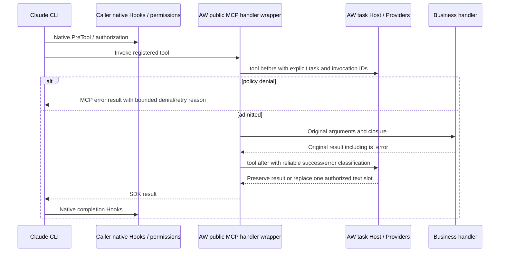

# Managed Claude SDK MCP handlers

[中文版](../../zh/adapters/claude-mcp.md)

The resident client factory can own the public in-process MCP handler boundary.
Use both factories from `aw_claude`; keep tool definitions, business closures and
SDK options in the application:

```python
from aw_claude import create_client, create_sdk_mcp_server
from claude_agent_sdk import ClaudeAgentOptions, tool

@tool("lookup", "Look up business data", {"key": str})
async def lookup(arguments):
    return await business_lookup(arguments)  # Existing closure and authorization.

server = create_sdk_mcp_server("business", tools=[lookup])
options = ClaudeAgentOptions(
    setting_sources=[], mcp_servers={"local": server},
    tools=[], allowed_tools=["mcp__local__lookup"],
)
async with create_client(options) as client:
    await client.query("Look up the requested record")
    async for message in client.receive_response():
        consume(message)
```

Start this application with the [resident entrypoint](resident-sdk.md). Each client
claims its own server configuration and may process many sequential executions. The server is claimed once, including
when its public configuration dict is copied; the registry follows the SDK server
instance through a weak reference. A duplicate claim fails before SDK connection.
The client snapshots the server mapping and each configuration dictionary before
claiming them. Later caller mutations cannot replace the SDK instance used by the
client; the snapshot retains the original instance and business closures.
Clearing the caller's mapping or assigning a server claimed by another client
also preserves the original task's tool selection and policy checks.
The server copies each tool definition at construction while retaining its
business closure. Assigning a new name or handler to the caller's definition
keeps the registered tool and its AW policy identity unchanged.
The server's `key`, `names`, `bridge` and `claimed` properties are read-only.
Handlers use a private claim record for the registered key and owning client.
Client construction validates all server keys, existing claims and duplicate
instances before claiming any server, after the SDK constructor succeeds.
Failed construction leaves fresh servers available for a corrected configuration.
Release removes its client reference; closed/unbound handlers cannot execute.
Server/tool names use bounded ASCII letters, digits, underscores or hyphens.
Server configuration keys containing `__` are rejected in managed configurations
because they can alias another server's native tool namespace.

## One execution path



For these registered names, the AW native CLI callback returns neutral; the
handler wrapper owns AW PreTool/PostTool. Caller native Hooks and native permission
checks still run. Unmanaged tools retain the existing native callback path. An
AW denial prevents the business handler and produces an MCP error result; the CLI
may still emit its native completion Hook for that error result. AW does not add
a synthetic `tool.after` for a denied business call. A retry is a new invocation
through permissions and AW before checks. Application argument rewrites remain
subject to the existing factory restrictions.

The public handler signature has arguments but no native `tool_use_id`. AW projects
a fresh UUID v4 in the model response and registers its name/input before native
dispatch. The pinned transport reads `_meta.claudecode/toolUseId` from the MCP
control frame and carries an execution-scoped dispatch ticket into the handler.
Unknown, duplicate, changed-input and retired calls stop before business execution.
The task binding ID remains the correlation session. `aw_source: claude-sdk-mcp/v1` identifies this explicit source. Normalization
checks the scope against the binding and rejects invented native identity fields.
Durable event metadata retains `correlation_source`; it contains no tool arguments
or raw results. The SDK server registration key determines the native tool prefix,
independently of the server's internal display name.

## Result and failure contract

The SDK public result uses `is_error`, defaulting to false when omitted. AW rejects
non-boolean values and wire-style `isError` in a handler result; translate upstream
MCP responses in the business MCP adapter first. SYSOM already performs that
translation. Native payloads must agree with the handler's error flag.

Only successful JSON results with exactly one text block and no `structuredContent`
are eligible for replacement. AW changes only `content[0].text`, preserving the
rest of the returned object. Errors, multiple blocks, media and structured results
still pass through PostTool observation and remain unchanged. Handler exceptions
produce a failed AW completion, then propagate to the SDK's existing error path.
The pinned SDK independently transforms/drops some resource and structured fields;
this wrapper preserves its input envelope and does not extend SDK serialization.
PostTool inspects a JSON snapshot of the handler result. The SDK receives that
checked snapshot or its authorized replacement, so concurrent changes to a
business-owned cached result cannot change the delivered text or error flag.

The shared Tokenless Provider supplies `pre_tool`/`post_tool`; no Python Tokenless
client or separate MCP compression service is introduced. Managed MCP results are
classified as API responses. Opaque tool names and a `command` argument do not
establish a shell execution contract. sec-core scanning and RTK suggestions for
such tools require explicit semantic registration and execution-location evidence.
Pi's equivalent boundary is its existing public custom-tool before/after pipeline;
MCP clients exposed as Pi tools pass through that pipeline. Arbitrary MCP clients
outside the managed SDK tool pipeline have no AW adoption boundary.

Hook/Provider failures, malformed replacement replies and unsupported result
shapes at the transport boundary stop the resident task before returning a
successful raw result. An unsuccessful compression invocation follows the same
interrupt/escalation path as other callback failures. Successful unsupported-result
classification is a normal unchanged result. Task cancellation and scope close
retain the resident contract; remote business side effects need their own cancel
protocol. Native and normalized inputs retain the existing one-MiB bound.

## SYSOM and subsequent work

For the inspected SYSOM OCD runtime, replace the local `ClaudeSDKClient`
construction with `aw_claude.create_client(options)`, and import the MCP server
factory from `aw_claude` in `_build_mcp_servers`. Keep `tool`, catalog closures,
uid/channel capture, `isError` translation, session store, streaming and existing
`connect/query/receive_response/interrupt/disconnect` calls. The image supplies
matching binaries and SDK versions; startup enters the resident host. All client
creation paths must use that common factory. Application request deadlines,
draining and supervisor restart remain application/deployment responsibilities.

Schema/BeforeModel still requires the exact model-visible tools/context after
resume and compaction, a newly admitted event/effect, and a native adoption seam.
The managed model relay supplies that request location; event/effect admission, safe
transformation and model-visible Schema adoption remain to be implemented. Retrieve
requires a registered tool before recoverable output is emitted, authenticated
model-visible markers, tenant/task storage, TTL/quota, exact original-byte return
and bypass of recompression. These dependencies remain in the
[full Tokenless delivery table](resident-sdk.md#acceptance-and-full-tokenless-dependencies)
and tracking issue [#8952](https://github.com/agentic-os-org/ANOLISA/issues/8952).

Native acceptance runs the real SDK/CLI and Tokenless backend. It checks adopted
model text, policy denial, before/after errors, business errors, multi/structured
results, exceptions, reversed parallel completions and failed compression. It also
checks copied-server duplicate claims, source-labelled audit, child-process/port
cleanup, zero service bindings/events, original tool name/handler assignment,
server-key assignment, failed-constructor retries and shared-result mutation during
PostTool. A direct unverified-result control
must stop before the next model request. Hosted model and production SYSOM
dependency acceptance are separate release gates.
