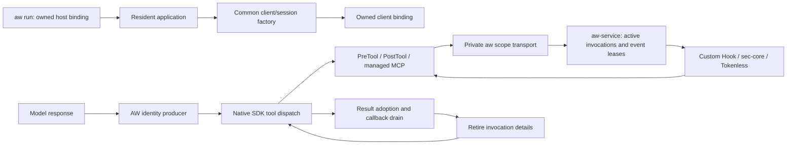

# Resident SDK lifecycle and long sessions

[中文版](../../zh/adapters/resident-sdk.md)

Pi 0.84.2 and Claude SDK 0.2.88 / bundled CLI 2.1.161 retain a client/session
across sequential executions. Independent clients run concurrently in the same
foreground worker. One configuration selects `aw run --config aw.yaml --agent pi`
or `--agent claude`. SYSOM integration stays in the image, startup and common
client/MCP factories; the application owns scheduling, credentials, HTTP/SSE,
business tools and conversation storage.

## Runtime ownership

A binding belongs to the client, an execution to one prompt/query response, and
an invocation to one model-produced tool call. Native IDs can repeat across
executions. AW projects fresh UUIDs before native dispatch, freezes tool name and
arguments, and registers a strictly increasing sequence within the binding.
Matching names or arguments never create an identity at callback arrival.
Pi uses its public model stream and the produced tool object. Claude uses a private
loopback Anthropic Messages relay and the pinned SDK transport dispatch context.
MCP `_meta.claudecode/toolUseId` links the native frame to that same identity before
the SDK removes metadata from its public handler arguments.

Only active details are retained. After result adoption, closing fences new Hook
opens, cancels/joins unfinished Provider work, removes both phase correlations,
and retires the invocation. Claude retains a small adopted-call record until its
native completion Hooks finish and the result enters the next model request, or
until execution drain. Its callback registry includes caller Hooks, permissions
and managed MCP callbacks, including asynchronous `finally` after SDK cancellation.
A Result is delivered and the next query admitted only after drain. A new prompt
cannot reuse a still-active execution. Native history remains SDK-owned.

The service keeps a sequence high-water mark plus the active map. Replayed
registrations, retired/unknown callbacks, changed input, foreign sessions and
closing calls fail closed. Slow earlier calls remain active while later calls
retire. There is no TTL/LRU eviction of active identities or cumulative call quota.
The producer and Adapter are trusted integration code in the owned worker, not a
sandbox against arbitrary code running under the same UID. Service generation,
binding identity, PID/start ticks, UID and PID namespace fence stale handles.

## Entrypoints and native transport

Claude target argv is `[python3, -m, aw_claude, --, -m, application]`, or a script
path after `--`. Foreground Gunicorn can use `-m aw_claude -- -m gunicorn ...`.
Create clients after fork through `aw_claude.create_client(options)` and in-process
MCP servers through `aw_claude.create_sdk_mcp_server`. Preserve native tool closures
and permissions. Use `connect/query/receive_response/interrupt/disconnect` and
close in `finally`. Sequential queries reuse the native process and conversation;
concurrent work uses independent clients. Each query accepts a string or a finite AsyncIterable containing one user message.
A multi-message iterable is rejected before native input: CLI coalescing makes its
terminal count ambiguous. Use sequential queries for successive turns.
SDK `session_store`, mirroring and resume materialization retain SDK ownership:
AW constructs its transport after materialization and disconnects before SDK cleanup.
Closed or inherited clients cannot reconnect. Options are copied.

The relay binds a random loopback port with a per-client secret path. It forwards
original authentication and model request bytes, projects response tool IDs, and
checks adoption before a tool result enters the next request. It does not log
credentials or model content. Upstream non-loopback HTTP is rejected; HTTPS uses
system trust plus `SSL_CERT_FILE`/`SSL_CERT_DIR`. HTTP(S) proxies and `NO_PROXY` are
honored. Redirects, SOCKS proxies, Bedrock/Vertex/Foundry transports, unsupported
response blocks and malformed/partial tool streams fail visibly; no direct fallback
bypasses identity registration. Supported blocks are text, thinking,
redacted_thinking and client tool_use, in JSON or SSE Messages responses.

Per-client transport bounds: eight requests, 64 KiB headers, 32 MiB request/JSON
response, one MiB SSE frame/tool input, 10-second connect/header, 30-second body,
60-second upstream read and 600-second total request. These bound active resources;
conversation compaction remains the application's/SDK's responsibility. Model
transport changes need acceptance against the actual production endpoint and TLS
configuration. The SDK transport and `_connect_inner` seams are pinned to 0.2.88;
the native init frame must report CLI 2.1.161. The relay is validated with HTTPX
0.28.1. Upgrades require rerunning acceptance.

Pi exports `createSession({sdk,cwd,...options})` and
`runWorker({createSession,closeSession,withSession,args})`. Return a fresh public
AgentSession with the admitted cwd and native callbacks installed. The managed
factory adds `close()`; `withSession` closes in `finally`. One session supports
sequential prompts and SDK custom tools, including MCP clients exposed as tools.
AW guards public model/tool callbacks; changing them requires a fresh session.

Legacy direct task-worker entrypoints retain their original policy and retained
1,024-correlation boundary. Long-session reclamation is enabled by the explicit
resident factories above. Pi rejects modules exporting both `run` and `runWorker`.

## Capacity, failure and deployment

`spec.daemon.limits` sets **concurrent** budgets. Defaults are 64 bindings
(including host bindings), 128 live events, 64 Provider calls, 128 connections and
256 active invocations per binding; each field accepts 1..4096. A binding includes
preparing, admitted/idle and draining clients. Each binding has at most 64 configured
steps across its events. Sixteen additional control connections reserve capacity for status, stop,
close and release. Overload rejects admission without bypass, hidden retries or
new budgets. After existing work drains, new identities can use reclaimed capacity.
A rejected registration consumes its sequence, so retrying it cannot reopen work.

`aw status --config aw.yaml` exposes limits, current bindings/invocations/
correlations/calls/connections, peak active invocations per binding, rejection
count and reason counters. Memory for AW correlation grows with active work;
audit disk and SDK conversation history require separate retention. Limits need
production concurrency measurements; increasing them does not add lifetime turns.

Callback/Provider/identity faults stop resident execution even under `on_error:
report`. Normal policy denial and Tokenless retry suggestions remain native denials;
fresh retries traverse native permissions and PreTool again. Unsupported compression
classified successfully preserves the result. Security denial keeps precedence.
Pi fences callbacks/model sends before awaiting abort during close. Claude waits at most five seconds for
interrupt acknowledgement and callback drain. Failed interruption, an undrained
terminal callback, or unsafe disconnect terminates the AW-owned foreground group,
including sibling workers/SDK children. A supervisor must restart that group.
SDK disconnect is bounded at 12 seconds; scope transport release at six seconds.

A scope must acknowledge handoff within five seconds. Closing an already reclaimed
ACK-expired scope succeeds; stale identity and transport failures still fail. Worker/launcher death,
parent release and lost handoff reclaim descendants. The service rechecks owner
identity after durable started audit and immediately before Provider invocation.
Failed audit, release or cancellation cannot revive a closing invocation.
An alive idle client has no inferred business deadline: the application must
close it and bound request admission. Remote side effects need tool cancellation.

Drain HTTP admission and finish/close requests before signaling the launcher;
its existing outer shutdown grace is two seconds. Validate forced shutdown,
worker replacement and supervisor restart in the production image. Active scopes
still reject policy reload and AgentSight observation; those need separate binding
contracts. Upgrade/rollback CLI and daemon together: drain, stop the old daemon,
install the matching build and restart. Wire v1alpha6 rejects older live bindings;
configuration v1alpha1 and Provider v1alpha1 stay unchanged.

## Acceptance and full Tokenless dependencies

Daily matrix cases cover 10,000 retired registrations with a slow active call,
changed input/replay, resource overload/recovery, service Provider execution,
configuration bounds, callback drain, owner death and audit failure. Both SDKs
verify reuse after ACK expiry; Pi cancellation fences tools and later model sends. Native tests
use pinned real SDKs and Tokenless: each retains one session for 1,280 calls over
five executions, with 768 calls in one execution. Claude mixes 640 Bash and 640
managed MCP calls and verifies compressed text in the next request. Reports include
RSS, FD/thread counts, elapsed time, active state and final zero bindings/events.
Cancellation barriers verify delayed custom-Hook cleanup, rejection of a new query,
subsequent reuse, and process-group termination when cleanup never completes.
These fixtures measure regression behavior; production load targets need actual
SYSOM traffic, image dependencies and endpoints.

| Delivery | Boundary / remaining work |
| --- | --- |
| Owned scopes and resident factories (#8953/#8954) | Per-client context, owner death, bounded release, common startup |
| Managed MCP (#8955) | Explicit handler source, native permissions, successful single-text adoption |
| Long sessions (#8956) | Producer identity, callback drain, state reclamation, concurrent budgets |
| Schema / BeforeModel (#8952) | Admit a request event/effect; classify actual tools/context after resume/compaction; preserve routing and cache/signature semantics; prove model-visible adoption. The relay supplies a request location, not these contracts. |
| Retrieve (#8952) | Register recovery before lossy output; authenticate markers; tenant/task storage, TTL/quota, byte-exact retrieval, no recompression. |

The shared Tokenless Provider currently executes PreTool/PostTool. Its backend
Schema/Retrieve operations need the remaining contracts above. Generic MCP shell
security and remote RTK need declared semantics and execution-location evidence;
opaque names/arguments cannot establish a shell contract.
