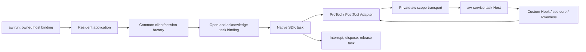

# Resident SDK task lifecycle

[中文版](../../zh/adapters/resident-sdk.md)

Pi 0.84.2 and Claude SDK 0.2.88 / bundled CLI 2.1.161 can keep an application
worker alive while admitting independent task clients. The application still
owns scheduling, model credentials, HTTP/SSE, tools and conversation storage.
`aw run --config aw.yaml --agent pi` or `--agent claude` selects a target in one
configuration. AW owns task admission, callback routing and bounded release.

## Runtime path

The private CLI serializes service DTOs; native assets carry opaque handles in
memory. No per-task binding files or Python/JavaScript service implementations
are introduced. Each task inherits the host's exact configuration and target,
and prepares Providers with its own immutable cwd/environment snapshot. Native
Hook commands also receive that task's environment. Process identity uses PID,
start ticks, UID and PID namespace. Handles cannot be transferred to another
worker. Create clients after Gunicorn forks; keep its foreground process group.

A task must acknowledge its handle within five seconds after admission. Lost
handoffs expire; cancellation after receiving a handle releases it. Host death,
worker death and parent release cancel descendant bindings and in-flight work.
The service retains closing state when release cannot complete by its deadline.
At most 16 bindings exist per service, including host bindings; overload rejects
new tasks. Each task retains at most 1,024 event correlations until release.
New tasks reclaim capacity without erasing a live task's replay fences.

## Public entrypoints

Claude uses `argv: [python3, -m, aw_claude, --, -m, application]`, or an absolute
Python script after `--`. The host receipt is published before any model client;
each subsequent `connect()` admits a scope and performs SDK initialization before
`query()`. The application imports `create_client` from `aw_claude` in its common
factory. The returned client supports public `connect`, `query`,
`receive_messages`, `receive_response`, `interrupt`, `disconnect` and async context
management. One client owns one query;
resume a conversation with a new client and its SDK resume/session-store options.
Options are copied. Independent clients may run concurrently. Disconnect is
idempotent; closed or inherited clients cannot reconnect or query.

Both message consumers record completion before yielding `ResultMessage`. EOF
without that terminal message raises an incomplete-response error; disconnect
still interrupts unfinished work and retains the fail-stop rule below.

Pi exports `createSession({sdk,cwd,...options})` and
`runWorker({createSession,closeSession,withSession,args})`. `createSession` returns
the public SDK result plus `close()`; `withSession(options, async session => ...)`
closes in `finally`. Return a fresh `AgentSession` whose SessionManager uses the
admitted cwd. Install native callbacks in this factory. Each session permits one
active prompt; sequential prompts remain in the same bounded task. Close the
session when its task ends. AW guards its public callbacks and model stream for
the session lifetime; use a fresh session when changing those functions.

Existing task-mode entrypoints keep their original failure policy. A direct
Claude script using the factory still allows one client per worker; a Pi module
exporting `run` retains worker-scoped lifecycle. Resident mode is explicit and
rejects Pi modules exporting both `run` and `runWorker`.

## Failure and shutdown contract

Resident callback failures stop the task even when an existing step declares
`on_error: report`. Normal policy denials and Tokenless retry suggestions retain
their native denial semantics; a fresh attempt still traverses native permissions
and PreTool. A successfully classified unsupported compression result remains
unchanged. Transport, protocol, deadline and Provider errors stop processing.

Pi fences callbacks and model transport before awaiting agent abort during close.
The pinned SDK can schedule another turn after abort, so the transport guard is
required. Claude awaits its public interrupt acknowledgement before releasing a
failed Hook or exposing the failure to the caller. `continue=false` alone allowed
a later model request in the native fixture. If interruption fails or exceeds
five seconds, AW kills the foreground process group it created, including sibling
workers and SDK children. This deliberate escalation requires a service supervisor
to restart the host. It prevents an unacknowledged stop from returning a neutral
Hook reply. Request cancellation interrupts before disconnecting.

SDK teardown has a 12-second bound; scope release has a six-second transport
bound. Closing a handoff already reclaimed after ACK expiry succeeds; other
release failures still poison the worker and reject new clients. The application
must close clients in `finally`. Process death is the fallback for abandoned
clients; an alive client with no close has no inferred business deadline.
Configure application request deadlines and overload responses explicitly.

The existing launcher forwards termination to its owned group and forces cleanup
after two seconds. Drain HTTP admission and finish/close requests **before** sending
that signal when graceful completion is required. Gunicorn graceful-timeout by
itself cannot extend AW's outer deadline. Deployment acceptance must test draining,
forced shutdown, worker replacement and supervisor restart in the actual image.
Already executed local or remote tool effects cannot be undone by PostTool.

Active task scopes cannot use reload or AgentSight observation. Resident entrypoints
reject enabled AgentSight evidence before publishing readiness; `evidence.mode: off`
is allowed. Legacy roots may observe while no task scopes exist; opening a task
while observation is active is rejected. Task attribution for observation and
resident policy rollover need a separate admitted lifecycle contract.

## Delivery slices and full Tokenless dependencies

| Slice | Acceptance boundary | Dependency |
| --- | --- | --- |
| Owned service scopes | Lost handoff, independent context, death, cancellation, bounded release | Service wire v1alpha6 |
| Resident factories | Repeated/concurrent clients, native Hook denial/failure, model visibility, cleanup | Owned scopes |
| [Managed Claude MCP factory](claude-mcp.md) | Wrap public handler before returning successful text, preserve PreTool/PostTool and business closures | Resident scopes; explicit MCP source and result adoption |
| Schema / BeforeModel | Compress the actual model-visible tools/context after resume/compaction; preserve tool-call routing | New admitted event/effect and native model request seam; current Claude public Hooks do not expose the complete request |
| Retrieve | Register the recovery tool before issuing recoverable lossy output; authenticate visible markers before reading original bytes | Task/tenant storage, expiry/quota, byte-exact retrieval and bypass of recompression |

Tokenless already has backend BeforeModel/Schema and Retrieve operations. AW's
current Provider integration executes PreTool/PostTool. The latter two slices
require protocol admission, Adapter adoption and end-to-end visibility tests;
calling a backend operation alone cannot establish those guarantees. Managed MCP
also needs declared tool semantics for sec-core scanning or remote RTK execution;
tool names or opaque `run_script` identifiers are insufficient to infer code.

Native acceptance lives in `tests/sdk_resident.py` and `tests/native-matrix.json`.
It runs both SDKs with the same configuration shape, 20 sequential and three
concurrent tasks, denial and before/after failures, and verifies zero retained
bindings/events. Both SDKs verify worker reuse after ACK expiry. Pi cancellation
verifies close before, during and after tool execution, no post-cancel model
transport, and refusal to reuse a worker after teardown timeout. Claude verifies
both message consumers, incomplete EOF, cancellation and failed interrupt
escalation. Both SDKs verify evidence rejection before readiness and disabled
observation. These deterministic model fixtures require no hosted model secrets.
