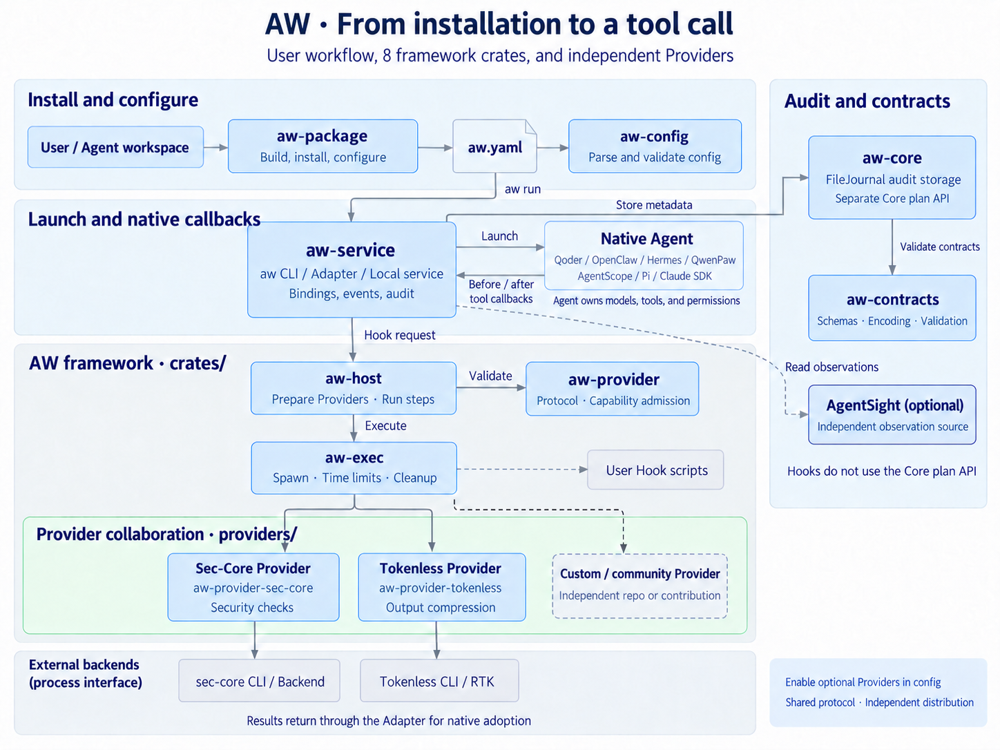

# AW architecture

[中文版](../zh/architecture.md)

AW runs policies around native Agent tool calls. An Adapter receives native
callbacks, the local service manages bindings and events, the Host invokes
Providers, and the Adapter returns results to the Agent. The Agent owns model
calls, tool scheduling, and permission approval.

Resident SDK support uses the service's owned root and per-task child bindings.
The root policy stays immutable; each task pins its own cwd and environment,
keeps replay fences until release, and is reclaimed when its owner exits.
Native factories remain Adapter responsibilities. See
[task scope lifecycle](runtime/local-service.md#resident-hosts-and-task-scopes).

## User workflow

This view follows user actions; arrows show runtime collaboration. The green
area is the Provider contribution space. The footer shows target release ownership:
component owners deliver components, and the OS distributor validates and combines
artifacts. See the [Provider guide](../../../../../docs/developer-guide/en/aw/providers/index.md) for current integration and
subsequent release work.

## Crate relationships

The AW framework contains ten crates under `crates/`. Concrete Providers are
maintained separately under `providers/`.

| Crate | Responsibility | Direct AW dependencies |
| --- | --- | --- |
| `aw-cli` | Unified `aw` frontend, launch and command orchestration | adapter, config, exec, host, package, provider, service |
| `aw-service` | Local service, client and runtime state | adapter, config, contracts, core, exec, host, provider |
| `aw-adapter` | Native registration, callback normalization, phase validation and effect adoption | config, contracts, exec, provider |
| `aw-host` | Prepare Providers and execute admitted Hook steps | config, exec, provider |
| `aw-provider` | Validate Provider messages and capability admission | config |
| `aw-exec` | Bound process lifetimes and output; hold managed package files; clean up owned processes | None |
| `aw-config` | Parse configuration and validate fields and static references | None |
| `aw-core` | Capability plan executor, Host/Journal ports, and FileJournal | contracts |
| `aw-contracts` | Schemas, canonical encoding, and cross-record validation | None |
| `aw-package` | Local package database, plans, durable transactions and configuration APIs; `aw-build` | config, exec |

The dependency column omits the `aw-` prefix. Tests in `aw-package` also depend
on `aw-service`; CLI integration tests also use `aw-contracts` and `reqwest`. Libraries do not
depend on `aw-cli`. The `aw` frontend calls package APIs in-process. The standalone
`aw-package` executable has been removed; the crate and `aw-build` remain.

The public `aw` tree uses one typed Clap declaration for parsing and help.
Admitted options call existing handlers without reparsing argv. Internal Hook
and lifecycle callbacks retain their protocol parser and failure replies.
Software installation, configuration and removal all use this `aw` tree;
the removal of the other executable does not change service messages,
Provider effects or existing file ownership records.

### Local package operations

`aw-cli` calls `aw-package::plan` to inspect a local bundle or selected removal.
The plan contains package/version decisions, exact file changes and blockers;
planning never creates a prefix, lock or database. `plan::execute` reacquires
database then prefix write locks, rechecks the snapshot and runs the shared
transaction backend. A durable `installed.json` replacement commits the change.
Unfinished operations require explicit `aw recover`, which finishes committed
cleanup or restores the previous files without overwriting conflicting bytes.

New package facts live in `$XDG_STATE_HOME/aw/packages` (HOME fallback) or the
explicit root-managed raw scope `/var/lib/aw/packages`. A sole
`.aw-packages/aw-core.json` locator identifies that database from a prefix.
Queries and configuration generation can follow it without guessing another
user's XDG location. Old component JSON is archived during the first successful
package write, then replaced by this locator, which old installers reject.
Removing the last package retains an empty registration and locator for safe
reinstallation. RPM/DEB backends and cross-prefix dependency selection remain
outside this implementation.

`aw-exec::PackageLeases` holds existing prefix read locks for known executable
and literal absolute argument paths. The CLI retains its core/Agent locks, the
service retains its executable lock, and the Host retains Provider locks through
its lifetime and owned process cleanup. This common library has no dependency
on `aw-package`; it reads no central inventory and creates no records. It does
not discover arbitrary external processes or paths generated by shell commands.
Removal of a prefix containing an older, unverified AW executable remains
blocked. See [local package management](packaging/package-management.md).

### Independent Providers

| Cargo package and binary | Directory | Responsibility | Framework dependencies |
| --- | --- | --- | --- |
| `aw-provider-sec-core` | `providers/agent-sec-core/` | Bridge the sec-core CLI for security checks | exec, provider |
| `aw-provider-tokenless` | `providers/tokenless/` | Bridge the Tokenless CLI for output compression | exec, provider |

These implementations each own an independent Cargo workspace and lockfile at
the repository root. They connect as separate processes and are not part of the
ten framework crates. Tokenless Provider tests also depend on the sec-core Provider. Other teams
can develop and distribute Providers independently; see the [collaboration guide](../../../../../docs/developer-guide/en/aw/providers/index.md).

## One Hook request

1. `aw run` calls `aw-adapter` to check the native entrypoint and prepare registration,
   then the launcher starts the Agent.
2. The Agent triggers a callback; the Adapter translates it into a service request.
3. `aw-service` manages the binding, event deadline, and audit, then delegates the
   step to `aw-host`.
4. The Host validates protocol messages with `aw-provider` and starts the configured
   Provider command through `aw-exec`. Built-in bridges then invoke Tokenless or
   sec-core through their public CLIs, across a process boundary.
5. Results return through the same path. The Adapter adopts blocking or result
   replacement through the native interface. A successful Provider call alone
   does not prove adoption; the Adapter must confirm it.

Native Hook scripts also run through `aw-exec`, preserving raw output and exit
status without a Provider handshake. AgentSight is a separate optional observation
source; read-only `aw inspect` views do not participate in Hook admission.

### Explicit policy updates

Opt-in `aw run --reloadable` installs stable Adapter entrypoints. `aw update`
addresses an existing instance and asks `aw-service` to prepare a new immutable
Host outside the request gate, then publish it only after a final idle/revision
check under that gate. The service retains the bootstrap identity while each
instance owns its active policy. Native Adapters report request/tool lifetimes
and preserve scheduling and adoption; Provider protocols and Core plan execution
are unchanged. See [policy reload](runtime/policy-reload.md)
for version pins, busy rejection, process association and acceptance boundaries.

### Where `aw-core` fits

The current Hook path is `aw-service → aw-host → aw-exec`. The service reuses
`aw-core::journal::FileJournal` for audit storage, without calling
`Core::prepare/execute`.

`aw-core::Core` is a separate capability-plan API. Its embedding caller supplies
`ProviderHost`, `Clock`, and `Journal`; it uses `aw-contracts` to validate plans
and execution records. `aw-host::Host` and this `ProviderHost` port have separate
contracts and are not interchangeable call layers.

## Directories and source entry points

`src/aw/Cargo.toml` defines only the workspace. Ten framework crates live in
`crates/`; two concrete Providers live in the repository-root `providers/`, each
with its own workspace, source and tests. The former root `src/` contracts code now lives in `crates/aw-contracts/`.

`providers/` is a collaboration space for first-party and community implementations.
Providers can also ship independently and connect through the process protocol.
See [Provider development and distribution](../../../../../docs/developer-guide/en/aw/providers/index.md) for directory conventions
and packaging scope.

| Path, relative to `src/aw/` | Content |
| --- | --- |
| `crates/aw-cli/src/bin/`, `crates/aw-cli/src/lib.rs`, `crates/aw-cli/src/cli/` | CLI entrypoints, launcher and RPC coordination |
| `crates/aw-cli/src/command.rs`, `crates/aw-cli/src/command/` | Typed public command declaration, generated help and handler dispatch |
| `crates/aw-service/src/server.rs`, `crates/aw-service/src/runtime/` | Local service and event execution |
| `crates/aw-host/src/lib.rs`, `crates/aw-host/src/event.rs` | Provider preparation and invocation |
| `crates/aw-core/src/journal.rs` | Durable audit storage |
| `crates/aw-package/src/{database,open_bundle,plan,transaction}.rs` | Package records, local bundle verification, preview and durable file changes |
| `crates/aw-exec/src/packages.rs` | Shared runtime ownership of known installed files |
| `crates/aw-contracts/src/registry.rs` | Contract schemas embedded in the program |
| `../../providers/agent-sec-core/`, `../../providers/tokenless/` | Concrete Providers, configuration examples, and tests |
| `crates/aw-adapter/src/` | Shared native dialects and catalog for launcher and service |
| `crates/aw-adapter/native/` | Packaged Python/JavaScript native bridge assets |
| `scripts/`, `tests/` | Workspace checks, cross-language vectors, and native acceptance |
| `docs/design/` | Protocol contracts, boundaries, and design rationale |

Follow the [design index](README.md) in call order
for details. [Architecture boundaries](architecture-boundaries.md)
explains Adapter interfaces and the deferred release changes. See [Contributing](../../../CONTRIBUTING.md) for the
development environment and checks.

## Schema ownership

| Contract | Owner |
| --- | --- |
| Active capability, plan and evidence schemas | `aw-contracts/schemas/` |
| Configuration | `aw-config/schemas/` |
| Provider messages and View protocol | `aw-provider/schemas/` |
| Provider private configuration and backend data | The concrete Provider directory |

`aw-contracts/schemas/` contains only registered, tested contracts, currently 23.
Plan, evidence and other v1 contracts remain active; the four capability profiles
use v2 inputs and outputs. Eight unregistered capability v1 drafts had no consumers
in this repository and were removed. Their contents remain in Git history.

New Providers can declare operations within the existing events and effects,
owning their private configuration and backend data. Adding a Core capability or
contract version requires schemas, Registry entries, cross-record validation and
valid and invalid examples together. Supported versions can coexist: give new
versions distinct names and `$id` values, retaining the old contracts and tests
until compatibility is explicitly retired. Relocating existing schemas must
preserve their bytes, `$id`, registry names and canonical digest vectors.

Qoder SDK integration uses `options.hooks` on each Query. The foreground worker
selects the Adapter's daemon and Query factories. The daemon factory admits
runtime launch options and registers its identity before a Query can use it.
Ordinary Queries open acknowledged child scopes with their own cwd/environment;
the Adapter registers model-produced identities before native dispatch and
retires them after the native queue and original callbacks drain. Tool dispatch
uses CLI scope transport → service → Host → Provider. The application retains daemon and Query
ownership; no SDK-specific service operation or Provider is introduced.

Reloadable Qoder SDK Queries reuse the stable dispatcher and service policy gate.
The Adapter owns message admission and native queue/close completion; the CLI
transports lifecycle frames through the existing bridge RPC. See the
[policy reload contract](runtime/policy-reload.md#qoder-sdk-request-admission).

[Resident SDK lifecycle](adapters/resident-sdk.md) describes per-client task admission, scoped callback routing, fail-close and release for Pi, Claude and ordinary Qoder SDK Queries.

[Managed Claude MCP handlers](adapters/claude-mcp.md) add an explicit handler source, task-owned invocation identity and success-aware result adoption through the existing Provider path.

Resident SDK model responses now enter an Adapter-owned identity producer before native
dispatch; the service owns sequence admission and active-state retirement.
[Long-session ownership and limits](adapters/resident-sdk.md) also cover callback drain,
MCP dispatch and the pinned Claude transport.

## Caller-owned native attachment

`aw install --pid` reuses the existing configuration and Adapter preparation,
Bind/Host admission, EnableReload, AssociateProcess and stable dispatch. The CLI
owns the private attachment record and service binding. `aw-adapter` owns Qoder
settings merging/confirmation and QwenPaw plugin API installation/removal;
its bounded loopback HTTP transport uses the workspace's existing `reqwest`.
The existing service process-identity helper is shared with the CLI.

The native callback confirms readiness before the caller dispatches input.
Later `aw update` uses the existing idle activation gate. `install --remove`
uses Unbind to close complete request/tool admission atomically, then removes
owned native registration and private artifacts. External processes are neither
launched nor signalled by this path. Ordinary `aw run` keeps child supervision.
