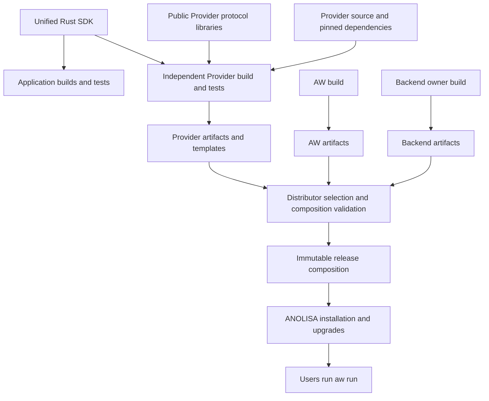

# Unified Rust SDK and independent Provider delivery

[中文版](provider-distribution_zh.md)

This document defines one application-facing Rust SDK for sec-core and Tokenless,
independent Provider builds, and OS composition. It specifies source dependencies,
artifact ownership, compatibility checks and installation lifecycle.
Implementations and release acceptance must satisfy these constraints.

## Delivery contract

Component owners are responsible for independently building, testing and
releasing Providers. The OS distributor obtains their artifacts, selects versions and validates a composition
for delivery. Users install once and use the selected capabilities through
`aw run`, without managing the Tokenless, RTK or other internal programs supplied
with AW. One product entrypoint can contain several private processes.

Rust applications use one SDK package to call both components. Native Agent
integrations use `aw run` and independently delivered Providers. Both paths reuse
component-owned clients and runtimes, with separate invocation and acceptance
boundaries.

Use two release compositions to prove independence. Letters below identify
immutable artifacts, including their content digests.

| Release composition | AW | sec-core Provider and backend | Tokenless Provider and backend |
| --- | --- | --- | --- |
| R1 | A | S | T1 |
| R2 | A | S | T2 |

Upgrading R1 to R2 obtains and replaces only T2; AW and sec-core retain their
artifact digests. Composition acceptance proves working behavior, failure
recovery, and traceable file ownership and origin. Independent versions do not
permit arbitrary combinations; the distributor delivers validated combinations.

The distribution supports fresh installation and its own upgrades, rollback and
uninstall. Existing Preview installations, old receipt recognition, adoption and
migration are outside this delivery contract.

## Unified Rust SDK

The first delivery provides one public Rust package with typed `sec_core` and
`tokenless` entrypoints. Applications declare one direct SDK dependency; its
transitive implementation can contain several independently maintained libraries.
The SDK has its own version and a tested set of component dependencies.

| Component entrypoint | First delivery | Execution |
| --- | --- | --- |
| `sec_core` | Typed `scan_code` request and result | Component client connects to the sec-core daemon |
| `tokenless` | `before_model`, `pre_tool`, `post_tool` and authorized `retrieve` | Component Runtime executes in the caller; RTK-dependent operations use a managed RTK executable |

Additional sec-core actions, ws-ckpt, new Python/TypeScript SDKs and new framework
integrations are later extensions. Existing component SDKs and native Agent
adapters retain their own support and regression coverage.

AW owns the unified client, configuration composition, shared call context and
error categories. Component owners maintain their typed entrypoints, request
mapping, clients, runtimes and business results. Reuse component types where
possible; do not flatten security verdicts and compression outcomes into a common
success flag or string-based operation dispatcher.

Constructing a client does not install dependencies, start system daemons or
register Hooks. Explicit configuration selects component state and endpoints.
Unsupported operations and missing dependencies fail visibly. Cleanup releases
only resources owned by the client. Timeouts and cancellation reflect the
backend's actual guarantees; cancelling a wait does not certify that execution
or persisted work was undone. Business calls are not automatically retried.

Direct calls return results for the application to adopt. They do not pass through
AW Service by default or produce Host receipts, Core admission or proof of native
effect adoption. Tokenless Retrieve validates caller-supplied, trusted visible
markers; recovery cannot be enabled without a usable recovery entrypoint.
sec-core transport failures, daemon errors and security verdicts remain distinct.
The SDK does not add automatic cross-component policy orchestration.

### Relationship to Providers

The application SDK and the Provider protocol serve different callers:

| Consumer | Uses | Responsibility |
| --- | --- | --- |
| Rust application | One unified SDK with both component entrypoints | Owns its Agent loop and adoption of returned results |
| First-party Provider | The corresponding SDK component entrypoint and public Provider protocol libraries | Maps AW requests and admitted effects to component calls |
| Third-party Provider | Public JSON/stdio protocol and YAML | Implements capabilities without requiring the unified SDK |

Providers remain independent executables in `providers/<component>/`. Each
first-party Provider can build with only its component's SDK dependencies;
sec-core must not pull in Tokenless implementation dependencies, or vice versa.
Cargo features can implement this selection. Public protocol-only users must not
acquire either component implementation through a mandatory SDK dependency.

The unified SDK has a separate workspace under `src/aw/sdk/rust/`. The framework
workspace in `src/aw/` remains independent of concrete component libraries and
Provider implementations. Dependencies point from the SDK to component public
libraries, and from Providers to the SDK and protocol libraries. Components do
not depend back on the unified SDK, and the SDK does not import Provider binaries.

The Tokenless Provider links the Runtime through its SDK entrypoint. The sec-core
Provider uses the SDK client to reach the daemon, preserving server identity,
authorization, context and deadline semantics. Neither route requires a CLI
forwarding process. RTK and the sec-core daemon remain explicit runtime
dependencies where required.

Using the SDK does not expand a Provider's admitted effects. In particular,
Tokenless PreTool still requires a fresh call through security and native
authorization; direct SDK parameter rewriting must not replace that contract.
SDK recovery support does not imply that every native Adapter exposes recovery.

### SDK releases and binary distribution

Publish SDK source and its complete dependency closure for application and
Provider builds. The distributor installs finished Provider/runtime artifacts;
end users need not install a Rust toolchain or an SDK source package.

An embedded SDK or Runtime update requires rebuilding and publishing the affected
application or Provider. Its artifact records the SDK and component dependency
versions and origins. Previously built compatible Providers remain valid; they
need not adopt the newest SDK release. R2 can therefore replace the Tokenless
Provider containing a newer Runtime while retaining the exact AW and sec-core
artifacts from R1.

## Component owners and the distributor

| Role | Delivers | Validates |
| --- | --- | --- |
| AW maintainer | Unified Rust SDK, public Provider protocol/libraries, AW runtime artifacts and protocol test tools | Framework behavior, typed application APIs and SDK/Provider consumer compatibility |
| Provider owner | Provider source package, pinned dependencies, build recipe, artifacts, configuration templates and instructions | Independent builds, protocol conformance and declared backend interfaces |
| Backend owner | Component SDK entrypoint/client, engine and private dependencies, platform artifacts and origin records | Backend behavior, SDK mapping, platform requirements and interface compatibility |
| OS distributor | Selected composition manifest, installation entrypoint and release evidence | Artifact origin and integrity, composition and installation lifecycle |

A single team may own a Provider and its backend; record the responsibilities
separately. A distribution build service may build components using owner-supplied
recipes. The composition step consumes artifacts without parsing backend source
or embedding backend build commands.

This follows the Linux distribution separation between component production and
public library consumption. The SDK supplies pinnable source interfaces; the
process protocol defines runtime compatibility. It does not promise a stable
Rust dynamic-library ABI or require a shared AW/Provider version or source commit.

Arrows describe build and delivery flow. The `aw run` runtime path passes through the
Adapter, service, Host, executor and Provider process. The Adapter interprets
native dialects, the service owns common state and constraints, and concrete
Providers implement capabilities.

## Independent source and builds

**Concrete Providers remain in the independent collaboration directory
`providers/<component>/` at the repository root.** Each directory owns its build
and test entrypoints and can be exported as an independent source package.
External repositories are also supported. `src/aw/crates/` contains only the AW
framework; `aw-provider` is the public protocol library. Sharing a repository
does not imply sharing a release cycle.

| Location | Responsibility |
| --- | --- |
| `src/aw/sdk/rust/` | Unified application SDK, separate workspace, typed component entrypoints and consumer tests |
| `src/aw/crates/aw-provider/`, `aw-exec/` and required public dependencies | Publishable, pinnable Provider protocol/execution libraries and assets |
| `providers/<component>/` | Implementation, private schemas, protocol tests, configuration examples and its own release recipes |
| `src/tokenless/`, `src/agent-sec-core/` | Public component libraries/clients, backend builds, private dependencies and artifacts |
| `src/aw/crates/aw-package/` | AW builds and generic configuration editing |
| `distribution/anolisa/` | Version selection, composition validation, installed state and transactions |

The public SDK delivery must include required source, schemas, licenses and
complete dependency declarations. Public libraries used by `aw-provider`,
including the generic `aw-config`, must belong to the independently obtainable
dependency closure. Feature separation depends on actual consumers. Do not copy
SDK source into every Provider or require AW service internals or a complete
ANOLISA checkout.

Choose a channel that makes these public packages independently obtainable.
Validate the packaged source, not only the repository workspace. Pin versions,
origins and dependency resolution. A Git revision pointing at the complete
monorepo still fetches that repository; replacing `path` with a pinned `git`
dependency alone does not deliver independent source packages. Declare build
and runtime dependencies separately. `--locked` fixes resolution, not offline
availability. An offline build offering also requires toolchains, dependency
materials and disconnected validation.

A Provider's build and self-tests must not read another Provider's source.
Component self-tests use their own protocol and backend fixtures. Cross-Provider
integration exercises delivered executables to verify security retries and other
composition behavior; these assertions must be required distribution checks.

Third-party implementations connect through the public JSON/stdio protocol and
YAML `transport.argv`. They do not need the Rust SDK, repository membership or OS
component registration. Distribution inclusion and managed installation add the
artifact metadata and composition acceptance obligations.

## Compatibility layers

| Boundary | Compatibility basis | Validation point |
| --- | --- | --- |
| SDK source interface | Unified package version, selected component dependencies, public types and behavior | Application and Provider builds, component mapping and candidate-SDK consumer tests |
| Provider process protocol | Protocol version, messages, events/effects, budgets and call correlation | Protocol tests and AW runtime admission |
| Backend interface | Provider-declared backend versions and capabilities | Owner contract tests and real-backend acceptance |
| Linux platform | Architecture, dynamic loader, libc and required system capabilities | Build environment records and target-platform execution |
| Product composition | Exact artifact set, configuration and native Agent capabilities | Distribution integration and installation acceptance |

Record package, SDK, protocol, backend and product versions separately. Matching
protocol versions may still lack a required event or effect. Distribution
validation cannot expand native permissions or the Adapter's adoption capability.
The distributor maintains explicitly supported combinations.

Composition admission uses these enforced checks, without requiring equal
component versions or source commits.
Integrity digests must bind to trusted distribution inputs; a digest declared
inside a package does not authenticate its origin. Descriptive signature or
dependency fields in an existing index are not enforcement. Reject invalid
inputs at the relevant acquisition, selection, installation or runtime admission
boundary, and preserve the failure reason.

## Artifacts, compositions and installed state

These records describe artifacts, release selection and actual installation
results. `ComponentManifest`, `DistributionIndex` and installed-state models carry
the corresponding information; the table defines their required semantics.

| Record | Required information |
| --- | --- |
| Component artifact | Component identity/version, source and build origin, platform requirements, entrypoints, files/permissions/digests, licenses, protocol/backend requirements, configuration and state ownership |
| Release composition | Exact component artifacts and digests, target platform, enabled capabilities and configuration composition, corresponding validation evidence |
| Installed state | Installed composition and components, file ownership and digests, configuration/state locations and transaction result |

The product version does not rewrite component versions or origins. A rebuild
from the same source that changes bytes gets a new build identity and digest.
Compositions reference immutable artifacts. Candidate reports bind to those
identities; results for old artifacts cannot certify new ones.

The Tokenless owner releases its Runtime libraries and builds and records origins
for RTK and its patches. The Provider records its linked Runtime and declares RTK
compatibility. The standalone CLI retains its own release; SDK-based calls do not
require it. RTK delivery can use a private payload or an exact backend package,
with ownership explicit in metadata.
AW uses managed installation paths without searching the user's RTK or falling
back to system binaries when a private payload is broken. Third-party licenses
travel with artifacts. Installation must not enable duplicate backend native Hooks.

The corresponding component and distribution service management own sec-core's
shared daemon installation, permissions and lifecycle. Providers connect through
public interfaces. Installing a Provider, querying status or exiting an Agent
must not adopt or stop services used by other workloads. Required activation is
an explicit product installation or operations action.

## Configuration and the new distribution lifecycle

Provider owners deliver templates and private configuration constraints. The
distributor binds verified artifact entrypoints and backend paths to those
templates, then validates the composition with AW's generic configuration
validator. Users choose enabled capabilities. Reuse the existing configuration
editor without embedding Provider-specific fields or installation scripts in
generic AW libraries.

ANOLISA owns the new distribution's installed state and transactions.
`aw-package` retains AW build and generic configuration tooling; the distribution
layer owns product component installation, upgrades and uninstall. Every file and
service has an explicit owner. Keep configuration and runtime state separate from
immutable program payloads.

Fresh installation verifies artifacts, dependencies and configuration before
activation. Upgrades stage and validate the candidate composition, then perform
bounded stopping, switching and health checks according to the affected component
lifecycles. Failure retains the previous composition or restores a validated one.
Uninstall removes only owned content, preserving user configuration, audit and
other components' shared state.

Rollback within the new distribution also checks state-format compatibility;
binary replacement alone does not guarantee arbitrary version rollback. Reject
candidates unable to read existing state before switching; do not clear state
to bypass validation. Switching must not replay in-flight calls. Existing runtime
contracts continue to enforce native permissions, security denial, PreTool fresh
calls and PostTool final text replacement.

## Regression and acceptance

| Layer | Required evidence |
| --- | --- |
| Unified SDK | An external Rust application uses one published package to call both real components; combined and single-component builds, typed results/errors, four Tokenless operations, recovery authorization, missing dependencies and owned-resource cleanup |
| Framework | Builds and self-tests without concrete Provider or backend source; covers active contracts, digest vectors, Adapter matrix and service lifecycle |
| Owner | Each Provider builds, tests and packages in an isolated export and dependency cache using actual published public materials; SDK changes also test consumers against the candidate SDK |
| Composition | Integration holds only artifacts and test tools without implicit component builds; validates supported mixed versions, rejected unsupported combinations, missing packages, wrong platforms, missing capabilities and bad digests |
| Security and native behavior | Native/security denial, fresh-call retries, call correlation, final text replacement, budgets, cancellation and cleanup; real backends and native frameworks reported separately from fixtures |
| Installation and upgrades | Fresh install, R1 to R2, failed-upgrade rollback, uninstall, user modifications and shared-service ownership; visible missing-backend failures; actual execution on each promised Linux x86_64/aarch64 platform |

Separate independent framework tests from complete distribution gates. Missing
planned components, cases or reports must fail the complete gate rather than
pass through skips. Daily and native acceptance must validate actual delivery
inputs and record all artifact identities, origins and test versions.

SDK guides must give a runnable single-package Rust example and explicit backend
requirements. Provider author guides must give independent build, test and release
steps; distribution guides must cover composition validation and installation.
Code, test entrypoints and bilingual documentation must agree in the same
delivery. READMEs map entrypoints; user manuals describe only operations available
in that version.

## References

- [Cargo dependencies](https://doc.rust-lang.org/cargo/reference/specifying-dependencies.html) and [source package validation](https://doc.rust-lang.org/cargo/reference/publishing.html)
- [Debian build and runtime relationships](https://www.debian.org/doc/debian-policy/ch-relationships.html)
- [Rust ABI definition](https://doc.rust-lang.org/reference/items/external-blocks.html#abi)
