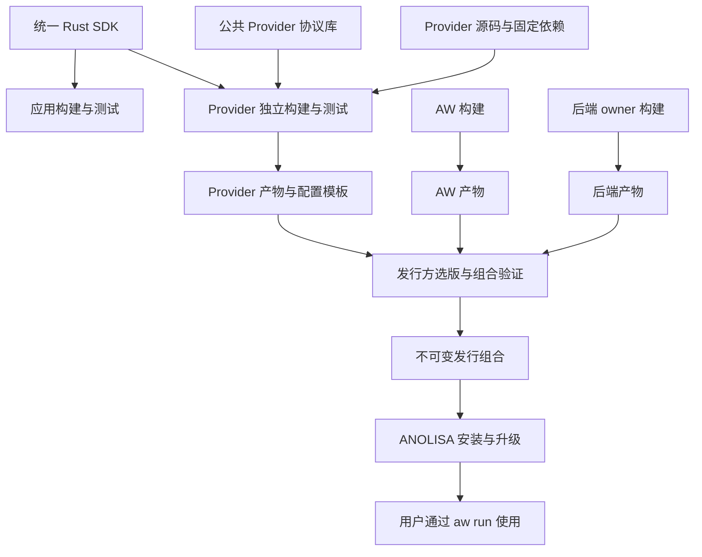

# 统一 Rust SDK 与 Provider 独立分发

[English](provider-distribution.md)

本文定义包含 sec-core 和 Tokenless 的统一 Rust SDK、Provider 独立构建与 OS
组合发行的架构契约，涵盖源码依赖、产物归属、兼容校验和安装生命周期。
实现与发行验收必须满足这些约束。

## 交付契约

组件 owner 负责独立构建、测试和发布 Provider；OS 发行方取得各组件产物，选定并
验证组合后交付。用户安装一次，通过 `aw run` 使用所选能力，无须管理 AW 随包
提供的 Tokenless、RTK 等内部程序。一个产品入口可以包含多个私有进程。

Rust 应用通过一个 SDK 包调用两个组件；原生 Agent 通过 `aw run` 和独立交付的
Provider 接入。两条路径复用组件维护的客户端和运行库，分别验证调用与采用边界。

以两个发行组合证明独立性。下表中的字母代表不可变产物身份，包含内容摘要。

| 发行组合 | AW | sec-core Provider 及后端 | Tokenless Provider 及后端 |
| --- | --- | --- | --- |
| R1 | A | S | T1 |
| R2 | A | S | T2 |

从 R1 升级到 R2，只取得并替换 T2，AW 与 sec-core 的产物摘要保持一致。组合验收
证明功能可用、失败能回退，并能查明每个文件的组件归属和来源。独立版本并不意味着
任意版本都可组合，发行方只交付经过验证的组合。

发行支持全新安装及自身的升级、回退和卸载。旧 Preview 安装、旧回执识别、
接管和迁移不属于此发行契约。

## 统一 Rust SDK

首期交付一个公共 Rust 包，提供类型化的 `sec_core` 和 `tokenless` 入口。
应用只声明一个 SDK 直接依赖，传递依赖可以包含多个独立维护的库。
SDK 有自己的版本，并验证所包含的组件依赖组合。

| 组件入口 | 首期能力 | 执行方式 |
| --- | --- | --- |
| `sec_core` | 类型化 `scan_code` 请求和结果 | 组件客户端连接 sec-core daemon |
| `tokenless` | `before_model`、`pre_tool`、`post_tool` 和授权 `retrieve` | 组件 Runtime 在调用方执行；需要 RTK 的操作使用受管 RTK 程序 |

其他 sec-core action、ws-ckpt、新增 Python/TypeScript SDK 和新框架集成后续扩展。
已有组件 SDK 和原生 Agent Adapter 保留各自支持范围及回归。

AW 维护统一客户端、配置组合、公共调用上下文和错误类别；组件 owner 维护对应的
类型化入口、请求映射、客户端、运行库和业务结果。优先复用组件类型，保留安全判定
与压缩结果的含义，不将它们压成统一成功标志或字符串操作分派。

创建客户端不安装依赖、启动系统 daemon 或注册 Hook。组件状态和连接地址通过
显式配置选择，不支持的操作和缺失依赖明确报错。清理只释放客户端拥有的资源。
超时和取消按后端实际保证表达；取消等待不代表执行已停止或持久化操作已撤销。
业务调用不自动重试。

直接调用返回结果，由应用负责采用，默认不经过 AW Service，也不产生 Host receipt、
Core admission 或原生效果采用证明。Tokenless Retrieve 校验调用方提供的可信可见
marker；没有可用恢复入口时不能启用依赖恢复的转换。sec-core 传输失败、daemon
错误和安全判定保持区分。SDK 不增加跨组件自动策略编排。

### 与 Provider 的关系

应用 SDK 与 Provider 协议分别服务不同的调用方：

| 调用方 | 使用入口 | 职责 |
| --- | --- | --- |
| Rust 应用 | 一个统一 SDK 的两个组件入口 | 管理自己的 Agent 循环，决定如何采用返回结果 |
| 一方 Provider | SDK 中对应组件的入口及公共 Provider 协议库 | 将 AW 请求和允许效果映射到组件调用 |
| 第三方 Provider | 公开 JSON/stdio 协议与 YAML | 无须使用统一 SDK 即可实现能力 |

Provider 仍是 `providers/<组件>/` 中独立构建和发布的程序。每个一方 Provider
可以只选择本组件的 SDK 依赖；sec-core 不引入 Tokenless 实现依赖，反之亦然。
可以用 Cargo feature 实现选择。只使用公共协议的调用方不应因强制依赖统一 SDK
而引入这两个组件实现。

统一 SDK 在 `src/aw/sdk/rust/` 维护独立 workspace。`src/aw/` 的框架 workspace
仍不依赖具体组件库或 Provider 实现。依赖从 SDK 指向组件公共库，从 Provider
指向 SDK 和协议库；组件不反向依赖统一 SDK，SDK 不导入 Provider 程序。

Tokenless Provider 通过 SDK 入口链接 Runtime；sec-core Provider 通过 SDK
客户端连接 daemon，保留服务身份、授权、上下文和预算语义。两条路径都不需要
CLI 转发进程；所需 RTK 和 sec-core daemon 仍是明确声明的运行依赖。

使用 SDK 不扩大 Provider 已获准的效果。Tokenless PreTool 仍要求新调用重新
经过安全检查和原生授权，不能以 SDK 直接改写参数替换此契约。SDK 支持恢复，
也不代表所有原生 Adapter 都已经提供恢复入口。

### SDK 发布与二进制分发

发布 SDK 源码及完整依赖，供应用和 Provider 构建。发行方安装完成构建的
Provider 与运行产物；终端用户不需要安装 Rust 工具链或 SDK 源码包。

更新静态链接的 SDK 或 Runtime，需要重新构建并发布对应应用或 Provider，
产物记录 SDK 和组件依赖的版本与来源。已构建且兼容的 Provider 仍可使用，
不必同步升级到最新 SDK。因此 R2 可以只替换包含新版 Runtime 的 Tokenless
Provider，保留 R1 的 AW 与 sec-core 原产物。

## 组件 owner 与发行方

| 角色 | 负责交付 | 负责验证 |
| --- | --- | --- |
| AW 维护方 | 统一 Rust SDK、公共 Provider 协议与库、AW 运行产物、协议测试工具 | 框架行为、类型化应用 API、SDK 与 Provider 消费者兼容性 |
| Provider owner | Provider 源码包、固定依赖、构建配方、产物、配置模板和说明 | 独立构建、协议一致性、所声明后端接口 |
| 后端 owner | 组件 SDK 入口及客户端、引擎及私有依赖、平台产物和来源记录 | 自身行为、SDK 映射、平台要求、后端兼容性 |
| OS 发行方 | 选版后的组合清单、安装入口、发行验证记录 | 产物来源与完整性、组件组合、安装生命周期 |

Provider 与后端可以由同一团队维护，责任仍分开记录。发行构建系统也可以按 owner
提供的配方构建组件；组合步骤只消费产物，不解析后端源码、不内置后端构建命令。

这与 Linux 发行版消费组件及公共库的分工一致。SDK 提供可固定的源码接口，运行时
兼容由进程协议定义。这里不承诺稳定 Rust 动态库 ABI，也不要求 Provider 与 AW
使用同一版本号或源码提交。

图中箭头表示构建和交付流，`aw run` 运行时经过 Adapter、服务、Host、执行器与 Provider
进程。Adapter 解释原生方言，服务管理通用状态和约束，具体 Provider 实现能力。

## 独立源码与构建

**具体 Provider 保留在仓库根 `providers/<组件>/` 独立协作目录。** 每个目录拥有
自己的构建与测试入口，能导出为独立源码包；也允许在外部仓库维护。`src/aw/crates/`
只放 AW 框架，`aw-provider` 是公共协议库。目录共享不意味着共用发布周期。

| 位置 | 职责 |
| --- | --- |
| `src/aw/sdk/rust/` | 统一应用 SDK、独立 workspace、类型化组件入口与消费者测试 |
| `src/aw/crates/aw-provider/`、`aw-exec/` 及所需公共依赖 | 可发布、可固定的 Provider 协议与执行库及资产 |
| `providers/<组件>/` | 实现、私有 Schema、协议测试、配置示例和自身发布配方 |
| `src/tokenless/`、`src/agent-sec-core/` | 组件公共库与客户端、后端构建、私有依赖和产物 |
| `src/aw/crates/aw-package/` | AW 自身构建、通用配置编辑 |
| `distribution/anolisa/` | 组件选版、组合校验、安装状态与事务 |

公共 SDK 的交付必须包含所需源码、Schema、许可证和完整依赖声明。`aw-provider`
使用的通用 `aw-config` 等公共库必须纳入可独立获取的依赖闭包；feature 拆分由
实际消费者决定。不能复制一套 SDK 源码到每个 Provider，也不能要求作者
获取 AW 服务内部源码或整个 ANOLISA checkout。

选择能独立取得这些公共包的发布渠道，验证打包后的源码，而非只验证仓库工作区。
固定版本、来源及依赖解析结果。指向完整 monorepo 的 Git revision 仍会获取仓库，
仅把 `path` 改为固定 `git` 依赖不足以完成独立源码交付。
构建依赖与运行依赖分别声明；`--locked` 只固定解析结果，不代表离线构建。
若交付离线构建能力，还需提供工具链、依赖材料和断网验证。

单个 Provider 的构建和自测不得读取其他 Provider 源码。组件自测使用自身协议和
后端 fixture，跨 Provider 集成通过交付程序验证安全重试等组合行为，相关断言
必须进入发行门禁。

第三方实现可以直接通过公开 JSON/stdio 协议及 YAML 的 `transport.argv` 接入。
它不需要 Rust SDK、加入本仓库或先注册为 OS 组件。发行方收录并负责安装第三方
产物时，再要求相应的交付元数据和组合验收。

## 兼容性分层

| 边界 | 判断依据 | 验证位置 |
| --- | --- | --- |
| SDK 源码接口 | 统一包版本、所选组件依赖、公开类型和行为 | 应用与 Provider 构建、组件映射、SDK 候选版本消费者测试 |
| Provider 进程协议 | 协议版本、消息、事件与效果、预算和调用关联 | 协议测试及 AW 运行时准入 |
| 后端接口 | Provider 声明的后端版本和能力 | owner 契约测试与真实后端验收 |
| Linux 平台 | 架构、动态加载器、libc 及所需系统能力 | 构建环境记录及目标平台运行验证 |
| 产品组合 | 精确产物集合、配置和原生 Agent 能力 | 发行集成及安装验收 |

包版本、SDK 版本、协议版本、后端版本和产品版本分别记录。协议版本相同仍可能
缺少某项事件或效果，发行验证通过也不能扩大 Adapter 的原生权限或采用能力。
发行方维护明确支持的组合。

组合准入依据这些实际执行的检查，不要求组件版本号或源码提交一致。完整性摘要必须与受信任发行输入
绑定，包内自行声明的摘要不能证明来源。现有索引中的描述性签名或依赖字段不能
视为已完成校验；实现必须在获取、选版、安装或运行准入的对应边界拒绝不满足条件
的输入，并保留失败原因。

## 产物、发行组合与安装记录

三类记录分别承载产物描述、发行选择和实际安装结果。`ComponentManifest`、
`DistributionIndex` 和安装状态模型分别承载相应信息，下表规定其所需语义。

| 记录 | 必须说明的内容 |
| --- | --- |
| 组件产物 | 组件身份与版本、源码和构建来源、平台要求、入口、文件与权限及摘要、许可证、协议与后端要求、配置和状态归属 |
| 发行组合 | 精确组件产物及摘要、目标平台、启用能力和配置组合、对应验证结果 |
| 安装记录 | 实际安装的组合与组件、文件归属和摘要、配置与状态位置、安装事务结果 |

外层产品版本不改写组件版本或来源。同源码重建得到不同字节时，记录新的构建
身份和摘要。组合引用不可变产物；发布候选的测试报告绑定这些身份，不能用旧产物
的测试结果证明新产物可用。

Tokenless owner 发布 Runtime 库，负责 RTK 及补丁的构建和来源记录。Provider
记录链接的 Runtime 并声明 RTK 兼容关系。独立 CLI 保留自己的发布，SDK 调用
不要求安装它。RTK 可以作为私有载荷交付，也可引用精确后端包，由元数据明确归属。
AW 使用发行安装的受管路径，不搜索用户的 RTK，也不在私有载荷损坏时回退到系统
版本。第三方许可证随产物交付，后端原生 Hook 不随安装重复启用。

sec-core 共享 daemon 的安装、权限和生命周期归对应组件及发行服务管理。
Provider 通过公开接口连接；安装 Provider、查询状态或退出 Agent 不应接管或
停止其他工作负载使用的服务。确需激活服务时，由产品安装或运维流程显式处理。

## 配置与新发行生命周期

Provider owner 交付配置模板及私有配置约束。发行方把已验证产物的入口和后端路径
绑定到模板，再用 AW 通用配置校验器检查组合；用户选择启用的能力。复用现有配置
编辑器，避免把具体 Provider 的字段或安装脚本嵌入 AW 通用库。

新发行由 ANOLISA 维护唯一安装记录和事务。`aw-package` 保留 AW 构建及通用配置
工具职责，产品组件的安装、升级和卸载由发行层统一负责。每个文件和服务有明确
owner，配置及运行状态与不可变程序载荷分开。

全新安装先验证所有产物、依赖和配置，再激活组合。升级先暂存并验证新组合，按
涉及的组件生命周期完成有界停止、切换和健康检查；失败保留原组合或恢复到已验证
组合。卸载只移除自身管理的内容，保留用户配置、审计和其他组件的共享状态。

新发行的回退同时检查状态格式兼容性，不承诺只换二进制就能回退任意版本。不能
读取已有状态的候选组合在切换前拒绝，不清空状态绕过校验。进行中的调用不得因
切换而重放，原生权限、安全拒绝、PreTool 新调用及 PostTool 最终文本替换约束
继续由现有运行时执行。

## 回归与验收

| 层次 | 必须提供的证据 |
| --- | --- |
| 统一 SDK | 仓库外 Rust 应用仅依赖一个发布包调用两个真实组件；组合及单组件构建、类型化结果与错误、Tokenless 四操作、恢复授权、缺失依赖和自有资源清理 |
| 框架 | 无具体 Provider 和后端源码时仍能构建、自测；覆盖活跃合同、摘要向量、Adapter 矩阵与服务生命周期 |
| owner | 每个 Provider 在隔离目录和依赖缓存中，使用真实发布的公共材料构建、测试、打包；SDK 变更另测候选 SDK 的消费者 |
| 组合 | 集成任务只持有产物和测试工具，不隐式编译组件；验证混合版本成功、不支持的组合失败、缺包、错平台、缺能力和摘要不符 |
| 安全与原生行为 | 原生权限和安全拒绝、新调用重试、调用关联、最终文本替换、预算、取消和清理；真实后端及原生框架分别报告，fixture 不代替真实采用证据 |
| 安装与升级 | 新装、R1 到 R2、失败回退、卸载、用户修改保留、共享服务归属；缺失后端失败明确；按承诺的 Linux x86_64/aarch64 平台实际运行 |

独立框架测试与完整发行门禁分开。完整门禁缺少计划内组件、用例或报告必须失败，
不能通过 skip 获得通过结果。日常及原生验收必须验证实际交付输入，并记录全部
产物身份、来源及测试版本。

SDK 指南应提供单包 Rust 应用示例和明确的后端要求；Provider 作者指南给出独立
构建、测试和发布步骤，发行指南给出组合验证与安装操作。代码、测试入口和双语文档必须在同一交付中一致；README 维护入口映射，
用户手册只描述该版本已经可用的操作。

## 参考

- [Cargo 依赖声明](https://doc.rust-lang.org/cargo/reference/specifying-dependencies.html)与[源码包验证](https://doc.rust-lang.org/cargo/reference/publishing.html)
- [Debian 构建与运行依赖](https://www.debian.org/doc/debian-policy/ch-relationships.html)
- [Rust ABI 定义](https://doc.rust-lang.org/reference/items/external-blocks.html#abi)
