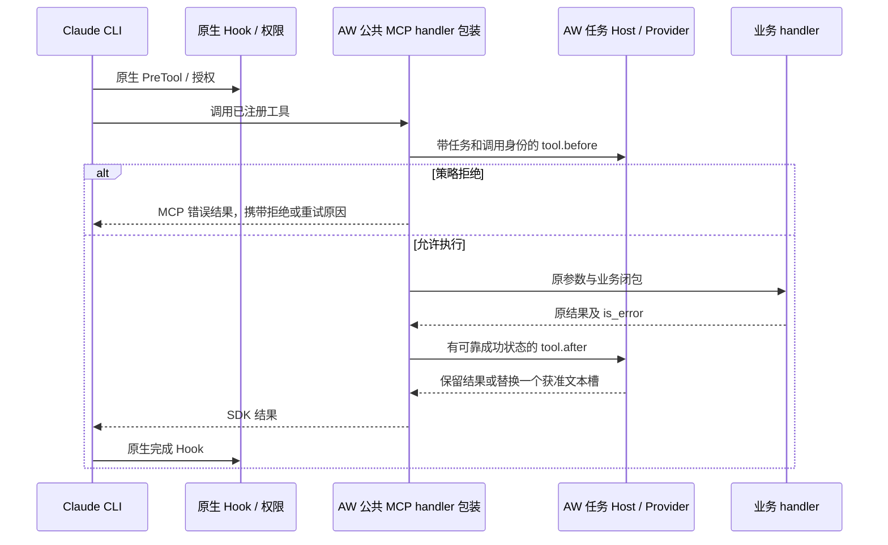

# Claude SDK 受管 MCP handler

[English](../../en/adapters/claude-mcp.md)

常驻客户端工厂可以接管 SDK 公开的进程内 MCP handler 边界。两个工厂均从 aw_claude 导入，
工具定义、业务闭包与 SDK options 继续由业务维护：

```python
from aw_claude import create_client, create_sdk_mcp_server
from claude_agent_sdk import ClaudeAgentOptions, tool

@tool("lookup", "Look up business data", {"key": str})
async def lookup(arguments):
    return await business_lookup(arguments)  # Existing closure and authorization.

server = create_sdk_mcp_server("business", tools=[lookup])
options = ClaudeAgentOptions(
    setting_sources=[], mcp_servers={"local": server},
    tools=[], allowed_tools=["mcp__local__lookup"],
)
async with create_client(options) as client:
    await client.query("Look up the requested record")
    async for message in client.receive_response():
        consume(message)
```

应用通过[常驻入口](resident-sdk.md)启动。每个客户端独立认领 server 配置，可连续处理多轮 execution。server 只允许
认领一次，即便复制了公开配置 dict，也通过 SDK server instance 的弱引用注册表检查重复认领，
在连接前拒绝。客户端在认领前复制 server 映射及各配置字典，保留原 SDK instance 和业务闭包；
调用方后续修改原字典无法替换客户端使用的 instance。
清空调用方映射或改为另一客户端已认领的 server，同样保留原任务的工具选择与策略检查。
server 创建时复制各工具定义并保留业务闭包。调用方为原定义重新赋值 name 或 handler，
已注册工具及其 AW 策略身份保持原样。
server 的 key、names、bridge 和 claimed 属性只读；handler 使用私有认领记录中的注册 key
和所属客户端。客户端先完成 SDK 构造，再整批检查注册 key、已有认领和重复 instance，
全部通过后才认领。构造失败后，新 server 仍可用于修正后的配置。
释放时移除客户端引用，关闭或未绑定的 handler 无法执行。server/tool 名称限定
为有界 ASCII 字母、数字、下划线和连字符；受管配置禁止 server key 含 `__`，避免不同 server
的原生工具名称发生歧义。

## 一次执行的链路



这些已注册工具的 AW 原生 CLI callback 返回中性结果，由 handler 包装执行 AW PreTool/PostTool。
调用方原生 Hook 与权限检查仍然执行，其他工具保留原回调路径。AW 拒绝时不执行业务 handler，
返回 MCP 错误结果；CLI 仍可能为该错误结果触发原生完成 Hook。AW 对拒绝的业务调用不补造
tool.after。重试是新的调用，重新经过原生权限与 AW before 检查。业务参数改写仍受公共工厂
原有约束。

公开 handler 只收到参数，没有原生 tool_use_id。AW 在模型响应中投射全新 UUID v4，
在原生调度前登记工具名和输入。固定传输从 MCP 控制帧读取 _meta.claudecode/toolUseId，
把 execution 内的调度票据传入 handler。未知、重复、变更输入和已回收调用在业务执行前停止。
任务 binding ID 继续作为关联 session。`aw_source: claude-sdk-mcp/v1`
标记明确来源；归一化核对 scope 与 binding，拒绝附加伪造的原生身份字段。持久事件元数据记录
correlation_source，不保存工具参数或原始结果。工具原生前缀来自 mcp_servers 的注册 key，
与 server 内部显示名相互独立。

## 结果和故障合同

SDK 公开返回值使用 is_error，省略时默认 false。AW 拒绝非布尔值和 handler 返回值中的线协议
isError；上游 MCP 响应先由业务 MCP adapter 转换，SYSOM 已有这层转换。原生载荷中的错误
状态必须与 handler 结果一致。

仅成功、JSON 可序列化、恰好一个文本块且没有 structuredContent 的结果允许替换。
AW 仅修改 content[0].text，保留返回对象其他字段。错误、多块、媒体和结构化结果仍经过
PostTool 观察并保持原样。业务异常生成失败的 AW completion，再沿用 SDK 异常处理。
固定版本 SDK 自身会转换或丢弃部分 resource/structured 字段；本包装保留 handler 返回
envelope，SDK 序列化扩展属于独立工作。
PostTool 检查 handler 结果的 JSON 快照；SDK 接收已检查快照或获准替换结果。
业务持有的缓存结果被其他协程修改后，交付给 SDK 的文本和错误标记保持检查时的值。

共用 Tokenless Provider 提供 pre_tool/post_tool，无需新增 Python Tokenless 客户端或独立
MCP 压缩服务。MCP 结果按 API 响应分类，不透明名称和 command 参数不足以声明 shell 执行
合同。对此类工具启用 sec-core 扫描或 RTK 建议，需要显式语义注册及执行位置证据。
Pi 的对应接点是已有公开 custom-tool before/after 链路，业务把 MCP client 暴露为 Pi 工具后
即可进入该链路。SDK 受管工具链路之外的任意 MCP 客户端缺少 AW 结果采纳边界。

Hook/Provider 故障、非法替换响应及传输边界的非法结果会先停止常驻任务，阻止原始成功结果
继续返回模型。压缩执行失败沿用相同中断与升级退出路径；成功分类为不支持压缩的结果正常保留。
取消与 scope 关闭遵循常驻合同，远端业务副作用需要工具自己的取消协议。原生输入和归一化
输入继续遵守一 MiB 上限。

## SYSOM 和后续工作

对已检查的 SYSOM OCD runtime，将局部 ClaudeSDKClient 构造替换为
aw_claude.create_client(options)，并在 _build_mcp_servers 中从 aw_claude 导入 MCP server
工厂。tool、catalog 闭包、uid/channel 捕获、isError 转换、session store、流式处理，以及已有
connect/query/receive_response/interrupt/disconnect 调用继续保留。镜像携带匹配的二进制和
SDK，启动进入常驻宿主；所有客户端创建路径都需经过该公共工厂。请求期限、排空和监督器
重启由业务与部署层负责。

Schema/BeforeModel 还需要 resume/compaction 后实际送给模型的 tools/context、新准入事件
和效果及原生采纳接点；受管模型转发层已提供请求位置，事件/效果准入、安全变换和 Schema 实际采纳仍需实现。Retrieve 需要在生成可恢复输出
前注册工具、校验模型可见 marker、隔离租户/任务存储、设置过期与配额、逐字节返回原文，并
避免再次压缩。依赖保留在[完整 Tokenless 交付表](resident-sdk.md#验收和完整-tokenless-依赖)
及跟踪 [#8952](https://github.com/agentic-os-org/ANOLISA/issues/8952)。

原生验收使用真实 SDK/CLI 和 Tokenless 后端，核对模型实际文本、策略拒绝、前后故障、业务错误、
多块及结构化结果、异常、并发逆序返回和压缩故障，同时检查复制 server 后的重复认领、审计
来源、SDK 进程/端口回收和服务 binding/event 归零。另核对原工具 name/handler 赋值、server key
赋值、构造失败后的重试及 PostTool 等待期间的共享结果修改；直接返回未获准内容的对照必须
阻止下一次模型请求。
线上模型与 SYSOM 实际依赖另作发布验收。
