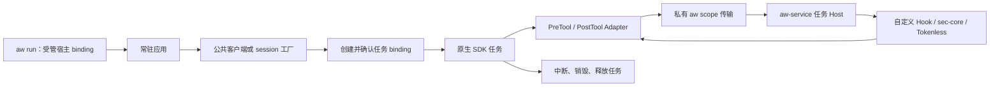

# 常驻 SDK 任务生命周期

[English](../../en/adapters/resident-sdk.md)

Pi 0.84.2 和 Claude SDK 0.2.88 / bundled CLI 2.1.161 可在常驻应用中创建独立任务客户端。
业务继续负责调度、模型凭据、HTTP/SSE、工具与会话存储。同一配置通过
`aw run --config aw.yaml --agent pi` 或 `--agent claude` 选择目标，AW 负责任务准入、
回调路由和有界释放。

## 运行链路

私有 CLI 负责服务协议序列化，原生桥接仅在内存中保存句柄。每个任务继承宿主的配置快照和
target，按自己的 cwd、环境变量快照准备 Provider；原生 Hook 命令也收到该任务环境。
进程身份包含 PID、启动时刻、UID 和 PID namespace。句柄禁止转交给其他 worker。
Gunicorn 应在 fork 后创建客户端，并保持 AW 创建的前台进程组。

任务准入后必须在五秒内确认句柄，丢失的交接会过期，拿到句柄后的取消会主动释放。
宿主死亡、worker 死亡和父 binding 释放会取消子任务及执行中的事件。释放超时保留 closing
状态。每个服务最多 16 个 binding（包括宿主），满载时拒绝新任务；每任务最多保留 1,024 个
事件关联，直到任务释放。新任务回收容量，同时保留活动任务的重放防线。

## 公共入口

Claude 配置 `argv: [python3, -m, aw_claude, --, -m, application]`，也可在 `--` 后指定
Python 脚本绝对路径。宿主在首次创建客户端前发布 ready；每次 `connect()` 独立准入任务，
完成 SDK 初始化后才能 `query()`。公共工厂改为导入 `aw_claude.create_client`，返回对象
支持 `connect`、`query`、`receive_messages`、`receive_response`、`interrupt`、`disconnect` 和异步上下文管理。
每个客户端拥有一次 query；多轮会话通过新客户端及 SDK resume/session-store 选项衔接。
工厂复制 options，不修改调用方对象。不同客户端可并发，disconnect 幂等，关闭或跨 fork
继承的客户端拒绝重连和查询。

两种消息消费方式都在交付 ResultMessage 前记录完成。没有该终态消息的 EOF 会报响应未完成；
disconnect 仍会中断未完成任务，并保留下文无法确认停止时的 fail-stop。

Pi 导出 `createSession({sdk,cwd,...options})` 和
`runWorker({createSession,closeSession,withSession,args})`。受管 createSession 返回
原 SDK 结果及 `close()`；`withSession(options, async session => ...)` 在 finally 关闭。
工厂必须返回全新 AgentSession，SessionManager 的 cwd 与准入 cwd 一致；原生回调在该
工厂中设置。每个 session 同时只执行一个 prompt，同一任务内可顺序执行，但共用有限关联
容量；任务结束即关闭。AW 在 session 生命周期内保护公开工具回调和模型发送函数，更换这些
函数需要创建新 session。

已有任务模式保留原失败策略。直接启动 Claude 脚本仍是每 worker 一个客户端；Pi 导出 run
仍按 worker 释放。常驻模式需要显式选择，Pi 同时导出 run 和 runWorker 会被拒绝。

## 失败和退出合同

常驻模式下，回调错误会停止任务，即便已有步骤配置 `on_error: report`。正常策略阻断和
Tokenless 重试建议保留原生拒绝语义，新调用仍经过原生权限和 PreTool。已可靠分类为不支持
压缩的结果保持原样；通信、协议、超时和 Provider 错误停止处理。

Pi 关闭任务时先禁止回调和模型发送，再等待 agent abort。固定版本 SDK 在 abort 后仍可能
安排下一轮，因此需要发送前的检查。Claude 在返回故障 Hook、向调用方交付错误前，等待公开
interrupt 的确认。真实测试发现仅返回 continue=false 仍会继续请求模型。中断失败或五秒内
无法确认时，终止 AW 自己创建的前台进程组，包括同组 worker 和 SDK 子进程；部署监督器需要
重启宿主。这一升级处理避免未确认停止后返回中性 Hook 结果。请求取消会先中断再断开 SDK。

SDK 清理期限为 12 秒，scope 释放传输期限为六秒。ACK 过期后已被服务回收的 handle 可成功
关闭；其他释放错误仍使 worker 拒绝新客户端。
应用必须在 finally 关闭客户端；仍然存活且没有 close 的客户端不会被猜测为任务已结束。
应用应明确配置请求期限、并发限制及过载响应，进程死亡是遗留客户端的最终回收边界。

launcher 向自有组转发退出信号，并在目标的 `shutdown_grace_ms` 宽限期结束后开始
强制清理，默认宽限期为两秒。从前台循环首次转发外部退出信号开始计时，重复信号不会
重置；转发前的等待和最终进程清理耗时不计入该区间。内部 readiness 或生命周期失败
仍使用强制清理前的两秒宽限期；Agent 自然退出后，立即开始清理其遗留子进程。需要优雅完成时，
应先停止 HTTP 接流、排空和关闭任务，再发送退出信号。请协调 Gunicorn graceful-timeout
与 AW 外层宽限期；两者都不会自动排空应用请求，也不保证 SDK 清理完成。
实际镜像必须验收排空、强制退出、worker 更换和监督器重启。PostTool 无法撤回已经发生的工具
副作用，包括远端副作用。

任务 scope 暂不支持策略 reload 或 AgentSight observation。resident 入口在发布 ready 前拒绝
已启用的 AgentSight evidence；`evidence.mode: off` 允许使用。没有任务 scope 的旧根 binding
可使用 observation；开启 observation 时拒绝创建任务。常驻任务策略切换和观察归属需要后续
独立的准入及生命周期合同。

## 交付拆分和完整 Tokenless 依赖

| 交付 | 独立验收边界 | 依赖 |
| --- | --- | --- |
| 服务端受管 scope | 丢失交接、上下文隔离、死亡、取消和有界释放 | service wire v1alpha6 |
| 常驻工厂 | 重复和并发客户端、真实 Hook 阻断与故障、模型可见性、清理 | 受管 scope |
| [Claude MCP 公共工厂](claude-mcp.md) | 在公开 handler 返回成功文本前介入，保留 PreTool/PostTool 和业务闭包 | 常驻 scope、明确 MCP 来源与结果采纳 |
| Schema / BeforeModel | 压缩 resume/compaction 后实际送往模型的 tools/context，保留调用路由 | 新准入事件和效果；Claude 当前公开 Hook 缺少完整模型请求接点 |
| Retrieve | 先注册恢复工具，再生成可恢复的有损结果；读取原文前鉴权模型可见 marker | 任务与租户存储隔离、过期、配额、逐字恢复、禁止再次压缩 |

Tokenless 后端已有 BeforeModel/Schema 和 Retrieve 操作；AW Provider 当前接入 PreTool/PostTool。
后两项需要协议准入、Adapter 采纳和模型可见性端到端验收。MCP 的 sec-core 扫描与远端 RTK
执行还需要明确工具语义，工具名称或不透明 run_script 标识不足以推导实际代码。

原生验收位于 tests/sdk_resident.py 和 tests/native-matrix.json：同一配置形态分别运行两种
SDK，覆盖 20 个顺序任务、三个并发任务、阻断和前后故障，验证最终 binding/event 数为零。
两种 SDK 都验证 ACK 过期后的 worker 复用。Pi 验证工具执行前、执行中和执行后的关闭、
取消后不再发送模型请求，以及清理超时后拒绝复用 worker。Claude 验证两种消息消费方式、
无 Result 的 EOF、取消和中断不可用时的退出升级。两种 SDK 都验证 ready 前拒绝 evidence
及关闭 observation 的情况。固定模型夹具无需线上模型凭据。
