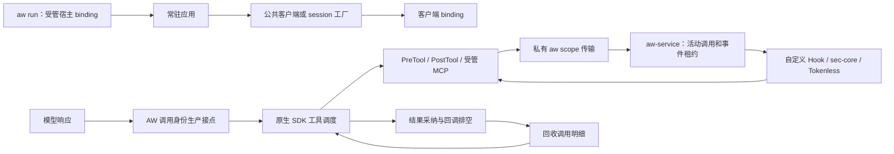

# 常驻 SDK 生命周期与长期会话

[English](../../en/adapters/resident-sdk.md)

Pi 0.84.2 和 Claude SDK 0.2.88 / bundled CLI 2.1.161 可在同一客户端/session 内连续
执行多轮，不同客户端在同一前台 worker 中并发。一份配置通过
`aw run --config aw.yaml --agent pi` 或 `--agent claude` 选择目标。SYSOM 接入集中在镜像、
启动和公共客户端/MCP 工厂，应用继续负责调度、凭据、HTTP/SSE、业务工具及会话存储。

普通 Qoder SDK 1.0.56 / Worker 1.1.78 Query 复用相同的子 scope 和递增 invocation 服务合同。
每个 Query 持有一个 execution，直到关闭；Query 保持开启时持续回收已完成工具身份。
其 `--reloadable` 模式使用独立的请求准入路径，详见下文。

## 运行时归属

binding 属于客户端或 Qoder Query。Pi 和 Claude 的 execution 属于一次 prompt/query 响应，
Qoder 的 execution 覆盖整个 Query 生命周期；invocation 属于一次模型产生的
工具调用。原生 ID 可以跨轮重复。AW 在原生调度前投射全新 UUID，冻结工具名和输入，并在
binding 内按严格递增序号登记；回调到达时不能靠名称或参数相同来创建身份。
输入身份将 JSON 数字按有限 binary64 值比较，与原生 JavaScript 解析一致：1.0 和 1 匹配，
大于 2^53 的整数遵循原生舍入语义。字符串、布尔值、工具名及结构变化仍严格区分。
AW 保留原始工具载荷；此比较规则保持 AW 元数据的独立整数编码合同。需要精确大整数的工具
应在 schema 中将其定义为字符串。
Pi 使用公开模型 stream 及其产生的工具对象。Claude 使用私有 loopback Anthropic Messages
转发层和固定 SDK 传输的回调调度上下文。MCP `_meta.claudecode/toolUseId` 在 SDK 移除
handler 参数中的元数据前，将原生帧关联到同一个身份。
Qoder 使用固定 Worker 私有 partial 输出中的完整模型工具块，并按原生 control 调度上下文
核验每个 Hook。子工具的私有 stream-start 帧在活动且已授权的父 Agent 下预留原生 ID。
PreTool 或权限回调可能早于完整 assistant 帧到达；回调在原生取消边界内等待该帧及其登记
确认，回调输入不能补充缺失的模型参数。未完成生产者占用活动调用预算，固定十二秒期限
从子调用 stream-start 帧到达开始，完整 assistant 参数到达后结束。该期限独立于 Provider
事件预算，目前没有配置覆盖项。参数流过慢可能导致所属 Query 失败；Adapter 始终等待
完整生产端参数后才授权。
取消、身份不匹配或父调用完成会阻止新授权；结果屏障仍等待原始回调排空后再回收。未知 ID
立即拒绝。

服务仅保留活动明细。结果采纳后，closing 状态拒绝新 Hook open，取消并等待未完成 Provider，
删除两个阶段的关联，再回收调用。Claude 暂留已采纳调用的小记录，直到原生完成 Hook 结束且
结果进入下一次模型请求，或本轮 execution 排空。回调注册表包含用户 Hook、权限回调和受管
MCP，也包含 SDK 取消后的异步 finally。Pi 和 Claude 排空完成后才交付 Result、允许下一轮 query；活动
execution 不能被新 prompt 复用。会话历史仍归 SDK 管理。
回调进入前收到取消时只回收 pending dispatch ticket，调用身份的防重放标记保留到回收。
已取消 ticket 拒绝迟到进入；已进入的回调持续占用 pending，直到自身清理完成。
Pi 为每个 prompt 开启一个 execution，排空前拦截新模型生产和注册。回收 RPC 的传输错误会
锁存失败并保留未确认的身份；即使排空失败，bridge 本地生产者状态也会清理。迟到模型结果
携带原 execution 代际，不能进入后续 prompt。
Claude 转发层也可在回调排空后向下一次模型请求交付明确的 is_error: true 原生结果：CLI 输入校验可能没有
任何 Hook，原生权限规则也可能只有 PreTool 而没有失败 Hook。只有 issued 或 allowed 阶段
允许走这条错误终态路径；成功结果仍需完成 AW PostTool，AW 回调故障继续阻止结果交付。
execution 排空会拦截排队中的注册，等待当前注册和结果采纳完成，再回收已确认调用。
尚未登记的残缺流片段直接丢弃；缺失注册确认时阻止复用。

服务保留递增序号高水位和活动表。重放注册、未知/已回收身份、变更输入、跨 session 和 closing
调用都 fail-close。早期慢调用在后续调用持续完成时仍保留。活动身份不按 TTL/LRU 淘汰，也没有
累计调用配额。身份生产者与 Adapter 是受管 worker 内受信任的接入代码；同 UID 任意代码执行
需要独立沙箱。服务代次、binding、PID/启动时刻、UID 和 PID namespace 共同拒绝旧句柄。

## 入口和原生传输

Claude target argv 为 `[python3, -m, aw_claude, --, -m, application]`，也可在 `--` 后给
脚本路径。前台 Gunicorn 使用 `-m aw_claude -- -m gunicorn ...`，在 fork 后通过
`aw_claude.create_client(options)` 创建客户端，进程内 MCP server 通过
`aw_claude.create_sdk_mcp_server` 创建，保留工具闭包与原生权限。继续使用
connect/query/receive_response/interrupt/disconnect，并在 finally 关闭。
顺序 query 复用原生进程与会话，并发任务使用独立客户端。每次 query 接受字符串，或恰好一个用户消息的有限 AsyncIterable。多消息输入在发送前被拒绝，
因为 CLI 合并消息后无法可靠计数终态；连续轮次使用逐次 query。
SDK session_store、存储镜像和 resume 临时目录仍由 SDK 管理：AW 在恢复准备后创建传输，
断开子进程后再由 SDK 清理。关闭或跨 fork 继承的客户端不能重连。每个 transport 持有
一个 reader；开始关闭后即拒绝重连和新读取，检查发生在原生 CLI 启动前，清理失败也继续
保持关闭。新任务需要新的 scope 和 transport 时创建新客户端。工厂复制 options。

转发层使用随机 loopback 端口和每客户端秘密路径，转发原鉴权和请求字节，投射响应工具 ID，
并在工具结果进入下一次请求前核对采纳状态，不记录凭据和模型内容。
非 loopback HTTP 被拒绝；HTTPS 使用系统信任及 SSL_CERT_FILE/SSL_CERT_DIR，支持 HTTP(S)
代理与 NO_PROXY，包含按端口匹配的 NO_PROXY=host:port 规则与 IPv6 主机。
重定向、SOCKS、Bedrock/Vertex/Foundry、未知响应块和非法/中断工具流
明确失败，没有绕过登记的直连后备路径。支持 JSON/SSE Messages 的 text、thinking、
redacted_thinking 和客户端 tool_use。
未认证的连接关闭或非法 header 被直接丢弃，保持会话状态。已认证下游断开时取消并等待
上游请求退出，支持原生流式中断后继续 query。Result 交付前最多等待五秒排空已认证生产者，
正在进行的服务 RPC 确认与本地状态转换需完成后才退出生产者。上游连接错误与协议损坏仍会
锁存故障并停止任务。
转发层关闭时先停止准入，取消并等待连接处理器退出，再等待监听器和 HTTP 客户端关闭，
共用五秒期限。超时保留未完成清理状态，并进入常驻 worker 的 fail-stop 路径。

每客户端传输边界：八个已认证请求；未认证握手使用独立的 32 个并发名额，header 期限一秒。
握手名额满时关闭新连接，已有握手释放后恢复准入；已认证请求过载保持 fail-close。
其他边界为 64 KiB header、32 MiB 请求/JSON 响应、一 MiB SSE frame/工具输入、
上游连接十秒、请求 body 三十秒、上游读取六十秒、请求总期限六百秒。这些限制
控制活动资源，会话 compaction 仍由应用/SDK 管理。实际生产 endpoint、TLS 和代理配置需要
部署验收。SDK transport 与 _connect_inner 接点固定为 0.2.88；原生 init 必须报告 CLI
2.1.161；转发层验收使用 HTTPX 0.28.1，升级时重跑验收。

Pi 导出 createSession({sdk,cwd,...options}) 和
runWorker({createSession,closeSession,withSession,args})，工厂返回 cwd 匹配且已装好原生回调
的全新公开 AgentSession。受管工厂增加 close()，withSession 在 finally 关闭。
同一 session 支持连续 prompt 和公开 custom tool，包括包装为工具的 MCP client。
AW 保护公开模型/工具回调，更换这些函数需要创建新 session。

Pi/Claude 直接任务 worker 入口保留原失败策略和 1,024 个累计关联边界。长期会话回收通过上述显式常驻
工厂启用。Pi 同时导出 run 和 runWorker 会被拒绝。

### 普通 Qoder SDK Query

应用选择 Bridge 的 `startDaemon`、`createQuery` 和 `createSdkMcpServer` 工厂。
`createQuery` 按规范 cwd 和环境快照建立并确认子 scope，再通过共享 scope 传输登记、
调用和结束递增 invocation。应用原始 Hook 保留原生 ID，AW 回调接收已登记 UUID。
原生 partial 消息默认保持私有，仅在请求 `includePartialMessages: true` 时公开。
启动方式与支持选项见 [Worker 指南](../../../../../../docs/developer-guide/zh/aw/agents/qoder-sdk.md)。

每个 Query 返回冻结的公共接口。工具完成后，先等待原生命令队列屏障和原始回调 finally，
再回收工具身份。提前 return、取消和 transport 丢失均等待原生 close、Hook、权限、凭据、
模型、memory/evolution gate/result 和 MCP 回调，以及执行中的 `sendHostAction()` fallback
清理，完成后才释放 scope。清理失败时保留所有权直到 worker 退出。
daemon stop 关闭所属 Query 并等待活动凭据回调，包括运行期 `daemon.auth(payload)` 安装的
回调及更早凭据仍在运行的回调。daemon 保留其环境快照；每个 Query 拒绝 `env` 和 `auth`
覆盖。需要独立凭据时使用独立 daemon 或直接创建 Query。

受管 MCP 为每个 Query 使用新的 server，保留原生 schema 和结果 envelope；schema 改变
已批准参数时，在 handler 进入前拒绝。匹配的原生 MCP Hook 将策略执行委托给受管 control
request，使每个阶段只执行一次。子调用绑定精确的 server/tool/arguments 和 Query；
固定协议没有为该 control request 提供父模型工具 ID。

Qoder 准入 `tool.before` observe/block 和 `tool.after` observe。普通 resident Query
支持 after `on_error: withhold_result`：必要检查失败时封锁 Query，在回调响应前关闭
原生 transport，阻止未核验结果交付和后续派发；已完成的工具副作用保留。`report`
保持原生结果，结果替换仍不支持。显式受管 handler 可通过 `awExecutionFactory`
获取逐工具凭据，见[私有执行租约](private-execution.md)。原生 close、租约排空与
原始回调清理共用 60 秒期限。工具失败且凭据已确认撤销时仍释放 scope；凭据清理未确认时
保留所有权并封锁 worker。
普通 Query 要求 evidence `mode: off`；子 scope 无法继承观测根 binding，启动准入明确
拒绝启用的 AgentSight evidence。常驻 scope 拒绝策略 reload。
独立的[可更新 Qoder SDK 路径](../runtime/policy-reload.md#qoder-sdk-请求准入)保留
1,024 个关联边界及请求/功能限制。

## 容量、故障和部署

spec.daemon.limits 配置**并发**资源：默认 64 个 binding（含宿主）、128 个 live event、
64 个 Provider call、128 条连接、每 binding 256 个活动 invocation；各字段范围为 1..4096。
binding 包含准备中、已准入/空闲和排空中的客户端；每个 binding 跨事件合计最多 64 个配置步骤。
连接计数包含普通工作和控制 RPC。共享连接额度用满后，额外 16 条连接只接纳
status/stop/close/release 操作。过载直接拒绝准入，不绕过、
不隐式重试、不重开预算。旧调用排空后，新身份可使用回收容量。注册因过载失败也消耗序号，
原序号不能在容量恢复后重新开工。

aw status --config aw.yaml 展示 limits、bindings/invocations/correlations/calls/connections
当前用量、单 binding 活动 invocation 峰值、拒绝总数与原因计数。AW 关联内存随活动工作量增长，
审计磁盘和 SDK 会话历史需要独立保留策略。生产并发数需实测，调大这些配置只增加并发容量。

Pi 和 Claude 的回调/Provider/身份错误会停止常驻 execution，即使步骤配置 on_error: report。
正常策略拒绝与 Tokenless 重试建议保留拒绝语义，新调用重新经过原生权限和 PreTool；成功分类
为不支持压缩的结果保持原样，安全拒绝保留优先级。Pi 关闭或调用公开 `session.abort()` 时，
先拦截回调/模型发送，再等待 abort。显式 abort 使该 session 失效，应关闭后创建新 session；
正常完成的 prompt 继续复用原 session。
Claude 对 interrupt 确认和回调排空各等待最多五秒。中断失败、终态回调无法排空或断开无法安全
完成时，终止 AW 自有前台进程组，包括兄弟 worker/SDK 子进程，由监督器重启。
SDK disconnect 期限为十二秒，scope release 传输期限为六秒。

scope 交接五秒内必须确认；关闭已被回收的 ACK 过期 scope 可成功，旧代次和传输故障仍失败。worker/launcher 死亡、父 binding 释放和丢失交接都会回收后代。
服务在 started audit 持久化后、Provider 调用前再次核对 owner。审计、释放或取消失败不会
复活 closing 调用。存活且空闲的客户端没有推测的业务期限，应用负责关闭和限制请求接流；
远端副作用需要工具自己的取消协议。

launcher 向自有组转发退出信号，并在目标的 `shutdown_grace_ms` 宽限期结束后开始
强制清理，默认宽限期为两秒。从前台循环首次转发外部退出信号开始计时，重复信号不会
重置；转发前的等待和最终进程清理耗时不计入该区间。内部 readiness 或生命周期失败
仍使用强制清理前的两秒宽限期；Agent 自然退出后，立即开始清理其遗留子进程。需要优雅完成时，
应先停止 HTTP 接流、排空和关闭任务，再发送退出信号。请协调 Gunicorn graceful-timeout
与 AW 外层宽限期；两者都不会自动排空应用请求，也不保证 SDK 清理完成。
实际镜像必须验收排空、强制退出、worker 更换和监督器重启。PostTool 无法撤回已经发生的工具
副作用，包括远端副作用。

活动 scope 仍拒绝策略 reload 和 AgentSight observation，后续需要独立 binding 合同。升级和回退都先排空、停止旧 daemon，再安装匹配
构建并重启。wire v1alpha7 拒绝旧活动 binding，配置和 Provider 协议仍为 v1alpha1。

常驻入口在发布 ready 前拒绝启用的 AgentSight evidence，`evidence.mode: off` 继续支持。
Claude 两种消息消费方式均在回调排空后交付 ResultMessage，缺少终态消息的 EOF 会报错。
Claude 显式持有并关闭响应与 transport 迭代器。调用身份上下文仅由设置它的 reader task
恢复。固定版本 SDK 的 transport 迭代器在原生进程清理前接收取消，避免其 GeneratorExit
处理等待进程退出而延后关闭。意外的 reader 与清理错误在现有清理期限内继续向外传播。
原生清单保留双消费端、EOF 中断、同一 worker 多次 Hook 故障后的新客户端任务恢复、
Pi 工具执行中取消与退出超时后拒绝复用 worker 的验收。

任务 cwd/environment 由受信公共工厂提供，并用于 Provider 执行。禁止将租户可控的
加载变量或可执行文件搜索路径直接传入该环境；租户隔离需要单独合同。

## 验收和完整 Tokenless 依赖

日常矩阵覆盖保留慢调用时回收 10,000 次登记、变更输入/重放、过载恢复、真实服务/Provider、
配置范围、回调排空、owner 死亡和审计失败。Pi 和 Claude 也覆盖原子协议切换及回收期间的迟到 close。
Claude 原生验收覆盖文本/工具流中途取消后复用客户端、输入校验和权限规则错误、数字参数的
Hook/MCP 往返。Pi 原生屏障覆盖工具执行前后公开 abort、等待回收确认，以及回收被拒绝或
传输超时后拒绝 prompt、模型和注册复用。Pi 和 Claude 验证 ACK 过期后的 worker 复用。
其固定真实 SDK 与 Tokenless 的原生验收分别在一个
session 中执行五轮、累计 1,280 次调用，单轮 768 次。Claude 混合 640 次 Bash 与 640 次受管
MCP，并核对下一次模型请求确实收到压缩文本。报告包含 RSS、FD/线程数、耗时、活动状态及
最终 binding/event 归零。取消屏障验证自定义 Hook 异步清理、排空期间拒绝新 query、同客户端
复用，以及永不结束的清理导致自有进程组退出。夹具验证回归行为，实际 SYSOM 流量、镜像依赖
与 endpoint 决定生产负载验收目标。

Qoder 固定版本解析器覆盖身份和回调排空、1,280 次完成调用、transport 丢失、受管 MCP
schema/envelope 和 Hook 委托、非受管 MCP 上下文、memory/evolution gate/result 回调、
`sendHostAction` fallback 清理和原生非法选项拒绝。普通 resident Query 准入严格 Post 策略；
hosted Worker 验收核对失败、超时、结果扣留及后续派发停止。私有租约夹具验证隔离、脱敏、
迟到获取清理和 worker 封锁。[原生清单](../../../../tests/native-matrix.json)分别记录解析器检查、
daemon 和 hosted Worker 验收。

| 交付 | 边界及后续工作 |
| --- | --- |
| 受管 scope 与常驻工厂（#8953/#8954） | 客户端上下文、owner 死亡、有界释放、统一启动 |
| 受管 MCP（#8955） | 明确 handler 来源、原生权限、成功单文本结果采纳 |
| 长期会话（#8956） | 生产端调用身份、回调排空、状态回收、并发预算 |
| Qoder 常驻接入（#9069） | 普通 Query 支持严格 Post、逐 handler 私有租约和 Hook 可见脱敏。MCP 父工具关联、Post 替换及 resident 热更新仍待交付；普通 Query 要求 evidence `mode: off`。 |
| Schema / BeforeModel（#8952） | 准入请求事件/效果；分类 resume/compaction 后实际 tools/context；保留路由和缓存/签名语义；验收模型实际采纳。转发层提供请求位置，这些合同仍需实现。 |
| Retrieve（#8952） | 有损输出前注册恢复工具；marker 鉴权；租户/任务存储、TTL/配额、逐字恢复、禁止重复压缩。 |

共用 Tokenless Provider 当前执行 PreTool/PostTool，后端 Schema/Retrieve 操作仍需上述合同。
通用 MCP shell 安全与远端 RTK 需要明确工具语义及执行位置证据，不能从不透明名称/参数推导。
